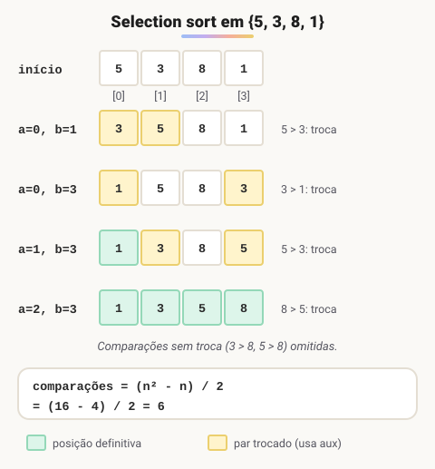

# Ordenação de Vetores com o algoritmo Selection Sort

> 🗺️ **Nesta aula:** por que ordenar, como funciona a ordenação por seleção passo a passo, quantas comparações ela faz e um programa que ordena 9 números.

## Ordenando um vetor

Ordenar é colocar os valores de um vetor em ordem crescente ou decrescente. Além de facilitar a leitura, a ordenação é pré-requisito de algoritmos mais eficientes, como a pesquisa binária.

O curso usa um método simples de **ordenação por seleção** (*selection sort*): para cada posição, o algoritmo procura, entre ela e as seguintes, o menor valor e o coloca ali.

> 💡 Existem muitos outros algoritmos de ordenação, mais ou menos eficientes: Bubble sort, Insertion sort, Cocktail shaker sort, Merge sort, Quicksort e Heapsort, entre outros.

## Como funciona

Para ordenar em ordem crescente:

1. Compare a posição 0 com cada uma das posições seguintes (1, 2, 3...).
  - Se o valor da posição 0 for **maior**, troque os dois de lugar (com a rotina de troca e uma variável auxiliar).
  - Se for menor ou igual, não faça nada.
2. Ao terminar as comparações, o menor valor do vetor está na posição 0, que não muda mais.
3. Repita o processo a partir da posição 1, depois da 2, e assim por diante, até a penúltima posição.

> 💡 A troca de posições usa a mesma variável auxiliar vista na aula **Rotina de Troca de Valores entre Variáveis**.



O número total de comparações para um vetor de `n` posições é `(n² - n) / 2`. Com 3 posições são `(9 - 3) / 2 = 3` comparações; com 4, são 6; com 9, são 36.

## Projeto: ordenar 9 números digitados

**Código**

```c
programa
{
	inteiro cont, a, b, aux
	inteiro vet[9]

	funcao inicio()
	{
		// preenchendo o vetor
		para (cont = 0; cont < 9; cont++) {
			escreva("Digite um número: ")
			leia(vet[cont])
		}

		// a: posição que está sendo definida
		// b: cada posição à direita de a
		para (a = 0; a < 8; a++) {
			para (b = a + 1; b < 9; b++) {
				se (vet[a] > vet[b]) {
					aux = vet[a]       // troca vet[a] com vet[b]
					vet[a] = vet[b]
					vet[b] = aux
				}
			}
		}

		// vetor ordenado
		para (cont = 0; cont < 9; cont++) {
			escreva(vet[cont], " ")
		}
		escreva("\n")
	}
}
```

> 💡 O laço externo pode parar em `a < 8` (a penúltima posição): quando todas as outras estão no lugar, a última já está certa. Para ordem decrescente, basta trocar `>` por `<` na comparação.

## 📌 Resumo

| Item | Em uma frase |
| --- | --- |
| Ordenação | Colocar os valores em ordem crescente ou decrescente |
| Ideia | Para cada posição, levar para ela o menor valor das posições seguintes |
| Estrutura | Dois `para` aninhados: `a` de 0 até a penúltima, `b` de `a + 1` até a última |
| Troca | Rotina com variável `aux` |
| Comparações | `(n² − n) / 2` para `n` posições |
| Decrescente | Troque `>` por `<` na comparação |
