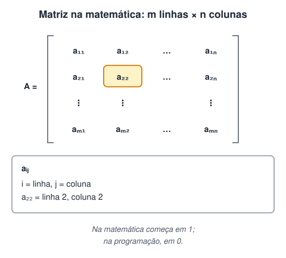
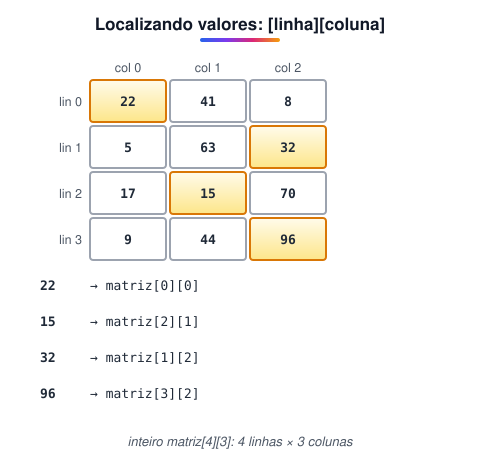
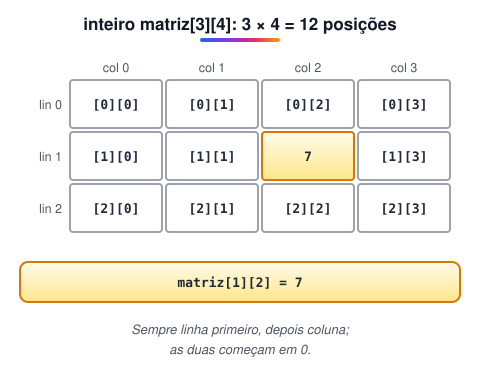
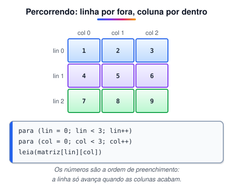

# Como criar e manipular Matrizes (Vetores bidimensionais)

> 🗺️ **Nesta aula:** o que é uma matriz e para que serve, como declarar e acessar posições por linha e coluna, como percorrê-la com dois `para` aninhados e três projetos.

## O que é uma matriz

Na matemática, uma matriz `m × n` é um conjunto de elementos organizados em **m linhas** e **n colunas**, como uma tabela. Costuma ser nomeada com letra maiúscula, e cada elemento é identificado por dois índices: `i` para a linha e `j` para a coluna.



Na programação, uma matriz é um **vetor de duas dimensões**: em vez de uma fila de posições, uma grade com linhas e colunas. Assim como no vetor, todos os elementos são do mesmo tipo.

## Para que serve

Matrizes aparecem sempre que os dados têm formato de tabela ou de grade:

- imagens (cada posição é um pixel);
- tabuleiros e mapas de jogos 2D;
- planilhas e cálculos tabulares;
- dados para gráficos;
- mapas de distâncias entre cidades;
- estruturas de dados mais avançadas.

## Linhas e colunas começam em 0

- A posição de um elemento é dada sempre por **linha primeiro, coluna depois**: `matriz[linha][coluna]`.
- Linhas e colunas começam em **0**. A última linha é `número de linhas - 1`, e a última coluna é `número de colunas - 1`.



## Declaração

```c
tipo nome_da_matriz[linhas][colunas]

inteiro matriz[3][4]   // 3 linhas x 4 colunas = 12 posições
```



O tamanho também pode vir de constantes, o que facilita mudar as dimensões depois:

```c
const inteiro LINHAS = 5
const inteiro COLUNAS = 3

inteiro matriz[LINHAS][COLUNAS]
```

## Lendo e gravando uma posição

```c
matriz[1][2] = 7          // grava 7 na linha 1, coluna 2
escreva(matriz[1][2])     // mostra 7
```

## Percorrendo a matriz inteira

Para visitar todas as posições usam-se **dois laços **`para`** aninhados**: o externo percorre as linhas e o interno, as colunas de cada linha.



## Projeto: matriz 3 x 3 com números digitados

O usuário digita 9 números, que formam uma matriz 3 x 3 mostrada em forma de tabela.

**Código**

```c
programa
{
	inteiro matriz[3][3]
	inteiro linha, coluna

	funcao inicio()
	{
		// preenchendo: para cada linha, todas as colunas
		para (linha = 0; linha < 3; linha++) {
			para (coluna = 0; coluna < 3; coluna++) {
				escreva("Digite o número da posição [", linha, "][", coluna, "]: ")
				leia(matriz[linha][coluna])
			}
		}

		limpa()
		escreva("A matriz completa é:\n")

		para (linha = 0; linha < 3; linha++) {
			para (coluna = 0; coluna < 3; coluna++) {
				se (coluna < 2) {
					escreva(matriz[linha][coluna], " | ")
				}
				senao {
					escreva(matriz[linha][coluna], "\n")   // última coluna: quebra a linha
				}
			}
		}
	}
}
```

A versão abaixo faz o mesmo, separando os números por vírgula:

**Código**

```c
programa
{
	inteiro matriz[3][3]
	inteiro lin, col

	funcao inicio()
	{
		para (lin = 0; lin < 3; lin++) {
			para (col = 0; col < 3; col++) {
				escreva("Digite um número: ")
				leia(matriz[lin][col])
			}
		}
		escreva("\n")

		para (lin = 0; lin < 3; lin++) {
			para (col = 0; col < 3; col++) {
				se (col < 2) {
					escreva(matriz[lin][col], ", ")
				}
				senao {
					escreva(matriz[lin][col], "\n")
				}
			}
		}
	}
}
```

## Projeto: matriz 10 x 10 com números aleatórios

Preencha uma matriz 10 x 10 com números aleatórios de 1 a 100 e mostre-a alinhada, completando com zeros à esquerda (`007`, `042`, `100`).

**Código**

```c
programa
{
	inclua biblioteca Util --> u

	inteiro matriz[10][10]
	inteiro lin, col

	funcao inicio()
	{
		para (lin = 0; lin < 10; lin++) {
			para (col = 0; col < 10; col++) {
				matriz[lin][col] = u.sorteia(1, 100)
			}
		}

		para (lin = 0; lin < 10; lin++) {
			para (col = 0; col < 10; col++) {
				// zeros à esquerda para todos terem 3 dígitos
				se (matriz[lin][col] < 10) {
					escreva("00")
				}
				senao se (matriz[lin][col] < 100) {
					escreva("0")
				}
				escreva(matriz[lin][col])

				// separador: " | " entre colunas, quebra de linha na última
				se (col < 9) {
					escreva(" | ")
				}
				senao {
					escreva("\n")
				}
			}
		}
	}
}
```

> 💡 A versão original repetia o teste dos zeros duas vezes, uma para as colunas do meio e outra para a última. Separar "escrever o número" de "escrever o separador" deixa o código com metade do tamanho e o mesmo resultado.

## Projeto: matriz 10 x 10 e soma de todos os elementos

**Código**

```c
programa
{
	inclua biblioteca Util --> u

	inteiro matriz[10][10]
	inteiro lin, col
	inteiro soma = 0   // acumulador

	funcao inicio()
	{
		para (lin = 0; lin < 10; lin++) {
			para (col = 0; col < 10; col++) {
				matriz[lin][col] = u.sorteia(1, 100)
				soma += matriz[lin][col]   // já soma enquanto preenche
			}
		}

		para (lin = 0; lin < 10; lin++) {
			para (col = 0; col < 10; col++) {
				escreva(matriz[lin][col], "\t")   // \t = tabulação, alinha as colunas
			}
			escreva("\n")
		}

		escreva("\nA soma total dos números da matriz é: ", soma, "\n")
	}
}
```

O original percorria a matriz uma terceira vez só para somar. Somando durante o preenchimento, basta um par de laços para gerar e somar.

## 📌 Resumo

| Item | Em uma frase |
| --- | --- |
| Matriz | Vetor de duas dimensões: uma grade de linhas e colunas, todas do mesmo tipo |
| Declaração | `tipo nome[linhas][colunas]` |
| Acesso | `matriz[linha][coluna]`: linha primeiro, coluna depois |
| Índices | Linhas e colunas começam em 0 |
| Percorrer | `para` das linhas por fora, `para` das colunas por dentro |
| Alinhar | `\t` (tabulação) ou zeros à esquerda |
