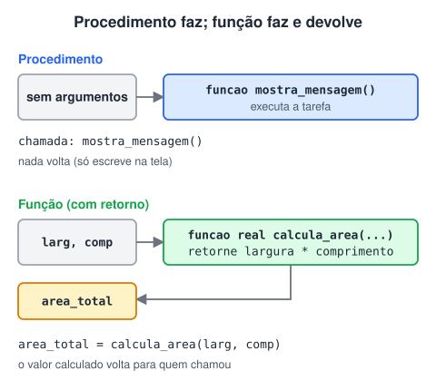
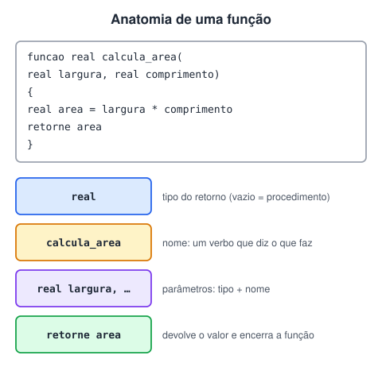
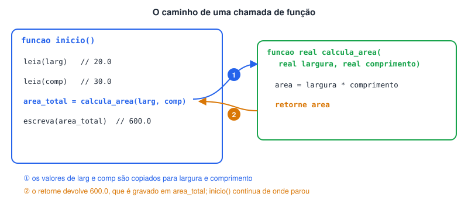

# Sub-rotinas (Funções e Procedimentos)

> 🗺️ **Nesta aula:** o que são sub-rotinas, a diferença entre procedimento e função, como declarar, passar parâmetros, chamar e usar o `retorne`, com cinco projetos.

## O que são sub-rotinas

Sub-rotinas são blocos de código com nome próprio, que executam uma tarefa específica e podem ser **chamados quantas vezes forem necessários**, inclusive a partir de outros programas.

- O código da tarefa é escrito uma única vez e reaproveitado em todas as chamadas.
- Quem chama não precisa saber como a tarefa é feita, só o que ela recebe e o que devolve.
- O programa fica dividido em partes menores, mais fáceis de entender, testar e corrigir.

> 💡 No Portugol, as sub-rotinas são declaradas dentro do `programa { }`, fora de qualquer outra função, ao lado da `funcao inicio()`. O próprio `inicio` é uma sub-rotina: a que o programa executa primeiro.

## Procedimento x função

| Procedimento | Função |
| --- | --- |
| Executa uma tarefa e **não devolve** valor a quem chamou | Executa uma tarefa e **devolve um valor** (`retorne`) a quem chamou |
| Ex.: mostrar uma mensagem, desenhar uma tabela | Ex.: calcular uma área, verificar se um número é primo |



## Declarando

```c
funcao [tipo_de_retorno] nome_da_funcao([tipo parametro1, tipo parametro2, ...])
{
	// código da sub-rotina
	[retorne valor]   // só nas funções com retorno
}
```

- **Sem** tipo de retorno, é um procedimento.
- **Com** tipo de retorno (`inteiro`, `real`, `cadeia`...), é uma função, e ela precisa terminar com `retorne` seguido de um valor desse tipo.
- Os **parâmetros** são os dados de que a sub-rotina precisa. Cada um tem seu tipo, e eles são separados por vírgula.



## Chamando (invocando)

Declarar a sub-rotina não a executa: ela só roda quando é **chamada** pelo nome, recebendo os **argumentos** (os valores concretos para os parâmetros).

```c
// Procedimento: basta chamar
mostra_mensagem()

// Função: o valor devolvido normalmente é guardado numa variável...
area = calcula_area(larg, comp)

// ...ou usado direto em outra expressão
escreva("Área: ", calcula_area(larg, comp))
```

Depois que a sub-rotina termina, a execução volta para a linha seguinte à chamada.



> 💡 O `retorne` encerra a função na hora: nenhuma linha depois dele é executada.

## Projeto: procedimento que mostra uma mensagem

**Código**

```c
programa
{
	// procedimento: sem tipo de retorno, sem parâmetros
	funcao mostra_mensagem()
	{
		escreva("Uma vez Flamengo, sempre Flamengo!\n")
		escreva("Vamo que vamo, programação.\n")
	}

	funcao inicio()
	{
		mostra_mensagem()   // chamada
	}
}
```

## Projeto: procedimento com parâmetros (potência)

**Código**

```c
programa
{
	funcao calcula_potencia(inteiro base, inteiro expoente)
	{
		inteiro resultado = 1

		// multiplica a base por ela mesma "expoente" vezes
		para (inteiro i = 0; i < expoente; i++) {
			resultado = resultado * base
		}

		escreva("Base: ", base, " | Expoente: ", expoente, "\n")
		escreva("Resultado: ", resultado, "\n")
	}

	funcao inicio()
	{
		inteiro num_1, num_2

		escreva("Digite a base: ")
		leia(num_1)
		escreva("Digite o expoente: ")
		leia(num_2)
		escreva("\n")

		calcula_potencia(num_1, num_2)   // num_1 vai para base, num_2 para expoente
	}
}
```

## Projeto: função que devolve a área de um terreno

**Código**

```c
programa
{
	// função: tipo de retorno real
	funcao real calcula_area(real largura, real comprimento)
	{
		retorne largura * comprimento
	}

	funcao inicio()
	{
		real larg, comp, area_total

		escreva("Largura do terreno (m): ")
		leia(larg)
		escreva("Comprimento do terreno (m): ")
		leia(comp)

		area_total = calcula_area(larg, comp)   // o valor devolvido vai para area_total

		escreva("\nA área total do terreno é: ", area_total, " m²\n")
	}
}
```

## Projeto: procedimento com dois parâmetros (intervalo de números)

Peça um número inicial e um final e mostre todos os números entre eles.

**Código**

```c
programa
{
	inteiro num_inicial, num_final

	funcao contar_numeros(inteiro x, inteiro y)
	{
		para (inteiro i = x; i <= y; i++) {
			se (i == y) {
				escreva(i, "\n")    // último: sem vírgula
			}
			senao {
				escreva(i, ", ")
			}
		}
	}

	funcao inicio()
	{
		escreva("Número inicial: ")
		leia(num_inicial)
		escreva("Número final: ")
		leia(num_final)

		limpa()
		escreva("Números do inicial ao final:\n")
		contar_numeros(num_inicial, num_final)
	}
}
```

## Projeto: área do círculo

Use uma função para calcular e devolver a área de um círculo a partir do raio: `A = π × r²`.

**Código**

```c
programa
{
	inclua biblioteca Matematica --> m   // para usar m.PI

	real raio, area_total

	funcao real calcula_area(real r)
	{
		retorne m.PI * r * r
	}

	funcao inicio()
	{
		escreva("Raio do círculo (cm): ")
		leia(raio)

		area_total = calcula_area(raio)

		escreva("A área do círculo é: ", area_total, " cm²\n")
	}
}
```

## 📌 Resumo

| Item | Em uma frase |
| --- | --- |
| Sub-rotina | Bloco de código com nome, escrito uma vez e chamado quantas vezes for preciso |
| Procedimento | `funcao nome()`: executa e não devolve valor |
| Função | `funcao tipo nome()`: executa e devolve um valor com `retorne` |
| Parâmetros | Os dados que a sub-rotina recebe, cada um com seu tipo |
| Argumentos | Os valores concretos passados na chamada |
| `retorne` | Devolve o valor e encerra a função na hora |
| Onde declarar | Dentro do `programa { }`, ao lado do `inicio()` |
