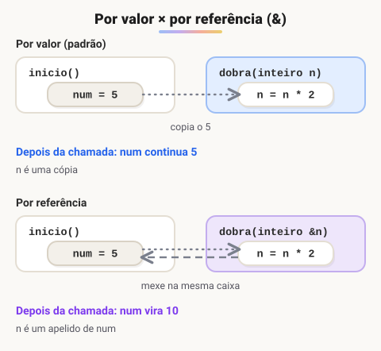

# Passagem de parâmetros por valor e por referência

> ✨ **Página nova.** Explica por que, na aula de pesquisa binária, a função `preenche_ordena_vetor` consegue alterar o vetor de quem a chamou.

> 🗺️ **Nesta aula:** a diferença entre passar um valor (cópia) e passar a própria variável (referência), o `&` do Portugol, a troca de valores com função e o caso dos vetores.

## Por valor (o padrão)

Quando uma função recebe um parâmetro comum, ela recebe uma **cópia** do valor. Mudar o parâmetro dentro da função não muda a variável de quem chamou.

```c
programa
{
	funcao dobra(inteiro n)
	{
		n = n * 2   // muda só a cópia
	}

	funcao inicio()
	{
		inteiro num = 5
		dobra(num)
		escreva(num, "\n")   // 5
	}
}
```

## Por referência (com &)

Com um `&` antes do nome do parâmetro, a função recebe a **própria variável**, não uma cópia. O parâmetro vira um apelido para ela, e qualquer mudança vale também fora da função.

```c
programa
{
	funcao dobra(inteiro &n)
	{
		n = n * 2   // muda a variável original
	}

	funcao inicio()
	{
		inteiro num = 5
		dobra(num)
		escreva(num, "\n")   // 10
	}
}
```



> ⚠️ Um parâmetro por referência precisa receber uma **variável**. Chamar `dobra(5)` ou `dobra(num + 1)` com `&n` dá erro, porque não há variável para alterar.

## Projeto: função de troca

A rotina de troca da aula de estruturas de dados vira uma função reutilizável. Ela só funciona por referência: por valor, trocaria apenas as cópias.

```c
programa
{
	funcao troca(inteiro &a, inteiro &b)
	{
		inteiro aux = a
		a = b
		b = aux
	}

	funcao inicio()
	{
		inteiro x = 3, y = 8

		escreva("Antes: x = ", x, " e y = ", y, "\n")
		troca(x, y)
		escreva("Depois: x = ", x, " e y = ", y, "\n")   // x = 8 e y = 3
	}
}
```

## Vetores e matrizes: sempre por referência

Vetores e matrizes passados para uma função **não são copiados**: a função trabalha direto sobre o original, mesmo sem `&`. Copiar um vetor inteiro a cada chamada seria lento, por isso as linguagens costumam fazer assim.

```c
programa
{
	inclua biblioteca Util --> u

	funcao preenche(inteiro v[], inteiro tamanho)
	{
		para (inteiro i = 0; i < tamanho; i++) {
			v[i] = u.sorteia(1, 100)   // altera o vetor de quem chamou
		}
	}

	funcao inicio()
	{
		inteiro numeros[5]
		preenche(numeros, 5)

		para (inteiro i = 0; i < 5; i++) {
			escreva(numeros[i], " ")   // mostra os números sorteados dentro da função
		}
	}
}
```

É isso que acontece na aula de pesquisa binária: `preenche_ordena_vetor(vet)` sorteia e ordena o vetor dentro da função, e o `inicio()` enxerga o resultado.

> 💡 Prefira devolver o resultado com `retorne` sempre que der: o código fica mais fácil de entender. Use referência quando a função precisa alterar **mais de um** valor (como na troca) ou quando trabalha sobre vetores.

## 📌 Resumo

| Item | Em uma frase |
| --- | --- |
| Por valor | A função recebe uma cópia; o original não muda |
| Por referência | `tipo &nome`: a função recebe a própria variável |
| Argumento por referência | Precisa ser uma variável, não um valor solto |
| Vetores e matrizes | Sempre passados por referência, mesmo sem `&` |
| Quando usar `&` | Para alterar mais de um valor, como na troca |
| Alternativa | Devolver o resultado com `retorne` |
