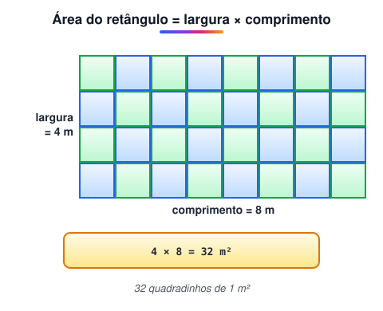
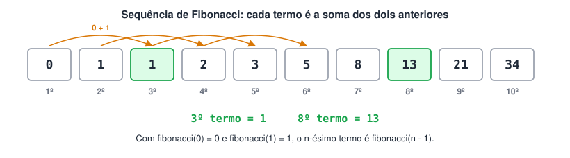
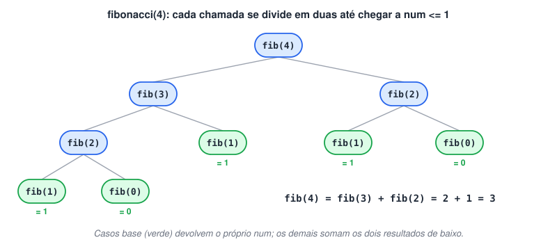
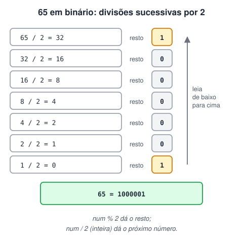
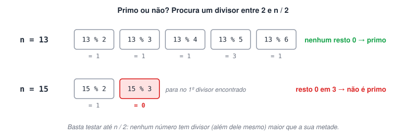
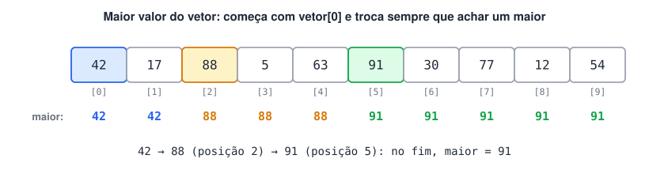

# 5ª Lista de exercícios

> 🗺️ **Nesta lista:** cinco exercícios de funções: área, Fibonacci recursivo, decimal para binário, números primos e maior valor de um vetor.

Exercícios sobre sub-rotinas (funções e procedimentos).

## Exercício 1: área do terreno

Use uma função para calcular e devolver a área, em m², de um terreno retangular, recebendo a largura e o comprimento como argumentos.



<details>
<summary>Ver resposta</summary>

```c
programa
{
	real largura, comprimento, area

	funcao real calcula_area(real larg, real compr)
	{
		retorne larg * compr
	}

	funcao inicio()
	{
		escreva("Calculando a área do seu terreno\n")
		escreva("Largura (m): ")
		leia(largura)
		escreva("Comprimento (m): ")
		leia(comprimento)

		area = calcula_area(largura, comprimento)

		limpa()
		escreva("Largura: ", largura, " m\n")
		escreva("Comprimento: ", comprimento, " m\n")
		escreva("Área do terreno: ", area, " m²\n")   // o original mostrava "cm²"
	}
}
```

</details>

## Exercício 2: n-ésimo número de Fibonacci

A sequência de Fibonacci começa com 0 e 1, e cada termo seguinte é a soma dos dois anteriores. Crie uma função que devolva o n-ésimo termo informado pelo usuário: o 3º termo é 1, e o 8º é 13.





<details>
<summary>Ver resposta</summary>

```c
programa
{
	// fibonacci(0) = 0, fibonacci(1) = 1, fibonacci(2) = 1, fibonacci(3) = 2...
	funcao inteiro fibonacci(inteiro num)
	{
		se (num <= 1) {
			retorne num                                   // casos base: 0 e 1
		}
		retorne fibonacci(num - 1) + fibonacci(num - 2)   // soma dos dois anteriores
	}

	funcao inicio()
	{
		inteiro x

		escreva("Qual termo da sequência de Fibonacci você quer? ")
		leia(x)

		// o 1º termo é fibonacci(0), então o x-ésimo é fibonacci(x - 1)
		escreva(x, "º termo de Fibonacci: ", fibonacci(x - 1), "\n")
	}
}
```

</details>

> ⚠️ O original mostrava `fibonacci(x)`, o que desloca a contagem em uma posição: pedindo o 8º termo, aparecia 21 em vez de 13. Como a função começa em `fibonacci(0) = 0` (o 1º termo), o x-ésimo termo é `fibonacci(x - 1)`.

## Exercício 3: decimal para binário

Crie uma função que converta um número decimal para binário: 65 em decimal equivale a 1000001 em binário. Use divisões sucessivas por 2 e o operador `%` para coletar os restos.



<details>
<summary>Ver resposta</summary>

```c
programa
{
	funcao inteiro converte_para_binario(inteiro num_dec)
	{
		inteiro num_bin = 0, resto, posicao = 1

		enquanto (num_dec != 0) {
			resto = num_dec % 2              // próximo dígito binário (0 ou 1)
			num_bin = num_bin + resto * posicao
			posicao = posicao * 10           // a próxima casa fica uma posição à esquerda
			num_dec = num_dec / 2            // divisão inteira
		}
		retorne num_bin
	}

	funcao inicio()
	{
		inteiro dec, bin

		escreva("Número decimal a converter: ")
		leia(dec)

		bin = converte_para_binario(dec)

		limpa()
		escreva(dec, " em binário é: ", bin, "\n")
	}
}
```

</details>

> 💡 Como o resultado é montado num `inteiro` (os dígitos 0 e 1 lidos como número decimal), a função só funciona até 1023, cujo binário tem 10 dígitos. Acima disso o valor não cabe mais. Para números maiores, monte o binário numa `cadeia`.

## Exercício 4: número primo

Um número primo é um inteiro positivo que só é divisível por 1 e por ele mesmo. Crie uma função que receba um número e diga se ele é primo, usando o operador `%`. Primos até 100: 2, 3, 5, 7, 11, 13, 17, 19, 23, 29, 31, 37, 41, 43, 47, 53, 59, 61, 67, 71, 73, 79, 83, 89 e 97.



<details>
<summary>Ver resposta</summary>

```c
programa
{
	funcao logico eh_primo(inteiro x)
	{
		se (x < 2) {
			retorne falso   // 0, 1 e negativos não são primos
		}

		para (inteiro i = 2; i <= x / 2; i++) {
			se (x % i == 0) {
				retorne falso   // achou um divisor: não é primo
			}
		}
		retorne verdadeiro
	}

	funcao inicio()
	{
		inteiro num

		escreva("Digite um número: ")
		leia(num)
		limpa()

		se (eh_primo(num)) {
			escreva(num, " é primo.\n")
		}
		senao {
			escreva(num, " não é primo.\n")
		}
	}
}
```

</details>

A versão original devolvia `inteiro` (1 para primo, 0 para não primo). Uma função do tipo `logico` expressa melhor uma resposta de sim ou não e pode ser usada direto no `se`.

## Exercício 5: maior valor de um vetor

Crie uma função que receba um vetor de 10 inteiros e devolva o maior valor dele. Para testar mais rápido, preencha o vetor com números aleatórios de 1 a 100.



<details>
<summary>Ver resposta</summary>

```c
programa
{
	inclua biblioteca Util --> u

	funcao inteiro maior_valor(inteiro vetor[])
	{
		inteiro maior = vetor[0]   // começa supondo que o primeiro é o maior

		para (inteiro i = 1; i < 10; i++) {
			se (vetor[i] > maior) {
				maior = vetor[i]   // achou um maior: atualiza
			}
		}
		retorne maior
	}

	funcao inicio()
	{
		inteiro vetor[10]
		inteiro i

		para (i = 0; i < 10; i++) {
			vetor[i] = u.sorteia(1, 100)
		}

		escreva("Vetor: ")
		para (i = 0; i < 10; i++) {
			escreva(vetor[i], " ")
		}

		escreva("\nO maior número do vetor é: ", maior_valor(vetor), "\n")
	}
}
```

</details>

O comentário da versão original chamava a função de recursiva, mas ela não é: percorre o vetor com um laço e não chama a si mesma.

## 📌 Resumo

| Exercício | O que pratica |
| --- | --- |
| 1. Área do terreno | Função com dois parâmetros que devolve um `real` |
| 2. Fibonacci | Recursão com dois casos base; o x-ésimo termo é `fibonacci(x - 1)` |
| 3. Binário | Divisões sucessivas por 2 e `%` para coletar os restos |
| 4. Primo | Função `logico` usada direto no `se` |
| 5. Maior do vetor | Passar um vetor como parâmetro e percorrê-lo |
