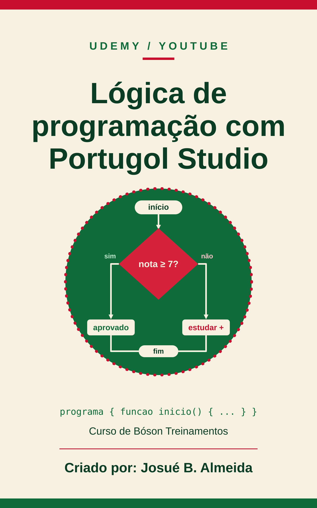

# Udemy/ YouTube: Lógica de programação com Portugol Studio - Bóson Treinamentos

📥 **[Baixar o EPUB](https://github.com/Joshpcbrrj/biblioteca-de-estudos/releases/download/epubs/boson-logica-portugol.epub)**

> ✍️ **Sobre a autoria:** deste curso foram usados apenas os tópicos e os objetivos. As anotações e as explicações são de autoria de Josué B. Almeida; onde a explicação foi complementada ou melhorada, o trabalho foi feito com IA (Claude). Os vídeos, os materiais e o conteúdo original do curso pertencem aos seus autores e não são reproduzidos aqui.

Lógica de programação do zero com o Portugol Studio: fundamentos, variáveis e operadores, decisões, laços de repetição, vetores e matrizes, funções e recursividade. Nas listas de exercícios, as respostas ficam recolhidas em **Ver resposta**.

- [Sobre o curso](aulas/00-sobre-o-curso.md)

## Fundamentos de lógica e computadores

1. [Introdução à Lógica de Programação com Portugol Studio](aulas/01-introducao-a-logica-de-programacao-com-portugol.md)
2. [Algoritmo, Fluxograma e Diagrama de Chapin](aulas/02-algoritmo-fluxograma-e-diagrama-de-chapin.md)
3. [Como baixar e instalar o Portugol Studio no Windows, Linux e Mac](aulas/03-como-baixar-e-instalar-o-portugol-studio-no.md)
4. [Recursos do Portugol Studio: comentários, caracteres especiais e depuração (Adicionado pelo aluno para melhorar o estudo)](aulas/04-recursos-do-portugol-studio-comentarios.md)

## Variáveis, tipos de dados e operadores

5. [O que são Tipos de Dados em Lógica de Programação](aulas/05-o-que-sao-tipos-de-dados-em-logica-de.md)
6. [Declaração e Atribuição de Variáveis em Lógica de Programação](aulas/06-declaracao-e-atribuicao-de-variaveis-em-logica.md)
7. [O que é Escopo de Variáveis?](aulas/07-o-que-e-escopo-de-variaveis.md)
8. [Estudo complementar de Constantes](aulas/08-estudo-complementar-de-constantes.md)
9. [Entrada e Saída de Dados com Leia e Escreva](aulas/09-entrada-e-saida-de-dados-com-leia-e-escreva.md)
10. [Operadores e Expressões Aritméticas](aulas/10-operadores-e-expressoes-aritmeticas.md)
11. [Operadores de incremento e decremento](aulas/11-operadores-de-incremento-e-decremento.md)
12. [Operadores de atribuição compostos (+=, -=, *=, /=) (Adicionado pelo aluno para melhorar o estudo)](aulas/12-operadores-de-atribuicao-compostos.md)
13. [Como usar Operadores e Expressões Relacionais (ou de Comparação)](aulas/13-como-usar-operadores-e-expressoes-relacionais.md)
14. [Operadores Lógicos e, ou e não (Operadores booleanos)](aulas/14-operadores-logicos-e-ou-e-nao-operadores.md)
15. [1ª Lista de exercícios](aulas/15-1a-lista-de-exercicios.md)

## Estruturas de decisão condicional

16. [Estrutura de Decisão Condicional Simples (SE)](aulas/16-estrutura-de-decisao-condicional-simples-se.md)
17. [Estrutura de Decisão Condicional Composta (SE, SENÃO)](aulas/17-estrutura-de-decisao-condicional-composta-se.md)
18. [Estrutura de Decisão Condicional Encadeada (SE, SENÃO SE, SENÃO)](aulas/18-estrutura-de-decisao-condicional-encadeada-se.md)
19. [Estrutura de Decisão Condicional Escolha Caso](aulas/19-estrutura-de-decisao-condicional-escolha-caso.md)
20. [Como usar Bibliotecas e suas Funções no Portugol Studio](aulas/20-como-usar-bibliotecas-e-suas-funcoes-no.md)
21. [Gerar números aleatórios com biblioteca “Util”](aulas/21-gerar-numeros-aleatorios-com-biblioteca-util.md)
22. [Funções úteis das bibliotecas Matematica, Texto e Tipos (Adicionado pelo aluno para melhorar o estudo)](aulas/22-funcoes-uteis-das-bibliotecas-matematica-texto.md)
23. [2ª Lista de exercícios](aulas/23-2a-lista-de-exercicios.md)

## Estruturas de controle de repetição

24. [Laço de Repetição “Enquanto”](aulas/24-laco-de-repeticao-enquanto.md)
25. [Laço de Repetição “Para”](aulas/25-laco-de-repeticao-para.md)
26. [Laço de Repetição “Faça-Enquanto” (Adicionado pelo aluno para melhorar o estudo)](aulas/26-laco-de-repeticao-faca-enquanto.md)
27. [Encadeamento de Laços de Repetição Para e Enquanto](aulas/27-encadeamento-de-lacos-de-repeticao-para-e.md)
28. [Teste de mesa: simulando o programa no papel (Adicionado pelo aluno para melhorar o estudo)](aulas/28-teste-de-mesa-simulando-o-programa-no-papel.md)
29. [3ª Lista de exercícios](aulas/29-3a-lista-de-exercicios.md)

## Estruturas de dados básicas

30. [Rotina de Troca de Valores entre Variáveis](aulas/30-rotina-de-troca-de-valores-entre-variaveis.md)
31. [Declaração e Atribuição de Valores a Vetores](aulas/31-declaracao-e-atribuicao-de-valores-a-vetores.md)
32. [Manipulação de Vetores com Laço Para](aulas/32-manipulacao-de-vetores-com-laco-para.md)
33. [Ordenação de Vetores com o algoritmo Selection Sort](aulas/33-ordenacao-de-vetores-com-o-algoritmo-selection.md)
34. [Algoritmo de Pesquisa Linear em Vetores](aulas/34-algoritmo-de-pesquisa-linear-em-vetores.md)
35. [Algoritmo de pesquisa binária em vetores](aulas/35-algoritmo-de-pesquisa-binaria-em-vetores.md)
36. [Como criar e manipular Matrizes (Vetores bidimensionais)](aulas/36-como-criar-e-manipular-matrizes-vetores.md)
37. [4ª Lista de exercícios](aulas/37-4a-lista-de-exercicios.md)

## Sub-rotinas (funções e procedimentos)

38. [Sub-rotinas (Funções e Procedimentos)](aulas/38-sub-rotinas-funcoes-e-procedimentos.md)
39. [Passagem de parâmetros por valor e por referência (Adicionado pelo aluno para melhorar o estudo)](aulas/39-passagem-de-parametros-por-valor-e-por.md)
40. [Recursividade (Funções recursivas)](aulas/40-recursividade-funcoes-recursivas.md)
41. [8 exemplos de Associatividade e Precedência de Operadores em Programação](aulas/41-8-exemplos-de-associatividade-e-precedencia-de.md)
42. [5ª Lista de exercícios](aulas/42-5a-lista-de-exercicios.md)
