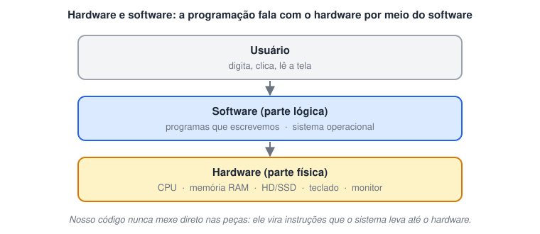
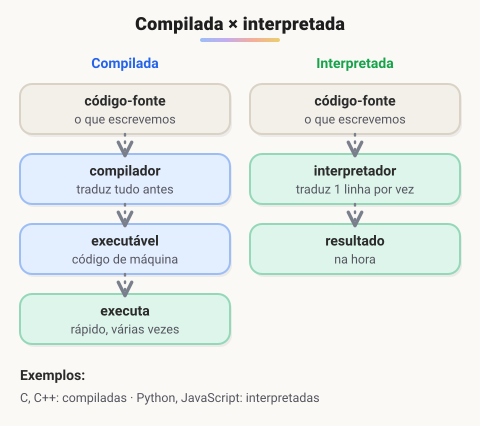
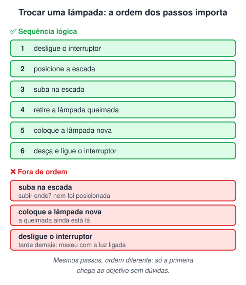
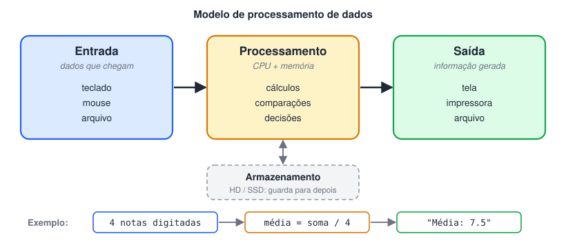
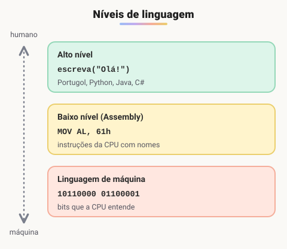

# Introdução à Lógica de Programação com Portugol Studio

**Ranking de linguagens (índice TIOBE)**

🔗 [https://www.tiobe.com/tiobe-index/](https://www.tiobe.com/tiobe-index/)

> 🗺️ **Nesta aula:** o que é lógica e lógica de programação, hardware e software, programa, linguagem (compilada e interpretada), algoritmo, o ciclo entrada → processamento → saída e os níveis de linguagem.

## Onde começamos

Este curso ensina a **pensar como programador** antes de escolher uma linguagem. Tudo será escrito em Portugol, um pseudocódigo em português, para que a atenção fique na lógica e não em detalhes de sintaxe. Esta primeira aula apresenta o vocabulário básico que aparece no curso inteiro.

## O que é lógica?

É a ciência do raciocínio correto: organizar pensamentos numa sequência coerente, em que cada passo faz sentido a partir do anterior.

## O que é lógica de programação?

É a técnica de organizar instruções numa **sequência lógica** que leva a um objetivo e que depois pode ser escrita numa linguagem de programação. Aprender lógica vem antes de aprender uma linguagem: a linguagem muda, o raciocínio continua o mesmo.

## Hardware e software

- **Hardware** é a parte física do computador: CPU, memória RAM, HD/SSD, teclado, monitor.
- **Software** é a parte lógica: os programas, incluindo o sistema operacional. É aqui que a programação acontece.

O programador não manipula o hardware diretamente. O código que escrevemos é traduzido em instruções que o sistema operacional leva até o hardware.

> 💡 **Analogia:** o hardware é o piano, e o software é a partitura. O piano sozinho não toca nada; a partitura sozinha é só papel. O programador escreve a partitura, e o sistema operacional é o pianista que a lê e aperta as teclas certas.

## O que é um programa?

É um conjunto de instruções, escritas numa linguagem de programação, que o computador executa numa ordem definida para resolver um problema.

## O que é uma linguagem de programação?

É um conjunto de regras (vocabulário e sintaxe) para escrever algoritmos de forma precisa, sem as ambiguidades da língua falada. Depois de escrito, o código precisa virar código de máquina, o que acontece de duas formas:

- **Compilação**: um compilador traduz o programa inteiro antes de executar, gerando um arquivo executável.
- **Interpretação**: um interpretador traduz e executa uma instrução por vez, no momento da execução.

Qual das duas é usada depende da linguagem.

> 💡 **Analogia:** compilar é como receber um livro estrangeiro já traduzido: alguém traduziu tudo antes, e você lê de uma vez, rápido. Interpretar é como assistir a um filme com um intérprete ao lado traduzindo cada fala na hora: começa logo, mas cada frase passa pela tradução.

## O que é um algoritmo?

É o passo a passo lógico para resolver um problema: uma sequência de instruções ordenada, finita e sem ambiguidade. Quando escrito numa linguagem de programação, o algoritmo vira o **código-fonte** do programa.

A ordem das instruções é tão importante quanto as instruções em si. No exemplo abaixo os passos são praticamente os mesmos, mas só a primeira sequência funciona. A segunda está fora de ordem e cada passo gera uma dúvida ou um risco.

> 💡 **Analogia:** um algoritmo é uma receita de bolo. Os ingredientes podem ser os mesmos, mas colocar o bolo no forno antes de misturar a massa estraga tudo. Finita (acaba quando o bolo fica pronto), ordenada (cada passo no seu lugar) e sem ambiguidade ("asse por 40 minutos a 180 °C", e não "asse um pouco").

## Modelo de processamento de dados

Todo programa segue o mesmo ciclo: recebe dados (**entrada**), trabalha sobre eles (**processamento**) e devolve um resultado (**saída**). Os dados também podem ser guardados para uso posterior (**armazenamento**).

> 💡 **Analogia:** é um liquidificador. As frutas são a **entrada**, bater é o **processamento**, o suco no copo é a **saída**, e a sobra guardada na geladeira para amanhã é o **armazenamento**.

## Níveis de linguagem

> 💡 **Analogia:** pense em pedir um café. Em alto nível você diz "um café, por favor". Em baixo nível você descreve cada movimento: "pegue a xícara, gire a alavanca, espere 25 segundos". Em linguagem de máquina, seriam os impulsos elétricos dos músculos do barista: preciso, mas impossível de escrever à mão.

| Nível | Características | Exemplos |
| --- | --- | --- |
| Linguagem de máquina | A única que o processador entende diretamente: instruções em binário (0 e 1) | `10110000 01100001` |
| Baixo nível | Instruções próximas da máquina, com nomes curtos legíveis por humanos | Assembly |
| Alto nível | Instruções próximas da linguagem humana; precisam ser compiladas ou interpretadas | C#, Python, Java, PHP, Visual Basic, Lisp |

## 🧠 Revisão rápida

**Por que aprender lógica antes de uma linguagem?**

Porque a lógica (a ordem das ideias) vale para qualquer linguagem. A linguagem é só a forma de escrever.

**Qual a diferença entre compilar e interpretar?**

Compilar traduz o programa inteiro antes de rodar e gera um executável. Interpretar traduz e roda uma instrução por vez.

**Num programa que calcula a média de 4 notas, o que é entrada, processamento e saída?**

Entrada: as 4 notas digitadas. Processamento: somar e dividir por 4. Saída: a média mostrada na tela.

> ➡️ **Próximo passo:** antes de programar, é preciso saber **desenhar** um algoritmo. A próxima aula mostra três formas de representá-lo: **Algoritmo, Fluxograma e Diagrama de Chapin**.

## 📌 Resumo

| Conceito | Em uma frase |
| --- | --- |
| Lógica de programação | Organizar instruções numa sequência que leva a um objetivo |
| Hardware / software | Parte física / parte lógica (programas e sistema operacional) |
| Programa | Instruções que o computador executa numa ordem definida |
| Compilação | Traduz o programa inteiro antes de executar |
| Interpretação | Traduz e executa uma instrução por vez |
| Algoritmo | Passo a passo ordenado, finito e sem ambiguidade |
| Entrada → processamento → saída | O ciclo que todo programa segue |
| Níveis de linguagem | Máquina (binário), baixo nível (Assembly), alto nível (Python, Java…) |
