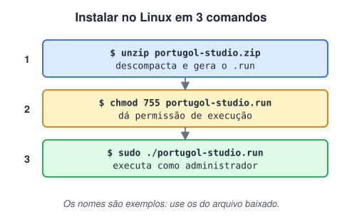

# Como baixar e instalar o Portugol Studio no Windows, Linux e Mac

> 🗺️ **Nesta aula:** as duas formas de usar o Portugol Studio, direto no navegador ou instalado no computador, com os comandos da instalação no Linux.

## De onde paramos

Você já sabe escrever e desenhar um algoritmo no papel. Para ver um algoritmo rodando de verdade, falta uma ferramenta que entenda Portugol.

O Portugol Studio é a ferramenta usada no curso: um editor com a linguagem Portugol (pseudocódigo em português), que executa o programa e mostra os erros em português. Há duas formas de usar.

## Sem instalar: Portugol Webstudio

Roda direto no navegador e serve para todos os exercícios do curso.

🔗 [Portugol Webstudio](https://portugol-webstudio.cubos.io/)

## Instalando no computador

Site oficial da Univali, com o instalador para Windows:

🔗 [Portugol Studio](http://lite.acad.univali.br/portugol/)

Repositório do projeto no GitHub, com instaladores para Windows, Linux e macOS (aba *Releases*):

### Windows e macOS

Baixe o instalador da sua plataforma e siga o assistente de instalação normalmente.

### Linux

Depois de baixar o arquivo compactado, abra o terminal na pasta do download e rode três comandos:



> 💡 **Analogia:** instalar no Linux é como montar um móvel que chegou pelo correio. Primeiro você abre a caixa (`unzip`), depois confere que tem permissão para usar a ferramenta de montagem (`chmod`) e, por fim, monta com a autorização do dono da casa (`sudo`).

```bash
# 1. o instalador vem compactado:
# descompacte para ter acesso ao script
unzip nome_do_arquivo_portugol.zip

# 2. por segurança, arquivos baixados não
# rodam sozinhos: dê permissão de execução
chmod 755 nome_do_script_do_portugol.run

# 3. instalar mexe em pastas do sistema,
# por isso precisa de administrador (sudo)
sudo ./nome_do_script_do_portugol.run
```

> 💡 `chmod 755` deixa o arquivo executável. Sem esse passo, o terminal responde `Permissão negada` ao tentar rodar o script.

## 🧠 Revisão rápida

**Preciso instalar algo para fazer os exercícios do curso?**

Não: o Portugol Webstudio roda direto no navegador.

**O terminal respondeu "Permissão negada" ao rodar o instalador. O que faltou?**

Dar permissão de execução ao script com `chmod 755`.

**Para que serve o `sudo` no último comando?**

Para rodar o instalador como administrador, já que ele grava em pastas do sistema.

> ➡️ **Próximo passo:** com a ferramenta aberta, conheça os recursos que vão acompanhar você no curso todo: **Recursos do Portugol Studio: comentários, caracteres especiais e depuração**.

## 📌 Resumo

| Opção | Como |
| --- | --- |
| Portugol Webstudio | Abre no navegador, sem instalar nada |
| Windows e macOS | Instalador da Univali ou da aba Releases do GitHub |
| Linux | `unzip` → `chmod 755` → `sudo ./script.run` |
