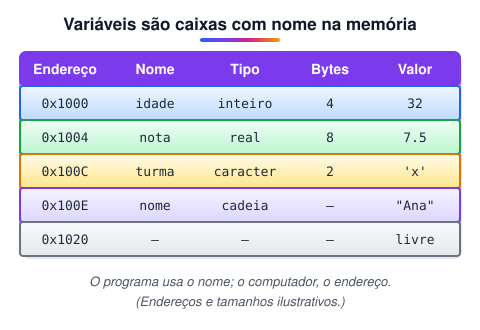
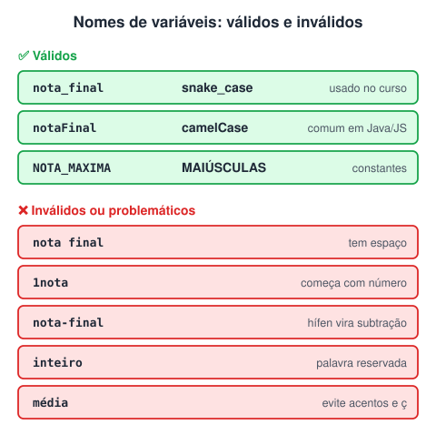
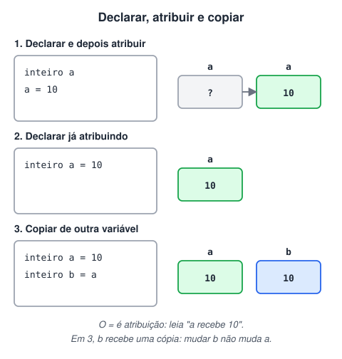
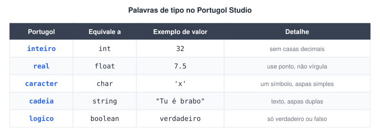

# Declaração e Atribuição de Variáveis em Lógica de Programação

> 🗺️ **Nesta aula:** o que é uma variável e suas cinco características, as regras e convenções de nomes, como declarar e como atribuir valores, com um programa completo no Portugol.

## De onde paramos

Na aula anterior você viu que cada dado tem um tipo. Agora o dado precisa de um lugar na memória, com um nome, para o programa poder usá-lo e alterá-lo: a variável.

## O que é uma variável

Variável é uma área da memória RAM, identificada por um nome, onde o programa guarda um dado temporariamente enquanto está sendo executado. Toda variável tem:

- **Nome** (identificador): como o programa se refere a ela.
- **Endereço**: a posição dela na memória, um número que o computador usa internamente.
- **Tipo de dado**: primitivo (inteiro, real, caractere, cadeia, lógico) ou composto.
- **Tamanho**: quanto espaço ocupa na memória, que depende do tipo.
- **Valor**: o conteúdo guardado naquele momento. Pode mudar durante a execução, daí o nome "variável".



> 💡 **Analogia:** uma variável é uma caixa com etiqueta numa estante. A etiqueta é o **nome**; a posição na estante é o **endereço**; o formato da caixa (para sapatos, para documentos) é o **tipo**; o espaço que ela ocupa é o **tamanho**; e o que está dentro agora é o **valor**, que você pode trocar quando quiser.

## Regras para nomes de variáveis

- Pode ter um ou mais caracteres.
- O primeiro caractere precisa ser uma **letra** (ou `_`, em algumas linguagens).
- Pode conter letras, dígitos e `_`, mas **não pode começar com um dígito**: `nota1` é válido, `1nota` não.
- Não pode ter espaços.
- Não pode ter símbolos como `-`, `@`, `!` ou `.`; o `_` é a exceção usada para separar palavras.
- Não pode ser uma palavra reservada da linguagem (`inteiro`, `se`, `programa`…).
- Evite acentos e `ç`: muitas linguagens não aceitam.

Além das regras, escolha nomes que digam o que a variável guarda: `media_final` é melhor que `mf`.

## Nomes compostos

Quando o nome tem mais de uma palavra, usa-se uma convenção para juntá-las sem espaço:



> 💡 **Analogia:** as regras de nome são como as de um nome de usuário numa rede social: não pode ter espaço, não aceita qualquer símbolo e não pode ser uma palavra que o próprio sistema já usa (como "admin"). Dentro das regras, o melhor nome é o que qualquer pessoa entende de primeira.

## Declaração: criando a variável

Antes de usar uma variável, é preciso **declará-la**: informar o tipo e o nome. A forma geral é `tipo nome`, e várias variáveis do mesmo tipo podem ser declaradas de uma vez, separadas por vírgula.

```c
// reserva espaço para um número inteiro
// chamado a (ainda sem valor definido)
inteiro a

// vários do mesmo tipo numa linha só
inteiro a, b, c
```

## Atribuição: guardando um valor

O sinal `=` é o **operador de atribuição**: ele guarda na variável da esquerda o valor da direita. Não é uma comparação de igualdade.

```c
// 1. declarar e depois atribuir: útil quando
// o valor só será conhecido mais adiante
inteiro a
a = 10

// 2. declarar já atribuindo (inicializar):
// evita usar a variável ainda vazia
inteiro a = 10

// 3. copiar o valor de uma variável:
// b recebe uma CÓPIA de 10, então mudar a
// depois não muda b
inteiro a = 10
inteiro b = a
```



> 💡 **Analogia:** declarar é reservar uma vaga no estacionamento com o seu nome na placa; atribuir é estacionar o carro nela. E `b = a` não move o carro de `a`: tira uma foto dele e coloca um carro igual na vaga `b`. Se depois você pintar o carro de `a`, o de `b` continua com a cor antiga.

## Os tipos no Portugol



> 💡 **Analogia:** esta tabela é um pequeno dicionário. `inteiro` no Portugol é `int` em C e Java, assim como "cachorro" em português é "dog" em inglês: a ideia é a mesma, só muda a palavra. Aprendendo o conceito aqui, você troca de linguagem só consultando o dicionário.

## Projeto: criando e atribuindo variáveis no Portugol

**Código**

```c
programa
{
  // declaradas fora de inicio(): são GLOBAIS,
  // visíveis em qualquer parte do programa
  caracter simbolo
  cadeia mensagem
  // vírgula declara várias de uma vez
  real n1, n2, n3, n4
  logico passa_ou_repassa
  inteiro idade

  funcao inicio()
  {
    // declaradas aqui dentro: LOCAIS, só
    // existem enquanto inicio() roda
    real media
    cadeia nome
    real notas

    // caractere usa aspas simples;
    // cadeia usa aspas duplas
    simbolo = 'x'
    mensagem = "Tu é brabo, chefe"
    // decimal com ponto, nunca com vírgula
    n1 = 7.5
    // n2 recebe uma cópia do valor de n1
    n2 = n1
    n3 = 8.2
    n4 = 6.9
    notas = n1 + n2 + n3 + n4
    passa_ou_repassa = verdadeiro
    idade = 32
    media = notas / 4
    nome = "Ana Souza"

    // "\n" pula linha depois de cada dado
    escreva("Turma: ", simbolo, "\n")
    escreva("O nome do aluno é: ", nome, "\n")
    escreva("Sua idade é: ", idade, "\n")
    // lógico aparece como "verdadeiro"
    escreva("Passou? ", passa_ou_repassa, "\n")
    escreva("Suas notas foram: ", n1, " / ",
      n2, " / ", n3, " / ", n4, "\n")
    escreva("Sua média foi: ", media, "\n")
    escreva(mensagem, "\n")
  }
}
```

Saída da média: `7.525` (soma 30.1 dividida por 4).

> ⌨️ Para executar o programa no Portugol Studio, use **Shift + F6**.

## 🧠 Revisão rápida

**Qual destes nomes é válido: 2lugar, nota final, nota_final, se?**

Só `nota_final`. Os outros começam com número, têm espaço ou são palavra reservada.

**Depois de inteiro a = 10, inteiro b = a e a = 20, quanto vale b?**

10. `b` recebeu uma cópia; mudar `a` depois não altera `b`.

**`a = 10` compara ou guarda?**

Guarda: o `=` é o operador de atribuição. Para comparar, usa-se `==`.

> ➡️ **Próximo passo:** no projeto, umas variáveis ficaram fora de `inicio()` e outras dentro. A diferença está em **O que é Escopo de Variáveis?**

## 📌 Resumo

| Conceito | Em uma frase |
| --- | --- |
| Variável | Espaço nomeado da memória que guarda um valor que pode mudar |
| Características | Nome, endereço, tipo, tamanho e valor |
| Nome válido | Começa com letra, sem espaços, acentos ou símbolos (exceto `_`), sem palavra reservada |
| Declaração | `tipo nome`, por exemplo `inteiro idade` |
| Atribuição | `=` guarda à esquerda o valor da direita (não compara) |
| Inicialização | Declarar já com valor: `inteiro a = 10` |
| Casas decimais | Com ponto: `7.5` |
