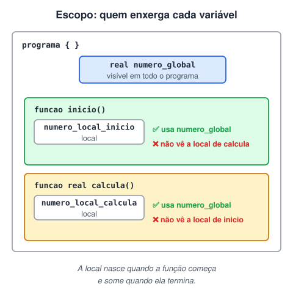

# O que é Escopo de Variáveis?

> 🗺️ **Nesta aula:** o que é escopo (visibilidade e tempo de vida), a diferença entre variáveis globais e locais e um programa que mostra quem enxerga o quê.

## De onde paramos

No projeto da aula anterior, algumas variáveis foram declaradas fora de `inicio()` e outras dentro. Isso não é detalhe: define **quem pode usar** cada variável e **por quanto tempo** ela existe.

## O que é escopo

O **escopo** de uma variável é a região do programa onde ela existe e pode ser usada. Ele define duas coisas:

- **Visibilidade**: quais partes do código conseguem acessar a variável.
- **Tempo de vida**: por quanto tempo ela ocupa espaço na memória.

Uma variável só pode ser usada dentro do escopo em que foi criada. Fora dele, para o programa, ela não existe.

## Variáveis globais e locais

|  | Variável global | Variável local |
| --- | --- | --- |
| Onde é declarada | No início do programa, fora de qualquer função (no Portugol, logo após `programa {`) | Dentro de uma função |
| Quem enxerga | Todo o programa (escopo amplo) | Só a função onde foi declarada (escopo restrito) |
| Tempo de vida | Do início ao fim da execução do programa | Só enquanto a função está sendo executada |
| Uso típico | Compartilhar um dado entre várias funções | Guardar valores de trabalho de uma única função |



> 💡 **Analogia:** pense numa casa. Uma variável global é o relógio da sala: todo mundo na casa vê, e ele fica lá o tempo todo. Uma variável local é o rascunho que alguém usa numa escrivaninha do quarto: só quem está naquele quarto o vê, e ele vai para o lixo quando a pessoa sai.

> 💡 Use variáveis globais com moderação. Elas ocupam memória durante toda a execução, e como qualquer função pode alterá-las, um valor errado numa global é mais difícil de rastrear na depuração. Prefira variáveis locais e passe valores entre funções quando possível.

## Projeto: testando o escopo no Portugol

**Código**

```c
programa
{
  // global: declarada fora das funções,
  // por isso inicio() e calcula() a enxergam
  real numero_global

  funcao inicio()
  {
    // inicio() pode alterar a global
    numero_global = 10.0
    // local: só existe dentro de inicio()
    real numero_local_inicio = 12.0

    escreva("O número global é: ",
      numero_global, "\n")
    escreva("O número local de inicio é: ",
      numero_local_inicio, "\n")
    // chama calcula() e mostra o que ela devolve
    escreva("numero_local_calcula x ",
      "numero_global = ", calcula(), "\n")
    escreva("Foi tudo! Agora, segue o baile.\n")
  }

  // "real" antes do nome: a função devolve
  // um número real com retorne
  funcao real calcula()
  {
    // local de calcula(): some quando ela acaba
    real numero_local_calcula = 5.0
    // a global também é visível aqui; já
    // numero_local_inicio NÃO seria, porque
    // pertence a inicio()
    retorne numero_local_calcula * numero_global
  }
}
```

Saída:

```
O número global é: 10.0
O número local de inicio é: 12.0
numero_local_calcula x numero_global = 50.0
Foi tudo! Agora, segue o baile.
```

## 🧠 Revisão rápida

**Uma variável declarada dentro de `inicio()` pode ser usada em `calcula()`?**

Não: ela é local de `inicio()`. Para `calcula()`, ela não existe.

**Quando uma variável local deixa de existir?**

Quando a função em que foi declarada termina de executar.

**Por que preferir variáveis locais?**

Porque só a própria função pode alterá-las, o que facilita achar erros, e elas liberam a memória ao fim da função.

> ➡️ **Próximo passo:** e quando um valor nunca deve mudar, como o valor de pi? Para isso existem as **constantes**: **Estudo complementar de Constantes**.

## 📌 Resumo

| Conceito | Em uma frase |
| --- | --- |
| Escopo | Região do programa onde a variável existe e pode ser usada |
| Global | Declarada fora das funções; vista por todas e vive o programa inteiro |
| Local | Declarada dentro de uma função; só existe enquanto ela roda |
| Boa prática | Prefira locais; use globais só para dados compartilhados |
