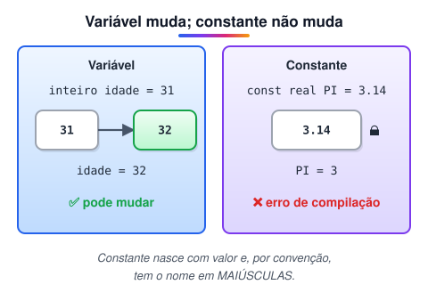

# Estudo complementar de Constantes

> 🗺️ **Nesta aula:** a diferença entre variável e constante, quando usar constantes e como declarar uma com `const` no Portugol.

## De onde paramos

Variáveis existem para mudar de valor. Mas alguns valores nunca deveriam mudar, como o valor de π ou a nota mínima de aprovação. Para eles existe a constante.

## Variáveis x constantes

|  | Variável | Constante |
| --- | --- | --- |
| O valor pode mudar? | Sim, quantas vezes for preciso durante a execução | Não: é definido uma vez e fica fixo até o fim |
| Quando recebe o valor | Pode ser declarada agora e receber o valor depois | Precisa receber o valor **na própria declaração** |
| Convenção de nome | minúsculas (`nota_final`) | MAIÚSCULAS (`PI`, `TAXA_JUROS`) |



> 💡 **Analogia:** uma variável é o quadro branco da sala, que se apaga e reescreve o dia todo. Uma constante é a placa de metal parafusada na porta com o número da sala: definida uma vez, na instalação, e ninguém consegue trocar com um apagador.

Use constantes para valores que não devem mudar: o valor de π, uma taxa fixa, a nota mínima de aprovação. Além de proteger o valor (o programa dá erro se alguém tentar alterá-lo), o nome deixa o código mais legível: `MEDIA_MINIMA` diz mais que um `7` solto no meio do código.

> 💡 Assim como as variáveis, as constantes podem ser locais ou globais.

## Como declarar

```c
// const + tipo + NOME em maiúsculas + valor:
// o valor vem na mesma linha porque depois
// não poderá mais ser atribuído
const tipo NOME_DA_CONSTANTE = valor
```

## Projeto: criando uma constante

**Código**

```c
programa
{
  // global e fixa: qualquer função usa o
  // mesmo PI, e ninguém consegue alterá-lo
  const real PI = 3.1415

  funcao inicio()
  {
    escreva("Aqui usamos a constante para ",
      "armazenar o valor de Pi: ", PI, "\n")

    // a linha abaixo daria ERRO, e é
    // justamente essa proteção que queremos:
    // PI = 3.0
  }
}
```

Saída: `Aqui usamos a constante para armazenar o valor de Pi: 3.1415`

## 🧠 Revisão rápida

**Posso declarar `const real PI` e atribuir o valor depois?**

Não: a constante precisa receber o valor na própria declaração.

**Por que escrever `MEDIA_MINIMA` em vez de usar o número 7 direto no código?**

Porque o nome explica o significado e, se a regra mudar, você altera um lugar só.

**O que acontece se o programa tentar fazer `PI = 3.0`?**

Dá erro: o valor de uma constante não pode ser alterado.

> ➡️ **Próximo passo:** até aqui, os valores foram escritos no próprio código. A próxima aula mostra como recebê-los do usuário e mostrar resultados: **Entrada e Saída de Dados com Leia e Escreva**.

## 📌 Resumo

| Conceito | Em uma frase |
| --- | --- |
| Constante | Valor fixo, definido uma vez e nunca alterado |
| Declaração | `const tipo NOME = valor`, sempre com o valor na mesma linha |
| Nome | Em MAIÚSCULAS, por convenção |
| Para que serve | Proteger valores fixos e deixar o código mais legível |
