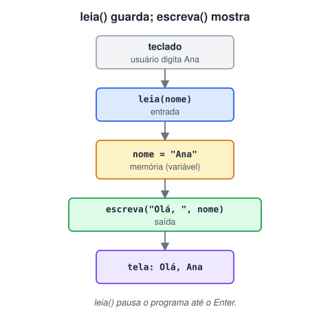

# Entrada e Saída de Dados com Leia e Escreva

> 🗺️ **Nesta aula:** os comandos de entrada (`leia`) e saída (`escreva`), como juntar textos e variáveis, quebrar linhas com `\n` e orientar o usuário antes de cada leitura.

## De onde paramos

Até aqui, os valores das variáveis e constantes foram escritos no próprio código. Um programa útil conversa com quem o usa: recebe dados (entrada) e mostra resultados (saída).

## Os dois comandos

| Comando | Papel | O que faz |
| --- | --- | --- |
| `leia(variavel)` | **Entrada** | Pausa o programa, espera o usuário digitar algo e apertar Enter, e guarda o valor na variável |
| `escreva(...)` | **Saída** | Mostra textos e valores de variáveis no console |



> 💡 **Analogia:** é um balcão de atendimento. O `leia` é o atendente que estende a mão e espera você entregar o documento (e não faz mais nada até receber); o `escreva` é o painel que mostra a senha chamada. Um bom atendente sempre diz antes o que precisa ("seu CPF, por favor"): esse é o `escreva` que vem antes de cada `leia`.

Detalhes do `escreva`:

- Textos fixos vão entre aspas duplas: `escreva("Olá")`.
- Vários itens são separados por **vírgula**: `escreva("Idade: ", idade)`.
- O `escreva` não pula linha sozinho. Para quebrar a linha, inclua `"\n"`.

> 💡 Antes de cada `leia`, use um `escreva` dizendo o que o usuário deve digitar. Sem isso, o programa só para e fica esperando, sem explicar nada.

## Projeto: testando leia e escreva

**Código**

```c
programa
{
  inteiro valor
  cadeia nome

  funcao inicio()
  {
    // o leia guarda o que for digitado na
    // variável; o tipo dela define o que
    // é aceito (número inteiro, texto)
    leia(valor)
    leia(nome)

    // sem "\n", as três saídas ficariam
    // grudadas na mesma linha
    escreva(1, "\n")
    // texto fixo entre aspas; a vírgula
    // junta o texto ao valor da variável
    escreva("O número digitado foi: ",
      valor, "\n")
    escreva("O texto digitado foi: ",
      nome, "\n")
  }
}
```

## Projeto: nome, idade e salário

**Código**

```c
programa
{
  inteiro idade
  cadeia nome
  real salario

  funcao inicio()
  {
    // cada leia vem depois de uma mensagem,
    // para o usuário saber o que digitar
    escreva("Digite seu nome: ")
    leia(nome)

    escreva("Digite sua idade (só o número): ")
    leia(idade)

    // avisar o formato evita que a pessoa
    // digite "2500,50" (vírgula dá erro)
    escreva("Digite seu salário (use ponto ",
      "para os centavos, ex.: 2500.50): ")
    leia(salario)

    // o "\n" no início separa as perguntas
    // das respostas com uma linha em branco
    escreva("\nSeu nome é: ", nome, "\n")
    escreva("Sua idade é: ", idade, "\n")
    escreva("O valor do seu salário é: R$ ",
      salario, "\n")
  }
}
```

Exemplo de execução:

```
Digite seu nome: Ana
Digite sua idade (só o número): 28
Digite seu salário (use ponto para os
centavos, ex.: 2500.50): 3200.0

Seu nome é: Ana
Sua idade é: 28
O valor do seu salário é: R$ 3200.0
```

## 🧠 Revisão rápida

**O que acontece quando o programa chega num `leia`?**

Ele para e espera o usuário digitar e apertar Enter; o valor vai para a variável.

**Por que `escreva("A")` seguido de `escreva("B")` mostra "AB"?**

Porque o `escreva` não pula linha sozinho. Para separar, use `"\n"`.

**Como mostrar um texto e o valor de uma variável no mesmo `escreva`?**

Separando com vírgula: `escreva("Idade: ", idade)`.

> ➡️ **Próximo passo:** com os dados em mãos, o programa precisa fazer contas com eles: **Operadores e Expressões Aritméticas**.

## 📌 Resumo

| Item | Em uma frase |
| --- | --- |
| `leia(x)` | Espera o usuário digitar e guarda o valor em `x` |
| `escreva(...)` | Mostra textos e valores no console |
| Vários itens | Separados por vírgula: `escreva("Idade: ", idade)` |
| `"\n"` | Quebra a linha (o `escreva` não pula sozinho) |
| Boa prática | Um `escreva` explicando o que digitar antes de cada `leia` |
