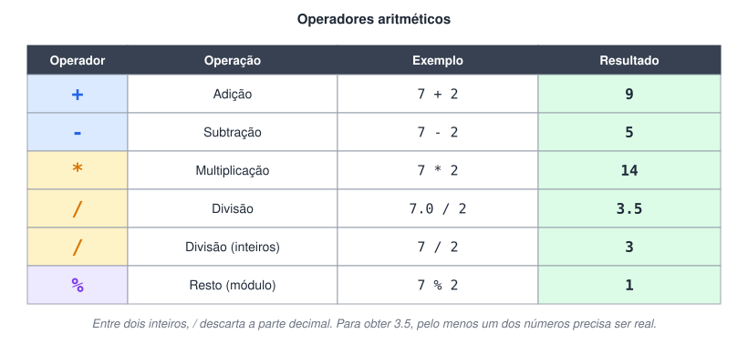
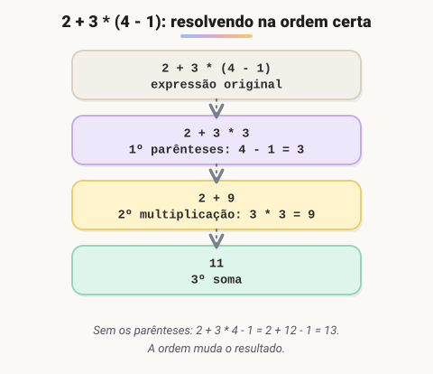
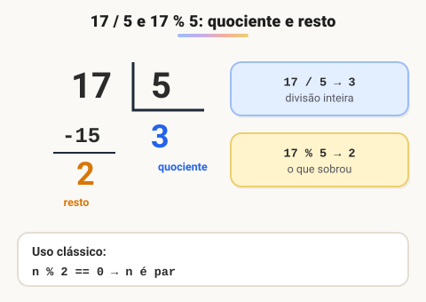
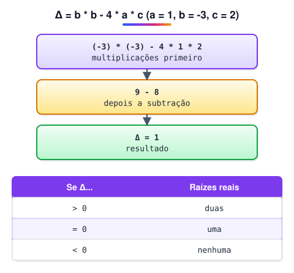

# Operadores e Expressões Aritméticas

> 🗺️ **Nesta aula:** os cinco operadores aritméticos, a ordem de precedência, o operador de resto e três projetos: calculadoras por operação, calculadora com menu e o delta da equação do segundo grau.

## De onde paramos

Com `leia` e `escreva`, o programa já recebe e mostra dados. Agora vem o **processamento**: fazer contas com esses dados.

## Os operadores



> 💡 **Analogia:** os operadores são os botões de uma calculadora de bolso: `+`, `-`, `*` (o "×") e `/` (o "÷"). O `%` é o botão que a calculadora comum não tem: ele responde "quanto sobra" numa divisão. E atenção: entre inteiros, a calculadora do programa corta a parte decimal, como uma calculadora que só mostra números inteiros.

Uma **expressão aritmética** combina valores, variáveis e operadores e sempre produz um número: `media = (n1 + n2) / 2`.

## Ordem de precedência

Como na matemática, as operações não são feitas da esquerda para a direita, e sim nesta ordem:

1. Parênteses `( )`. Em programação só se usam parênteses (nada de colchetes ou chaves); para agrupar mais de um nível, coloque parênteses dentro de parênteses.
2. Potências e raízes (no Portugol, por funções da biblioteca `Matematica`, vistas mais adiante).
3. Multiplicação `*`, divisão `/` e resto `%`.
4. Adição `+` e subtração `-`.

Operadores com a mesma prioridade são resolvidos da esquerda para a direita.



> 💡 **Analogia:** a precedência é como a ordem de se vestir: meia antes do sapato, mesmo que você leia "sapato e meia" nessa ordem. Os parênteses são o recado "faça isto primeiro", que passa na frente de qualquer regra.

## O operador de resto (%)

O `%` devolve o que sobra de uma divisão inteira. Só funciona com inteiros.



> 💡 **Analogia:** divida 17 balas entre 5 crianças, sem partir nenhuma. Cada criança ganha 3 (isso é `17 / 5`) e sobram 2 balas no saco (isso é `17 % 5`).

## Projeto: uma calculadora para cada operação

Os cinco programas seguem o mesmo modelo, mudando só o operador:

**Soma**

```c
programa
{
  // real aceita números com e sem decimal
  real a, b, soma

  funcao inicio()
  {
    // entrada: os dois números da conta
    escreva("Digite um número: ")
    leia(a)

    escreva("Digite outro número: ")
    leia(b)

    // processamento: guardar o resultado
    // permite usá-lo de novo se precisar
    soma = a + b

    escreva("\nO resultado da soma é: ",
      soma, "\n")
  }
}
```

**Subtração**

```c
programa
{
  real a, b, sub

  funcao inicio()
  {
    escreva("Digite um número: ")
    leia(a)

    escreva("Digite outro número: ")
    leia(b)

    // a ordem importa: a - b é diferente
    // de b - a
    sub = a - b

    escreva("\nO resultado da subtração é: ",
      sub, "\n")
  }
}
```

**Multiplicação**

```c
programa
{
  real a, b, multi

  funcao inicio()
  {
    escreva("Digite um número: ")
    leia(a)

    escreva("Digite outro número: ")
    leia(b)

    // em programação o "×" é o asterisco
    multi = a * b

    escreva("\nO resultado da multiplicação é: ",
      multi, "\n")
  }
}
```

**Divisão**

```c
programa
{
  // real, e não inteiro, para não perder
  // a parte decimal: 7 / 2 dá 3.5
  real a, b, div

  funcao inicio()
  {
    escreva("Digite um número: ")
    leia(a)

    escreva("Digite outro número: ")
    leia(b)

    // se b for 0, o programa dá erro:
    // não existe divisão por zero
    div = a / b

    escreva("\nO resultado da divisão é: ",
      div, "\n")
  }
}
```

**Resto**

```c
programa
{
  // inteiro porque o % só funciona
  // com números inteiros
  inteiro a, b, mod

  funcao inicio()
  {
    escreva("Digite um número: ")
    leia(a)

    escreva("Digite outro número: ")
    leia(b)

    // o que sobra da divisão de a por b
    mod = a % b

    escreva("\nO resto da divisão é: ",
      mod, "\n")
  }
}
```

Teste: 17 e 5 → `O resto da divisão é: 2`.

## Projeto: calculadora com escolha de operação

Este projeto já usa o `se ... senao se`, estudado em detalhe na seção de estruturas de decisão.

**Código**

```c
programa
{
  inteiro a, b, operacao

  funcao inicio()
  {
    escreva("Digite um número: ")
    leia(a)

    escreva("Digite outro número: ")
    leia(b)

    // o menu numerado evita que o usuário
    // precise digitar o nome da operação
    escreva("\nEscolha a operação:\n")
    escreva("1 - soma | 2 - subtração\n")
    escreva("3 - multiplicação | 4 - divisão\n")
    escreva("5 - resto\n")
    leia(operacao)

    // só a conta escolhida é calculada
    se (operacao == 1) {
      escreva("Soma: ", a + b, "\n")
    } senao se (operacao == 2) {
      escreva("Subtração: ", a - b, "\n")
    } senao se (operacao == 3) {
      escreva("Multiplicação: ", a * b, "\n")
    } senao se (operacao == 4) {
      // inteiros: a parte decimal é cortada
      escreva("Divisão inteira: ", a / b, "\n")
    } senao se (operacao == 5) {
      escreva("Resto: ", a % b, "\n")
    } senao {
      // qualquer número fora do menu
      escreva("Opção inválida. ",
        "As opções são de 1 a 5.\n")
    }
  }
}
```

Teste: 7, 2 e opção 4 → `Divisão inteira: 3`.

> 💡 Em relação à versão original, cada conta passou a ser feita só no ramo escolhido (antes, as cinco eram calculadas sempre) e o resultado não é mais guardado na própria variável `operacao`. A mensagem de opção inválida também passou a citar as 5 opções.

## Projeto: delta da equação do segundo grau (Δ)

Para uma equação `ax² + bx + c = 0`, o delta é `Δ = b² - 4ac`. Como a multiplicação vem antes da subtração, a fórmula pode ser escrita sem parênteses: `b * b - 4 * a * c`.



> 💡 **Analogia:** pense na parábola como uma ponte em arco e no eixo x como o rio. O delta diz quantas vezes a ponte toca a água: positivo, ela mergulha e sai (duas raízes); zero, ela só encosta (uma raiz); negativo, passa inteira por cima, sem tocar (nenhuma raiz real).

**Código**

```c
programa
{
  inteiro a, b, c, delta

  funcao inicio()
  {
    escreva("Cálculo do Δ de uma equação ",
      "do segundo grau\n")

    // os três coeficientes de ax² + bx + c
    escreva("Digite o valor de a: ")
    leia(a)

    escreva("Digite o valor de b: ")
    leia(b)

    escreva("Digite o valor de c: ")
    leia(c)

    // mostrar a equação ajuda o usuário a
    // conferir se digitou certo
    escreva("\nA equação ficou: ", a, "x² + ",
      b, "x + ", c, " = 0")

    // b² escrito como b * b; a multiplicação
    // é feita antes da subtração
    delta = b * b - 4 * a * c

    escreva("\nO Δ da equação é: ", delta, "\n")
  }
}
```

Teste: a = 1, b = -5, c = 6 → `O Δ da equação é: 1`.

## 🧠 Revisão rápida

**Quanto vale 10 - 2 * 3?**

4. A multiplicação vem antes: 2 * 3 = 6, e 10 - 6 = 4.

**Quanto vale 7 / 2 com variáveis inteiras? E 7 % 2?**

7 / 2 dá 3 (a parte decimal é descartada) e 7 % 2 dá 1 (o resto).

**Como saber se um número n é par?**

Se `n % 2 == 0`: o resto da divisão por 2 é zero.

> ➡️ **Próximo passo:** somar 1 a uma variável é tão comum que tem atalho próprio: **Operadores de incremento e decremento**.

## 📌 Resumo

| Item | Em uma frase |
| --- | --- |
| Operadores | Soma `+`, subtração `-`, multiplicação `*`, divisão `/`, resto `%` |
| Precedência | Parênteses, depois potência/raiz, depois `*` `/` `%`, por fim soma e subtração |
| Empate | Mesma prioridade: da esquerda para a direita |
| Resto `%` | O que sobra da divisão inteira; só com inteiros |
| Divisão | Entre inteiros descarta a parte decimal; entre reais, não |
| Delta | `b * b - 4 * a * c` dispensa parênteses |
