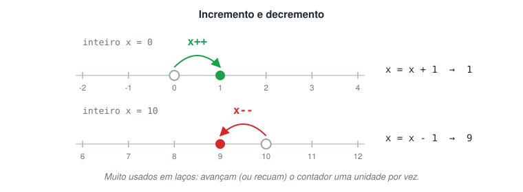
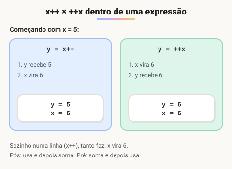

# Operadores de incremento e decremento

> 🗺️ **Nesta aula:** os atalhos `x++` e `x--` para somar ou subtrair 1, a diferença entre a forma pré e pós-fixada e um programa de teste.

## De onde paramos

Na aula anterior, as contas usaram os operadores aritméticos. Uma conta aparece tanto que ganhou atalho próprio: somar ou subtrair 1 de uma variável.

## O que são

São atalhos para somar ou subtrair **1** de uma variável. Aparecem o tempo todo em laços de repetição (`enquanto`, `para`), para avançar ou recuar um contador.

| Operador | Nome | Equivale a |
| --- | --- | --- |
| `x++` | Incremento | `x = x + 1` |
| `x--` | Decremento | `x = x - 1` |



> 💡 **Analogia:** é o contador manual (aquele "clic-clic") do porteiro de um show. Cada pessoa que entra, um clique: `x++`. Se alguém sai, ele aperta o botão de voltar: `x--`. Ninguém faz a conta "total = total + 1" de cabeça; só clica.

### Incremento

```c
inteiro x = 0
// mesmo que x = x + 1
x++
escreva(x)  // 1
```

### Decremento

```c
inteiro x = 10
// mesmo que x = x - 1
x--
escreva(x)  // 9
```

> 💡 Em várias linguagens o operador também pode vir antes da variável (`++x`, `--x`). Sozinho numa linha, o efeito é o mesmo. A diferença aparece quando ele está dentro de outra expressão: `++x` altera o valor antes de usá-lo; `x++` usa o valor atual e só depois altera.



> 💡 **Analogia:** na fila da padaria, `senha++` é "chame a senha atual e depois vire o painel"; `++senha` é "vire o painel e chame a nova". O painel termina igual nos dois casos; muda qual número foi chamado.

## Projeto: trabalhando com incremento e decremento

**Código**

```c
programa
{
  inteiro numero

  funcao inicio()
  {
    escreva("Digite um número: ")
    leia(numero)

    escreva("\nO número digitado foi: ",
      numero, "\n")

    // +1: o atalho altera a própria variável
    numero++
    escreva("Após o incremento: ",
      numero, "\n")

    // -1 desfaz o incremento e volta ao
    // valor digitado
    numero--
    escreva("Desfazendo o incremento, ",
      "volta ao original: ", numero, "\n")

    // -1 de novo: uma unidade abaixo do
    // valor original
    numero--
    escreva("Após o decremento do original: ",
      numero, "\n")
  }
}
```

Digitando 5, a saída é:

```
O número digitado foi: 5
Após o incremento: 6
Desfazendo o incremento, volta ao
original: 5
Após o decremento do original: 4
```

## 🧠 Revisão rápida

**Se `x` vale 4, quanto vale depois de `x++` e `x++`?**

6: cada `x++` soma 1.

**`x--` é o mesmo que qual atribuição?**

`x = x - 1`.

**Sozinhos numa linha, `x++` e `++x` dão resultados diferentes?**

Não. A diferença só aparece quando o operador está dentro de outra expressão.

> ➡️ **Próximo passo:** e quando o passo não é 1? Somar 5, descontar um valor, dobrar: é o assunto dos **operadores de atribuição compostos** (`+=`, `-=`, `*=`, `/=`).

## 📌 Resumo

| Item | Em uma frase |
| --- | --- |
| `x++` | Soma 1: o mesmo que `x = x + 1` |
| `x--` | Subtrai 1: o mesmo que `x = x - 1` |
| Pré x pós | Dentro de uma expressão, `++x` altera antes de usar e `x++` usa e depois altera |
| Uso típico | Contadores de laços de repetição |
