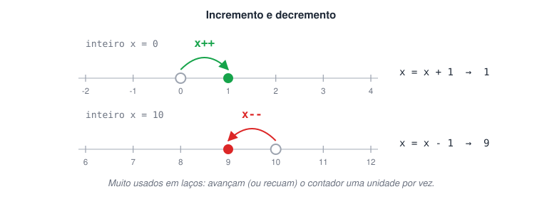

# Operadores de incremento e decremento

> 🗺️ **Nesta aula:** os atalhos `x++` e `x--` para somar ou subtrair 1, a diferença entre a forma pré e pós-fixada e um programa de teste.

## O que são

São atalhos para somar ou subtrair **1** de uma variável. Aparecem o tempo todo em laços de repetição (`enquanto`, `para`), para avançar ou recuar um contador.

| Operador | Nome | Equivale a |
| --- | --- | --- |
| `x++` | Incremento | `x = x + 1` |
| `x--` | Decremento | `x = x - 1` |



### Incremento

```c
inteiro x = 0
x++  // mesmo que x = x + 1
escreva(x)  // 1
```

### Decremento

```c
inteiro x = 10
x--  // mesmo que x = x - 1
escreva(x)  // 9
```

> 💡 Em várias linguagens o operador também pode vir antes da variável (`++x`, `--x`). Sozinho numa linha, o efeito é o mesmo. A diferença aparece quando ele está dentro de outra expressão: `++x` altera o valor antes de usá-lo; `x++` usa o valor atual e só depois altera.

## Projeto: trabalhando com incremento e decremento

**Código**

```c
programa
{
  inteiro numero

  funcao inicio()
  {
    escreva("Digite um número: ")
    leia(numero)

    escreva("\nO número digitado foi: ", numero, "\n")

    numero++  // +1
    escreva("Após o incremento: ", numero, "\n")

    numero--  // -1: volta ao valor digitado
    escreva("Desfazendo o incremento, volta ao original: ", numero, "\n")

    numero--  // -1 de novo: fica uma unidade abaixo do original
    escreva("Após o decremento do original: ", numero, "\n")
  }
}
```

Digitando 5, a saída é:

```
O número digitado foi: 5
Após o incremento: 6
Desfazendo o incremento, volta ao original: 5
Após o decremento do original: 4
```

## 📌 Resumo

| Item | Em uma frase |
| --- | --- |
| `x++` | Soma 1: o mesmo que `x = x + 1` |
| `x--` | Subtrai 1: o mesmo que `x = x - 1` |
| Pré x pós | Dentro de uma expressão, `++x` altera antes de usar e `x++` usa e depois altera |
| Uso típico | Contadores de laços de repetição |
