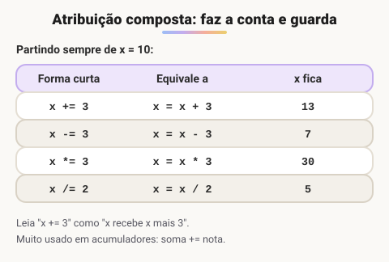

# Operadores de atribuição compostos (+=, -=, *=, /=)

> ✨ **Página nova.** Estes operadores são usados nas listas de exercícios, nos vetores e nas matrizes, mas não tinham uma aula própria.

> 🗺️ **Nesta aula:** os atalhos que combinam uma conta com a atribuição, a equivalência com a forma longa e onde eles aparecem no curso.

## O que são

É muito comum atualizar uma variável a partir do próprio valor dela: somar algo ao total, descontar do saldo, dobrar um número. Os operadores compostos escrevem isso de forma mais curta, sem repetir o nome da variável.



A leitura é sempre a mesma: `x += 3` significa "pegue o valor atual de x, some 3 e guarde o resultado em x". É a mesma ideia do `x++`, mas com qualquer valor e qualquer uma das quatro operações.

> 💡 O lado direito é calculado inteiro antes da operação: `x *= 2 + 1` é `x = x * (2 + 1)`, e não `x = x * 2 + 1`.

## Onde aparecem no curso

- **Acumuladores**: `soma += notas[i]` na média de notas e `soma += matriz[lin][col]` na soma da matriz.
- **Somatórios**: `soma += 1.0 / denominador` na soma das 20 frações (3ª lista).
- **Passos diferentes de 1**: `num -= 2` para descer de 2 em 2 nos números pares (3ª lista).

## Projeto: caixa eletrônico simples

```c
programa
{
  real saldo = 1000.0
  real valor
  inteiro opcao

  funcao inicio()
  {
    faca {
      escreva("\nSaldo: R$ ", saldo, "\n")
      escreva("1 - Depositar | 2 - Sacar | 0 - Sair: ")
      leia(opcao)

      se (opcao == 1) {
        escreva("Valor do depósito: ")
        leia(valor)
        saldo += valor  // saldo = saldo + valor
      }
      senao se (opcao == 2) {
        escreva("Valor do saque: ")
        leia(valor)
        se (valor <= saldo) {
          saldo -= valor  // saldo = saldo - valor
        }
        senao {
          escreva("Saldo insuficiente.\n")
        }
      }
    } enquanto (opcao != 0)

    escreva("\nSaldo final: R$ ", saldo, "\n")
  }
}
```

O menu usa o `faca-enquanto`, visto na seção de repetição: ele mostra as opções pelo menos uma vez e repete até o usuário digitar 0.

## 📌 Resumo

| Operador | Equivale a | Uso típico |
| --- | --- | --- |
| `x += v` | `x = x + v` | Acumular, somar ao total |
| `x -= v` | `x = x - v` | Descontar, contar de v em v para baixo |
| `x *= v` | `x = x * v` | Multiplicar acumulando (potências, fatorial) |
| `x /= v` | `x = x / v` | Dividir sucessivamente (conversão para binário) |
| Ordem | O lado direito é calculado primeiro | `x *= 2 + 1` multiplica por 3 |
