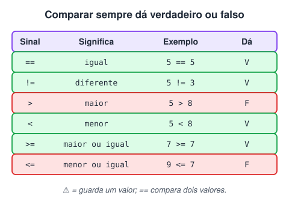
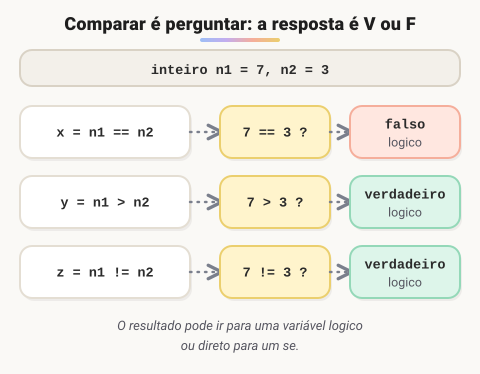

# Como usar Operadores e Expressões Relacionais (ou de Comparação)

> 🗺️ **Nesta aula:** os seis operadores de comparação, por que o resultado é sempre um valor lógico e um programa que compara dois números.

## De onde paramos

Os operadores aritméticos produzem números. Para tomar decisões, porém, o programa precisa fazer perguntas sobre esses números: "é maior?", "é igual?". É isso que os operadores relacionais fazem.

## O que são operadores relacionais

São os operadores que **comparam dois valores** (operandos): o da esquerda com o da direita. Toda comparação funciona como uma pergunta de sim ou não, e por isso o resultado é sempre um valor **lógico**: `verdadeiro` ou `falso`.

- Comparam números, caracteres e cadeias, desde que os dois lados sejam de tipos compatíveis.
- O resultado pode ser guardado numa variável `logico` ou usado direto numa decisão (`se`), como veremos na próxima seção.

## Os operadores



> 💡 **Analogia:** é a balança de dois pratos. Você coloca um valor em cada lado e ela só pode responder uma coisa: pende para a esquerda, para a direita ou fica equilibrada. Cada operador é uma pergunta sobre essa balança, e a resposta é sempre sim ou não.



## Projeto: comparando dois números

**Código**

```c
programa
{
  // logico porque cada variável guarda a
  // resposta de uma pergunta (sim ou não)
  logico x, y, z
  inteiro n1, n2

  funcao inicio()
  {
    escreva("Digite um número: ")
    leia(n1)

    escreva("Digite outro número: ")
    leia(n2)

    // == pergunta; um = sozinho guardaria
    // n2 em n1, que é outra coisa
    x = n1 == n2
    escreva("\nOs números ", n1, " e ", n2,
      " são iguais? ", x, "\n")

    // n1 é maior que n2?
    y = n1 > n2
    escreva("O número ", n1, " é maior que ",
      n2, "? ", y, "\n")

    // n1 é diferente de n2?
    z = n1 != n2
    escreva("Os números ", n1, " e ", n2,
      " são diferentes? ", z, "\n")
  }
}
```

Digitando 7 e 3:

```
Os números 7 e 3 são iguais? falso
O número 7 é maior que 3? verdadeiro
Os números 7 e 3 são diferentes?
verdadeiro
```

## 🧠 Revisão rápida

**Qual a diferença entre = e ==?**

`=` guarda um valor (atribuição); `==` pergunta se dois valores são iguais (comparação).

**Quanto vale 9 <= 7?**

`falso`, porque 9 não é menor nem igual a 7.

**Quanto vale 5 >= 5?**

`verdadeiro`: o "ou igual" aceita o empate.

> ➡️ **Próximo passo:** uma comparação sozinha responde uma pergunta. Para juntar várias ("maior de idade **e** com carteira"), vêm os **operadores lógicos**.

## 📌 Resumo

| Operador | Pergunta |
| --- | --- |
| `==` | É igual? (não confunda com `=`, que atribui) |
| `!=` | É diferente? |
| `>` / `<` | É maior? / É menor? |
| `>=` / `<=` | É maior ou igual? / É menor ou igual? |
| Resultado | Sempre `verdadeiro` ou `falso` |
