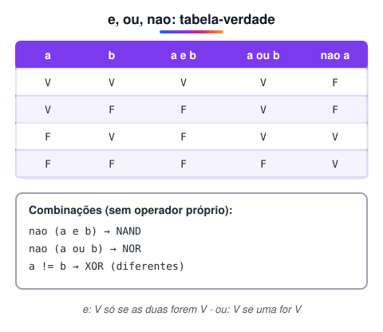
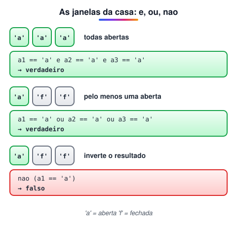

# Operadores Lógicos e, ou e não (Operadores booleanos)

> 🗺️ **Nesta aula:** como os operadores lógicos combinam condições, os básicos (E, OU, NÃO) e os derivados (NAND, NOR, XOR, XNOR), a tabela-verdade e projetos com janelas abertas e fechadas.

## Para que servem

Os operadores lógicos **combinam condições**. Com eles uma única expressão pode testar várias comparações ao mesmo tempo, como "a nota é maior que 7 **e** as faltas são menores que 10". O resultado continua sendo um valor lógico: `verdadeiro` ou `falso`.



## Os operadores básicos

**E (AND)**: resulta em verdadeiro **só se as duas** entradas forem verdadeiras. Basta uma falsa para o resultado ser falso.

**OU (OR)**: resulta em verdadeiro se **pelo menos uma** das entradas for verdadeira. Só é falso quando as duas são falsas.

**NÃO (NOT)**: é o único que recebe **uma** entrada só, e simplesmente inverte o valor: verdadeiro vira falso e falso vira verdadeiro.

## Os operadores derivados

**NÃO-E (NAND)**: é o E seguido de um NÃO. Resulta em verdadeiro se pelo menos uma entrada for falsa.

**NÃO-OU (NOR)**: é o OU seguido de um NÃO. Resulta em verdadeiro só se as duas entradas forem falsas.

**OU-EXCLUSIVO (XOR)**: resulta em verdadeiro se **apenas uma** das entradas for verdadeira, ou seja, se as entradas forem **diferentes**.

**NÃO-OU-EXCLUSIVO (XNOR)**: o contrário do XOR. Resulta em verdadeiro se as entradas forem **iguais**.

## Tabela-verdade

Todas as combinações possíveis de duas entradas `a` e `b` (V = verdadeiro, F = falso):

**Operadores básicos**

| a | b | a e b | a ou b | nao a |
| --- | --- | --- | --- | --- |
| V | V | **V** | **V** | F |
| V | F | F | **V** | F |
| F | V | F | **V** | **V** |
| F | F | F | F | **V** |

**Operadores derivados**

| a | b | NAND | NOR | XOR | XNOR |
| --- | --- | --- | --- | --- | --- |
| V | V | F | F | F | **V** |
| V | F | **V** | F | **V** | F |
| F | V | **V** | F | **V** | F |
| F | F | **V** | **V** | F | **V** |

> 💡 No Portugol só existem as palavras `e`, `ou` e `nao`. Os demais se montam com elas: NAND é `nao (a e b)`, NOR é `nao (a ou b)`, e, para variáveis do tipo `logico`, XOR é `a != b` e XNOR é `a == b`.

## Projeto: janelas abertas ou fechadas

Nos projetos abaixo, cada variável representa uma janela: `'a'` para aberta e `'f'` para fechada.



**Operador e**

```c
programa
{
  caracter a1, a2, a3
  logico estado

  funcao inicio()
  {
    a1 = 'a'
    a2 = 'a'
    a3 = 'a'

    // verdadeiro só se as TRÊS estiverem abertas
    estado = a1 == 'a' e a2 == 'a' e a3 == 'a'

    escreva("Janelas (a = aberta | f = fechada)\n")
    escreva("a1: ", a1, "\na2: ", a2, "\na3: ", a3, "\n")

    escreva("\nTodas as janelas estão abertas? ", estado, "\n")
    escreva("Alguma janela está fechada? ", nao estado, "\n")
  }
}
```

**Operador ou**

```c
programa
{
  caracter a1, a2, a3
  logico estado

  funcao inicio()
  {
    a1 = 'a'
    a2 = 'f'
    a3 = 'f'

    // verdadeiro se PELO MENOS UMA estiver aberta
    estado = a1 == 'a' ou a2 == 'a' ou a3 == 'a'

    escreva("Janelas (a = aberta | f = fechada)\n")
    escreva("a1: ", a1, "\na2: ", a2, "\na3: ", a3, "\n")
    escreva("\nAlguma janela está aberta? ", estado, "\n")
  }
}
```

**Operador nao**

```c
programa
{
  caracter a1, a2, a3
  logico alguma_aberta

  funcao inicio()
  {
    a1 = 'a'
    a2 = 'f'
    a3 = 'f'

    alguma_aberta = a1 == 'a' ou a2 == 'a' ou a3 == 'a'

    escreva("Janelas (a = aberta | f = fechada)\n")
    escreva("a1: ", a1, "\na2: ", a2, "\na3: ", a3, "\n")

    // se NÃO há nenhuma aberta, então todas estão fechadas
    escreva("\nTodas as janelas estão fechadas? ", nao alguma_aberta, "\n")  // falso
  }
}
```

> ⚠️ Na versão original do projeto `nao`, a mesma expressão `nao estado` respondia a duas perguntas diferentes ("todas abertas?" e "todas fechadas?"). Negar o "alguma aberta?" responde só à segunda. Para saber se todas estão abertas é preciso o `e`, como no primeiro projeto.

## Projeto maior: e, ou e nao juntos

**Código**

```c
programa
{
  caracter a1, a2, a3, b1, b2, b3
  cadeia c1, c2
  logico estado_a, estado_b, afirmacao_d, negacao_d

  funcao inicio()
  {
    // 'a' = aberta | 'f' = fechada
    a1 = 'a'
    a2 = 'a'
    a3 = 'a'

    b1 = 'f'
    b2 = 'a'
    b3 = 'f'

    c1 = "dia"
    c2 = "noite"

    estado_a = a1 == 'a' e a2 == 'a' e a3 == 'a'  // todas abertas?
    estado_b = b1 == 'a' ou b2 == 'a' ou b3 == 'a'  // alguma aberta?

    afirmacao_d = c1 == "dia"  // comparação de cadeias
    negacao_d = nao afirmacao_d

    escreva("Janelas a: ", a1, " ", a2, " ", a3, "\n")
    escreva("Janelas b: ", b1, " ", b2, " ", b3, "\n")

    escreva("\nTodas as janelas a estão abertas? ", estado_a, "\n")  // verdadeiro
    escreva("Alguma janela b está aberta? ", estado_b, "\n")  // verdadeiro
    escreva("9 horas da manhã é ", c1, "? ", afirmacao_d, "\n")  // verdadeiro
    escreva("10 horas da ", c2, " é dia? ", negacao_d, "\n")  // falso
  }
}
```

> 💡 No original, `estado_b` testava `b1 == 'f' ou b2 == 'a' ou b3 == 'f'`, misturando "fechada" e "aberta" na mesma pergunta. Na versão acima as três comparações testam a mesma coisa (aberta). Também tirei o trecho final de brincadeira, que reproduzia letra de música.

## 📌 Resumo

| Operador | No Portugol | Verdadeiro quando… |
| --- | --- | --- |
| E | `a e b` | as duas condições são verdadeiras |
| OU | `a ou b` | pelo menos uma é verdadeira |
| NÃO | `nao a` | inverte o valor |
| NAND | `nao (a e b)` | pelo menos uma é falsa |
| NOR | `nao (a ou b)` | as duas são falsas |
| XOR | `a != b` | as entradas são diferentes |
| XNOR | `a == b` | as entradas são iguais |
