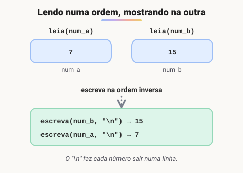
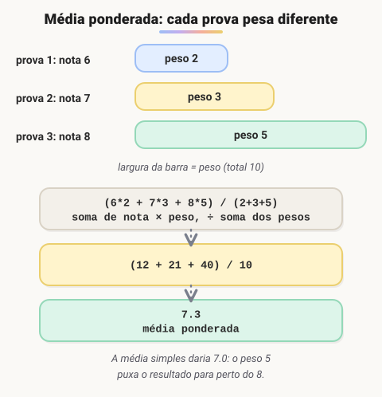
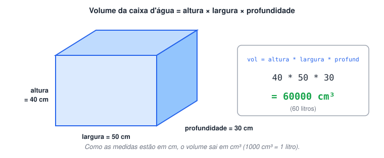
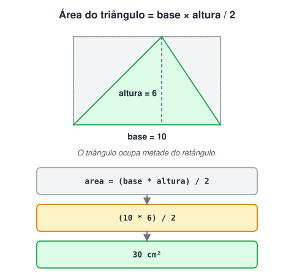
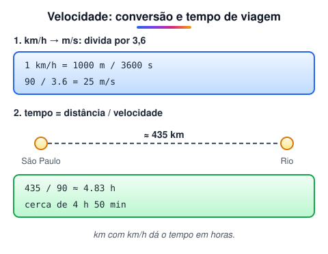

# 1ª Lista de exercícios

> 🗺️ **Nesta lista:** sete exercícios que juntam variáveis, operadores aritméticos e `leia`/`escreva`: nome completo, diferença, ordem inversa, média ponderada, volume, área e velocidade.

Exercícios sobre variáveis, operadores e entrada e saída de dados. Cada um traz o enunciado e a resolução, que fica recolhida: tente resolver antes de abrir.

## Exercício 1: nome completo

Escreva um algoritmo que:

1. pergunte o nome de uma pessoa;
2. pergunte o sobrenome;
3. mostre o nome completo na tela.

<details>
<summary>Ver resposta</summary>

```c
programa
{
  cadeia nome, sobrenome
  inteiro idade

  funcao inicio()
  {
    escreva("Digite seu primeiro nome: ")
    leia(nome)
    escreva("Digite seu sobrenome: ")
    leia(sobrenome)
    escreva("Digite sua idade: ")  // extra: o enunciado pede só nome e sobrenome
    leia(idade)

    // o " " entre as variáveis coloca o espaço entre nome e sobrenome
    escreva("\nSeu nome é: ", nome, " ", sobrenome, ", e sua idade é: ", idade, " anos.\n")
  }
}
```

</details>

## Exercício 2: diferença entre dois números

Leia dois valores numéricos e mostre a diferença entre eles (o primeiro menos o segundo).

<details>
<summary>Ver resposta</summary>

```c
programa
{
  real num_1, num_2

  funcao inicio()
  {
    escreva("Digite o primeiro número: ")
    leia(num_1)
    escreva("Digite o segundo número: ")
    leia(num_2)

    escreva("\n", num_1, " - ", num_2, " = ", num_1 - num_2, "\n")
  }
}
```

</details>

A resolução original foi além e virou uma calculadora com quatro operações:

<details>
<summary>Ver versão estendida (calculadora)</summary>

```c
programa
{
  real num_1, num_2
  caracter operacao

  funcao inicio()
  {
    escreva("Digite o primeiro número: ")
    leia(num_1)
    escreva("Digite o segundo número: ")
    leia(num_2)
    escreva("\nEscolha a operação: 1-Soma, 2-Subtração, 3-Multiplicação, 4-Divisão: ")
    leia(operacao)  // lido como caracter, por isso a comparação é com '1', '2'...

    se (operacao == '1') {
      escreva("Soma: ", num_1 + num_2, "\n")
    }
    senao se (operacao == '2') {
      escreva("Subtração (1º - 2º): ", num_1 - num_2, "\n")
    }
    senao se (operacao == '3') {
      escreva("Multiplicação: ", num_1 * num_2, "\n")
    }
    senao se (operacao == '4') {
      escreva("Divisão (1º / 2º): ", num_1 / num_2, "\n")
    }
    senao {
      escreva("\nOpção inválida. Escolha 1, 2, 3 ou 4.\n")
    }
  }
}
```

</details>

## Exercício 3: ordem inversa

Leia dois números nas variáveis `num_a` e `num_b`, nessa ordem, e mostre-os em ordem inversa, um embaixo do outro. Se forem lidos 7 e 15, deve aparecer 15 e depois 7.



<details>
<summary>Ver resposta</summary>

```c
programa
{
  inteiro num_a, num_b

  funcao inicio()
  {
    escreva("Digite o 1º número: ")
    leia(num_a)
    escreva("Digite o 2º número: ")
    leia(num_b)

    // basta escrever na ordem contrária, cada um em uma linha
    escreva("\n", num_b, "\n")
    escreva(num_a, "\n")
  }
}
```

</details>

A versão original também recusava números iguais (`se (num_a != num_b)`). O enunciado não exige essa regra, mas ela não atrapalha.

## Exercício 4: média ponderada

Uma disciplina tem três provas: a primeira com peso 2, a segunda com peso 3 e a terceira com peso 5. Calcule a média final do aluno.

Na **média ponderada**, cada nota é multiplicada pelo seu peso e a soma é dividida pela soma dos pesos.



<details>
<summary>Ver resposta (conforme o enunciado)</summary>

```c
programa
{
  real prova_1, prova_2, prova_3, media

  funcao inicio()
  {
    escreva("Nota da prova 1 (peso 2): ")
    leia(prova_1)
    escreva("Nota da prova 2 (peso 3): ")
    leia(prova_2)
    escreva("Nota da prova 3 (peso 5): ")
    leia(prova_3)

    media = (prova_1 * 2 + prova_2 * 3 + prova_3 * 5) / (2 + 3 + 5)

    escreva("\nA média final é: ", media, "\n")
  }
}
```

</details>

<details>
<summary>Ver versão estendida: 6 notas (provas e trabalhos) com situação final</summary>

```c
programa
{
  real prova_1, prova_2, prova_final, trab_1, trab_2, trab_final, media_ponderada

  funcao inicio()
  {
    escreva("Nota do trabalho 1 (peso 1): ")
    leia(trab_1)
    escreva("Nota da prova 1 (peso 2): ")
    leia(prova_1)
    escreva("Nota do trabalho 2 (peso 2): ")
    leia(trab_2)
    escreva("Nota da prova 2 (peso 3): ")
    leia(prova_2)
    escreva("Nota do trabalho final (peso 3): ")
    leia(trab_final)
    escreva("Nota da prova final (peso 5): ")
    leia(prova_final)

    media_ponderada = (trab_1 * 1 + prova_1 * 2 + trab_2 * 2 + prova_2 * 3 + trab_final * 3 + prova_final * 5) / (1 + 2 + 2 + 3 + 3 + 5)

    se (media_ponderada >= 7) {
      escreva("\nParabéns! Você está aprovado.\n")
    }
    senao se (media_ponderada >= 4) {
      escreva("\nRecuperação. Não desanime, ainda dá para passar.\n")
    }
    senao {
      escreva("\nReprovado. Tente novamente no ano que vem.\n")
    }
    escreva("A média final é: ", media_ponderada, "\n")
  }
}
```

</details>

## Exercício 5: volume da caixa d'água

O usuário informa altura, largura e profundidade de uma caixa d'água, em cm. Mostre o volume.



<details>
<summary>Ver resposta</summary>

```c
programa
{
  real altura, largura, profund, vol

  funcao inicio()
  {
    escreva("Altura da caixa (cm): ")
    leia(altura)
    escreva("Largura da caixa (cm): ")
    leia(largura)
    escreva("Profundidade da caixa (cm): ")
    leia(profund)

    vol = altura * largura * profund

    escreva("\nO volume da caixa é: ", vol, " cm³\n")
    escreva("Isso equivale a ", vol / 1000, " litros.\n")  // 1000 cm³ = 1 litro
  }
}
```

</details>

## Exercício 6: área do triângulo

O usuário informa base e altura de um triângulo, em cm. Mostre a área. Fórmula: `área = base × altura / 2`.



<details>
<summary>Ver resposta</summary>

```c
programa
{
  real base, altura, area_do_tri

  funcao inicio()
  {
    escreva("Base do triângulo (cm): ")
    leia(base)
    escreva("Altura do triângulo (cm): ")
    leia(altura)

    area_do_tri = (base * altura) / 2

    escreva("\nBase: ", base, " cm | Altura: ", altura, " cm\n")
    escreva("A área do triângulo é: ", area_do_tri, " cm²\n")
  }
}
```

</details>

## Exercício 7: velocidade e tempo de viagem

Leia a velocidade de um veículo em km/h e mostre:

- a velocidade convertida para m/s (divida por 3,6);
- quanto tempo leva uma viagem de São Paulo ao Rio de Janeiro (cerca de 435 km) nessa velocidade média.



<details>
<summary>Ver resposta</summary>

```c
programa
{
  const real DISTANCIA_SP_RJ = 435.0  // km

  real veloc, metro_por_segundo, tempo

  funcao inicio()
  {
    escreva("Velocidade média do veículo (km/h): ")
    leia(veloc)

    metro_por_segundo = veloc / 3.6
    tempo = DISTANCIA_SP_RJ / veloc  // km ÷ km/h = horas

    escreva("\nVelocidade em m/s: ", metro_por_segundo, "\n")
    escreva("Tempo de São Paulo ao Rio de Janeiro: ", tempo, " horas\n")
  }
}
```

</details>

> ⚠️ A resolução original pedia a distância em **metros** e dividia pela velocidade em **km/h**, misturando unidades: o resultado não correspondia a horas nem a segundos. Na versão acima, distância em km dividida por velocidade em km/h dá o tempo em horas. A 90 km/h, por exemplo, são cerca de 4,83 h (4 h 50 min).

## 📌 Resumo

| Exercício | O que pratica |
| --- | --- |
| 1. Nome completo | Juntar cadeias no `escreva` com `" "` entre elas |
| 2. Diferença | Expressão direto no `escreva` |
| 3. Ordem inversa | Escrever as variáveis na ordem contrária à leitura |
| 4. Média ponderada | Multiplicar cada nota pelo peso e dividir pela soma dos pesos |
| 5. Volume | Produto de três medidas; 1000 cm³ = 1 litro |
| 6. Área do triângulo | `base * altura / 2` |
| 7. Velocidade | km/h ÷ 3,6 = m/s; distância ÷ velocidade = tempo (unidades compatíveis) |
