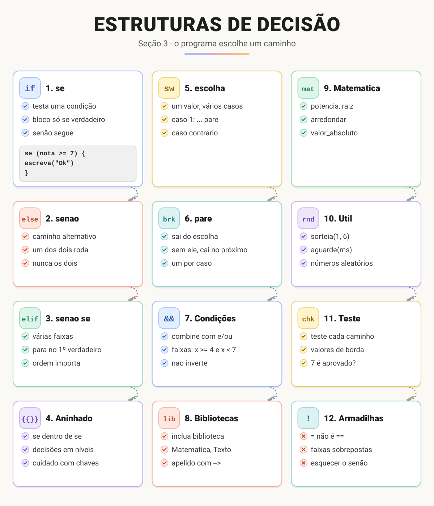
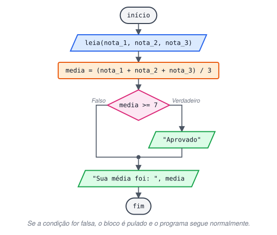
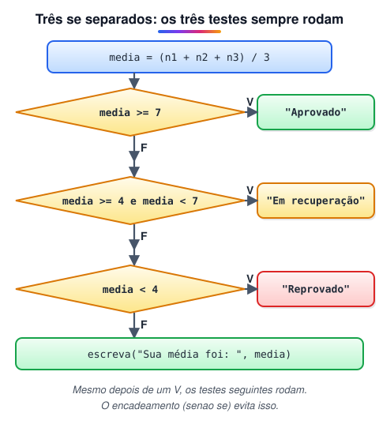

# Estrutura de Decisão Condicional Simples (SE)

> 🗺️ **Nesta aula:** o que é uma estrutura de decisão, como funciona o `se` simples e dois projetos de média: um com um `se` e outro com três `se` independentes.

## 🧭 Cheat sheet da seção

Antes de começar, veja o mapa da seção: é o que as próximas aulas vão explicar. Volte a ele no fim para revisar.



## De onde paramos

Na seção anterior, os operadores relacionais e lógicos produziam respostas `verdadeiro` ou `falso`, mas o programa só mostrava essas respostas. Agora ele vai usá-las para decidir o que fazer.

## Estruturas de decisão

Até aqui os programas executavam todas as instruções, de cima para baixo. Uma **estrutura de decisão** permite que o programa escolha um caminho durante a execução: em certo ponto ele faz uma pergunta (uma condição) e, conforme a resposta, executa ou pula um trecho de código.

## Decisão simples: se

Em pseudocódigo: `se <condição> então <instruções> fim se`.

- A condição é uma expressão lógica, normalmente uma comparação (`media >= 7`).
- Se ela for **verdadeira**, as instruções dentro do bloco são executadas.
- Se for **falsa**, o bloco é pulado e nada acontece. O programa continua na linha seguinte ao bloco.

```c
se (condicao) {
  // executado só se a condição for
  // verdadeira
}
// executado sempre, depois do se
```



> 💡 **Analogia:** é o "se estiver chovendo, leve o guarda-chuva". Se chove, você pega o guarda-chuva e sai; se não chove, simplesmente sai. Em nenhum dos casos você deixa de sair: o `se` só acrescenta um passo opcional no caminho.

## Projeto: média com decisão simples

**Código**

```c
programa
{
  // as três notas do aluno
  real nota_1, nota_2, nota_3
  real media

  funcao inicio()
  {
    escreva("Digite a primeira nota: ")
    leia(nota_1)
    escreva("Digite a segunda nota: ")
    leia(nota_2)
    escreva("Digite a terceira nota: ")
    leia(nota_3)

    // parênteses: soma primeiro, divide
    // depois
    media = (nota_1 + nota_2 + nota_3) / 3

    // a mensagem só aparece para quem
    // atingiu a média
    se (media >= 7) {
      escreva("Resultado: Aprovado, chefe!\n")
    }
    // fora do bloco: roda sempre
    escreva("Sua média foi: ", media, "\n")
  }
}
```

## Projeto: aprovado, recuperação e reprovado só com se

É possível cobrir as três situações com três `se` independentes, desde que as condições não se sobreponham:



> 💡 **Analogia:** é como um fiscal que confere três portas, uma depois da outra, mesmo já tendo encontrado a pessoa na primeira. Funciona, mas é trabalho repetido.

**Código**

```c
programa
{
  real nota_1, nota_2, nota_3
  real media

  funcao inicio()
  {
    escreva("Digite a primeira nota: ")
    leia(nota_1)
    escreva("Digite a segunda nota: ")
    leia(nota_2)
    escreva("Digite a terceira nota: ")
    leia(nota_3)

    media = (nota_1 + nota_2 + nota_3) / 3

    se (media >= 7) {
      escreva("Resultado: Aprovado, chefe!\n")
    }
    // o "e" fecha a faixa dos dois lados,
    // para não sobrepor com o se acima
    se ((media >= 4) e (media < 7)) {
      escreva("Em recuperação. Se esforce ",
        "mais que ainda dá para passar!\n")
    }
    se (media < 4) {
      escreva("Infelizmente não foi dessa ",
        "vez. Tente novamente no ano ",
        "que vem!\n")
    }
    escreva("Sua média foi: ", media, "\n")
  }
}
```

> 💡 Funciona, mas o programa testa as três condições mesmo depois de já ter encontrado a resposta. As próximas aulas mostram o `senao` e o `senao se`, que resolvem isso de forma mais limpa.

## 🧠 Revisão rápida

**Com notas 5, 6 e 7, o que o primeiro projeto mostra?**

Só "Sua média foi: 6.0". A média é 6, a condição `media >= 7` é falsa e o bloco é pulado.

**No projeto com três se, quantos testes são feitos para uma média 9?**

Três. O primeiro dá verdadeiro, mas os outros dois também são testados.

**O que acontece com a linha logo depois do bloco `se` quando a condição é falsa?**

Ela roda normalmente: só o bloco é pulado.

> ➡️ **Próximo passo:** e quando a condição é falsa e você quer fazer outra coisa, em vez de nada? É o papel do `senao`: **Estrutura de Decisão Condicional Composta (SE, SENÃO)**.

## 📌 Resumo

| Item | Em uma frase |
| --- | --- |
| Estrutura de decisão | Faz o programa escolher um caminho conforme uma condição |
| `se (condicao) { }` | Executa o bloco só se a condição for verdadeira |
| Condição falsa | O bloco é pulado e o programa segue na linha seguinte |
| Vários `se` independentes | Todos são testados, mesmo depois de achar a resposta |
