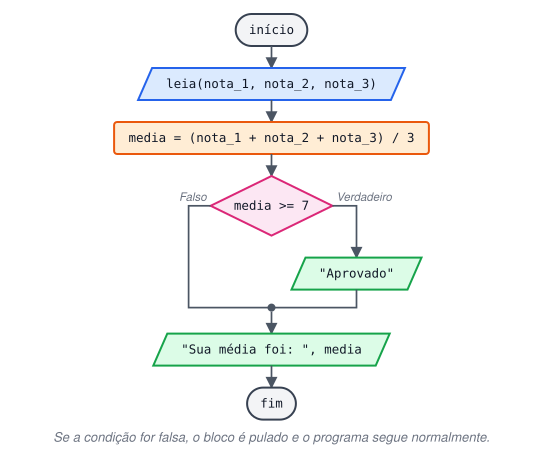
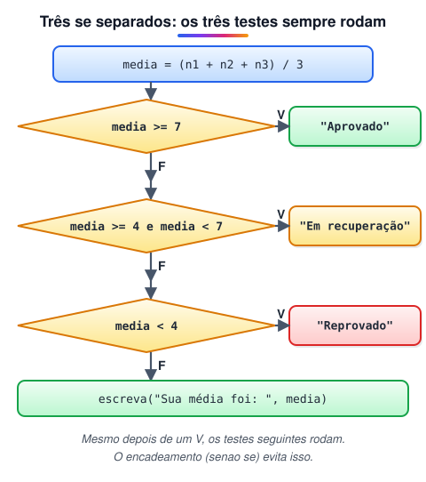

# Estrutura de Decisão Condicional Simples (SE)

> 🗺️ **Nesta aula:** o que é uma estrutura de decisão, como funciona o `se` simples e dois projetos de média: um com um `se` e outro com três `se` independentes.

## Estruturas de decisão

Até aqui os programas executavam todas as instruções, de cima para baixo. Uma **estrutura de decisão** permite que o programa escolha um caminho durante a execução: em certo ponto ele faz uma pergunta (uma condição) e, conforme a resposta, executa ou pula um trecho de código.

## Decisão simples: se

Em pseudocódigo: `se <condição> então <instruções> fim se`.

- A condição é uma expressão lógica, normalmente uma comparação (`media >= 7`).
- Se ela for **verdadeira**, as instruções dentro do bloco são executadas.
- Se for **falsa**, o bloco é pulado e nada acontece. O programa continua na linha seguinte ao bloco.

```c
se (condicao) {
  // executado só se a condição for verdadeira
}
// executado sempre, depois do se
```



## Projeto: média com decisão simples

**Código**

```c
programa
{
  real nota_1, nota_2, nota_3  // as três notas do aluno
  real media

  funcao inicio()
  {
    escreva("Digite a primeira nota: ")
    leia(nota_1)
    escreva("Digite a segunda nota: ")
    leia(nota_2)
    escreva("Digite a terceira nota: ")
    leia(nota_3)

    media = (nota_1 + nota_2 + nota_3) / 3

    se (media >= 7) {
      escreva("Resultado: Aprovado, chefe!\n")
    }
    escreva("Sua média foi: ", media, "\n")  // sempre executado
  }
}
```

## Projeto: aprovado, recuperação e reprovado só com se

É possível cobrir as três situações com três `se` independentes, desde que as condições não se sobreponham:



**Código**

```c
programa
{
  real nota_1, nota_2, nota_3
  real media

  funcao inicio()
  {
    escreva("Digite a primeira nota: ")
    leia(nota_1)
    escreva("Digite a segunda nota: ")
    leia(nota_2)
    escreva("Digite a terceira nota: ")
    leia(nota_3)

    media = (nota_1 + nota_2 + nota_3) / 3

    se (media >= 7) {
      escreva("Resultado: Aprovado, chefe!\n")
    }
    se ((media >= 4) e (media < 7)) {
      escreva("Em recuperação. Se esforce mais que ainda dá para passar!\n")
    }
    se (media < 4) {
      escreva("Infelizmente não foi dessa vez. Tente novamente no ano que vem!\n")
    }
    escreva("Sua média foi: ", media, "\n")
  }
}
```

> 💡 Funciona, mas o programa testa as três condições mesmo depois de já ter encontrado a resposta. As próximas aulas mostram o `senao` e o `senao se`, que resolvem isso de forma mais limpa.

## 📌 Resumo

| Item | Em uma frase |
| --- | --- |
| Estrutura de decisão | Faz o programa escolher um caminho conforme uma condição |
| `se (condicao) { }` | Executa o bloco só se a condição for verdadeira |
| Condição falsa | O bloco é pulado e o programa segue na linha seguinte |
| Vários `se` independentes | Todos são testados, mesmo depois de achar a resposta |
