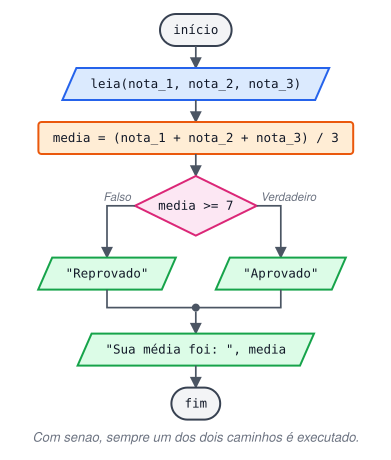
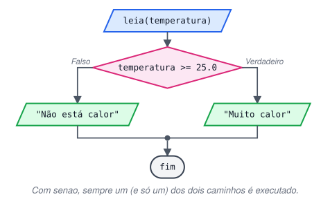

# Estrutura de Decisão Condicional Composta (SE, SENÃO)

> 🗺️ **Nesta aula:** a decisão composta com `se` e `senao`, em que sempre um dos dois caminhos é executado, com os projetos da média e da temperatura.

## Decisão composta: se / senao

Em pseudocódigo: `se <condição> então <instruções> senão <instruções> fim se`.

- Se a condição for **verdadeira**, executa o bloco do `se`.
- Se for **falsa**, executa o bloco do `senao`.
- Exatamente **um** dos dois blocos é executado, nunca os dois e nunca nenhum. Depois disso o programa continua normalmente.
- O `senao` não tem condição própria: ele é simplesmente o caminho do "se falso".

```c
se (condicao) {
  // executado se a condição for verdadeira
}
senao {
  // executado se a condição for falsa
}
// executado sempre, depois de um dos dois blocos
```



## Projeto: média com se / senao

**Código**

```c
programa
{
  real nota_1, nota_2, nota_3
  real media

  funcao inicio()
  {
    escreva("Digite a primeira nota: ")
    leia(nota_1)
    escreva("Digite a segunda nota: ")
    leia(nota_2)
    escreva("Digite a terceira nota: ")
    leia(nota_3)

    media = (nota_1 + nota_2 + nota_3) / 3

    se (media >= 7) {
      escreva("Resultado: Aprovado, chefe!\n")
    }
    senao {  // sem condição: é o caminho do "falso"
      escreva("Resultado: Reprovado. Deu ruim -_-\n")
    }

    escreva("Sua média foi: ", media, "\n")
  }
}
```

## Projeto: está calor?



**Código**

```c
programa
{
  real temperatura

  funcao inicio()
  {
    escreva("Qual a temperatura agora? ")
    leia(temperatura)

    se (temperatura >= 25.0) {
      escreva("Está ", temperatura, " °C. Muito calor, meu amigo.\n")
    }
    senao {
      escreva("Está ", temperatura, " °C. Que sorte, hoje não está calor.\n")
    }
  }
}
```

## 📌 Resumo

| Item | Em uma frase |
| --- | --- |
| `se` | Executado quando a condição é verdadeira |
| `senao` | Executado quando a condição é falsa; não tem condição própria |
| Garantia | Exatamente um dos dois blocos roda, nunca os dois nem nenhum |
| Depois | O programa segue normalmente após o bloco escolhido |
