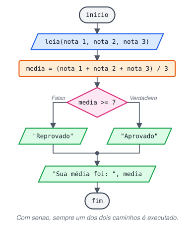
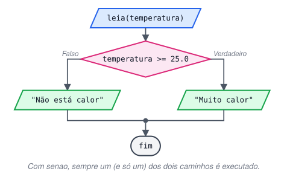

# Estrutura de Decisão Condicional Composta (SE, SENÃO)

> 🗺️ **Nesta aula:** a decisão composta com `se` e `senao`, em que sempre um dos dois caminhos é executado, com os projetos da média e da temperatura.

## De onde paramos

O `se` simples executa um bloco quando a condição é verdadeira e não faz nada quando é falsa. Muitas vezes, porém, o caso falso também precisa de uma resposta: "reprovado", "não está calor". É o papel do `senao`.

## Decisão composta: se / senao

Em pseudocódigo: `se <condição> então <instruções> senão <instruções> fim se`.

- Se a condição for **verdadeira**, executa o bloco do `se`.
- Se for **falsa**, executa o bloco do `senao`.
- Exatamente **um** dos dois blocos é executado, nunca os dois e nunca nenhum. Depois disso o programa continua normalmente.
- O `senao` não tem condição própria: ele é simplesmente o caminho do "se falso".

```c
se (condicao) {
  // executado se a condição for
  // verdadeira
}
senao {
  // executado se a condição for falsa
}
// executado sempre, depois de um dos
// dois blocos
```



> 💡 **Analogia:** é uma bifurcação na estrada sem acostamento. Ou você vira à esquerda, ou à direita; não dá para seguir pelas duas nem ficar parado. Depois, as duas pistas voltam a se juntar na mesma rodovia.

## Projeto: média com se / senao

**Código**

```c
programa
{
  real nota_1, nota_2, nota_3
  real media

  funcao inicio()
  {
    escreva("Digite a primeira nota: ")
    leia(nota_1)
    escreva("Digite a segunda nota: ")
    leia(nota_2)
    escreva("Digite a terceira nota: ")
    leia(nota_3)

    media = (nota_1 + nota_2 + nota_3) / 3

    se (media >= 7) {
      escreva("Resultado: Aprovado, chefe!\n")
    }
    // sem condição: é o caminho de todo
    // valor que não passou no teste acima
    senao {
      escreva("Resultado: Reprovado. ",
        "Deu ruim -_-\n")
    }

    // roda nos dois casos
    escreva("Sua média foi: ", media, "\n")
  }
}
```

## Projeto: está calor?



> 💡 **Analogia:** é o termostato do ar-condicionado. Ele faz uma única pergunta ("passou de 25 °C?") e sempre toma uma ação: liga o frio ou deixa desligado. Nunca fica sem resposta.

**Código**

```c
programa
{
  real temperatura

  funcao inicio()
  {
    escreva("Qual a temperatura agora? ")
    leia(temperatura)

    // >= faz o próprio 25 contar como calor
    se (temperatura >= 25.0) {
      escreva("Está ", temperatura,
        " °C. Muito calor, meu amigo.\n")
    }
    senao {
      escreva("Está ", temperatura,
        " °C. Que sorte, hoje não está ",
        "calor.\n")
    }
  }
}
```

> ⚠️ Erro comum: escrever uma condição no `senao`, como `senao (media < 7)`. Isso não existe: o `senao` já significa "caso contrário". Para testar outra condição, use `senao se`, visto na próxima aula.

## 🧠 Revisão rápida

**Com temperatura 25.0, qual mensagem aparece?**

"Muito calor": a condição é `>= 25.0`, então 25 já é verdadeira.

**Qual a diferença entre dois `se` separados e um `se`/`senao`?**

Com dois `se`, as duas condições são testadas e podem rodar zero, um ou os dois blocos. Com `se`/`senao`, só uma condição é testada e exatamente um bloco roda.

**O `senao` pode ter uma condição entre parênteses?**

Não. Para testar outra condição, use `senao se`.

> ➡️ **Próximo passo:** dois caminhos nem sempre bastam (aprovado, recuperação, reprovado). A próxima aula encadeia vários testes: **Estrutura de Decisão Condicional Encadeada (SE, SENÃO SE, SENÃO)**.

## 📌 Resumo

| Item | Em uma frase |
| --- | --- |
| `se` | Executado quando a condição é verdadeira |
| `senao` | Executado quando a condição é falsa; não tem condição própria |
| Garantia | Exatamente um dos dois blocos roda, nunca os dois nem nenhum |
| Depois | O programa segue normalmente após o bloco escolhido |
