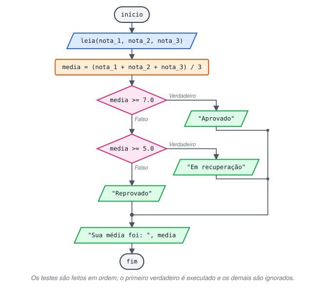
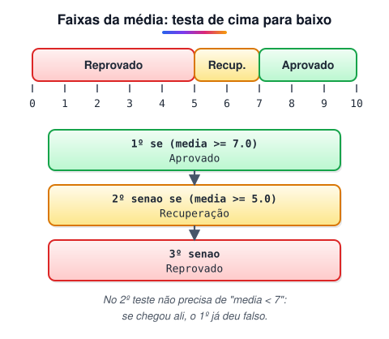
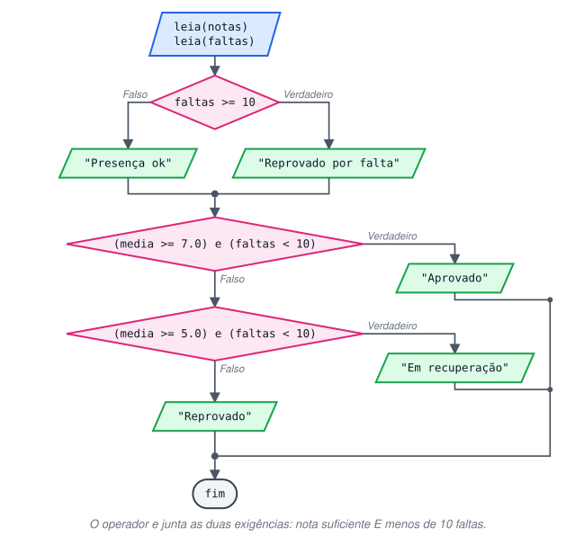

# Estrutura de Decisão Condicional Encadeada (SE, SENÃO SE, SENÃO)

> 🗺️ **Nesta aula:** como encadear condições com `senao se` quando há mais de dois caminhos, por que a ordem dos testes importa e o desafio da média com faltas.

## De onde paramos

O `se`/`senao` resolve escolhas de dois caminhos. Mas a média do aluno tem três resultados (aprovado, recuperação, reprovado), e três `se` separados repetem testes à toa. A solução é encadear.

## Decisão encadeada: se / senao se / senao

Quando há mais de dois caminhos possíveis, encadeamos várias condições:

- O programa testa as condições **em ordem**, de cima para baixo.
- Executa o bloco da **primeira condição verdadeira** e ignora todas as demais, mesmo que alguma delas também fosse verdadeira.
- O `senao` final é opcional e funciona como "nenhuma das anteriores": só é executado se todas as condições forem falsas.

> 💡 Entre o primeiro `se` e o `senao` final cabem quantos `senao se` forem necessários.

```c
se (condicao_1) {
  // condição 1 verdadeira
}
senao se (condicao_2) {
  // 1 falsa e 2 verdadeira
}
senao se (condicao_3) {
  // 1 e 2 falsas e 3 verdadeira
}
senao {
  // todas as condições falsas
}
// executado sempre, depois da cadeia
```



> 💡 **Analogia:** é a triagem de um pronto-socorro. A enfermeira pergunta primeiro o mais grave ("está inconsciente?"), depois o médio ("tem febre alta?"), e assim por diante. Na primeira resposta "sim", o paciente já vai para a fila certa, e as outras perguntas nem são feitas.

Como os testes são feitos em ordem, o segundo não precisa repetir o limite superior: se o programa chegou ao `media >= 5.0`, já se sabe que a média é menor que 7.



> 💡 **Analogia:** pense em peneiras empilhadas. A de cima, de malha grossa, segura só as pedras grandes (média ≥ 7); a de baixo segura as médias (≥ 5); o que passa por todas cai no fundo (reprovado). Se a peneira de malha fina ficasse em cima, ela seguraria tudo, inclusive as pedras grandes.

> ⚠️ **A ordem importa.** Se o primeiro teste fosse `media >= 5.0`, uma média 9 cairia nele e o aluno apareceria "em recuperação". Teste sempre da condição mais restrita para a mais ampla.

## Projeto: média com se / senao se / senao

**Código**

```c
programa
{
  real nota_1, nota_2, nota_3
  real media

  funcao inicio()
  {
    escreva("Digite a primeira nota: ")
    leia(nota_1)
    escreva("Digite a segunda nota: ")
    leia(nota_2)
    escreva("Digite a terceira nota: ")
    leia(nota_3)

    media = (nota_1 + nota_2 + nota_3) / 3

    // 1º teste: o mais restrito vem antes
    se (media >= 7.0) {
      escreva("Resultado: Aprovado, chefe!\n")
    }
    // 2º teste: só chega aqui se media < 7,
    // por isso não precisa repetir o limite
    senao se (media >= 5.0) {
      escreva("Em recuperação! Calma que ",
        "ainda dá.\n")
    }
    // todos os testes deram falso
    senao {
      escreva("Reprovado. Esse ano não deu, ",
        "mas ano que vem tem mais.\n")
    }

    escreva("Sua média foi: ", media, "\n")
  }
}
```

## Desafio: média e faltas

Calcule a média e verifique também as faltas: com 10 faltas ou mais, o aluno é reprovado independentemente da nota.



> 💡 **Analogia:** é a catraca de um show. Antes de olhar qual é o seu setor (a nota), o segurança confere se você tem ingresso (a frequência). Sem ingresso, o setor nem importa.

<details>
<summary>Ver resposta</summary>

```c
programa
{
  real nota_1, nota_2, nota_3
  real media
  // faltas são contadas, então inteiro
  inteiro faltas

  funcao inicio()
  {
    escreva("Digite a primeira nota: ")
    leia(nota_1)
    escreva("Digite a segunda nota: ")
    leia(nota_2)
    escreva("Digite a terceira nota: ")
    leia(nota_3)
    escreva("Digite a quantidade de faltas: ")
    leia(faltas)

    media = (nota_1 + nota_2 + nota_3) / 3

    // 1ª decisão: frequência, porque ela
    // reprova sozinha, qualquer que seja
    // a nota
    se (faltas >= 10) {
      escreva("\nReprovado por falta, ",
        "independentemente da nota.\n")
    }
    senao {
      escreva("\nVocê está dentro do ",
        "limite de faltas.\n")
    }
    escreva("Quantidade de faltas: ",
      faltas, "\n")

    // 2ª decisão: o "e" exige nota E
    // presença ao mesmo tempo
    se ((media >= 7.0) e (faltas < 10)) {
      escreva("Resultado: Aprovado, chefe!\n")
    }
    senao se ((media >= 5.0) e (faltas < 10)) {
      escreva("Em recuperação! Calma que ",
        "ainda dá.\n")
    }
    senao {
      escreva("Reprovado. Esse ano não deu, ",
        "mas ano que vem tem mais.\n")
    }

    escreva("Sua média foi: ", media, "\n")
  }
}
```

</details>

## 🧠 Revisão rápida

**Com média 7.5, quantas condições da cadeia são testadas?**

Só uma. `media >= 7.0` é verdadeira, o bloco roda e o resto da cadeia é pulado.

**Com média 3 e 2 faltas, qual mensagem final aparece no desafio?**

"Reprovado...". As duas primeiras condições são falsas (a média é menor que 5), então cai no `senao`.

**Por que o segundo teste não precisa ser `(media >= 5.0) e (media < 7.0)`?**

Porque ele só é avaliado quando o primeiro deu falso, ou seja, quando já se sabe que a média é menor que 7.

> ➡️ **Próximo passo:** quando todas as perguntas são do tipo "a variável vale exatamente X?", há um jeito mais limpo que a cadeia de `senao se`: **Estrutura de Decisão Condicional Escolha Caso**.

## 📌 Resumo

| Item | Em uma frase |
| --- | --- |
| `senao se` | Testa outra condição quando as anteriores foram falsas |
| Ordem | Os testes são feitos de cima para baixo; vale a primeira condição verdadeira |
| Limites | Cada teste já sabe que os anteriores falharam, então não precisa repeti-los |
| `senao` final | Opcional; roda quando todas as condições são falsas |
| Várias regras | Combine condições com `e`/`ou` (média e faltas) |
