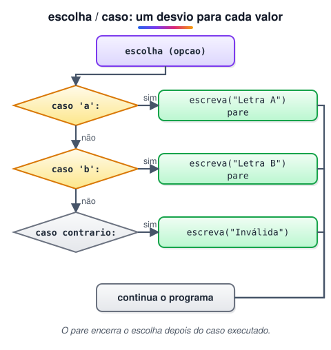
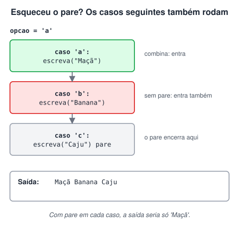

# Estrutura de Decisão Condicional Escolha Caso

> 🗺️ **Nesta aula:** o `escolha`/`caso` como alternativa a longas cadeias de `senao se`, o papel do `pare` e do `caso contrario`, e um menu de letras.

## De onde paramos

A cadeia de `senao se` resolve qualquer decisão com vários caminhos. Mas, quando todas as perguntas são "a variável vale exatamente 1? 2? 3?", ela fica longa e repetitiva. O `escolha` foi feito para esse caso.

## Para que serve

O `escolha` seleciona uma opção entre várias, comparando **uma variável** com uma lista de valores possíveis. Ele substitui uma sequência longa de `se ... senao se` quando todas as condições são do tipo "a variável é igual a tal valor?".

- Deixa o código mais curto e fácil de ler.
- Facilita a depuração e a inclusão de novas opções.
- Funciona com valores exatos (`inteiro` ou `caracter`), não com faixas como `nota >= 7`. Para faixas, use `se`.

## Sintaxe

```c
escolha (variavel) {
  caso valor_1:
    // comandos para o valor 1
    pare
  caso valor_2:
    // comandos para o valor 2
    pare
  caso valor_3:
    // comandos para o valor 3
    pare
  caso contrario:
    // nenhum caso combinou
}
```

- `pare` encerra o `escolha`. Sem ele, o programa continua executando os comandos dos casos seguintes, mesmo que não combinem.
- `caso contrario` é o "nenhuma das anteriores", como o `senao` final. É opcional e, por ser o último, não precisa de `pare`.



> 💡 **Analogia:** é o elevador de um prédio. Você aperta um número e ele vai direto àquele andar, sem parar em cada um para perguntar "é este?". O `caso contrario` é o aviso "andar inexistente" quando alguém digita 99.



> 💡 **Analogia:** o `pare` é a porta do elevador abrindo no andar certo. Sem ele, o elevador abre no seu andar e continua descendo, abrindo a porta em todos os andares abaixo.

## Projeto: escolhendo uma letra

**Código**

```c
programa
{
  // caracter porque a opção é uma letra
  caracter opcao

  funcao inicio()
  {
    escreva("Digite uma letra (opções ",
      "válidas: a, b, c): ")
    leia(opcao)

    escolha (opcao) {
      // letras entre aspas simples:
      // é um caractere, não uma cadeia
      caso 'a':
        escreva("A opção escolhida foi ",
          "a letra A\n")
        // sem o pare, mostraria B e C também
        pare
      caso 'b':
        escreva("A opção escolhida foi ",
          "a letra B\n")
        pare
      caso 'c':
        escreva("A opção escolhida foi ",
          "a letra C\n")
        pare
      // qualquer outra tecla cai aqui
      caso contrario:
        escreva("Você digitou uma opção ",
          "inválida\n")
    }
  }
}
```

> 💡 A comparação diferencia maiúsculas de minúsculas: digitar `A` cai no `caso contrario`, porque `'A'` e `'a'` são caracteres diferentes.

## 🧠 Revisão rápida

**Dá para usar `escolha` para testar `nota >= 7`?**

Não. O `escolha` só compara com valores exatos; para faixas, use `se`.

**O que acontece se o `caso 'a'` não tiver `pare` e o usuário digitar `a`?**

Aparecem as mensagens de A, B e C: o programa continua nos casos seguintes até encontrar um `pare`.

**O `caso contrario` precisa de `pare`?**

Não: ele é o último, então o `escolha` termina logo depois.

> ➡️ **Próximo passo:** o Portugol já traz funções prontas para matemática, texto e datas. A próxima aula mostra como usá-las: **Como usar Bibliotecas e suas Funções no Portugol Studio**.

## 📌 Resumo

| Item | Em uma frase |
| --- | --- |
| `escolha (variavel)` | Compara uma variável com uma lista de valores exatos |
| `caso valor:` | Bloco executado quando a variável tem esse valor |
| `pare` | Encerra o `escolha`; sem ele, os casos seguintes também rodam |
| `caso contrario` | Nenhum caso combinou (como o `senao` final) |
| Limite | Só valores exatos (inteiro ou caractere); para faixas, use `se` |
