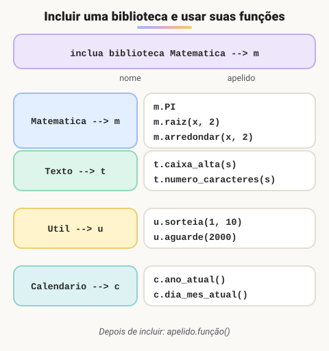

# Como usar Bibliotecas e suas Funções no Portugol Studio

> 🗺️ **Nesta aula:** o que é uma biblioteca, por que usá-las, como incluí-las com apelido no Portugol e projetos com `Matematica`, `Texto`, `Calendario` e `Util`.

## De onde paramos

Até aqui, tudo o que os programas faziam foi escrito por você, linha a linha. Mas tarefas comuns (raiz quadrada, letras maiúsculas, data de hoje) já foram resolvidas por alguém. As bibliotecas trazem essas soluções prontas.

## O que é uma biblioteca

É um conjunto de código pronto, organizado para ser reaproveitado em vários programas. Em vez de escrever do zero uma função para calcular raiz quadrada ou converter texto para maiúsculas, o programa inclui a biblioteca que já faz isso. Uma biblioteca pode conter funções, procedimentos, constantes, classes, tipos, documentação e dados de configuração.

## Vantagens

- **Reaproveitamento**: não é preciso reinventar a roda.
- **Rapidez**: o desenvolvimento anda mais rápido com funções prontas e testadas.
- **Organização**: o código fica dividido em módulos.
- **Manutenção**: uma correção na biblioteca vale para todos os programas que a usam.

## Incluindo uma biblioteca no Portugol

```c
inclua biblioteca NomeDaBiblioteca --> apelido
```

A linha vai logo no início do `programa`. O **apelido** (alias) é um nome curto usado para chamar os recursos da biblioteca no formato `apelido.recurso`: `m.PI`, `t.caixa_alta(nome)`.



> 💡 **Analogia:** é uma caixa de ferramentas emprestada do vizinho. O `inclua` é pegar a caixa e colocar uma etiqueta nela ("m" para a de matemática). Depois, para usar uma ferramenta, você diz de qual caixa ela vem: `m.raiz` é "a chave de raiz da caixa m".

> 💡 A lista completa das bibliotecas e funções fica na Ajuda do Portugol Studio (menu Ajuda → Bibliotecas), com a descrição de cada função e de seus parâmetros.

> ⚠️ Sem o apelido na frente (`PI` em vez de `m.PI`), o Portugol não encontra o recurso e acusa erro. E o nome da biblioteca não tem acento: `Matematica`, `Calendario`.

## Projeto: testando bibliotecas

**Código**

```c
programa
{
  // cada biblioteca ganha um apelido curto
  // para não repetir o nome inteiro
  inclua biblioteca Util --> u
  inclua biblioteca Texto --> t
  inclua biblioteca Calendario --> c
  inclua biblioteca Matematica --> m

  cadeia nome

  funcao inicio()
  {
    // Matematica: constante PI pronta,
    // com mais casas do que digitaríamos
    escreva(m.PI, "\n")

    // Texto: converte para maiúsculas
    escreva("\nDigite seu nome: ")
    leia(nome)
    escreva("Caixa alta: ",
      t.caixa_alta(nome), "\n")

    // Calendario: lê a data do computador
    escreva("\nDia: ", c.dia_mes_atual(), "\n")
    escreva("Ano: ", c.ano_atual(), "\n")

    // Util: pausa a execução; o valor é
    // em milissegundos (2000 ms = 2 s)
    escreva("\nDe 0 a 10, pausa de 2 s:\n")
    para (inteiro i = 0; i <= 10; i++) {
      escreva(i, "\n")
      u.aguarde(2000)
    }
  }
}
```

O laço `para` usado no final é explicado na seção de estruturas de repetição.

## Projeto: radiciação com qualquer índice

A função `m.raiz(radicando, indice)` calcula a raiz de qualquer índice: `m.raiz(27.0, 3.0)` é a raiz cúbica de 27, que dá 3.

**Código**

```c
programa
{
  inclua biblioteca Matematica --> m

  // real: raízes quase nunca dão inteiros
  real radicando, indice, raiz

  funcao inicio()
  {
    escreva("Digite o radicando: ")
    leia(radicando)

    escreva("Digite o índice: ")
    leia(indice)

    // a biblioteca faz a conta; nós só
    // passamos os dois valores
    raiz = m.raiz(radicando, indice)

    escreva("\nRaiz de índice ", indice)
    escreva(" de ", radicando, ": ",
      raiz, "\n")
  }
}
```

Teste: 27 e 3 → `Raiz de índice 3.0 de 27.0: 3.0`.

## 🧠 Revisão rápida

**Qual linha inclui a biblioteca Texto com o apelido `t`?**

`inclua biblioteca Texto --> t`

**Quanto vale `m.raiz(16.0, 2.0)`? E `m.raiz(8.0, 3.0)`?**

4 (raiz quadrada de 16) e 2 (raiz cúbica de 8).

**Quanto tempo o programa espera em `u.aguarde(500)`?**

Meio segundo: o valor é em milissegundos.

> ➡️ **Próximo passo:** a biblioteca `Util` tem um recurso que deixa programas bem mais divertidos: **Gerar números aleatórios com biblioteca "Util"**.

## 📌 Resumo

| Item | Em uma frase |
| --- | --- |
| Biblioteca | Código pronto e testado para reaproveitar em vários programas |
| Incluir | `inclua biblioteca Nome --> apelido`, logo no início do `programa` |
| Usar | `apelido.recurso`, por exemplo `m.PI` ou `t.caixa_alta(nome)` |
| `Matematica` | `m.PI`, `m.raiz(radicando, indice)` |
| `Texto` | `t.caixa_alta()`, `t.numero_caracteres()` |
| `Calendario` | `c.dia_mes_atual()`, `c.ano_atual()` |
| `Util` | `u.aguarde(ms)`, `u.sorteia(ini, fim)` |
