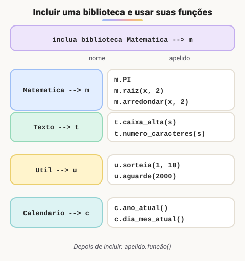

# Como usar Bibliotecas e suas Funções no Portugol Studio

> 🗺️ **Nesta aula:** o que é uma biblioteca, por que usá-las, como incluí-las com apelido no Portugol e projetos com `Matematica`, `Texto`, `Calendario` e `Util`.

## O que é uma biblioteca

É um conjunto de código pronto, organizado para ser reaproveitado em vários programas. Em vez de escrever do zero uma função para calcular raiz quadrada ou converter texto para maiúsculas, o programa inclui a biblioteca que já faz isso. Uma biblioteca pode conter funções, procedimentos, constantes, classes, tipos, documentação e dados de configuração.

## Vantagens

- **Reaproveitamento**: não é preciso reinventar a roda.
- **Rapidez**: o desenvolvimento anda mais rápido com funções prontas e testadas.
- **Organização**: o código fica dividido em módulos.
- **Manutenção**: uma correção na biblioteca vale para todos os programas que a usam.

## Incluindo uma biblioteca no Portugol

```c
inclua biblioteca NomeDaBiblioteca --> apelido
```

A linha vai logo no início do `programa`. O **apelido** (alias) é um nome curto usado para chamar os recursos da biblioteca no formato `apelido.recurso`: `m.PI`, `t.caixa_alta(nome)`.



> 💡 A lista completa das bibliotecas e funções fica na Ajuda do Portugol Studio (menu Ajuda → Bibliotecas), com a descrição de cada função e de seus parâmetros.

## Projeto: testando bibliotecas

**Código**

```c
programa
{
  inclua biblioteca Util --> u
  inclua biblioteca Texto --> t
  inclua biblioteca Calendario --> c
  inclua biblioteca Matematica --> m

  cadeia nome

  funcao inicio()
  {
    // Matematica: constante PI
    escreva(m.PI, "\n")

    // Texto: converte para maiúsculas
    escreva("\nDigite seu nome: ")
    leia(nome)
    escreva("Seu nome em caixa alta: ", t.caixa_alta(nome), "\n")

    // Calendario: data atual
    escreva("\nEstamos no dia: ", c.dia_mes_atual(), "\n")
    escreva("Do ano de: ", c.ano_atual(), "\n")

    // Util: pausa a execução (em milissegundos)
    escreva("\nContando de 0 a 10, com pausa de 2 segundos entre os números:\n")
    para (inteiro i = 0; i <= 10; i++) {
      escreva(i, "\n")
      u.aguarde(2000)  // 2000 ms = 2 s
    }
  }
}
```

O laço `para` usado no final é explicado na seção de estruturas de repetição.

## Projeto: radiciação com qualquer índice

A função `m.raiz(radicando, indice)` calcula a raiz de qualquer índice: `m.raiz(27.0, 3.0)` é a raiz cúbica de 27, que dá 3.

**Código**

```c
programa
{
  inclua biblioteca Matematica --> m

  real radicando, indice, raiz

  funcao inicio()
  {
    escreva("Digite o radicando: ")
    leia(radicando)

    escreva("Digite o índice: ")
    leia(indice)

    raiz = m.raiz(radicando, indice)

    escreva("\nA raiz de índice ", indice, " de ", radicando, " é: ", raiz, "\n")
  }
}
```

## 📌 Resumo

| Item | Em uma frase |
| --- | --- |
| Biblioteca | Código pronto e testado para reaproveitar em vários programas |
| Incluir | `inclua biblioteca Nome --> apelido`, logo no início do `programa` |
| Usar | `apelido.recurso`, por exemplo `m.PI` ou `t.caixa_alta(nome)` |
| `Matematica` | `m.PI`, `m.raiz(radicando, indice)` |
| `Texto` | `t.caixa_alta()`, `t.numero_caracteres()` |
| `Calendario` | `c.dia_mes_atual()`, `c.ano_atual()` |
| `Util` | `u.aguarde(ms)`, `u.sorteia(ini, fim)` |
