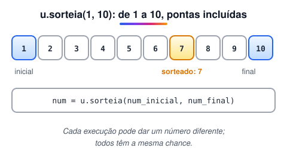

# Gerar números aleatórios com biblioteca “Util”

> 🗺️ **Nesta aula:** o que são números aleatórios (e pseudoaleatórios), a função `u.sorteia` da biblioteca `Util` e dois projetos de sorteio.

## De onde paramos

Na aula de bibliotecas, a `Util` apareceu com o `u.aguarde`. Ela tem outro recurso muito usado em jogos e testes: sortear números.

## O que é um número aleatório

É um número gerado pelo próprio programa, sem que se saiba de antemão qual será, como no lançamento de um dado. Serve para jogos, sorteios, simulações e testes com dados variados.

A palavra vem do latim *alea*, que quer dizer "dado" ou "sorte". Daí a famosa frase *alea jacta est*: "a sorte está lançada".

> 💡 Na verdade o computador gera números **pseudoaleatórios**: eles vêm de um cálculo matemático, mas a sequência é tão imprevisível que, na prática, funcionam como sorteio.

## No Portugol: u.sorteia()

A função `sorteia` da biblioteca `Util` devolve um número inteiro dentro de um intervalo, **incluindo** os dois extremos.

```c
inclua biblioteca Util --> u

// simula um dado: 1, 2, 3, 4, 5 ou 6
numero = u.sorteia(1, 6)
```



> 💡 **Analogia:** é um saquinho de bingo com uma bola para cada número do intervalo, do primeiro ao último, sem faltar nenhum. `u.sorteia(1, 6)` coloca as bolas 1 a 6 no saquinho, mistura e tira uma. Depois a bola volta para o saquinho, por isso um próximo sorteio pode repetir o número.

> ⚠️ O primeiro argumento precisa ser menor ou igual ao segundo. `u.sorteia(10, 1)` gera erro de execução.

## Projeto: sorteio no intervalo escolhido

**Código**

```c
programa
{
  inclua biblioteca Util --> u

  inteiro num_inicial, num_final
  inteiro num_sorteado

  funcao inicio()
  {
    escreva("Primeiro número do ",
      "intervalo: ")
    leia(num_inicial)

    escreva("Último número do intervalo: ")
    leia(num_final)

    // os extremos entram no sorteio; o
    // primeiro precisa ser <= o segundo
    num_sorteado = u.sorteia(num_inicial,
      num_final)

    escreva("\nNúmero sorteado: ",
      num_sorteado, "\n")
  }
}
```

## Projeto: vários sorteios no mesmo intervalo

O laço `para` (visto mais adiante) repete o sorteio uma vez para cada número do intervalo: de 1 a 5, por exemplo, são 5 sorteios. Os números podem se repetir, porque cada sorteio é independente dos anteriores.

**Código**

```c
programa
{
  inclua biblioteca Util --> u

  inteiro num_inicial, num_final, sorteado

  funcao inicio()
  {
    escreva("Primeiro número do ",
      "intervalo: ")
    leia(num_inicial)

    escreva("Último número do intervalo: ")
    leia(num_final)

    escreva("\nSorteios:\n")

    // o i só conta quantas vezes repetir:
    // um sorteio por número do intervalo
    para (inteiro i = num_inicial;
      i <= num_final; i++) {
      // cada chamada é um sorteio novo,
      // independente dos anteriores
      sorteado = u.sorteia(num_inicial,
        num_final)
      escreva("Número gerado: ",
        sorteado, "\n")
    }
  }
}
```

## 🧠 Revisão rápida

**Quais valores `u.sorteia(0, 3)` pode devolver?**

0, 1, 2 ou 3: os dois extremos estão incluídos.

**Como sortear uma moeda (cara ou coroa)?**

Use `u.sorteia(0, 1)` e trate 0 como cara e 1 como coroa, com um `se`.

**Dois sorteios seguidos de `u.sorteia(1, 6)` podem dar o mesmo número?**

Sim: cada sorteio é independente, como lançar o dado de novo.

> ➡️ **Próximo passo:** decisões, bibliotecas e sorteios juntos na **2ª Lista de exercícios**.

## 📌 Resumo

| Item | Em uma frase |
| --- | --- |
| Aleatório | Número que não se sabe de antemão, como num lançamento de dado |
| Pseudoaleatório | Gerado por cálculo, mas imprevisível na prática |
| `u.sorteia(a, b)` | Inteiro entre `a` e `b`, incluindo os dois extremos |
| Vários sorteios | Cada um é independente; os números podem se repetir |
