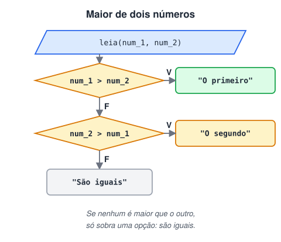
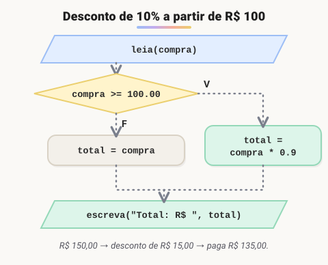
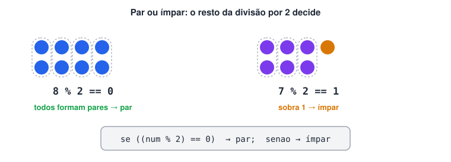
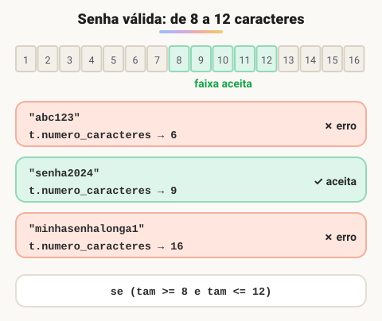
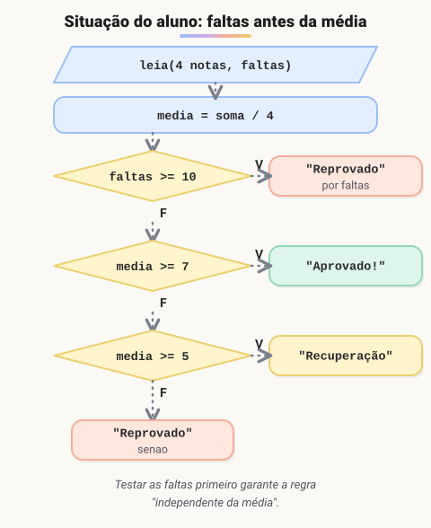
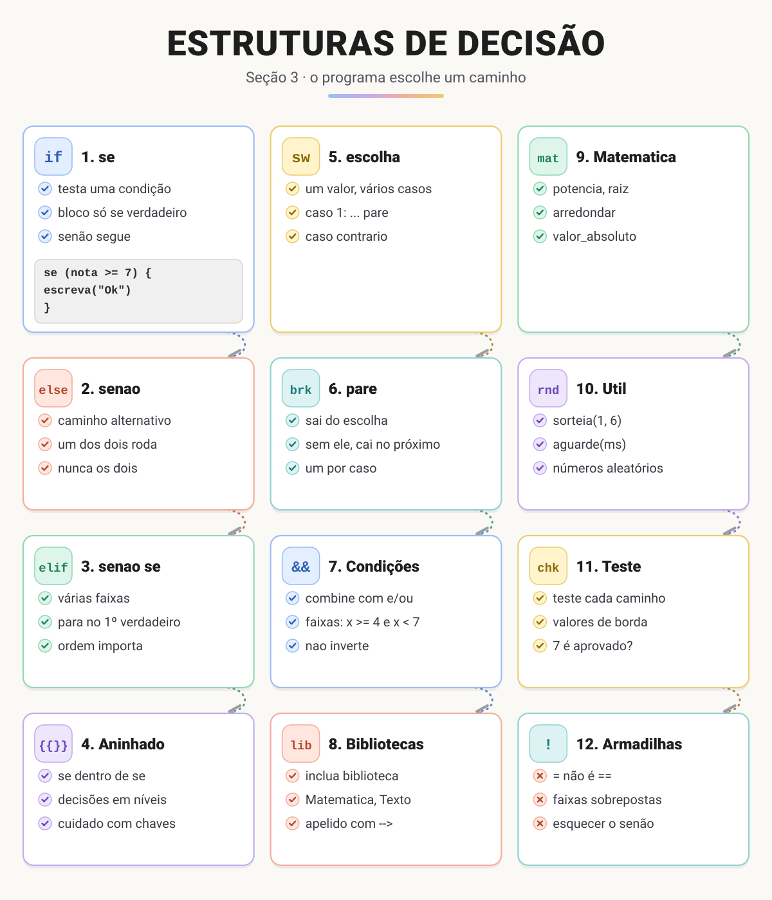

# 2ª Lista de exercícios

> 🗺️ **Nesta lista:** nove exercícios de decisão: comparações, descontos, idades, par ou ímpar, metas, validação de senha, situação do aluno e sorteios.

## De onde paramos

A seção mostrou o `se`, o `senao`, o `senao se`, o `escolha`, as bibliotecas e os sorteios. Agora é praticar decisões em problemas do dia a dia.

Cada exercício traz o enunciado e a resolução, que fica recolhida: tente resolver antes de abrir. O arquivo `.por` original de cada exercício fica logo abaixo do enunciado. Quando a resolução original foi além do enunciado, ela aparece como versão estendida.

> 💡 **Antes de codificar uma decisão:** liste todos os casos possíveis (inclusive o empate) e decida a ordem dos testes. A regra que vale "independentemente" das outras vem primeiro.

## Exercício 1: maior e menor

Leia dois números e indique qual é o menor e qual é o maior.



> 💡 **Analogia:** é uma queda de braço. Ou o primeiro vence, ou o segundo vence, ou dá empate. Esquecer o empate é o erro mais comum: o programa precisa de uma resposta para os três finais.

<details>
<summary>Ver resposta</summary>

```c
programa
{
  inteiro num_1, num_2

  funcao inicio()
  {
    escreva("Digite o 1º número: ")
    leia(num_1)
    escreva("Digite o 2º número: ")
    leia(num_2)

    se (num_1 > num_2) {
      escreva("\nMaior: ", num_1)
      escreva(" | Menor: ", num_2, "\n")
    }
    senao se (num_2 > num_1) {
      escreva("\nMaior: ", num_2)
      escreva(" | Menor: ", num_1, "\n")
    }
    // sobrou só o empate: não precisa
    // testar num_1 == num_2
    senao {
      escreva("\nOs números são iguais.\n")
    }
  }
}
```

</details>

## Exercício 2: a pessoa mais alta

Leia os nomes e as alturas (em metros) de duas pessoas e mostre os dados da mais alta.

<details>
<summary>Ver resposta</summary>

```c
programa
{
  cadeia nome_1, nome_2
  // real: altura tem casas decimais
  real alt_1, alt_2

  funcao inicio()
  {
    escreva("Nome da 1ª pessoa: ")
    leia(nome_1)
    escreva("Altura da 1ª pessoa (m): ")
    leia(alt_1)
    escreva("Nome da 2ª pessoa: ")
    leia(nome_2)
    escreva("Altura da 2ª pessoa (m): ")
    leia(alt_2)

    // compara as alturas, mas mostra o
    // nome que acompanha a vencedora
    se (alt_1 > alt_2) {
      escreva("\nMais alta: ", nome_1)
      escreva(", com ", alt_1, " m\n")
    }
    senao se (alt_2 > alt_1) {
      escreva("\nMais alta: ", nome_2)
      escreva(", com ", alt_2, " m\n")
    }
    senao {
      escreva("\n", nome_1, " e ", nome_2)
      escreva(" têm ", alt_1, " m\n")
    }
  }
}
```

</details>

<details>
<summary>Ver versão estendida: altura e idade</summary>

```c
programa
{
  cadeia nom_1, nom_2
  real alt_1, alt_2
  inteiro idade_1, idade_2

  funcao inicio()
  {
    escreva("Nome da 1ª pessoa: ")
    leia(nom_1)
    escreva("Idade da 1ª pessoa: ")
    leia(idade_1)
    escreva("Altura da 1ª pessoa: ")
    leia(alt_1)
    escreva("\nNome da 2ª pessoa: ")
    leia(nom_2)
    escreva("Idade da 2ª pessoa: ")
    leia(idade_2)
    escreva("Altura da 2ª pessoa: ")
    leia(alt_2)

    // 9 combinações: 3 resultados de
    // altura x 3 resultados de idade
    se (alt_1 > alt_2 e idade_1 > idade_2) {
      escreva("\n1ª: mais alta e mais ",
        "velha.\n")
    }
    senao se (alt_1 > alt_2
      e idade_1 < idade_2) {
      escreva("\n1ª: mais alta; 2ª: mais ",
        "velha.\n")
    }
    senao se (alt_1 > alt_2
      e idade_1 == idade_2) {
      escreva("\n1ª: mais alta; mesma ",
        "idade.\n")
    }
    senao se (alt_1 < alt_2
      e idade_1 > idade_2) {
      escreva("\n2ª: mais alta; 1ª: mais ",
        "velha.\n")
    }
    senao se (alt_1 < alt_2
      e idade_1 < idade_2) {
      escreva("\n2ª: mais alta e mais ",
        "velha.\n")
    }
    senao se (alt_1 < alt_2
      e idade_1 == idade_2) {
      escreva("\n2ª: mais alta; mesma ",
        "idade.\n")
    }
    senao se (alt_1 == alt_2
      e idade_1 > idade_2) {
      escreva("\nMesma altura; 1ª mais ",
        "velha.\n")
    }
    senao se (alt_1 == alt_2
      e idade_1 < idade_2) {
      escreva("\nMesma altura; 2ª mais ",
        "velha.\n")
    }
    // única combinação que sobrou
    senao {
      escreva("\nMesma altura e mesma ",
        "idade.\n")
    }

    escreva("1ª: ", nom_1, ", ", idade_1)
    escreva(" anos, ", alt_1, " m\n")
    escreva("2ª: ", nom_2, ", ", idade_2)
    escreva(" anos, ", alt_2, " m\n")
  }
}
```

</details>

## Exercício 3: desconto da loja

Uma loja dá 10% de desconto em compras de no mínimo R$ 100,00. Leia o valor da compra e calcule o total a pagar, já com o desconto quando houver.



> 💡 **Analogia:** é o "frete grátis acima de R$ 100" das lojas online. Quem chega no valor mínimo, mesmo exato, ganha o benefício; quem fica um centavo abaixo, não.

<details>
<summary>Ver resposta</summary>

```c
programa
{
  real compra, total

  funcao inicio()
  {
    escreva("Valor da compra (R$): ")
    leia(compra)

    // >= porque "no mínimo 100" inclui
    // o próprio 100
    se (compra >= 100.00) {
      // tira 10% (o mesmo que compra * 0.9)
      total = compra - compra * 10 / 100
    }
    senao {
      total = compra
    }

    escreva("Total a pagar: R$ ", total, "\n")
  }
}
```

</details>

<details>
<summary>Ver versão estendida: descontos de 10%, 20% e 30% (corrigida)</summary>

```c
programa
{
  real compra, valor_desconto, total
  inteiro desconto
  cadeia nome_cliente

  funcao inicio()
  {
    escreva("Nome do cliente: ")
    leia(nome_cliente)
    escreva("Valor da compra (R$): ")
    leia(compra)

    // da faixa mais alta para a mais baixa,
    // senão 600 cairia nos 10%
    se (compra >= 500.00) {
      desconto = 30
    }
    senao se (compra >= 300.00) {
      desconto = 20
    }
    senao se (compra >= 100.00) {
      desconto = 10
    }
    senao {
      desconto = 0
    }

    // porcentagem: valor * taxa / 100
    valor_desconto = compra * desconto / 100
    total = compra - valor_desconto

    escreva("\nCliente: ", nome_cliente, "\n")
    escreva("Compra: R$ ", compra)
    escreva(" | Desconto: ", desconto, "%\n")
    escreva("Total a pagar: R$ ", total, "\n")
  }
}
```

</details>

> ⚠️ A versão original calculava `compras / desconto`. Isso divide pelo número 10 em vez de tirar 10%, e com desconto 0 o programa para com erro de divisão por zero. A porcentagem se calcula com `valor * desconto / 100`.

## Exercício 4: quem é a pessoa mais nova

Pergunte o nome e o ano de nascimento de duas pessoas, calcule a idade aproximada de cada uma em relação ao ano atual, mostre nome e idade das duas e indique a mais nova.

<details>
<summary>Ver resposta</summary>

```c
programa
{
  // Calendario: o ano atual vem do
  // computador, não fica fixo no código
  inclua biblioteca Calendario --> c

  cadeia nome_1, nome_2
  inteiro ano_1, ano_2, idade_1, idade_2

  funcao inicio()
  {
    escreva("Nome da 1ª pessoa: ")
    leia(nome_1)
    escreva("Ano de nascimento: ")
    leia(ano_1)
    escreva("Nome da 2ª pessoa: ")
    leia(nome_2)
    escreva("Ano de nascimento: ")
    leia(ano_2)

    // aproximada: ignora mês e dia
    idade_1 = c.ano_atual() - ano_1
    idade_2 = c.ano_atual() - ano_2

    escreva("\n", nome_1, ": ", idade_1,
      " anos\n")
    escreva(nome_2, ": ", idade_2, " anos\n")

    se (idade_1 < idade_2) {
      escreva("A mais nova é ", nome_1, "\n")
    }
    senao se (idade_2 < idade_1) {
      escreva("A mais nova é ", nome_2, "\n")
    }
    senao {
      escreva("As duas têm a mesma idade.\n")
    }
  }
}
```

</details>

<details>
<summary>Ver versão estendida: data completa, com desempate por mês e dia</summary>

```c
programa
{
  inclua biblioteca Calendario --> c

  cadeia nome_1, nome_2
  inteiro dia_1, mes_1, ano_1
  inteiro dia_2, mes_2, ano_2
  inteiro ano_atual, idade_1, idade_2
  logico data_1_ok, data_2_ok

  funcao inicio()
  {
    escreva("Nome da 1ª pessoa: ")
    leia(nome_1)
    escreva("Dia, mês e ano (um por linha): ")
    leia(dia_1, mes_1, ano_1)
    escreva("\nNome da 2ª pessoa: ")
    leia(nome_2)
    escreva("Dia, mês e ano (um por linha): ")
    leia(dia_2, mes_2, ano_2)

    ano_atual = c.ano_atual()
    idade_1 = ano_atual - ano_1
    idade_2 = ano_atual - ano_2

    // valida as DUAS datas; cada parte vai
    // somando à variável com "e"
    data_1_ok = dia_1 >= 1 e dia_1 <= 31
    data_1_ok = data_1_ok
      e mes_1 >= 1 e mes_1 <= 12
    data_1_ok = data_1_ok e ano_1 <= ano_atual
    data_2_ok = dia_2 >= 1 e dia_2 <= 31
    data_2_ok = data_2_ok
      e mes_2 >= 1 e mes_2 <= 12
    data_2_ok = data_2_ok e ano_2 <= ano_atual

    se (data_1_ok e data_2_ok) {
      // ano decide; se empatar, mês; se
      // empatar de novo, dia
      se (ano_1 > ano_2) {
        escreva("\n", nome_2,
          " é mais velha.\n")
      }
      senao se (ano_1 < ano_2) {
        escreva("\n", nome_1,
          " é mais velha.\n")
      }
      senao se (mes_1 > mes_2) {
        escreva("\n", nome_2,
          " é mais velha.\n")
      }
      senao se (mes_1 < mes_2) {
        escreva("\n", nome_1,
          " é mais velha.\n")
      }
      senao se (dia_1 > dia_2) {
        escreva("\n", nome_2,
          " é mais velha.\n")
      }
      senao se (dia_1 < dia_2) {
        escreva("\n", nome_1,
          " é mais velha.\n")
      }
      senao {
        escreva("\nNasceram no mesmo dia.\n")
      }

      escreva("\n", nome_1, ": cerca de ")
      escreva(idade_1, " anos\n")
      escreva(nome_2, ": cerca de ")
      escreva(idade_2, " anos\n")
    }
    senao {
      escreva("\nData inválida: dia de 1 a ",
        "31, mês de 1 a 12, ano até o ",
        "atual.\n")
    }
  }
}
```

</details>

> 💡 Guardar cada validação numa variável `logico` (`data_1_ok`) deixa a condição do `se` curta e legível. É uma técnica comum quando a condição tem muitas partes.

## Exercício 5: par ou ímpar

Leia um número e diga se ele é par ou ímpar. Um número é par quando o resto da divisão por 2 é zero.



> 💡 **Analogia:** é formar duplas numa aula de dança. Se todo mundo encontra par e ninguém sobra (resto 0), o número de alunos é par. Se sobra uma pessoa sozinha (resto 1), é ímpar.

<details>
<summary>Ver resposta</summary>

```c
programa
{
  // inteiro: o % só funciona com inteiros
  inteiro num

  funcao inicio()
  {
    escreva("Digite um número: ")
    leia(num)

    // resto 0 na divisão por 2: par
    se (num % 2 == 0) {
      escreva("\n", num, " é par.\n")
    }
    senao {
      escreva("\n", num, " é ímpar.\n")
    }
  }
}
```

</details>

## Exercício 6: meta de vendas

Leia o valor da meta de um funcionário e o valor que ele vendeu. Mostre "Ganhou!" se ele atingiu a meta e "Não ganhou…" se não atingiu.

<details>
<summary>Ver resposta</summary>

```c
programa
{
  real meta, vendas

  funcao inicio()
  {
    escreva("Valor da meta (R$): ")
    leia(meta)
    escreva("Valor vendido (R$): ")
    leia(vendas)

    // "atingir" inclui vender exatamente
    // o valor da meta
    se (vendas >= meta) {
      escreva("Ganhou!\n")
    }
    senao {
      escreva("Não ganhou…\n")
    }
  }
}
```

</details>

<details>
<summary>Ver versão estendida: vendas por trimestre e comissão</summary>

```c
programa
{
  // constante: a meta é regra fixa da
  // empresa, e o nome explica o número
  const real META_ANUAL = 36000.0

  cadeia nome_func
  real tri_1, tri_2, tri_3, tri_4
  real total_ano, comissao

  funcao inicio()
  {
    escreva("Nome do funcionário: ")
    leia(nome_func)
    escreva("Vendas do 1º trimestre (R$): ")
    leia(tri_1)
    escreva("Vendas do 2º trimestre (R$): ")
    leia(tri_2)
    escreva("Vendas do 3º trimestre (R$): ")
    leia(tri_3)
    escreva("Vendas do 4º trimestre (R$): ")
    leia(tri_4)

    // é a soma do ano, não uma média
    total_ano = tri_1 + tri_2 + tri_3 + tri_4

    escreva("\nFuncionário: ", nome_func, "\n")
    escreva("Total no ano: R$ ", total_ano,
      "\n")

    se (total_ano >= META_ANUAL) {
      // 5% de comissão + 20% de prêmio
      comissao = total_ano * 25 / 100
      escreva("Meta batida! Comissão: 25%\n")
    }
    senao {
      comissao = total_ano * 5 / 100
      escreva("Meta não batida. ",
        "Comissão: 5%\n")
    }
    escreva("Comissão: R$ ", comissao, "\n")
  }
}
```

</details>

## Exercício 7: validação de senha

Pergunte o login desejado e peça uma senha. A senha deve ter **entre 8 e 12 caracteres**. Fora desse intervalo, mostre uma mensagem de erro. Dentro dele, mostre "usuário XXX criado com sucesso!", onde XXX é o login.



> 💡 **Analogia:** é a altura mínima e máxima de um brinquedo do parque. Precisa passar das duas réguas ao mesmo tempo, por isso o teste usa `e`: maior ou igual a 8 **e** menor ou igual a 12.

<details>
<summary>Ver resposta (com o teste de login da versão original)</summary>

```c
programa
{
  // Texto: para contar os caracteres
  inclua biblioteca Texto --> t

  cadeia login, senha
  cadeia teste_login, teste_senha
  inteiro tam

  funcao inicio()
  {
    escreva("Login desejado: ")
    leia(login)
    escreva("Senha (de 8 a 12 caracteres): ")
    leia(senha)

    // guardar o tamanho evita chamar a
    // função duas vezes no teste abaixo
    tam = t.numero_caracteres(senha)

    se (tam >= 8 e tam <= 12) {
      escreva("\nUsuário ", login)
      escreva(" criado com sucesso!\n")

      // extra: confere se o usuário lembra
      escreva("\nDigite o login novamente: ")
      leia(teste_login)
      escreva("Digite a senha novamente: ")
      leia(teste_senha)

      se (teste_login == login e
        teste_senha == senha) {
        escreva("\nDados conferem.\n")
      }
      senao {
        escreva("\nDados não conferem.\n")
      }
    }
    senao {
      escreva("\nErro: a senha tem ", tam)
      escreva(" caracteres; use de 8 a 12.\n")
    }
  }
}
```

</details>

> ⚠️ A versão original aceitava senhas de 9 a 12 caracteres; o enunciado pede de 8 a 12. A condição foi corrigida para `tam >= 8`.

## Exercício 8: situação do aluno

Leia 4 notas e o número de faltas de um aluno, calcule a **média aritmética** e mostre:

- "Aprovado!" se a média for 7 ou mais;
- "Recuperação" se a média estiver entre 5 e 7;
- "Reprovado…" se a média for menor que 5;
- "Reprovado por Faltas" se o aluno tiver 10 faltas ou mais, independentemente da média.



> 💡 **Analogia:** é o controle de bagagem do aeroporto. Se a mala passou do peso (faltas), você não embarca com ela, não importa a classe da passagem (a média). Por isso essa regra é a primeira a ser conferida.

<details>
<summary>Ver resposta</summary>

```c
programa
{
  real nota_1, nota_2, nota_3, nota_4
  real media
  inteiro faltas

  funcao inicio()
  {
    escreva("Digite a 1ª nota: ")
    leia(nota_1)
    escreva("Digite a 2ª nota: ")
    leia(nota_2)
    escreva("Digite a 3ª nota: ")
    leia(nota_3)
    escreva("Digite a 4ª nota: ")
    leia(nota_4)
    escreva("Quantidade de faltas: ")
    leia(faltas)

    media = (nota_1 + nota_2 + nota_3
      + nota_4) / 4

    // faltas primeiro: reprovam sem
    // olhar a média
    se (faltas >= 10) {
      escreva("\nReprovado por Faltas\n")
    }
    senao se (media >= 7) {
      escreva("\nAprovado!\n")
    }
    senao se (media >= 5) {
      escreva("\nRecuperação\n")
    }
    senao {
      escreva("\nReprovado…\n")
    }
    escreva("Média: ", media)
    escreva(" | Faltas: ", faltas, "\n")
  }
}
```

</details>

> 💡 A versão original usava média ponderada (pesos 1, 2, 2 e 3, dividindo por 8). O enunciado pede média aritmética simples: soma das 4 notas dividida por 4.

## Exercício 9: dois números aleatórios

Gere dois números aleatórios entre 1 e 5 e compare-os. Se forem iguais, mostre "Números iguais"; senão, "Os números são diferentes". Mostre também os números gerados.

<details>
<summary>Ver resposta</summary>

```c
programa
{
  inclua biblioteca Util --> u

  inteiro num_1, num_2

  funcao inicio()
  {
    // dois sorteios independentes
    num_1 = u.sorteia(1, 5)
    num_2 = u.sorteia(1, 5)

    escreva("Sorteados: ", num_1, " e ",
      num_2, "\n")

    se (num_1 == num_2) {
      escreva("Números iguais\n")
    }
    senao {
      escreva("Os números são diferentes\n")

      // decisão dentro da decisão: só faz
      // sentido perguntar o maior quando
      // já se sabe que são diferentes
      se (num_1 > num_2) {
        escreva("O primeiro é maior\n")
      }
      senao {
        escreva("O segundo é maior\n")
      }
    }
  }
}
```

</details>

A versão original também pedia para o usuário digitar `start` antes de sortear, um detalhe que não faz parte do enunciado.

## 🧠 Revisão rápida

<details>
<summary>Ver resposta: No exercício 3, quanto paga uma compra de exatamente R$ 100,00?</summary>

R$ 90,00. A condição é `>=`, então 100 já recebe o desconto.

</details>

<details>
<summary>Ver resposta: No exercício 8, um aluno com média 9 e 12 faltas sai como?</summary>

"Reprovado por Faltas": o teste das faltas vem primeiro e encerra a cadeia.

</details>

<details>
<summary>Ver resposta: Qual a chance de os dois sorteios do exercício 9 darem iguais?</summary>

1 em 5 (20%): para cada valor do primeiro, só 1 dos 5 valores do segundo é igual.

</details>

> ➡️ **Próximo passo:** o programa já sabe escolher caminhos. A próxima seção ensina a **repetir** instruções sem copiar e colar: as estruturas de repetição.

## 📌 Resumo

| Exercício | O que pratica |
| --- | --- |
| 1. Maior e menor | `se` / `senao se` / `senao` com o caso de empate |
| 2. Mais alta | Comparar reais e mostrar os dados do vencedor |
| 3. Desconto | Porcentagem: `valor * desconto / 100` |
| 4. Mais nova | `c.ano_atual()` e desempate por mês e dia |
| 5. Par ou ímpar | `num % 2 == 0` |
| 6. Meta de vendas | Decisão composta e constante `META_ANUAL` |
| 7. Senha | `t.numero_caracteres()` e faixa com `e` |
| 8. Situação do aluno | Testar primeiro a regra que vale independentemente das outras (faltas) |
| 9. Sorteio | `u.sorteia()` e decisão dentro de decisão |

## 🧭 Cheat sheet da seção


