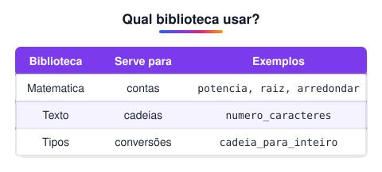
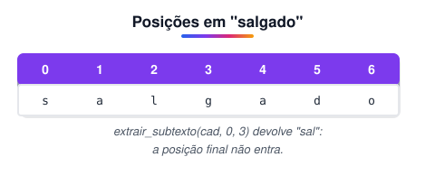

# Funções úteis das bibliotecas Matematica, Texto e Tipos (Adicionado pelo aluno para melhorar o estudo)

> 🗺️ **Nesta aula:** as funções mais usadas das bibliotecas `Matematica`, `Texto` e `Tipos`: potência, raiz e arredondamento, contar e cortar cadeias, e converter entre tipos.

## De onde paramos

Na aula anterior você aprendeu a incluir uma biblioteca e a usar a `Util` para sortear números. O Portugol Studio traz outras bibliotecas que resolvem tarefas comuns, como calcular uma raiz, contar letras de um nome ou transformar o texto digitado em número.

## Por que usar as bibliotecas

Você poderia escrever na mão a conta de uma potência ou a rotina de contar letras, mas as bibliotecas já trazem isso pronto e testado. **Uma biblioteca é um conjunto de funções prontas que você chama pelo apelido dado no** `inclua biblioteca`**.** Três delas aparecem o tempo todo: `Matematica` para contas além dos operadores, `Texto` para trabalhar com cadeias e `Tipos` para converter um tipo em outro.



> 💡 **Analogia:** as bibliotecas são as bancadas de uma oficina. Na bancada de medir e calcular fica a `Matematica`; na de cortar e emendar tecido fica o `Texto`; e na dos adaptadores de tomada fica a `Tipos`, que faz um formato encaixar no outro.

## Matematica

Para usar, inclua a biblioteca com um apelido curto. As funções recebem e devolvem números reais:

| Função | O que faz |
| --- | --- |
| `potencia(base, expoente)` | eleva a base ao expoente |
| `raiz(radicando, indice)` | raiz de qualquer índice (2 é a quadrada) |
| `arredondar(numero, casas)` | arredonda para o número de casas decimais |
| `valor_absoluto(numero)` | tira o sinal do número |
| `maior_numero(a, b)` e `menor_numero(a, b)` | o maior e o menor de dois valores |
| `PI` | constante π |

**Código**

```c
programa
{
  inclua biblioteca Matematica --> m

  funcao inicio()
  {
    // 2 elevado a 10
    escreva(m.potencia(2.0, 10.0), "\n")

    // raiz quadrada: índice 2
    escreva(m.raiz(81.0, 2.0), "\n")

    // mantém 2 casas decimais
    escreva(m.arredondar(3.14159, 2), "\n")

    // distância sem sinal
    escreva(m.valor_absoluto(-7.5), "\n")

    // o maior entre dois valores
    escreva(m.maior_numero(4.0, 9.0), "\n")
  }
}
```

Saída: `1024.0`, `9.0`, `3.14`, `7.5` e `9.0`, uma por linha.

## Texto

Uma cadeia é uma sequência de caracteres, e as posições começam no **zero**, como nos vetores. Veja as funções principais:

| Função | O que faz |
| --- | --- |
| `numero_caracteres(cad)` | conta os caracteres, inclusive espaços |
| `caixa_alta(cad)` e `caixa_baixa(cad)` | maiúsculas e minúsculas |
| `extrair_subtexto(cad, inicio, fim)` | corta um pedaço; a posição final **não** entra |
| `posicao_texto(procurado, cad, inicio)` | posição da 1ª ocorrência, ou -1 se não achar |
| `substituir(cad, busca, novo)` | troca todas as ocorrências |
| `obter_caracter(cad, indice)` | o caractere de uma posição |
| `preencher_a_esquerda(car, tamanho, cad)` | completa à esquerda até o tamanho |



> 💡 **Analogia:** as posições são como os riscos de uma régua: o corte começa no risco inicial e termina *antes* do risco final. Cortar de 0 a 3 leva as três primeiras letras, e o risco 3 fica de fora.

**Código**

```c
programa
{
  inclua biblioteca Texto --> t

  funcao inicio()
  {
    cadeia frase = "Portugol Studio"

    // conta todas as letras e o espaço
    escreva(t.numero_caracteres(frase), "\n")

    // da posição 0 até antes da 8
    escreva(t.extrair_subtexto(frase, 0, 8), "\n")

    // procura a partir do início (posição 0)
    escreva(t.posicao_texto("Studio", frase, 0), "\n")

    // não achou: devolve -1
    escreva(t.posicao_texto("xyz", frase, 0), "\n")

    escreva(t.substituir(frase, "Studio", "Web"), "\n")
    escreva(t.caixa_alta(frase), "\n")

    // completa com zeros até ter 5 caracteres
    escreva(t.preencher_a_esquerda('0', 5, "42"), "\n")
  }
}
```

Saída, uma por linha: `15`, `Portugol`, `9`, `-1`, `Portugol Web`, `PORTUGOL STUDIO` e `00042`.

> ⚠️ **Armadilha comum:** pedir um corte fora do tamanho da cadeia. `extrair_subtexto(frase, 0, 99)` em uma frase de 15 caracteres gera um erro em tempo de execução. Confira o tamanho com `numero_caracteres` antes de cortar.

## Tipos

Tudo o que o usuário digita pode chegar como cadeia. Para usar como número, converta. A biblioteca segue o padrão `origem_para_destino`, e as funções `cadeia_e_inteiro` e `cadeia_e_real` conferem antes se a conversão é possível:

| Função | O que faz |
| --- | --- |
| `cadeia_para_inteiro(cad, base)` | cadeia vira inteiro (base 10 é a usual) |
| `cadeia_para_real(cad)` | cadeia vira real |
| `inteiro_para_cadeia(n, base)` | inteiro vira cadeia |
| `real_para_cadeia(x)` | real vira cadeia |
| `real_para_inteiro(x)` | descarta a parte decimal (7.9 vira 7) |
| `cadeia_e_inteiro(cad, base)` | confere se a cadeia é um inteiro |

**Código**

```c
programa
{
  inclua biblioteca Tipos --> tp

  funcao inicio()
  {
    cadeia entrada = "42"

    // confere antes de converter
    se (tp.cadeia_e_inteiro(entrada, 10)) {
      inteiro n = tp.cadeia_para_inteiro(entrada, 10)
      escreva(n + 1, "\n")
    }

    // a base 2 mostra o número em binário
    escreva(tp.inteiro_para_cadeia(5, 2), "\n")

    // trunca: não arredonda
    escreva(tp.real_para_inteiro(7.9), "\n")
  }
}
```

Saída, uma por linha: `43`, `101` e `7`.

## Exercício

Leia o nome completo de uma pessoa e mostre: o nome em maiúsculas, a quantidade de caracteres e só o primeiro nome. Em seguida, leia o número de um pedido (inteiro) e mostre-o com 5 dígitos, completando com zeros à esquerda.

<details>
<summary>Ver resposta</summary>

```c
programa
{
  inclua biblioteca Texto --> t
  inclua biblioteca Tipos --> tp

  cadeia nome, codigo
  inteiro espaco, pedido

  funcao inicio()
  {
    escreva("Nome completo: ")
    leia(nome)

    // posição do 1º espaço (-1 se não houver)
    espaco = t.posicao_texto(" ", nome, 0)

    // sem espaço, o nome todo é o 1º nome
    se (espaco == -1) {
      espaco = t.numero_caracteres(nome)
    }

    escreva("Maiúsculas: ", t.caixa_alta(nome), "\n")
    escreva("Caracteres: ",
      t.numero_caracteres(nome), "\n")
    escreva("Primeiro nome: ",
      t.extrair_subtexto(nome, 0, espaco), "\n")

    escreva("\nNúmero do pedido: ")
    leia(pedido)

    // preencher_a_esquerda trabalha com cadeia
    codigo = tp.inteiro_para_cadeia(pedido, 10)
    codigo = t.preencher_a_esquerda('0', 5, codigo)
    escreva("Pedido: ", codigo, "\n")
  }
}
```

Teste: com `Ana Souza` e o pedido `7`, a saída é `ANA SOUZA`, `9` caracteres, primeiro nome `Ana` e `Pedido: 00007`.

</details>

## 🧠 Revisão rápida

**O que `m.raiz(27.0, 3.0)` devolve?**

A raiz cúbica de 27, que é `3.0`. O segundo valor é o índice da raiz.

**Por que `extrair_subtexto("salgado", 0, 3)` devolve "sal"?**

As posições começam no zero e a posição final não entra no corte.

**O que `posicao_texto` devolve quando o texto não existe?**

Devolve `-1`.

**Por que converter antes de fazer contas com o que o usuário digitou?**

Porque uma cadeia como "42" não é número: precisa de `cadeia_para_inteiro` para entrar numa conta.

> ➡️ **Próximo passo:** praticar decisões e bibliotecas em programas completos na **2ª Lista de exercícios**.

## 📌 Resumo

| Item | Em uma frase |
| --- | --- |
| `Matematica` | potência, raiz, arredondar, valor absoluto, maior e menor |
| `Texto` | contar, cortar, procurar e substituir em cadeias |
| Posições | começam no zero; a final do corte não entra |
| `Tipos` | converte entre cadeia, inteiro, real e outros |
| `cadeia_e_inteiro` | confere antes de converter |
