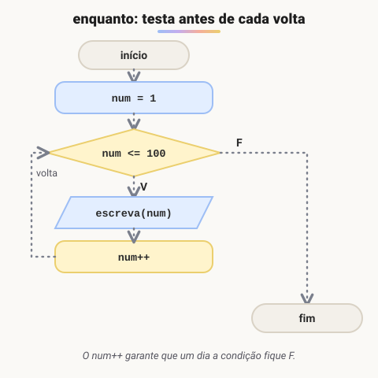
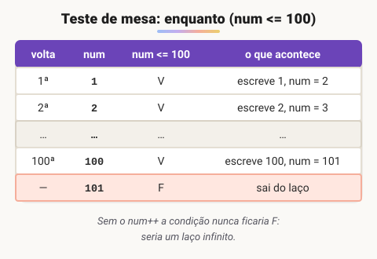
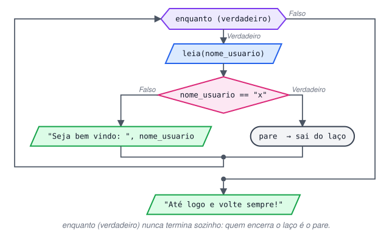

# Laço de Repetição “Enquanto”

> 🗺️ **Nesta aula:** o que é um laço de repetição, como funciona o `enquanto`, o risco do laço infinito e duas formas de repetir até o usuário pedir para sair (com e sem `pare`).

## De onde paramos

As estruturas de decisão escolhem **qual** caminho seguir. Falta poder **voltar** e repetir um caminho várias vezes. É o que fazem os laços de repetição.

## Laços de repetição

Muitas vezes um trecho do programa precisa ser executado várias vezes: mostrar 100 números, pedir dados até o usuário digitar "sair", somar os valores de uma lista. Em vez de copiar o código, usamos um **laço de repetição** (ou *loop*), que repete um bloco quantas vezes forem necessárias.

## O laço enquanto

O `enquanto` testa uma condição **antes** de cada volta:

- Se a condição for **verdadeira**, executa o bloco e volta para testar de novo.
- Se for **falsa**, o laço termina e o programa segue para a instrução seguinte.
- Se a condição já começar falsa, o bloco não é executado nenhuma vez.

É o laço indicado quando **não se sabe de antemão** quantas repetições serão necessárias.

```c
enquanto (condicao) {
  // repetido enquanto a condição for
  // verdadeira
}
// executado quando a condição ficar falsa
```

> 💡 Dentro do laço, alguma coisa precisa mudar para que a condição um dia fique falsa: um contador que aumenta, um novo valor lido do usuário. Sem isso, o programa entra em **laço infinito** e nunca termina.



> 💡 **Analogia:** "enquanto tiver louça na pia, lave um prato". Antes de cada prato você olha a pia; se estiver vazia já de início, não lava nenhum. E cada prato lavado tira um da pia: se a louça nunca diminuísse, você lavaria para sempre (o laço infinito).

Todo laço com contador tem três ingredientes. Vale conferir os três sempre que escrever um:

1. **Início**: o contador recebe um valor antes do laço (`num = 1`).
2. **Condição**: diz até quando repetir (`num <= 100`).
3. **Passo**: muda o contador dentro do laço (`num++`).

## Projeto: escreva de 1 a 100



> 💡 **Analogia:** o teste de mesa é o caderninho do juiz contando as voltas de uma corrida: a cada volta ele anota o número, confere se já chegou à última e risca a volta seguinte.

**Código**

```c
programa
{
  inteiro num

  funcao inicio()
  {
    // 1) início: o contador parte do 1
    num = 1

    // 2) condição: testada antes de
    // cada volta
    enquanto (num <= 100) {
      escreva("Número: ", num, "\n")
      // 3) passo: sem ele, num seria 1
      // para sempre (laço infinito)
      num++
    }
  }
}
```

## Projeto: boas-vindas a vários usuários

O programa pede nomes até o usuário digitar `x`. Como não se sabe quantos nomes virão, o `enquanto` é a escolha natural. Há duas formas de montar o laço.

### Forma 1: ler antes do laço e no final de cada volta

**Código**

```c
programa
{
  cadeia nome

  funcao inicio()
  {
    escreva("Seu nome (x para sair): ")
    // 1ª leitura antes do laço: a condição
    // precisa de um valor para testar
    leia(nome)

    enquanto (nome != "x") {
      escreva("Bem-vindo, ", nome, "!\n")

      escreva("\nSeu nome (x para sair): ")
      // nova leitura no fim da volta: é ela
      // que um dia torna a condição falsa
      leia(nome)
    }
    escreva("\nHasta la vista, baby!\n")
  }
}
```

### Forma 2: laço infinito encerrado com pare

`enquanto (verdadeiro)` cria um laço que nunca termina sozinho. Quem o encerra é o `pare`, que sai do laço na hora e continua o programa depois dele.



> 💡 **Analogia:** é a esteira de bagagens do aeroporto: gira sem parar por conta própria. Quem a desliga é o funcionário que aperta o botão de emergência quando acontece algo específico. O `pare` é esse botão.

**Código**

```c
programa
{
  cadeia nome

  funcao inicio()
  {
    // laço infinito proposital: a saída
    // fica lá dentro, no pare
    enquanto (verdadeiro) {
      escreva("Seu nome (x para sair): ")
      leia(nome)

      // testar logo após ler evita dar
      // boas-vindas ao "x"
      se (nome == "x") {
        pare
      }
      escreva("Seja bem-vindo, ", nome, "!\n")
    }
  }
}
```

Versão reestruturada, com despedida no final:

**Código**

```c
programa
{
  cadeia nome_usuario

  funcao inicio()
  {
    enquanto (verdadeiro) {
      escreva("Seu nome (x para sair): ")
      leia(nome_usuario)

      se (nome_usuario == "x") {
        pare
      }
      senao {
        escreva("Bem-vindo, ",
          nome_usuario, "!\n")
      }
    }
    // o pare pula para cá: a despedida
    // roda uma vez, depois do laço
    escreva("\nAté logo e volte sempre!\n")
  }
}
```

> 💡 O `pare` não torna a condição falsa: ele simplesmente pula para fora do laço, como o `break` de outras linguagens. É o mesmo `pare` usado no `escolha`.

## 🧠 Revisão rápida

**Quantas vezes o bloco roda em `num = 10` seguido de `enquanto (num < 5)`?**

Nenhuma: a condição já começa falsa e o `enquanto` testa antes de entrar.

**O que acontece se, no projeto de 1 a 100, a linha `num++` for apagada?**

Laço infinito: `num` fica 1 para sempre e "Número: 1" é escrito sem parar.

**Na forma 1, por que o `leia(nome)` aparece duas vezes?**

A primeira leitura dá o valor que a condição testa na 1ª volta; a segunda, dentro do laço, renova o valor para a próxima volta.

> ➡️ **Próximo passo:** quando se sabe quantas voltas serão (100 números, 5 sorteios), existe um laço que junta início, condição e passo numa linha só: **Laço de Repetição "Para"**.

## 📌 Resumo

| Item | Em uma frase |
| --- | --- |
| Laço de repetição | Repete um bloco quantas vezes for preciso |
| `enquanto (condicao)` | Testa antes de cada volta; repete enquanto for verdadeira |
| Quando usar | Quando não se sabe de antemão quantas voltas serão |
| Três ingredientes | Início, condição e passo do contador |
| Laço infinito | Acontece se nada dentro do laço muda a condição |
| `enquanto (verdadeiro)` com `pare` | Laço infinito proposital, encerrado de dentro |
| `pare` | Sai do laço na hora, como o `break` |
