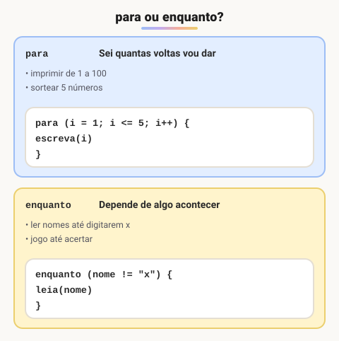
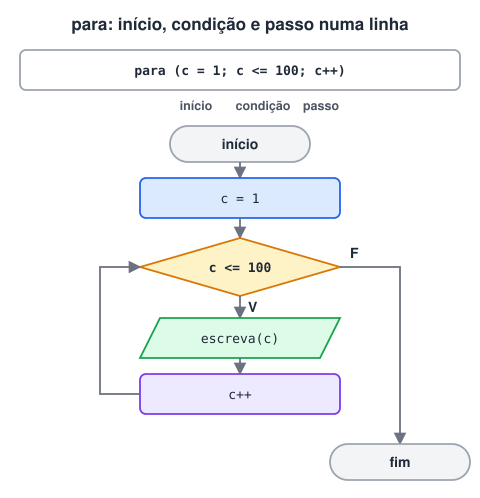
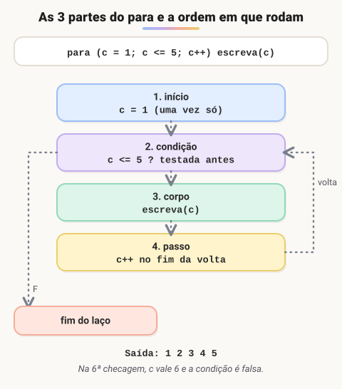
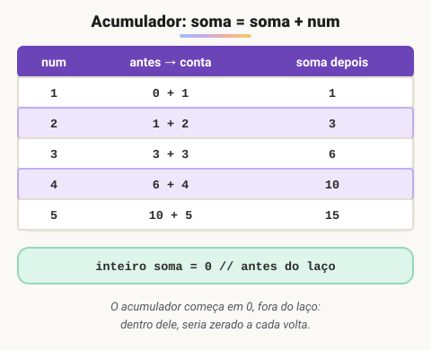

# Laço de Repetição “Para”

> 🗺️ **Nesta aula:** o laço `para` e suas três partes, quando preferi-lo ao `enquanto`, sorteios em sequência e a variável acumuladora para somar valores.

## De onde paramos

No `enquanto`, o início, a condição e o passo do contador ficam espalhados em linhas diferentes, e esquecer um deles gera bugs. O `para` junta os três numa linha só.

## O laço para

O `para` é o laço indicado quando **se sabe de antemão quantas repetições** serão feitas: 100 números, 5 sorteios, uma volta para cada item de um vetor. Ele concentra numa só linha tudo o que controla a repetição.

O `enquanto`, por outro lado, é usado quando o número de repetições depende de algo que só se descobre durante a execução.



> 💡 **Analogia:** o `para` é a série da academia: "3 séries de 12 repetições", número combinado antes de começar. O `enquanto` é "corra até cansar": só durante a corrida você descobre quando parar.

## Sintaxe

```c
para (inicializacao; condicao; incremento)
{
  // repetido enquanto a condição for
  // verdadeira
}
```

- **Inicialização**: executada uma única vez, no começo. Define o valor inicial do contador (`i = 1`).
- **Condição**: testada antes de cada volta. Enquanto for verdadeira, o bloco é executado (`i <= 100`).
- **Incremento**: executado no fim de cada volta. Atualiza o contador (`i++`).





> 💡 **Analogia:** é o controle de um forno micro-ondas. Você define de onde começa (o tempo), até quando vai (chegar a zero) e o passo (um segundo a menos por vez), tudo no painel, antes de apertar "iniciar".

> 💡 O passo não precisa ser `++`. `para (i = 10; i >= 1; i--)` conta de 10 até 1, e `para (i = 0; i <= 100; i += 5)` anda de 5 em 5.

## Projeto: escreva de 1 a 100

**Código**

```c
programa
{
  // contador
  inteiro c

  funcao inicio()
  {
    // início, condição e passo juntos:
    // impossível esquecer o c++
    para (c = 1; c <= 100; c++) {
      escreva("Número: ", c, "\n")
    }
  }
}
```

Compare com a versão em `enquanto` da aula anterior: as mesmas três partes (valor inicial, condição e `++`) estavam espalhadas em três linhas diferentes.

## Projeto: escreva quantos números o usuário pedir

**Código**

```c
programa
{
  inteiro num, quant_num

  funcao inicio()
  {
    escreva("Quantos números você quer? ")
    leia(quant_num)

    // o limite vem do usuário, mas é
    // conhecido antes de o laço começar
    para (num = 1; num <= quant_num; num++) {
      escreva("Número: ", num, "\n")
    }
  }
}
```

## Projeto: 5 números para a loteria

Gere 5 números aleatórios entre 1 e 50.

**Código**

```c
programa
{
  inclua biblioteca Util --> u

  inteiro i

  funcao inicio()
  {
    escreva("Seus 5 números da sorte: ")

    // o i só conta as voltas; o número
    // mostrado vem do sorteio
    para (i = 1; i <= 5; i++) {
      escreva(u.sorteia(1, 50), " ")
    }
    // fecha a linha depois do último
    escreva("\n")
  }
}
```

> 💡 Como cada sorteio é independente, o mesmo número pode sair duas vezes. Evitar repetições exige guardar os números já sorteados, o que fica fácil com os vetores, mais adiante no curso.

## Projeto: sorteie quantos números o usuário pedir

**Código**

```c
programa
{
  inclua biblioteca Util --> u

  inteiro quant_num, i

  funcao inicio()
  {
    escreva("Quantos números quer sortear? ")
    leia(quant_num)

    // mesma ideia da loteria, com o total
    // de voltas escolhido pelo usuário
    para (i = 1; i <= quant_num; i++) {
      escreva(u.sorteia(1, 50), " ")
    }
    escreva("\n")
  }
}
```

## Projeto: imprimir números e somá-los

Para somar valores dentro de um laço, usa-se uma **variável acumuladora**: ela começa em 0 e, a cada volta, recebe o próprio valor mais o número da vez.



> 💡 **Analogia:** é o carrinho do supermercado passando no caixa. O total começa em R$ 0,00 e, a cada produto que passa no leitor, o valor dele é somado ao que já estava no visor.

**Código**

```c
programa
{
  // o acumulador precisa começar em zero;
  // sem isso a soma parte de um valor
  // indefinido
  inteiro soma_total = 0
  inteiro num, quant_num

  funcao inicio()
  {
    escreva("Quantos números quer ",
      "imprimir? ")
    leia(quant_num)
    escreva("\nNúmeros:\n")

    para (num = 1; num <= quant_num; num++) {
      // zero à esquerda: 01, 02... 09,
      // para alinhar com os de 2 dígitos
      se (num <= 9) {
        escreva(0)
      }
      escreva(num, "\n")

      // acumula: soma o número da vez ao
      // total que já existia
      soma_total = soma_total + num
    }

    escreva("\nSoma total: ", soma_total, "\n")
  }
}
```

> 💡 Variações do acumulador: um **contador** soma 1 a cada volta em que algo acontece (`pares++`); um **produto** começa em 1 e multiplica (`fat = fat * i`). A regra é a mesma: valor inicial fora do laço, atualização dentro.

## 🧠 Revisão rápida

**Quantas vezes roda `para (i = 0; i < 10; i++)`?**

10 vezes, com `i` de 0 a 9.

**Qual laço escreve 10, 8, 6, 4, 2?**

`para (i = 10; i >= 2; i -= 2)`

**Com `quant_num = 4`, qual é a soma impressa no último projeto?**

1 + 2 + 3 + 4 = 10.

> ➡️ **Próximo passo:** o `enquanto` e o `para` testam antes de entrar. E quando o bloco precisa rodar pelo menos uma vez, como um menu? **Laço de Repetição "Faça-Enquanto"**.

## 📌 Resumo

| Item | Em uma frase |
| --- | --- |
| `para (ini; cond; inc)` | Controla a repetição inteira numa só linha |
| Inicialização | Roda uma vez, no começo (`i = 1`) |
| Condição | Testada antes de cada volta (`i <= 100`) |
| Incremento | Roda no fim de cada volta (`i++`, `i--`, `i += 5`) |
| Quando usar | Quando se sabe quantas voltas serão |
| Acumulador | Começa em 0 e soma o valor da vez: `soma = soma + num` |
