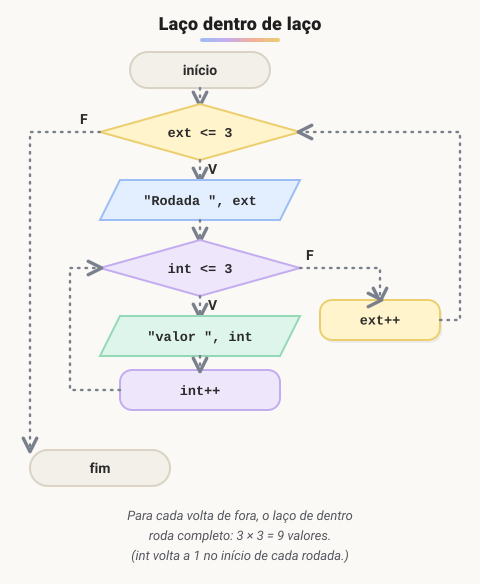
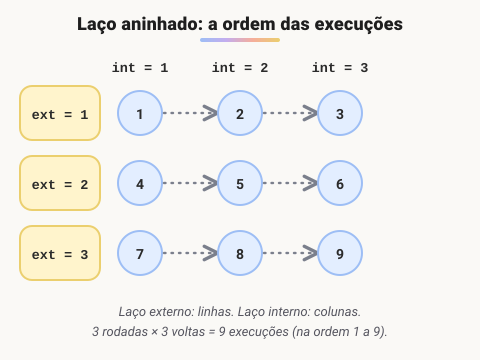
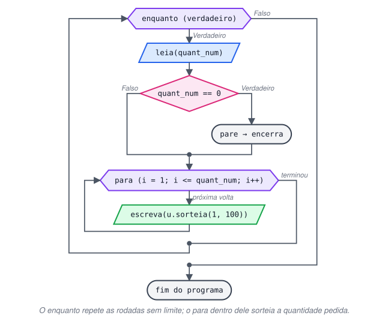

# Encadeamento de Laços de Repetição Para e Enquanto

> 🗺️ **Nesta aula:** como colocar um laço dentro de outro, a ordem em que as voltas acontecem e dois projetos: `para` dentro de `para` e `para` dentro de `enquanto`.

## De onde paramos

Os três laços (`enquanto`, `para` e `faca-enquanto`) foram vistos um de cada vez. Muitos problemas, porém, têm repetição dentro de repetição: várias rodadas com vários sorteios, linhas e colunas de uma tabela.

## Laços dentro de laços

Um laço pode ficar dentro de outro. Todas as combinações são possíveis:

- `enquanto` dentro de `enquanto`;
- `para` dentro de `para`;
- `para` dentro de `enquanto`;
- `enquanto` dentro de `para`.

A regra é sempre a mesma: **a cada volta do laço de fora, o laço de dentro é executado do começo ao fim**.

```c
para (ext = 1; ext <= 3; ext++) {
  // comandos do laço externo

  para (dentro = 1; dentro <= 3;
    dentro++) {
    // comandos do laço interno
  }
}
// 3 voltas de fora x 3 de dentro
// = 9 execuções do bloco interno
```



> 💡 **Analogia:** é o relógio de ponteiros. O ponteiro dos minutos (laço interno) dá uma volta completa inteira para cada passo do ponteiro das horas (laço externo). As horas só avançam quando os minutos terminam a volta.



> 💡 **Analogia:** é como ler esta página: você percorre uma linha inteira, palavra por palavra (laço interno), e só então desce para a próxima linha (laço externo).

> ⚠️ Use contadores **diferentes** em cada laço. Se o laço interno também usasse `ext`, ele mexeria no contador do externo e as rodadas sairiam erradas (ou o programa nunca terminaria).

## Projeto: 5 valores em cada rodada (para dentro de para)

**Código**

```c
programa
{
  // um contador para cada laço
  inteiro cont_a, cont_b

  funcao inicio()
  {
    // externo: 5 rodadas
    para (cont_a = 1; cont_a <= 5;
      cont_a++) {
      escreva("Rodada: ", cont_a, "\n")

      // interno: recomeça do 1 a cada
      // rodada e mostra 5 valores
      para (cont_b = 1; cont_b <= 5;
        cont_b++) {
        escreva("  valor: ", cont_b, "\n")
      }
      // linha em branco entre rodadas
      escreva("\n")
    }
  }
}
```

## Projeto: sorteios sem fim (para dentro de enquanto)

Pergunte quantos números o usuário quer gerar (cada um aleatório, de 1 a 100), mostre os números e pergunte de novo, quantas vezes ele quiser. O programa termina quando for digitado 0.



> 💡 **Analogia:** é uma máquina de chiclete com fila. O `enquanto` é a fila, que continua enquanto aparecer gente; o `para` é cada pessoa girando a manivela o número de vezes que pediu.

**Código**

```c
programa
{
  inclua biblioteca Util --> u

  inteiro quant_num, i

  funcao inicio()
  {
    escreva("Digite 0 para encerrar.\n")

    // externo: não se sabe quantas
    // rodadas, então enquanto + pare
    enquanto (verdadeiro) {
      escreva("\nQuantos números sortear? ")
      leia(quant_num)

      se (quant_num == 0) {
        pare
      }

      // interno: aqui se sabe quantas
      // voltas, então para
      para (i = 1; i <= quant_num; i++) {
        escreva(u.sorteia(1, 100), "\n")
      }
    }
  }
}
```

## 🧠 Revisão rápida

**Um `para` de 1 a 4 contém outro de 1 a 10. Quantas vezes roda o corpo interno?**

4 × 10 = 40 vezes.

**Como imprimir um quadrado de asteriscos 3 × 3?**

Laço externo para as linhas e interno para as colunas: dentro do interno `escreva("*")`; depois do interno, `escreva("\n")`.

**No último projeto, por que o laço externo é `enquanto` e o interno é `para`?**

Porque não se sabe quantas rodadas o usuário vai querer, mas em cada rodada se sabe quantos números sortear.

> ➡️ **Próximo passo:** com laços dentro de laços, fica difícil acompanhar os valores de cabeça. A próxima aula ensina a simular o programa no papel: **Teste de mesa**.

## 📌 Resumo

| Item | Em uma frase |
| --- | --- |
| Laços aninhados | Um laço dentro de outro, em qualquer combinação de `para` e `enquanto` |
| Regra | A cada volta do externo, o interno roda do começo ao fim |
| Total de execuções | Voltas do externo × voltas do interno (3 × 3 = 9) |
| Contadores | Um contador diferente para cada laço |
| Uso típico | Rodadas com vários itens, tabelas, matrizes |
