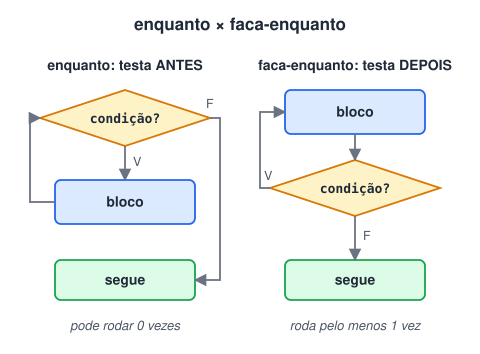
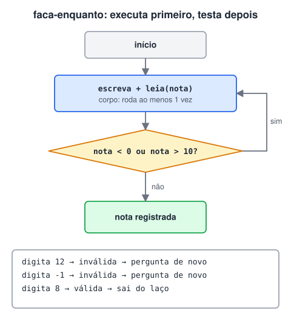

# Laço de Repetição “Faça-Enquanto” (Adicionado pelo aluno para melhorar o estudo)

> 🗺️ **Nesta aula:** o laço que executa o bloco antes de testar a condição, a diferença para o `enquanto`, e os dois usos mais comuns: menus e validação de entrada.

## De onde paramos

O `enquanto` e o `para` testam a condição antes de entrar, por isso podem não rodar nenhuma vez. Para menus e validações, porém, o bloco precisa rodar pelo menos uma vez: é preciso mostrar o menu antes de saber a opção.

## O laço faca-enquanto

No `enquanto`, a condição é testada **antes** de cada volta, e o bloco pode nem ser executado. No `faca-enquanto`, o bloco vem **primeiro** e a condição é testada **depois**. Por isso ele sempre executa o bloco **pelo menos uma vez**.

```c
faca {
  // executado uma vez, e de novo enquanto
  // a condição for verdadeira
} enquanto (condicao)
```



> 💡 **Analogia:** é provar a comida enquanto cozinha. Você sempre prova pelo menos uma colherada e só então decide: "falta sal? então tempero e provo de novo". Não dá para decidir se falta sal antes de provar.

> 💡 O `faca-enquanto` é a escolha natural quando o bloco **produz** o valor que a condição vai testar: ler um dado e repetir se ele for inválido, mostrar um menu e repetir até escolherem "sair". Com o `enquanto`, seria preciso ler uma vez antes do laço e outra dentro dele.



> 💡 **Analogia:** o fluxo do `faca-enquanto` é a porta de um restaurante self-service: você entra e se serve primeiro, e só na saída o caixa pergunta se você quer voltar para repetir. Ninguém é barrado antes da primeira rodada.

## Os três laços lado a lado

| Laço | Testa a condição | Mínimo de voltas | Use quando |
| --- | --- | --- | --- |
| `para` | Antes de cada volta | 0 | Se sabe quantas voltas serão |
| `enquanto` | Antes de cada volta | 0 | Não se sabe quantas voltas, e talvez nenhuma |
| `faca-enquanto` | Depois de cada volta | 1 | O bloco precisa rodar pelo menos uma vez |

## Projeto: validando uma nota

A nota deve estar entre 0 e 10. Enquanto o usuário digitar um valor fora disso, o programa pergunta de novo.

```c
programa
{
  real nota

  funcao inicio()
  {
    // a pergunta sempre acontece ao menos
    // uma vez: por isso faca-enquanto
    faca {
      escreva("Digite a nota (0 a 10): ")
      leia(nota)

      // avisa o erro antes de repetir
      se (nota < 0 ou nota > 10) {
        escreva("Nota inválida! ",
          "Tente de novo.\n")
      }
    // repete enquanto a nota for inválida
    } enquanto (nota < 0 ou nota > 10)

    escreva("Nota registrada: ", nota, "\n")
  }
}
```

Compare com a versão em `enquanto`: seria preciso um `leia` antes do laço e outro dentro dele.

## Projeto: menu que repete até sair

```c
programa
{
  inteiro opcao, num

  funcao inicio()
  {
    faca {
      // o menu aparece antes de qualquer
      // teste: o usuário precisa vê-lo
      escreva("\n1 - Ver o dobro\n")
      escreva("2 - Ver o quadrado\n")
      escreva("0 - Sair\n")
      escreva("Opção: ")
      leia(opcao)

      escolha (opcao) {
        caso 1:
          escreva("Número: ")
          leia(num)
          escreva("Dobro: ", num * 2, "\n")
          pare
        caso 2:
          escreva("Número: ")
          leia(num)
          escreva("Quadrado: ",
            num * num, "\n")
          pare
        caso 0:
          escreva("Até logo!\n")
          pare
        caso contrario:
          escreva("Opção inválida.\n")
      }
    // 0 encerra; qualquer outra volta
    // ao menu
    } enquanto (opcao != 0)
  }
}
```

> ⚠️ Não confunda o `enquanto (condicao)` que fecha o `faca` com o início de um novo laço `enquanto`. Ele não tem bloco próprio: termina ali mesmo, logo depois do `}`.

## 🧠 Revisão rápida

**Com `x = 10`, quantas vezes roda `faca { x++ } enquanto (x < 5)`?**

Uma vez: o bloco roda antes do teste, e o teste já dá falso.

**Por que o menu combina com `faca-enquanto`?**

Porque ele precisa aparecer pelo menos uma vez antes de se saber a opção escolhida.

**O `pare` dentro do `escolha` encerra o `faca-enquanto`?**

Não: ele só sai do `escolha`. Quem encerra o laço é a condição `opcao != 0`.

> ➡️ **Próximo passo:** já vimos os três laços separados. E quando um laço precisa ficar dentro de outro? **Encadeamento de Laços de Repetição Para e Enquanto**.

## 📌 Resumo

| Item | Em uma frase |
| --- | --- |
| `faca { } enquanto (cond)` | Executa o bloco e só depois testa a condição |
| Garantia | O bloco roda pelo menos uma vez |
| Repete quando | A condição é verdadeira, como no `enquanto` |
| Uso típico | Validar entradas e repetir menus |
| Diferença para o `enquanto` | Dispensa a leitura antes do laço |
