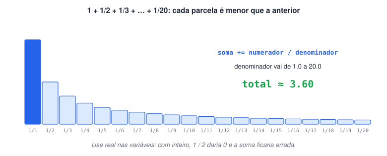
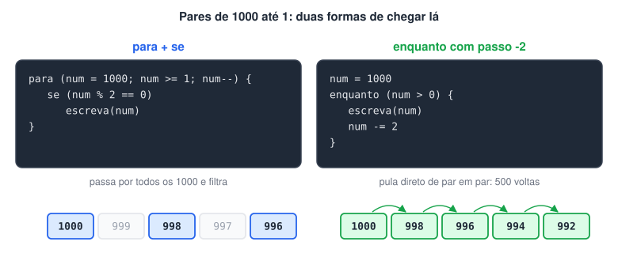
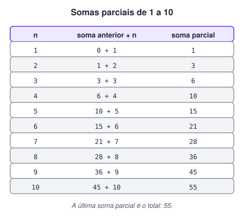
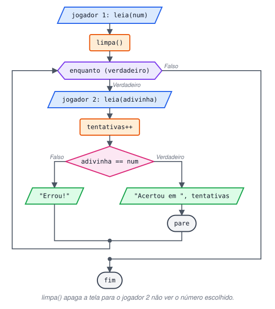
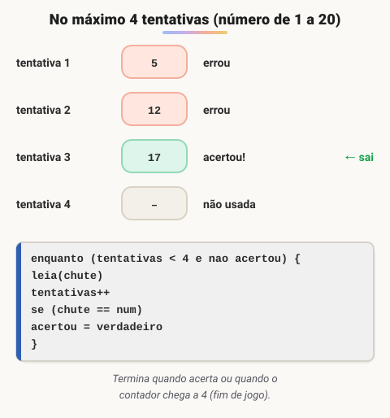
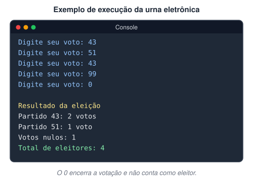
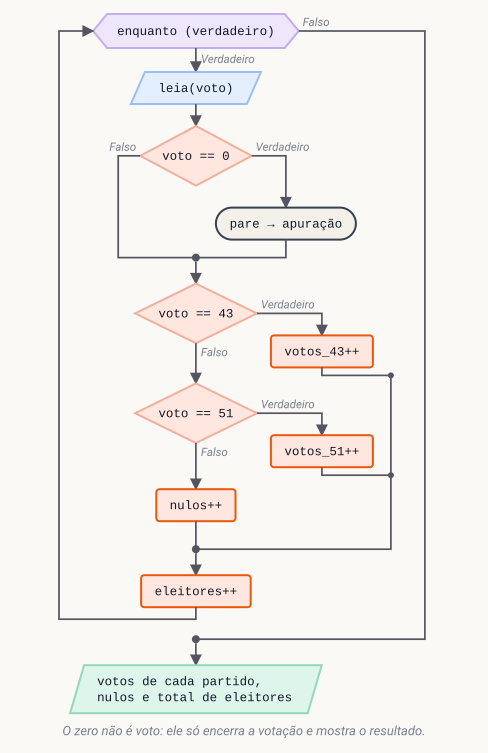
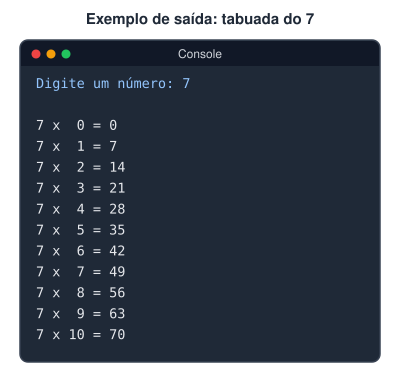
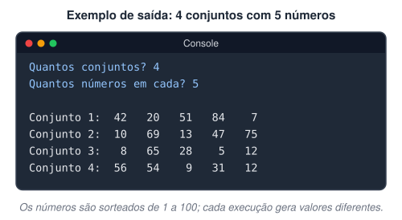

# 3ª Lista de exercícios

> 🗺️ **Nesta lista:** oito exercícios de repetição: somatórios, contagem regressiva, jogos de adivinhação, urna eletrônica, tabuada e conjuntos aleatórios com laços aninhados.

## De onde paramos

A seção apresentou o `enquanto`, o `para`, o `faca-enquanto`, os laços aninhados e o teste de mesa. Agora é colocar tudo em prática em problemas com repetição.

> 💡 **Antes de escolher o laço:** sei quantas voltas serão? Use `para`. Depende do usuário ou de um acerto? Use `enquanto`. E confira os três ingredientes: valor inicial, condição e passo.

## Exercício 1: soma de 20 frações

Mostre o somatório da sequência `1 + 1/2 + 1/3 + 1/4 + … + 1/20`.



> 💡 **Analogia:** é dividir uma pizza com cada vez mais gente: primeiro ela inteira, depois meia, depois um terço... Cada fatia nova é menor, mas o total ainda cresce um pouquinho a cada volta.

<details>
<summary>Ver resposta</summary>

```c
programa
{
  // para arredondar o resultado
  inclua biblioteca Matematica --> m

  const real NUMERADOR = 1.0
  // real: com inteiros, 1 / 2 daria 0
  real den
  real soma = 0.0

  funcao inicio()
  {
    para (den = 1.0; den <= 20.0; den++) {
      // soma += x é o mesmo que
      // soma = soma + x
      soma += NUMERADOR / den
    }

    // mostra 3.6
    escreva("Soma: ", m.arredondar(soma, 2),
      "\n")
  }
}
```

</details>

## Exercício 2: pares de 1000 até 1

Mostre todos os números pares entre 1000 e 1, em ordem decrescente.



> 💡 **Analogia:** é descer uma escada pisando só nos degraus pares. Você pode passar por todos e escolher onde pisar (forma 1) ou já descer de dois em dois (forma 2), que dá metade dos passos.

<details>
<summary>Ver resposta: Forma 1: para de 1 em 1, filtrando com se</summary>

```c
programa
{
  inteiro num

  funcao inicio()
  {
    // decrescente: começa em 1000 e
    // usa num-- como passo
    para (num = 1000; num >= 1; num--) {
      // o se filtra: só os pares saem
      se (num % 2 == 0) {
        escreva(num, "\n")
      }
    }
  }
}
```

</details>

<details>
<summary>Ver resposta: Forma 2: enquanto de 2 em 2 (sem teste)</summary>

```c
programa
{
  // já começa num par
  inteiro num = 1000

  funcao inicio()
  {
    enquanto (num > 0) {
      escreva(num, "\n")
      // pula direto para o próximo par
      num -= 2
    }
  }
}
```

</details>

A forma 2 faz metade das voltas e dispensa o `se`, porque já começa num par e anda de 2 em 2.

## Exercício 3: somas parciais de 1 a 10

Some os números de 1 a 10 mostrando as somas parciais e, no final, o total. O enunciado pede as parciais a partir de 1 + 2, no formato `3 (soma parcial com o número 2)`, `6 (soma parcial com o número 3)`… e por fim `Soma total: 55`.



> 💡 **Analogia:** é o placar de um jogo de basquete. A cada cesta, o placar mostra o total até aquele momento; no apito final, o último placar é o resultado.

<details>
<summary>Ver resposta</summary>

```c
programa
{
  inteiro soma_total = 0
  inteiro num

  funcao inicio()
  {
    para (num = 1; num <= 10; num++) {
      soma_total = soma_total + num

      // a 1ª parcial do enunciado já é 1 + 2,
      // por isso o num 1 só acumula
      se (num >= 2) {
        escreva(soma_total, " (soma parcial")
        escreva(" com o número ", num, ")\n")
      }
    }
    escreva("Soma total: ", soma_total, "\n")
  }
}
```

</details>

<details>
<summary>Ver resposta: Forma 2 original: com o operador +=</summary>

```c
programa
{
  inteiro num, total = 0

  funcao inicio()
  {
    para (num = 1; num <= 10; num++) {
      total += num
      // mostra também a primeira parcial (1)
      escreva(total, "\n")
    }
    escreva("\nSoma total: ", total, "\n")
  }
}
```

</details>

## Exercício 4: jogo de adivinhação

O jogador 1 escolhe um número entre 1 e 10, e o jogador 2 digita números até acertar.



> 💡 **Analogia:** é o "quente ou frio" sem dicas: o jogador 2 continua chutando até ouvir "acertou". Como ninguém sabe quantos chutes serão, o laço é um `enquanto`.

<details>
<summary>Ver resposta</summary>

```c
programa
{
  inteiro num, chute
  inteiro tentativas = 0

  funcao inicio()
  {
    escreva("Jogador 1, número de 1 a 10: ")
    leia(num)
    // apaga a tela para o jogador 2 não
    // ver o número escolhido
    limpa()

    // não se sabe quantos chutes serão
    enquanto (verdadeiro) {
      escreva("Jogador 2, qual é o número? ")
      leia(chute)
      tentativas++

      se (chute == num) {
        escreva("\nAcertou! Era ", num, "\n")
        escreva("Tentativas: ", tentativas,
          "\n")
        pare
      }
      escreva("Errou! Tente de novo.\n")
    }
  }
}
```

</details>

## Exercício 5: adivinhação com limite

Reescreva o jogo: o jogador 1 só pode escolher números entre 1 e 20, e o jogador 2 tem apenas 4 tentativas.



> 💡 **Analogia:** a variável `acertou` é a bandeirinha do bandeirinha de futebol: fica abaixada até acontecer o lance; quando ele acontece, ela sobe e todo mundo sabe que o jogo deve parar.

<details>
<summary>Ver resposta</summary>

```c
programa
{
  const inteiro MAX_TENTATIVAS = 4

  inteiro num, chute
  inteiro tentativas = 0
  // flag: começa falsa e vira verdadeira
  // no acerto
  logico acertou = falso

  funcao inicio()
  {
    // valida a escolha do jogador 1
    enquanto (verdadeiro) {
      escreva("Jogador 1, número de 1 a 20: ")
      leia(num)
      se (num >= 1 e num <= 20) {
        pare
      }
      escreva("Inválido! Use de 1 a 20.\n")
    }
    limpa()

    // duas saídas: acabar as tentativas
    // ou acertar
    enquanto (tentativas < MAX_TENTATIVAS
      e nao acertou) {
      escreva("Tentativa ", tentativas + 1)
      escreva(" de ", MAX_TENTATIVAS, ": ")
      leia(chute)
      tentativas++

      se (chute == num) {
        acertou = verdadeiro
      }
      senao {
        escreva("Errou!\n")
      }
    }

    // a mensagem final é decidida fora do
    // laço, olhando a flag
    se (acertou) {
      escreva("\nAcertou em ", tentativas)
      escreva(" tentativa(s)!\n")
    }
    senao {
      escreva("\nGame over! Era ", num, ".\n")
    }
  }
}
```

</details>

> ⚠️ As duas versões originais tinham falhas na contagem. Na 1ª, a mensagem "Você errou!" aparecia também depois do "Game over". Na 2ª, o acerto só era reconhecido quando `num_t == 0`, uma condição que nunca acontece naquele ponto, então acertar não encerrava o jogo. A versão acima usa uma variável `logico` (`acertou`) e decide a mensagem final depois do laço.

## Exercício 6: urna eletrônica

Os partidos válidos são o 43 e o 51. Cada eleitor digita seu voto e tecla Enter, e o programa chama o próximo eleitor. Qualquer outro número é voto **nulo**. Digitar **0** encerra a votação e mostra o resultado: votos de cada partido, votos nulos e total de eleitores.





> 💡 **Analogia:** cada contador é uma caixinha de apuração com o nome de um partido. A cada voto, você coloca um palito na caixinha certa; no final, basta contar os palitos de cada uma.

<details>
<summary>Ver resposta (conforme o enunciado)</summary>

```c
programa
{
  inteiro voto
  // um contador por resultado possível,
  // todos começando em zero
  inteiro votos_43 = 0, votos_51 = 0
  inteiro nulos = 0, eleitores = 0

  funcao inicio()
  {
    enquanto (verdadeiro) {
      escreva("Digite seu voto: ")
      leia(voto)

      // 0 encerra e não conta como eleitor
      se (voto == 0) {
        pare
      }

      eleitores++
      se (voto == 43) {
        votos_43++
      }
      senao se (voto == 51) {
        votos_51++
      }
      // qualquer outro número
      senao {
        nulos++
      }
      // voto é secreto: limpa para o
      // próximo eleitor
      limpa()
    }

    escreva("\nResultado da eleição\n")
    escreva("Partido 43: ", votos_43,
      " votos\n")
    escreva("Partido 51: ", votos_51,
      " votos\n")
    escreva("Votos nulos: ", nulos, "\n")
    escreva("Eleitores: ", eleitores, "\n")
  }
}
```

</details>

<details>
<summary>Ver versão estendida: número de eleitores definido antes, com brancos</summary>

```c
programa
{
  inteiro num_eleitores, voto, i
  inteiro brancos = 0, nulos = 0
  inteiro votos_13 = 0, votos_22 = 0

  funcao inicio()
  {
    escreva("Número de eleitores: ")
    leia(num_eleitores)

    // aqui o total de votos é conhecido
    // antes, por isso o laço é para
    para (i = 1; i <= num_eleitores; i++) {
      limpa()
      escreva("Digite o seu voto: ")
      leia(voto)

      se (voto == 13) {
        votos_13++
      }
      senao se (voto == 22) {
        votos_22++
      }
      senao se (voto == 0) {
        brancos++
      }
      senao {
        nulos++
      }
      limpa()
    }

    escreva("Resultado da eleição\n")
    escreva("Votantes: ", num_eleitores, "\n")
    escreva("Válidos: ",
      votos_13 + votos_22, "\n")
    escreva("Brancos e nulos: ",
      brancos + nulos)
    escreva("\n\nPartido 13: ", votos_13, "\n")
    escreva("Partido 22: ", votos_22, "\n")

    // casos especiais primeiro, senão
    // nunca seriam alcançados
    se (num_eleitores == 0) {
      escreva("\nSem eleitores: eleição ",
        "inválida.\n")
    }
    senao se (votos_13 == 0 e votos_22 == 0) {
      escreva("\nNenhum partido teve ",
        "votos.\n")
    }
    senao se (votos_13 > votos_22) {
      escreva("\nO partido 13 venceu.\n")
    }
    senao se (votos_22 > votos_13) {
      escreva("\nO partido 22 venceu.\n")
    }
    senao {
      escreva("\nEmpate: haverá 2º turno.\n")
    }
  }
}
```

</details>

> 💡 A variação original difere do enunciado: pergunta antes quantos eleitores vão votar, usa os partidos 13 e 22 e trata o 0 como voto branco em vez de fim da votação. Também reorganizei a ordem dos testes do resultado: no original, o caso "nenhum voto" vinha depois do "empate" e nunca era alcançado.

## Exercício 7: tabuada

Pergunte um número ao usuário e mostre a tabuada dele:



> 💡 **Analogia:** é a tabuada impressa na contracapa do caderno: o número escolhido fica fixo e só o multiplicador desce de 0 a 10, uma linha por vez.

<details>
<summary>Ver resposta (versão original, que repete até digitar 0)</summary>

```c
programa
{
  inteiro n, i

  funcao inicio()
  {
    // externo: menu que repete até o 0
    enquanto (verdadeiro) {
      escreva("Tabuada de 1 a 9 (0 sai): ")
      leia(n)

      se (n >= 1 e n <= 9) {
        limpa()
        escreva("Tabuada do ", n, ":\n")
        // interno: 11 linhas, de 0 a 10
        para (i = 0; i <= 10; i++) {
          escreva(n, " x ", i, " = ")
          escreva(n * i, "\n")
        }
      }
      senao se (n == 0) {
        limpa()
        escreva("Até a próxima!\n")
        pare
      }
      senao {
        limpa()
        escreva(n, " é uma opção inválida\n")
      }
      escreva("\n")
    }
  }
}
```

</details>

## Exercício 8: conjuntos de números

Pergunte quantos conjuntos o usuário quer gerar e quantos números cada conjunto terá (por exemplo, 10 conjuntos de 3 números, ou 5 de 9). Mostre os conjuntos com números aleatórios:



> 💡 **Analogia:** é preencher cartelas de bingo: o laço externo pega uma cartela nova, e o interno preenche cada casa dela antes de passar para a próxima cartela.

<details>
<summary>Ver resposta</summary>

```c
programa
{
  inclua biblioteca Util --> u

  inteiro i, j, quant_conj, quant_num

  funcao inicio()
  {
    // repete até receber valores válidos
    enquanto (verdadeiro) {
      escreva("Quantos conjuntos? ")
      leia(quant_conj)
      escreva("Quantos números em cada? ")
      leia(quant_num)

      se (quant_conj >= 1 e quant_num >= 1) {
        pare
      }
      limpa()
      escreva("Use valores maiores que ",
        "zero.\n\n")
    }

    escreva("\n")
    // externo: um conjunto por volta
    para (i = 1; i <= quant_conj; i++) {
      // \t alinha os números em colunas
      escreva("Conjunto ", i, ":\t")
      // interno: um número por volta
      para (j = 1; j <= quant_num; j++) {
        escreva(u.sorteia(1, 100), "\t")
      }
      escreva("\n")
    }
  }
}
```

</details>

## 🧠 Revisão rápida

<details>
<summary>Ver resposta: No exercício 2, quantas voltas cada forma dá?</summary>

Forma 1: 1000 voltas (testa todos). Forma 2: 500 voltas (só os pares).

</details>

<details>
<summary>Ver resposta: Por que o exercício 1 usa `real` e não `inteiro`?</summary>

Com inteiros, `1 / 2` daria 0 (divisão inteira) e a soma ficaria só 1.

</details>

<details>
<summary>Ver resposta: No exercício 8, com 3 conjuntos de 4 números, quantos sorteios são feitos?</summary>

3 × 4 = 12.

</details>

> ➡️ **Próximo passo:** antes de guardar muitos valores juntos (os vetores), uma técnica que eles vão usar o tempo todo: a **Rotina de Troca de Valores entre Variáveis**.

## 📌 Resumo

| Exercício | O que pratica |
| --- | --- |
| 1. Soma de frações | Acumulador com `+=` e `m.arredondar()` |
| 2. Pares de 1000 a 1 | Laço decrescente; andar de 2 em 2 evita o teste |
| 3. Somas parciais | Mostrar o acumulador a cada volta |
| 4. Adivinhação | `enquanto (verdadeiro)` com `pare` e contador de tentativas |
| 5. Adivinhação com limite | Validar a entrada e usar uma variável `logico` como flag |
| 6. Urna eletrônica | Vários contadores e valor de parada (0) |
| 7. Tabuada | `para` dentro de `enquanto` com menu |
| 8. Conjuntos | `para` dentro de `para` |
