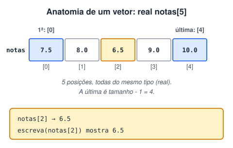
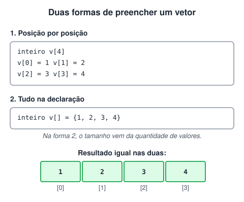
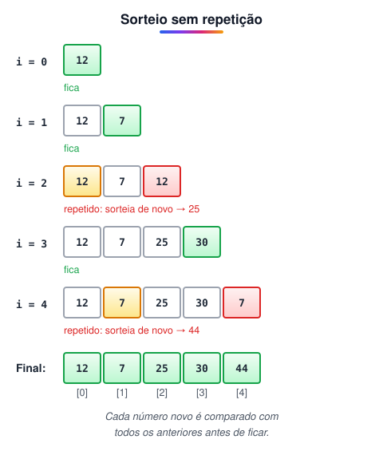

# Declaração e Atribuição de Valores a Vetores

> 🗺️ **Nesta aula:** o que é um vetor e como funcionam os índices, as duas formas de declarar e preencher, e dois projetos: média com pesos num vetor e sorteio sem repetição.

## De onde paramos

Na urna eletrônica, cada partido precisou de uma variável própria; com 30 notas, seriam 30 variáveis. A rotina de troca mostrou que vamos mexer muito em valores. Agora vem a estrutura que guarda muitos valores juntos: o vetor.

## O que é um vetor

Um vetor (ou *array* unidimensional) é uma variável que guarda **vários valores do mesmo tipo** sob um único nome, como uma lista. Cada valor ocupa uma posição numerada, o **índice**.

- Todos os valores são do mesmo tipo (só inteiros, só reais...).
- Cada posição é acessada pelo nome do vetor seguido do índice entre colchetes: `notas[2]`.
- A **primeira** posição tem índice **0**.
- A **última** posição tem índice **tamanho - 1**: num vetor de 5 posições, vai de 0 a 4.



> 💡 **Analogia:** o vetor é um prédio: o nome do vetor é o endereço e o índice é o número do apartamento. A diferença é que, neste prédio, o primeiro apartamento é o 0 (como o térreo), por isso o último de um prédio com 5 andares é o 4.

> 💡 Sem vetor, guardar 30 notas exigiria 30 variáveis (`nota_1` … `nota_30`) e 30 linhas de `leia`. Com vetor, é uma declaração e um laço `para`.

## Declaração

```c
tipo nome_vetor[quantidade_de_posicoes]

// notas[0] a notas[4]
real notas[5]
// nomes[0] a nomes[29]
cadeia nomes[30]
```

## Atribuindo valores

```c
// 1. Posição por posição, depois de
//    declarar (o tamanho é obrigatório)
inteiro v[4]
v[0] = 1
v[1] = 2
v[2] = 3
v[3] = 4

// 2. Tudo na declaração, entre chaves
//    (o tamanho vem da quantidade de
//    valores)
inteiro v[] = {1, 2, 3, 4}
```



> 💡 **Analogia:** é arrumar uma caixa de ovos. Você pode colocar um ovo de cada vez em cada cavidade numerada (posição por posição) ou comprar a caixa já cheia (tudo na declaração).

## Projeto: média com pesos guardados num vetor

**Código**

```c
programa
{
  inteiro pesos[4]
  real nt_1, nt_2, nt_3, nt_4
  real soma, media
  cadeia nome

  funcao inicio()
  {
    // um peso em cada posição: mudar a
    // regra é mexer só aqui
    pesos[0] = 1
    pesos[1] = 2
    pesos[2] = 3
    pesos[3] = 5

    escreva("Vamos calcular sua média\n")
    escreva("Pesos: ", pesos[0], ", ",
      pesos[1])
    escreva(", ", pesos[2], ", ",
      pesos[3], "\n")
    escreva("Digite seu nome: ")
    leia(nome)
    escreva("Digite a 1ª nota: ")
    leia(nt_1)
    escreva("Digite a 2ª nota: ")
    leia(nt_2)
    escreva("Digite a 3ª nota: ")
    leia(nt_3)
    escreva("Digite a 4ª nota: ")
    leia(nt_4)

    // cada nota com o peso de mesma posição
    soma = nt_1 * pesos[0] + nt_2 * pesos[1]
    soma = soma + nt_3 * pesos[2]
      + nt_4 * pesos[3]
    // soma dos pesos: 1 + 2 + 3 + 5 = 11
    media = soma / 11

    escreva("\nOlá, ", nome, "\n")
    escreva("Sua média é: ", media, "\n")
  }
}
```

O vetor se chamava `notas` no original, mas guarda os **pesos**; renomeá-lo deixa a fórmula mais fácil de ler.

## Projeto: 5 números aleatórios sem repetição

A estratégia: sortear uma posição de cada vez e, antes de aceitar o número, conferir se ele já apareceu nas posições anteriores. Se já apareceu, sorteia de novo.



> 💡 **Analogia:** é o amigo secreto em que você tira o próprio nome. Antes de aceitar o papel, você confere; se já saiu, devolve e tira outro. Só passa para o próximo participante quando o nome é válido.

**Código**

```c
programa
{
  inclua biblioteca Util --> u

  inteiro vet[5]
  inteiro i, j
  logico repetido

  funcao inicio()
  {
    para (i = 0; i < 5; i++) {
      // faca-enquanto: sorteia pelo menos
      // uma vez e repete até sair um novo
      faca {
        vet[i] = u.sorteia(1, 50)
        repetido = falso
        // compara só com as posições já
        // preenchidas (antes de i)
        para (j = 0; j < i; j++) {
          se (vet[j] == vet[i]) {
            repetido = verdadeiro
          }
        }
      } enquanto (repetido)
    }

    para (i = 0; i < 5; i++) {
      escreva(vet[i], "\n")
    }
  }
}
```

> ⚠️ A versão original sorteava tudo primeiro e depois comparava cada posição só com as **seguintes**. Quando uma posição era re-sorteada, o número novo podia coincidir com uma posição **anterior**, já conferida, e a repetição passava. Conferir cada sorteio contra todas as posições anteriores evita isso.

## 🧠 Revisão rápida

**Depois de `inteiro v[] = {4, 8, 15, 16, 23}`, quanto vale `v[3]`?**

16 (a 4ª posição, pois o índice começa em 0).

**O que acontece com `v[5]` nesse mesmo vetor?**

Erro: o vetor tem 5 posições, de 0 a 4. O índice 5 não existe.

**No sorteio sem repetição, por que o laço interno vai só até `j < i`?**

Porque só as posições anteriores a `i` já têm números sorteados; as seguintes ainda estão vazias.

> ➡️ **Próximo passo:** preencher posição por posição não escala para vetores grandes. A próxima aula usa o contador do laço como índice: **Manipulação de Vetores com Laço Para**.

## 📌 Resumo

| Item | Em uma frase |
| --- | --- |
| Vetor | Vários valores do mesmo tipo sob um único nome |
| Índice | A primeira posição é 0; a última é tamanho − 1 |
| Declaração | `tipo nome[tamanho]`, como `real notas[5]` |
| Preencher depois | Posição por posição: `v[0] = 1` |
| Preencher na declaração | `inteiro v[] = {1, 2, 3, 4}` (o tamanho pode ser omitido) |
