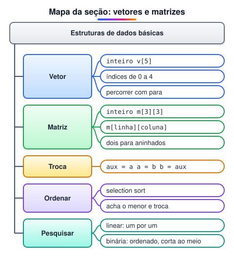
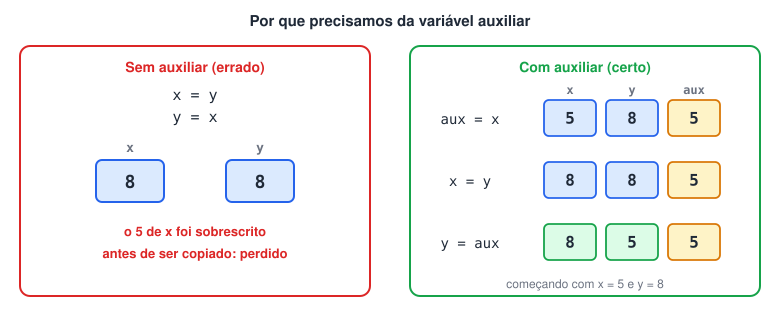
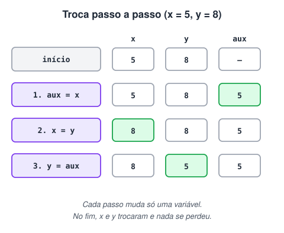

# Rotina de Troca de Valores entre Variáveis

> 🗺️ **Nesta aula:** por que não dá para trocar duas variáveis atribuindo uma à outra e a rotina de troca com variável auxiliar, base dos algoritmos de ordenação.

## 🧭 Cheat sheet da seção

Antes de começar, veja o mapa da seção: é o que as próximas aulas vão explicar. Volte a ele no fim para revisar.



## De onde paramos

Desde a aula de variáveis, sabemos que atribuir um valor apaga o anterior. Essa regra, que parecia inofensiva, cria um problema quando queremos trocar os valores de duas variáveis entre si.

## O problema

Trocar os valores de duas variáveis entre si é uma tarefa comum: aparece, por exemplo, em todos os algoritmos de ordenação. Mas não dá para fazer a troca atribuindo uma variável diretamente à outra:

```c
// x perde o valor original...
x = y
// ...e y recebe o próprio valor de volta
y = x
```

Ao executar `x = y`, o valor antigo de `x` é sobrescrito e se perde para sempre.



> 💡 **Analogia:** são dois carros trocando de vaga numa garagem apertada. Se o primeiro tenta entrar na vaga do segundo direto, bate. Alguém precisa estacionar temporariamente numa vaga extra para liberar o caminho.

## A solução: uma variável auxiliar

Pense em dois copos, um com suco e outro com leite. Para trocar o conteúdo, você precisa de um terceiro copo vazio. A rotina de troca usa uma terceira variável, `aux`, com o mesmo papel:

1. Copie o valor de `x` para `aux` (agora ele está salvo).
2. Copie o valor de `y` para `x` (pode sobrescrever, porque o valor antigo de `x` está em `aux`).
3. Copie o valor de `aux` para `y`.



> 💡 **Analogia:** é como dois jogadores trocando de camisa no vestiário. Um deles pendura a camisa no banco (`aux`), veste a do colega e, por fim, o colega pega a camisa que ficou no banco. Seguir essa ordem é o que evita que as duas camisas se misturem.

> 💡 As três variáveis precisam ser do mesmo tipo: para trocar dois inteiros, `aux` também deve ser `inteiro`.

## Projeto: trocando os valores de x e y

**Código**

```c
programa
{
  // aux do mesmo tipo de x e y
  inteiro x, y, aux

  funcao inicio()
  {
    escreva("Digite o valor de x: ")
    leia(x)
    escreva("Digite o valor de y: ")
    leia(y)

    escreva("\nAntes: x = ", x, " e y = ",
      y, "\n")

    // 1) salva x antes de ele ser apagado
    aux = x
    // 2) agora x pode receber y
    x = y
    // 3) y recebe o x original, guardado
    y = aux

    escreva("Depois: x = ", x, " e y = ",
      y, "\n")
  }
}
```

## 🧠 Revisão rápida

**Com x = 3 e y = 9, quanto vale cada variável depois de `aux = x`, `x = y`, `y = aux`?**

x = 9, y = 3 e aux = 3.

**E se a ordem fosse `aux = x`, `y = aux`, `x = y`?**

Erro: y recebe 3, depois x recebe esse 3. As duas ficam com 3 e o 9 se perde.

**Por que `aux` precisa ser do mesmo tipo de `x` e `y`?**

Porque ela guarda temporariamente o valor de `x`: precisa aceitar o mesmo tipo de dado.

> ➡️ **Próximo passo:** e quando são 10, 100 ou 1.000 valores? Em vez de uma variável para cada, usamos um vetor: **Declaração e Atribuição de Valores a Vetores**.

## 📌 Resumo

| Item | Em uma frase |
| --- | --- |
| Problema | `x = y` sobrescreve `x`, e o valor antigo se perde |
| Solução | `aux = x`, depois `x = y`, depois `y = aux` |
| Tipo | `aux` precisa ser do mesmo tipo das variáveis trocadas |
| Onde aparece | Em todos os algoritmos de ordenação |
