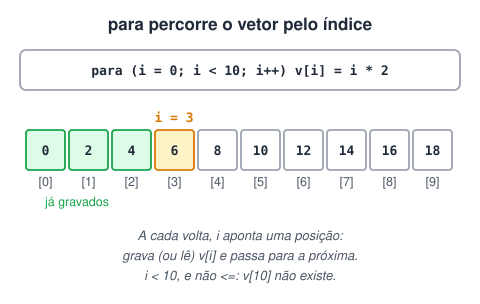
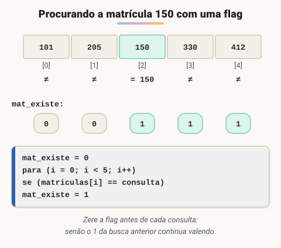

# Manipulação de Vetores com Laço Para

> 🗺️ **Nesta aula:** como usar o contador do `para` como índice para gravar e ler um vetor inteiro, o limite dos índices e dois projetos: média de notas e consulta de matrículas com flag.

## De onde paramos

A aula anterior mostrou como declarar um vetor e preenchê-lo posição por posição. Escrever `v[0]`, `v[1]`, `v[2]`… à mão não escala; junto com o `para`, o vetor permite tratar 4 ou 4.000 valores com o mesmo código.

## Percorrendo um vetor com para

O laço `para` combina perfeitamente com vetores: o contador do laço serve de **índice**, e a cada volta o programa acessa uma posição diferente, `v[i]`. Assim é possível preencher ou ler um vetor inteiro com duas ou três linhas, seja ele de 10 ou de 1.000 posições.

```c
inteiro v[10]

// gravando: cada posição recebe o dobro
// do próprio índice
para (inteiro i = 0; i < 10; i++) {
  v[i] = i * 2
}

// lendo: mostra as 10 posições
para (inteiro i = 0; i < 10; i++) {
  escreva(v[i], "\n")
}
```



> 💡 **Analogia:** o vetor é uma fileira de armários numerados no vestiário, e o `i` é o funcionário que passa abrindo um por um, do armário 0 ao último. Ele não precisa saber o nome de cada armário: basta o número.

> ⚠️ Os índices vão de 0 a **tamanho - 1**. Por isso a condição é `i < 10`, e não `i <= 10`: acessar `v[10]` num vetor de 10 posições é um erro de índice inválido.

## Projeto: média de 4 notas

Leia 4 notas, calcule a média e mostre, no final, a média e cada uma das notas.

**Código**

```c
programa
{
  real media, soma = 0.0
  inteiro i
  // as 4 notas sob um só nome
  real notas[4]
  cadeia nome_aluno

  funcao inicio()
  {
    escreva("Nome do aluno: ")
    leia(nome_aluno)

    // lê e soma no mesmo laço: evita
    // percorrer o vetor duas vezes
    para (i = 0; i < 4; i++) {
      // i + 1: mostra 1ª a 4ª, não 0 a 3
      escreva("Digite a ", i + 1,
        "ª nota: ")
      leia(notas[i])
      soma += notas[i]
    }

    media = soma / 4
    limpa()

    escreva("Olá, ", nome_aluno, "\n")
    escreva("Sua média é: ", media, "\n")
    // as notas continuam guardadas no
    // vetor e podem ser mostradas depois
    para (i = 0; i < 4; i++) {
      escreva("Nota ", i + 1, ": ",
        notas[i], "\n")
    }
  }
}
```

## Projeto: cadastro e consulta de matrículas

Leia 5 números de matrícula (com o nome de cada aluno). Depois, permita consultar matrículas, uma de cada vez, informando se cada número está ou não cadastrado. O programa termina quando o usuário digitar `n`.

A busca usa uma **variável sinalizadora** (*flag*): `mat_existe` começa em 0 e vira 1 se a matrícula for encontrada durante a varredura.



> 💡 **Analogia:** a flag é a plaquinha "achei!" que você levanta numa caça ao tesouro. Antes de cada nova caçada, a plaquinha precisa voltar para baixo, senão todo mundo acha que você já encontrou o próximo tesouro.

**Código**

```c
programa
{
  // dois vetores "paralelos": a posição i
  // de um corresponde à posição i do outro
  inteiro matriculas[5]
  cadeia alunos[5]
  inteiro i, consulta, mat_existe, posicao
  caracter continua = 's'

  funcao inicio()
  {
    // cadastro
    para (i = 0; i < 5; i++) {
      escreva("Matrícula ", i + 1, ": ")
      leia(matriculas[i])
      escreva("Nome do aluno: ")
      leia(alunos[i])
      escreva("\n")
    }
    limpa()

    // consultas: aceita 's' e 'S'
    enquanto (continua == 's'
      ou continua == 'S') {
      escreva("Matrícula a consultar: ")
      leia(consulta)

      // zera a flag a cada nova consulta
      mat_existe = 0
      para (i = 0; i < 5; i++) {
        se (matriculas[i] == consulta) {
          mat_existe = 1
          // guarda onde achou, para mostrar
          // o nome sem novo laço
          posicao = i
        }
      }

      se (mat_existe == 1) {
        escreva("\nEncontrada: ")
        escreva(matriculas[posicao], " - ")
        escreva(alunos[posicao], "\n")
      }
      senao {
        escreva("\nMatrícula não ",
          "encontrada.\n")
      }

      escreva("\nConsultar outra? (s/n): ")
      leia(continua)
      limpa()
    }
  }
}
```

> ⚠️ Na versão original, `mat_existe` nunca voltava a 0: depois da primeira matrícula encontrada, todas as consultas seguintes diziam "encontrada", mesmo com números inexistentes. A linha `mat_existe = 0` antes de cada busca resolve. Guardar a `posicao` também dispensa o segundo laço que o original usava para mostrar o nome.

## 🧠 Revisão rápida

**Num vetor `real precos[8]`, quais são o primeiro e o último índice?**

0 e 7.

**Como somar todas as posições de `inteiro v[6]`?**

`soma = 0` antes; `para (i = 0; i < 6; i++) soma += v[i]`.

**Por que a flag é zerada antes de cada busca, e não só uma vez no começo?**

Porque, depois de uma busca que achou, ela ficaria em 1 e a próxima consulta diria "encontrada" sem ter achado nada.

> ➡️ **Próximo passo:** com o vetor preenchido, uma tarefa clássica é colocá-lo em ordem, usando a rotina de troca: **Ordenação de Vetores com o algoritmo Selection Sort**.

## 📌 Resumo

| Item | Em uma frase |
| --- | --- |
| Contador como índice | A cada volta, `v[i]` acessa uma posição diferente |
| Índices | Vão de 0 a tamanho − 1; por isso `i < tamanho` |
| Mostrar ao usuário | Use `i + 1` para contar a partir de 1 |
| Flag | Variável que começa em 0 e vira 1 quando algo é encontrado |
| Zerar a flag | Antes de cada nova busca, senão o resultado anterior contamina |
