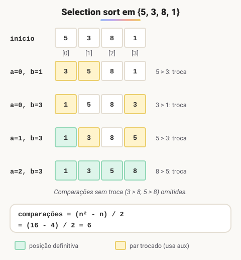

# Ordenação de Vetores com o algoritmo Selection Sort

> 🗺️ **Nesta aula:** por que ordenar, como funciona a ordenação por seleção passo a passo, quantas comparações ela faz e um programa que ordena 9 números.

## De onde paramos

Já sabemos preencher e percorrer vetores com o `para`, e trocar dois valores com uma variável auxiliar. Juntando as duas coisas, dá para colocar um vetor inteiro em ordem.

## Ordenando um vetor

Ordenar é colocar os valores de um vetor em ordem crescente ou decrescente. Além de facilitar a leitura, a ordenação é pré-requisito de algoritmos mais eficientes, como a pesquisa binária.

O curso usa um método simples de **ordenação por seleção** (*selection sort*): para cada posição, o algoritmo procura, entre ela e as seguintes, o menor valor e o coloca ali. É como arrumar cartas na mão: você escolhe a menor e põe na primeira posição, depois a menor das que sobraram na segunda, e assim por diante.

> 💡 Existem muitos outros algoritmos de ordenação, mais ou menos eficientes: Bubble sort, Insertion sort, Cocktail shaker sort, Merge sort, Quicksort e Heapsort, entre outros.

## Como funciona

Para ordenar em ordem crescente:

1. Compare a posição 0 com cada uma das posições seguintes (1, 2, 3...).
  - Se o valor da posição 0 for **maior**, troque os dois de lugar (com a rotina de troca e uma variável auxiliar).
  - Se for menor ou igual, não faça nada.
2. Ao terminar as comparações, o menor valor do vetor está na posição 0, que não muda mais.
3. Repita o processo a partir da posição 1, depois da 2, e assim por diante, até a penúltima posição.

> 💡 A troca de posições usa a mesma variável auxiliar vista na aula **Rotina de Troca de Valores entre Variáveis**.



> 💡 **Analogia:** é o professor de educação física formando a fila por altura. Ele olha a turma toda, chama o mais baixo para o primeiro lugar; depois olha os que sobraram e chama o mais baixo para o segundo lugar; e assim até a fila ficar pronta. Quem já está posicionado não se mexe mais.

O número total de comparações para um vetor de `n` posições é `(n² - n) / 2`. Com 3 posições são `(9 - 3) / 2 = 3` comparações; com 4, são 6; com 9, são 36.

> 💡 Por que essa fórmula? A posição 0 é comparada com n − 1 outras, a 1 com n − 2, …, a penúltima com 1. Somando: (n − 1) + (n − 2) + … + 1 = n(n − 1)/2. Dobrar o tamanho do vetor quase quadruplica o trabalho.

## Projeto: ordenar 9 números digitados

**Código**

```c
programa
{
  inteiro cont, a, b, aux
  inteiro vet[9]

  funcao inicio()
  {
    // preenchendo o vetor
    para (cont = 0; cont < 9; cont++) {
      escreva("Digite um número: ")
      leia(vet[cont])
    }

    // a: posição que está sendo definida;
    // para na penúltima, porque a última
    // sobra já no lugar
    para (a = 0; a < 8; a++) {
      // b: cada posição à direita de a
      para (b = a + 1; b < 9; b++) {
        // achou um menor que vet[a]?
        // traz para a posição a
        se (vet[a] > vet[b]) {
          aux = vet[a]
          vet[a] = vet[b]
          vet[b] = aux
        }
      }
    }

    // vetor ordenado
    para (cont = 0; cont < 9; cont++) {
      escreva(vet[cont], " ")
    }
    escreva("\n")
  }
}
```

Teste: 5 3 8 1 9 2 7 4 6 → `1 2 3 4 5 6 7 8 9`.

> 💡 O laço externo pode parar em `a < 8` (a penúltima posição): quando todas as outras estão no lugar, a última já está certa. Para ordem decrescente, basta trocar `>` por `<` na comparação.

## 🧠 Revisão rápida

**Quantas comparações o selection sort faz num vetor de 10 posições?**

(100 − 10) / 2 = 45.

**Como fica {4, 2, 3} depois da primeira passada (a = 0)?**

a=0, b=1: 4 > 2, troca → {2, 4, 3}; b=2: 2 > 3? não. Resultado: {2, 4, 3}, com o menor já na posição 0.

**O que muda no código para ordenar em ordem decrescente?**

Só a comparação: `vet[a] < vet[b]` no lugar de `vet[a] > vet[b]`.

> ➡️ **Próximo passo:** com os dados guardados (ordenados ou não), a pergunta seguinte é "este valor está no vetor?": **Algoritmo de Pesquisa Linear em Vetores**.

## 📌 Resumo

| Item | Em uma frase |
| --- | --- |
| Ordenação | Colocar os valores em ordem crescente ou decrescente |
| Ideia | Para cada posição, levar para ela o menor valor das posições seguintes |
| Estrutura | Dois `para` aninhados: `a` de 0 até a penúltima, `b` de `a + 1` até a última |
| Troca | Rotina com variável `aux` |
| Comparações | `(n² − n) / 2` para `n` posições |
| Decrescente | Troque `>` por `<` na comparação |
