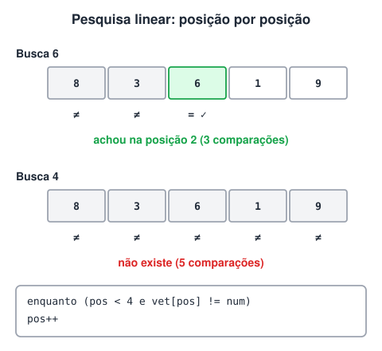

# Algoritmo de Pesquisa Linear em Vetores

> 🗺️ **Nesta aula:** como a pesquisa linear compara o valor procurado com cada posição, a condição dupla do `enquanto` e dois projetos: números e frutas.

## De onde paramos

Na consulta de matrículas, um `para` percorria o vetor inteiro com uma flag. A pesquisa linear organiza essa ideia e para assim que encontra o valor, sem olhar o resto.

## Pesquisa linear (sequencial)

Na pesquisa linear o valor procurado é comparado com cada posição do vetor, **uma por uma, da primeira à última**, até ser encontrado ou até o vetor acabar.

- Funciona com qualquer vetor, ordenado ou não.
- É simples, mas lenta em vetores grandes: no pior caso (valor no fim ou inexistente), compara todas as posições.



> 💡 **Analogia:** é procurar a chave do carro numa gaveta bagunçada: você tira um objeto de cada vez até achar a chave ou esvaziar a gaveta. Se ela estiver no fundo (ou não estiver lá), você mexe em tudo.

O laço `enquanto` avança a posição enquanto **duas** condições forem verdadeiras: ainda não chegou à última posição **e** o valor da posição atual não é o procurado. Quando ele termina, basta conferir a posição em que parou.

## Projeto: procurar um número entre 5

**Código**

```c
programa
{
  inteiro num, pos, i
  inteiro vet[5]

  funcao inicio()
  {
    para (i = 0; i < 5; i++) {
      escreva("Digite um valor: ")
      leia(vet[i])
    }

    escreva("Digite o valor a pesquisar: ")
    leia(num)

    // avança enquanto não chegou à última
    // posição (4) e ainda não achou
    pos = 0
    enquanto (pos < 4 e vet[pos] != num) {
      pos++
    }

    // o laço para por dois motivos: achou
    // ou chegou ao fim. O se descobre qual
    se (vet[pos] == num) {
      escreva("\n", num, " está na posição ",
        pos, "\n")
    }
    senao {
      escreva("\n", num, " não existe no ",
        "vetor.\n")
    }

    escreva("\nVetor completo: ")
    para (i = 0; i < 5; i++) {
      escreva(vet[i], " ")
    }
    escreva("\n")
  }
}
```

> 💡 A condição é `pos < 4` (e não `< 5`) porque, ao parar em 4, o `se` logo abaixo ainda compara a última posição. Se o laço pudesse chegar a 5, `vet[5]` não existiria.

## Projeto: fruta disponível?

Um mercado tem 4 frutas em estoque: morango, banana, caju e amora. Pergunte qual fruta o usuário quer comprar e diga se ela está disponível. Os nomes ficam guardados num vetor.

**Código**

```c
programa
{
  inclua biblioteca Texto --> t

  // o estoque já vem preenchido
  cadeia frutas[] = {"morango", "banana",
    "caju", "amora"}
  cadeia fruta
  inteiro pos

  funcao inicio()
  {
    escreva("Qual fruta você deseja ",
      "comprar? ")
    leia(fruta)

    // "Banana" e "BANANA" viram "banana",
    // igual ao que está no vetor
    fruta = t.caixa_baixa(fruta)

    // 4 frutas: a última posição é 3
    pos = 0
    enquanto (pos < 3
      e frutas[pos] != fruta) {
      pos++
    }

    se (frutas[pos] == fruta) {
      escreva("\nFruta disponível!\n")
    }
    senao {
      escreva("\nFruta indisponível.\n")
    }
  }
}
```

## 🧠 Revisão rápida

**Num vetor de 1000 posições, quantas comparações a pesquisa linear faz no pior caso?**

1000: quando o valor está na última posição ou não existe.

**Por que padronizar o texto com `t.caixa_baixa()` antes de comparar?**

Porque "Banana" e "banana" são cadeias diferentes para o computador. Convertendo tudo para minúsculas, a comparação ignora maiúsculas.

**A pesquisa linear exige vetor ordenado?**

Não: ela olha todas as posições em sequência, então funciona com qualquer ordem.

> ➡️ **Próximo passo:** se o vetor estiver ordenado, dá para achar o valor com muito menos comparações: **Algoritmo de pesquisa binária em vetores**.

## 📌 Resumo

| Item | Em uma frase |
| --- | --- |
| Pesquisa linear | Compara o valor com cada posição, da primeira à última |
| Vantagem | Funciona com vetor ordenado ou não |
| Desvantagem | Lenta em vetores grandes: no pior caso, olha todas as posições |
| Laço | Avança enquanto não chegou à última posição e não achou |
| Depois do laço | Confira a posição em que parou para saber se achou |
| Textos | Padronize com `t.caixa_baixa()` antes de comparar |
