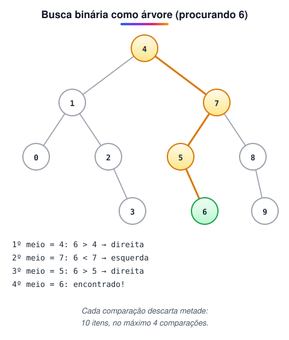
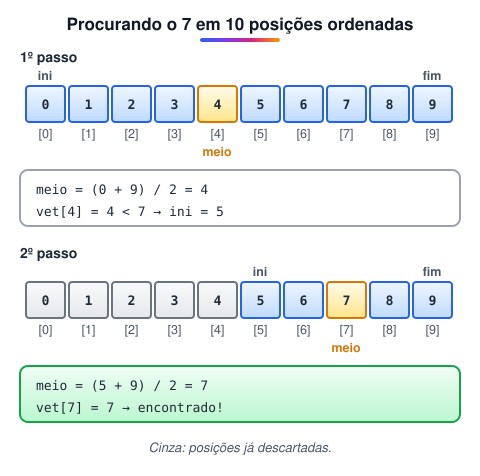
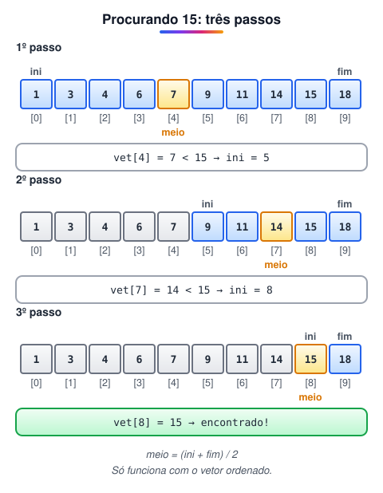

# Algoritmo de pesquisa binária em vetores

**Calculadora de log₂ (Omni)**

🔗 [Log Base 2 Calculator](https://www.omnicalculator.com/math/log-2)

> 🗺️ **Nesta aula:** como a pesquisa binária divide o vetor ao meio a cada passo, por que ele precisa estar ordenado, o papel de cada variável e um projeto que sorteia, ordena e pesquisa.

## De onde paramos

A pesquisa linear olha uma posição de cada vez e, no pior caso, todas elas. Se o vetor já estiver ordenado (com o selection sort, por exemplo), existe um jeito muito mais rápido.

## Pesquisa binária

A pesquisa binária procura um valor num vetor **ordenado** dividindo o espaço de busca ao meio a cada passo. É o que fazemos ao procurar uma palavra no dicionário: abrimos no meio e decidimos se a palavra está antes ou depois.

1. Compara o valor procurado com o elemento do **meio** do trecho que ainda pode contê-lo.
2. Se for igual, encontrou.
3. Se o procurado for **menor**, descarta a metade da direita; se for **maior**, descarta a da esquerda.
4. Repete com a metade que sobrou, até encontrar ou até não sobrar nada.

É um exemplo do paradigma **dividir para conquistar**. Num vetor de 1.000 posições, a pesquisa linear pode precisar de 1.000 comparações; a binária, de no máximo 10 (porque 2¹⁰ = 1.024). Por isso a calculadora de log₂ acima: o número máximo de passos é log₂(n), arredondado para cima.

> 📎 A pesquisa binária **só funciona se o vetor estiver ordenado** (do menor para o maior). Num vetor desordenado, descartar uma metade pode jogar fora justamente o valor procurado. Se o vetor não estiver ordenado, ordene antes (com o selection sort, por exemplo) ou use a pesquisa linear.

## A busca como árvore de decisões

Cada comparação com o meio é uma bifurcação: menor vai para a esquerda, maior vai para a direita. No vetor `{0, 1, 2, ..., 9}`, procurar o 6 percorre o caminho em destaque:



> 💡 **Analogia:** é o jogo "pensei num número de 1 a 100", em que só se responde "maior" ou "menor". Quem chuta sempre o meio (50, depois 25 ou 75...) acerta em no máximo 7 tentativas; quem chuta 1, 2, 3... pode precisar de 100.

## Passo a passo com as variáveis

A implementação usa quatro variáveis (nos diagramas, `ini` e `fim` abreviam `inicial` e `final`):

| Variável | Papel |
| --- | --- |
| `inicial` | primeira posição do trecho que ainda está sendo pesquisado (começa em 0) |
| `final` | última posição desse trecho (começa em tamanho - 1) |
| `meio` | `(inicial + final) / 2`, calculado a cada volta |
| `encontrado` | sinalizador (`logico`) que vira `verdadeiro` quando o valor é achado |

Procurando o 7 no vetor de 0 a 9:



E um caso mais longo, procurando o 15:



> 💡 **Analogia:** `inicial` e `final` são as duas mãos segurando as páginas do livro que ainda importam. A cada passo, uma das mãos pula para perto do meio, e o pedaço entre elas fica cada vez mais fino, até sobrar a página certa ou nenhuma.

> 💡 `meio = (inicial + final) / 2` é uma divisão entre inteiros: o resto é descartado. Com `inicial = 0` e `final = 9`, o meio é 4 (e não 4,5).

## Projeto: sortear, ordenar e pesquisar

Crie um vetor de 10 posições com números aleatórios, ordene do menor para o maior e diga se um número informado pelo usuário está no vetor.

**Código**

```c
programa
{
  inclua biblioteca Util --> u

  inteiro vet[10]

  funcao inicio()
  {
    // a binária exige vetor ordenado
    preenche_ordena_vetor(vet)

    // mostra o vetor ordenado, para conferir
    para (inteiro i = 0; i < 10; i++) {
      escreva(vet[i], " ")
    }
    escreva("\n")

    inteiro inicial = 0
    inteiro final = 9
    inteiro meio
    logico encontrado = falso
    inteiro busca

    escreva("Digite o valor a pesquisar: ")
    leia(busca)

    // para quando acha ou quando o trecho
    // de busca fica vazio
    enquanto (inicial <= final
      e nao encontrado) {
      // divisão inteira: descarta o resto
      meio = (inicial + final) / 2

      se (vet[meio] == busca) {
        encontrado = verdadeiro
      }
      senao se (vet[meio] > busca) {
        // procurado é menor: fica só a
        // metade da esquerda
        final = meio - 1
      }
      senao {
        // procurado é maior: fica só a
        // metade da direita
        inicial = meio + 1
      }
    }

    se (encontrado) {
      escreva("\nSim! O número está no ",
        "vetor.\n")
    }
    senao {
      escreva("\nNão. O número não está ",
        "no vetor.\n")
    }
  }

  // preenche com sorteios e ordena com o
  // selection sort; o vetor é recebido
  // como parâmetro
  funcao preenche_ordena_vetor(
    inteiro vetor[])
  {
    inteiro a, b, aux

    para (a = 0; a < 10; a++) {
      vetor[a] = u.sorteia(1, 20)
    }

    para (a = 0; a < 9; a++) {
      para (b = a + 1; b < 10; b++) {
        se (vetor[a] > vetor[b]) {
          aux = vetor[a]
          vetor[a] = vetor[b]
          vetor[b] = aux
        }
      }
    }
  }
}
```

> 💡 A função `preenche_ordena_vetor` (funções são vistas na seção de sub-rotinas) recebe o vetor como parâmetro. No original, ela misturava o parâmetro `vetor` com a variável global `vet` no preenchimento e na troca. Funcionava só porque os dois eram o mesmo vetor; agora a função usa apenas o parâmetro e tem suas próprias variáveis locais.

## 🧠 Revisão rápida

**Quantos passos, no máximo, a busca binária precisa para 100 posições?**

7, porque 2⁷ = 128 ≥ 100 (e 2⁶ = 64 não basta).

**No vetor {2, 5, 8, 12, 16, 23, 38}, procurando 23: quais meios são visitados?**

meio = 3 (12 < 23, inicial = 4); meio = 5 (23): encontrado em 2 passos.

**Quando o laço termina sem achar?**

Quando `inicial` passa de `final`: o trecho de busca ficou vazio.

> ➡️ **Próximo passo:** o vetor é uma fileira. E quando os dados formam uma tabela, com linhas e colunas? **Como criar e manipular Matrizes (Vetores bidimensionais)**.

## 📌 Resumo

| Item | Em uma frase |
| --- | --- |
| Pesquisa binária | Compara com o meio e descarta a metade que não pode conter o valor |
| Pré-requisito | O vetor precisa estar ordenado |
| Passos | No máximo log₂(n): 10 comparações para 1.000 posições |
| `meio` | `(inicial + final) / 2`, recalculado a cada volta |
| Procurado menor | `final = meio - 1` |
| Procurado maior | `inicial = meio + 1` |
| Fim | Quando acha ou quando `inicial` passa de `final` |
