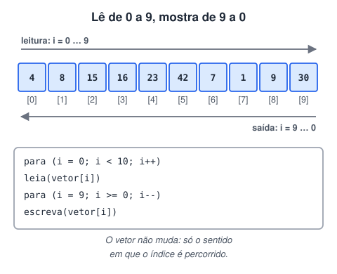
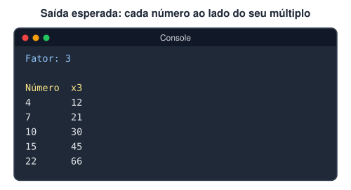
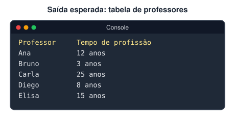
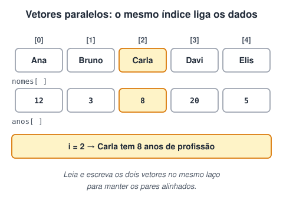
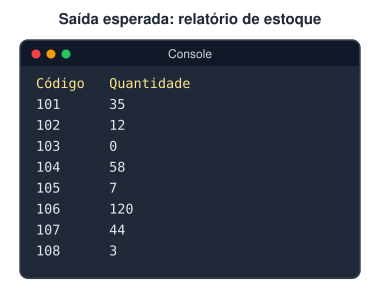
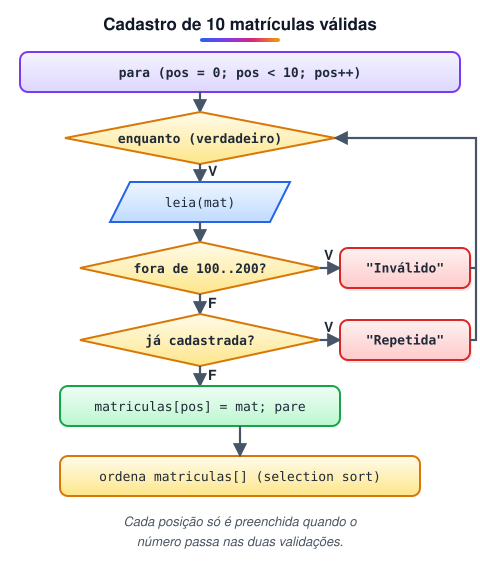
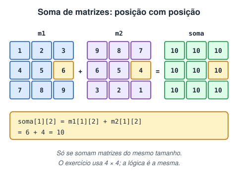

# 4ª Lista de exercícios

> 🗺️ **Nesta lista:** sete exercícios com vetores e matrizes: ordem inversa, vetores paralelos, validação com ordenação, temporizador e soma de matrizes.

## De onde paramos

A seção mostrou troca de valores, vetores, ordenação, pesquisa linear e binária e matrizes. Agora é praticar com problemas que guardam muitos dados.

> 💡 **Padrão desta lista:** quase todo exercício tem um laço para **ler** e outro para **mostrar**. Com matrizes, cada um desses laços vira um par de `para` aninhados (linhas por fora, colunas por dentro).

## Exercício 1: ordem inversa

Leia 10 números e mostre-os na ordem inversa da leitura: o último lido é o primeiro mostrado.



> 💡 **Analogia:** é a contagem regressiva de um lançamento de foguete. Os números já estão todos guardados; basta ler a fileira de trás para a frente, do 9 ao 0.

<details>
<summary>Ver resposta</summary>

```c
programa
{
  inteiro vetor[10]
  inteiro i

  funcao inicio()
  {
    para (i = 0; i < 10; i++) {
      escreva("Número ", i + 1, " de 10: ")
      leia(vetor[i])
    }

    limpa()
    escreva("Números em ordem inversa:\n")

    // contador decrescente: de 9 (última
    // posição) até 0
    para (i = 9; i >= 0; i--) {
      escreva(vetor[i], " ")
    }
    escreva("\n")
  }
}
```

</details>

## Exercício 2: vetor multiplicado por um fator

Leia 5 números para um vetor e monte outro vetor com esses valores multiplicados por um fator, também informado pelo usuário. Mostre os dois vetores lado a lado:



> 💡 **Analogia:** é dobrar uma receita. A lista original de ingredientes continua no caderno, e você escreve ao lado uma segunda lista com cada quantidade multiplicada pelo fator.

<details>
<summary>Ver resposta</summary>

```c
programa
{
  inteiro numeros[5], multiplicados[5]
  inteiro fator, i

  funcao inicio()
  {
    escreva("Fator de multiplicação: ")
    leia(fator)

    para (i = 0; i < 5; i++) {
      escreva("Número ", i + 1, " de 5: ")
      leia(numeros[i])
      // o 2º vetor que o enunciado pede,
      // montado na mesma volta
      multiplicados[i] = numeros[i] * fator
    }

    limpa()
    escreva("Número\tx", fator, "\n")
    para (i = 0; i < 5; i++) {
      escreva(numeros[i], "\t")
      escreva(multiplicados[i], "\n")
    }
  }
}
```

</details>

O original calculava `vet_numero[i] * fator` direto no `escreva`, sem montar o segundo vetor pedido no enunciado.

## Exercício 3: professores e tempo de profissão

Cadastre 5 professores e seus tempos de profissão em dois vetores. Mostre uma tabela com os nomes à esquerda e os tempos à direita:





> 💡 **Analogia:** vetores paralelos são como a lista de chamada e a planilha de notas da mesma turma. A linha 3 de uma corresponde à linha 3 da outra; se alguém reordenar só uma das folhas, os dados se misturam.

<details>
<summary>Ver resposta</summary>

```c
programa
{
  cadeia nomes[5]
  inteiro tempos[5]
  inteiro i

  funcao inicio()
  {
    para (i = 0; i < 5; i++) {
      escreva("Nome do professor: ")
      leia(nomes[i])
      escreva("Tempo de profissão (anos): ")
      leia(tempos[i])
      escreva("\n")
    }

    limpa()
    escreva("Professor\tTempo de ",
      "profissão\n")
    para (i = 0; i < 5; i++) {
      // o mesmo índice liga o nome ao
      // tempo do mesmo professor
      escreva(nomes[i], "\t\t", tempos[i])
      escreva(" anos\n")
    }
  }
}
```

</details>

## Exercício 4: estoque do depósito

Um depósito guarda 8 produtos, cada um com um código. Leia o código e a quantidade em estoque de cada produto, guarde em dois vetores e mostre um relatório em forma de tabela:



> 💡 **Analogia:** é a prateleira com etiquetas: cada etiqueta (código) fica em cima de uma caixa (quantidade). O relatório só lê as duas coisas na mesma posição, prateleira por prateleira.

<details>
<summary>Ver resposta</summary>

```c
programa
{
  inteiro codigos[8], quantidades[8]
  inteiro i

  funcao inicio()
  {
    para (i = 0; i < 8; i++) {
      escreva("Produto ", i + 1, " de 8\n")
      escreva("Código: ")
      leia(codigos[i])
      escreva("Quantidade em estoque: ")
      leia(quantidades[i])
      escreva("\n")
    }

    limpa()
    // \t separa as colunas do relatório
    escreva("Código\tQuantidade\n")
    para (i = 0; i < 8; i++) {
      escreva(codigos[i], "\t",
        quantidades[i], "\n")
    }
  }
}
```

</details>

A versão original também pedia o nome de cada produto, num terceiro vetor paralelo. Funciona igual: basta mais um `leia` e mais uma coluna no relatório.

## Exercício 5: matrículas válidas e ordenadas

Cadastre 10 números de matrícula num vetor. Eles devem estar entre 100 e 200 e não podem se repetir; se estiverem fora do intervalo, mostre um erro e peça de novo. No final, mostre as matrículas em ordem crescente.



> 💡 **Analogia:** é o porteiro de uma festa com lista: ele confere se o convite é válido (faixa de 100 a 200) e se a pessoa já não entrou (repetição). Só depois de passar pelas duas checagens o nome entra na lista.

<details>
<summary>Ver resposta</summary>

```c
programa
{
  inteiro matriculas[10]
  inteiro pos, mat, j, a, b, aux
  logico valida

  funcao inicio()
  {
    para (pos = 0; pos < 10; pos++) {
      // insiste até a matrícula ser válida
      enquanto (verdadeiro) {
        escreva("Matrícula ", pos + 1,
          " de 10: ")
        leia(mat)

        valida = verdadeiro
        se (mat < 100 ou mat > 200) {
          escreva("Erro: use de 100 a ",
            "200.\n")
          valida = falso
        }
        senao {
          // compara só com as já cadastradas
          para (j = 0; j < pos; j++) {
            se (mat == matriculas[j]) {
              escreva("Erro: já ",
                "cadastrada.\n")
              valida = falso
            }
          }
        }

        se (valida) {
          matriculas[pos] = mat
          pare
        }
      }
    }

    // ordenação crescente (selection sort)
    para (a = 0; a < 9; a++) {
      para (b = a + 1; b < 10; b++) {
        se (matriculas[a] > matriculas[b]) {
          aux = matriculas[a]
          matriculas[a] = matriculas[b]
          matriculas[b] = aux
        }
      }
    }

    limpa()
    escreva("Matrículas cadastradas:\n")
    para (a = 0; a < 10; a++) {
      escreva(matriculas[a], "\n")
    }
  }
}
```

</details>

> 💡 A versão original também cadastrava o nome de cada aluno (sem repetir) e o reordenava junto com a matrícula, uma extensão válida. Só a chamada `t.caixa_baixa(nome)` não tinha efeito: a função devolve o texto convertido, então o certo seria `nome = t.caixa_baixa(nome)`.

## Exercício 6: matriz 4 x 4 com temporizador

Preencha uma matriz 4 x 4 com números aleatórios e mostre um número por segundo. Dica: use a função `aguarde` da biblioteca `Util`.

<details>
<summary>Ver resposta</summary>

```c
programa
{
  inclua biblioteca Util --> u

  inteiro matriz[4][4]
  inteiro lin, col

  funcao inicio()
  {
    para (lin = 0; lin < 4; lin++) {
      para (col = 0; col < 4; col++) {
        matriz[lin][col] = u.sorteia(1, 100)
      }
    }

    para (lin = 0; lin < 4; lin++) {
      para (col = 0; col < 4; col++) {
        escreva(matriz[lin][col], "\t")
        // pausa depois de cada número:
        // 1000 ms = 1 s
        u.aguarde(1000)
      }
      escreva("\n")
    }
  }
}
```

</details>

## Exercício 7: soma de duas matrizes

Preencha duas matrizes 4 x 4 com valores digitados e mostre as duas e a **soma** delas. A soma de matrizes de mesmo tamanho é outra matriz, em que cada posição recebe a soma das posições correspondentes.



> 💡 **Analogia:** é somar as vendas de duas filiais com o mesmo mapa de prateleiras: a prateleira [1][2] da loja A soma com a prateleira [1][2] da loja B, e o resultado vai para a mesma prateleira no relatório geral.

<details>
<summary>Ver resposta</summary>

```c
programa
{
  inteiro m1[4][4], m2[4][4], soma[4][4]
  inteiro lin, col

  funcao inicio()
  {
    para (lin = 0; lin < 4; lin++) {
      para (col = 0; col < 4; col++) {
        escreva("m1 [", lin, "][", col,
          "]: ")
        leia(m1[lin][col])
      }
    }
    limpa()

    para (lin = 0; lin < 4; lin++) {
      para (col = 0; col < 4; col++) {
        escreva("m2 [", lin, "][", col,
          "]: ")
        leia(m2[lin][col])
        // posição a posição: m1 já está
        // completa, então dá para somar
        soma[lin][col] = m1[lin][col]
          + m2[lin][col]
      }
    }
    limpa()

    escreva("Matriz 1\n")
    para (lin = 0; lin < 4; lin++) {
      para (col = 0; col < 4; col++) {
        escreva(m1[lin][col], "\t")
      }
      escreva("\n")
    }

    escreva("\nMatriz 2\n")
    para (lin = 0; lin < 4; lin++) {
      para (col = 0; col < 4; col++) {
        escreva(m2[lin][col], "\t")
      }
      escreva("\n")
    }

    escreva("\nMatriz soma\n")
    para (lin = 0; lin < 4; lin++) {
      para (col = 0; col < 4; col++) {
        escreva(soma[lin][col], "\t")
      }
      escreva("\n")
    }
  }
}
```

</details>

> ⚠️ A versão original somava todos os 32 valores numa única variável e mostrava um número só. O enunciado pede a **matriz soma**: cada posição `[lin][col]` recebe `m1[lin][col] + m2[lin][col]`, e o resultado é uma terceira matriz 4 x 4.

## 🧠 Revisão rápida

<details>
<summary>Ver resposta: No exercício 6, quanto tempo leva para mostrar a matriz inteira?</summary>

16 posições × 1 s = 16 segundos.

</details>

<details>
<summary>Ver resposta: No exercício 5, por que o laço de repetidas vai só até `j < pos`?</summary>

As posições a partir de `pos` ainda não foram preenchidas; comparar com elas não faz sentido.

</details>

<details>
<summary>Ver resposta: Dá para somar uma matriz 3 × 3 com uma 4 × 4?</summary>

Não: a soma só existe entre matrizes do mesmo tamanho.

</details>

> ➡️ **Próximo passo:** os programas ficaram longos e com trechos repetidos (o selection sort apareceu várias vezes). A última seção ensina a dividir o código em partes reutilizáveis: **Sub-rotinas (Funções e Procedimentos)**.

## 📌 Resumo

| Exercício | O que pratica |
| --- | --- |
| 1. Ordem inversa | `para` decrescente, de 9 até 0 |
| 2. Fator | Montar um segundo vetor a partir do primeiro |
| 3. Professores | Vetores paralelos ligados pelo mesmo índice |
| 4. Estoque | Vetores paralelos em forma de relatório |
| 5. Matrículas | Validar faixa e repetição, depois ordenar |
| 6. Matriz com temporizador | `u.aguarde(1000)` dentro dos laços aninhados |
| 7. Soma de matrizes | Cada posição recebe a soma das posições correspondentes |
