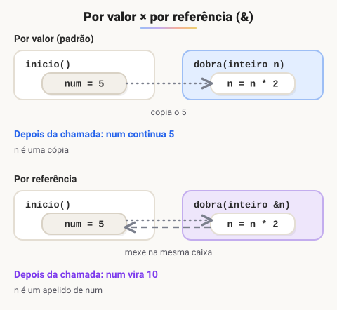

# Passagem de parâmetros por valor e por referência (Adicionado pelo aluno para melhorar o estudo)

> 🗺️ **Nesta aula:** a diferença entre passar um valor (cópia) e passar a própria variável (referência), o `&` do Portugol, a troca de valores com função e o caso dos vetores.

## De onde paramos

Na aula de sub-rotinas, as funções recebiam parâmetros e devolviam um resultado com `retorne`. Mas o que acontece se a função alterar um parâmetro: a variável de quem chamou muda junto?

## Por valor (o padrão)

Quando uma função recebe um parâmetro comum, ela recebe uma **cópia** do valor. Mudar o parâmetro dentro da função não muda a variável de quem chamou.

```c
programa
{
  funcao dobra(inteiro n)
  {
    // n é uma cópia: dobrar aqui não
    // afeta quem chamou
    n = n * 2
  }

  funcao inicio()
  {
    inteiro num = 5
    dobra(num)
    // continua 5
    escreva(num, "\n")
  }
}
```

## Por referência (com &)

Com um `&` antes do nome do parâmetro, a função recebe a **própria variável**, não uma cópia. O parâmetro vira um apelido para ela, e qualquer mudança vale também fora da função.

```c
programa
{
  // o & faz n ser outro nome para a
  // variável de quem chamou
  funcao dobra(inteiro &n)
  {
    n = n * 2
  }

  funcao inicio()
  {
    inteiro num = 5
    dobra(num)
    // agora vale 10
    escreva(num, "\n")
  }
}
```



> 💡 **Analogia:** por valor é entregar uma **fotocópia** de um documento: a pessoa pode rabiscar à vontade, e o seu original fica intacto. Por referência é entregar o **original**: qualquer anotação feita aparece no seu documento quando ele voltar.

> ⚠️ Um parâmetro por referência precisa receber uma **variável**. Chamar `dobra(5)` ou `dobra(num + 1)` com `&n` dá erro, porque não há variável para alterar.

## Projeto: função de troca

A rotina de troca da aula de estruturas de dados vira uma função reutilizável. Ela só funciona por referência: por valor, trocaria apenas as cópias.

```c
programa
{
  // os dois & são obrigatórios: a função
  // precisa alterar as duas variáveis
  funcao troca(inteiro &a, inteiro &b)
  {
    inteiro aux = a
    a = b
    b = aux
  }

  funcao inicio()
  {
    inteiro x = 3, y = 8

    escreva("Antes: x = ", x, " e y = ",
      y, "\n")
    troca(x, y)
    // x = 8 e y = 3
    escreva("Depois: x = ", x, " e y = ",
      y, "\n")
  }
}
```

## Vetores e matrizes: sempre por referência

Vetores e matrizes passados para uma função **não são copiados**: a função trabalha direto sobre o original, mesmo sem `&`. Copiar um vetor inteiro a cada chamada seria lento, por isso as linguagens costumam fazer assim.

```c
programa
{
  inclua biblioteca Util --> u

  // v[] sem &: vetores já chegam por
  // referência
  funcao preenche(inteiro v[],
    inteiro tamanho)
  {
    para (inteiro i = 0; i < tamanho; i++) {
      // altera o vetor de quem chamou
      v[i] = u.sorteia(1, 100)
    }
  }

  funcao inicio()
  {
    inteiro numeros[5]
    preenche(numeros, 5)

    // mostra os números sorteados dentro
    // da função
    para (inteiro i = 0; i < 5; i++) {
      escreva(numeros[i], " ")
    }
  }
}
```

É isso que acontece na aula de pesquisa binária: `preenche_ordena_vetor(vet)` sorteia e ordena o vetor dentro da função, e o `inicio()` enxerga o resultado.

> 💡 Prefira devolver o resultado com `retorne` sempre que der: o código fica mais fácil de entender. Use referência quando a função precisa alterar **mais de um** valor (como na troca) ou quando trabalha sobre vetores.

## 🧠 Revisão rápida

**Com `funcao soma1(inteiro n) { n = n + 1 }` e `x = 7`, quanto vale `x` depois de `soma1(x)`?**

7: o parâmetro é por valor, então só a cópia mudou.

**Por que a função de troca não funciona sem os `&`?**

Porque ela trocaria só as cópias; as variáveis de quem chamou ficariam iguais.

**Um vetor passado sem `&` pode ser alterado pela função?**

Sim: vetores e matrizes são sempre passados por referência.

> ➡️ **Próximo passo:** uma função pode chamar outras... e também chamar a si mesma. É a **Recursividade (Funções recursivas)**.

## 📌 Resumo

| Item | Em uma frase |
| --- | --- |
| Por valor | A função recebe uma cópia; o original não muda |
| Por referência | `tipo &nome`: a função recebe a própria variável |
| Argumento por referência | Precisa ser uma variável, não um valor solto |
| Vetores e matrizes | Sempre passados por referência, mesmo sem `&` |
| Quando usar `&` | Para alterar mais de um valor, como na troca |
| Alternativa | Devolver o resultado com `retorne` |
