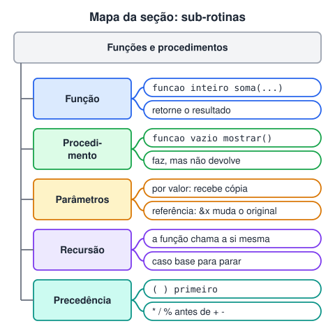
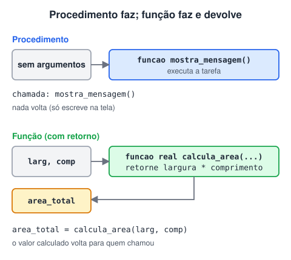
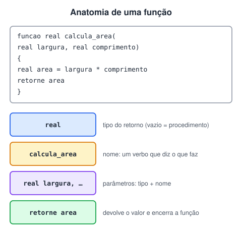
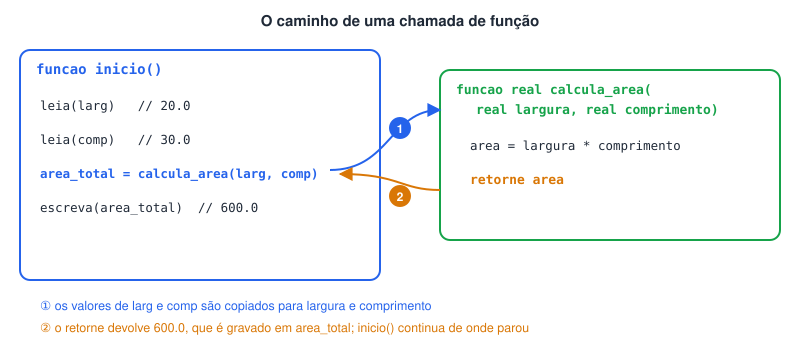

# Sub-rotinas (Funções e Procedimentos)

> 🗺️ **Nesta aula:** o que são sub-rotinas, a diferença entre procedimento e função, como declarar, passar parâmetros, chamar e usar o `retorne`, com cinco projetos.

## 🧭 Cheat sheet da seção

Antes de começar, veja o mapa da seção: é o que as próximas aulas vão explicar. Volte a ele no fim para revisar.



## De onde paramos

Na seção de vetores, o mesmo selection sort foi copiado em vários programas, e alguns códigos passaram de 60 linhas dentro do `inicio()`. Sub-rotinas resolvem as duas coisas: escrever uma tarefa uma vez e dividir o programa em partes com nome.

## O que são sub-rotinas

Sub-rotinas são blocos de código com nome próprio, que executam uma tarefa específica e podem ser **chamados quantas vezes forem necessários**, inclusive a partir de outros programas. Pense numa receita de bolo dentro de um livro de receitas: a receita "massa básica" é escrita uma vez, e outras receitas apenas dizem "faça a massa básica".

- O código da tarefa é escrito uma única vez e reaproveitado em todas as chamadas.
- Quem chama não precisa saber como a tarefa é feita, só o que ela recebe e o que devolve.
- O programa fica dividido em partes menores, mais fáceis de entender, testar e corrigir.

> 💡 No Portugol, as sub-rotinas são declaradas dentro do `programa { }`, fora de qualquer outra função, ao lado da `funcao inicio()`. O próprio `inicio` é uma sub-rotina: a que o programa executa primeiro.

## Procedimento x função

| Procedimento | Função |
| --- | --- |
| Executa uma tarefa e **não devolve** valor a quem chamou | Executa uma tarefa e **devolve um valor** (`retorne`) a quem chamou |
| Ex.: mostrar uma mensagem, desenhar uma tabela | Ex.: calcular uma área, verificar se um número é primo |



> 💡 **Analogia:** um procedimento é pedir a alguém "apague a luz da sala": a pessoa faz e não traz nada de volta. Uma função é "veja que horas são": a pessoa faz a tarefa e volta com uma resposta que você vai usar.

## Declarando

```c
funcao [tipo_retorno] nome([tipo p1,
  tipo p2])
{
  // código da sub-rotina
  // retorne valor: só nas funções
  [retorne valor]
}
```

- **Sem** tipo de retorno, é um procedimento.
- **Com** tipo de retorno (`inteiro`, `real`, `cadeia`...), é uma função, e ela precisa terminar com `retorne` seguido de um valor desse tipo.
- Os **parâmetros** são os dados de que a sub-rotina precisa. Cada um tem seu tipo, e eles são separados por vírgula.



> 💡 **Analogia:** a declaração é o cardápio de um restaurante: o nome do prato (nome da função), os ingredientes que você precisa informar (parâmetros, como "ponto da carne") e o que chega à mesa (o tipo de retorno).

## Chamando (invocando)

Declarar a sub-rotina não a executa: ela só roda quando é **chamada** pelo nome, recebendo os **argumentos** (os valores concretos para os parâmetros).

```c
// procedimento: basta chamar
mostra_mensagem()

// função: o valor devolvido vai
// para uma variável...
area = calcula_area(larg, comp)

// ...ou é usado direto em outra expressão
escreva("Área: ", calcula_area(larg, comp))
```

Depois que a sub-rotina termina, a execução volta para a linha seguinte à chamada.



> 💡 **Analogia:** é ligar para o suporte técnico. Você pausa o que estava fazendo, o atendente resolve a parte dele e, ao desligar, você continua exatamente de onde parou, agora com a resposta em mãos.

> 💡 O `retorne` encerra a função na hora: nenhuma linha depois dele é executada.

## Projeto: procedimento que mostra uma mensagem

**Código**

```c
programa
{
  // procedimento: sem tipo de retorno e
  // sem parâmetros
  funcao mostra_mensagem()
  {
    escreva("Olá! Esta mensagem vem de ",
      "um procedimento.\n")
    escreva("Vamo que vamo, programação.\n")
  }

  funcao inicio()
  {
    // a chamada executa o bloco acima;
    // chamar de novo repetiria a mensagem
    mostra_mensagem()
  }
}
```

## Projeto: procedimento com parâmetros (potência)

**Código**

```c
programa
{
  funcao calcula_potencia(inteiro base,
    inteiro expoente)
  {
    // produto começa em 1 (neutro da
    // multiplicação), não em 0
    inteiro resultado = 1

    // multiplica a base "expoente" vezes
    para (inteiro i = 0; i < expoente;
      i++) {
      resultado = resultado * base
    }

    escreva("Base: ", base)
    escreva(" | Expoente: ", expoente, "\n")
    escreva("Resultado: ", resultado, "\n")
  }

  funcao inicio()
  {
    inteiro num_1, num_2

    escreva("Digite a base: ")
    leia(num_1)
    escreva("Digite o expoente: ")
    leia(num_2)
    escreva("\n")

    // a ordem importa: num_1 vai para
    // base, num_2 para expoente
    calcula_potencia(num_1, num_2)
  }
}
```

## Projeto: função que devolve a área de um terreno

**Código**

```c
programa
{
  // função: o tipo real antes do nome diz
  // o que ela devolve
  funcao real calcula_area(real largura,
    real comprimento)
  {
    retorne largura * comprimento
  }

  funcao inicio()
  {
    real larg, comp, area_total

    escreva("Largura do terreno (m): ")
    leia(larg)
    escreva("Comprimento do terreno (m): ")
    leia(comp)

    // o valor devolvido vai para area_total
    area_total = calcula_area(larg, comp)

    escreva("\nÁrea total: ", area_total,
      " m²\n")
  }
}
```

## Projeto: procedimento com dois parâmetros (intervalo de números)

Peça um número inicial e um final e mostre todos os números entre eles.

**Código**

```c
programa
{
  inteiro num_inicial, num_final

  // x e y recebem cópias dos valores
  // passados na chamada
  funcao contar_numeros(inteiro x,
    inteiro y)
  {
    para (inteiro i = x; i <= y; i++) {
      // último número: fecha a linha em
      // vez de pôr vírgula
      se (i == y) {
        escreva(i, "\n")
      }
      senao {
        escreva(i, ", ")
      }
    }
  }

  funcao inicio()
  {
    escreva("Número inicial: ")
    leia(num_inicial)
    escreva("Número final: ")
    leia(num_final)

    limpa()
    escreva("Do inicial ao final:\n")
    contar_numeros(num_inicial, num_final)
  }
}
```

## Projeto: área do círculo

Use uma função para calcular e devolver a área de um círculo a partir do raio: `A = π × r²`.

**Código**

```c
programa
{
  // para usar m.PI
  inclua biblioteca Matematica --> m

  real raio, area_total

  // recebe o raio e devolve a área;
  // r * r é o r² da fórmula
  funcao real calcula_area(real r)
  {
    retorne m.PI * r * r
  }

  funcao inicio()
  {
    escreva("Raio do círculo (cm): ")
    leia(raio)

    area_total = calcula_area(raio)

    escreva("Área do círculo: ", area_total)
    escreva(" cm²\n")
  }
}
```

## 🧠 Revisão rápida

**`funcao inteiro dobro(inteiro n)` é procedimento ou função?**

Função: tem tipo de retorno (`inteiro`) e precisa de `retorne`.

**Em `calcula_potencia(num_1, num_2)`, quais são os argumentos e quais os parâmetros?**

Argumentos: `num_1` e `num_2` (os valores da chamada). Parâmetros: `base` e `expoente` (os nomes na declaração).

**O que acontece com uma linha escrita logo depois de `retorne`?**

Nunca é executada: o `retorne` encerra a função.

> ➡️ **Próximo passo:** quando uma função recebe `x`, ela recebe uma cópia ou a própria variável? A resposta muda o resultado: **Passagem de parâmetros por valor e por referência**.

## 📌 Resumo

| Item | Em uma frase |
| --- | --- |
| Sub-rotina | Bloco de código com nome, escrito uma vez e chamado quantas vezes for preciso |
| Procedimento | `funcao nome()`: executa e não devolve valor |
| Função | `funcao tipo nome()`: executa e devolve um valor com `retorne` |
| Parâmetros | Os dados que a sub-rotina recebe, cada um com seu tipo |
| Argumentos | Os valores concretos passados na chamada |
| `retorne` | Devolve o valor e encerra a função na hora |
| Onde declarar | Dentro do `programa { }`, ao lado do `inicio()` |
