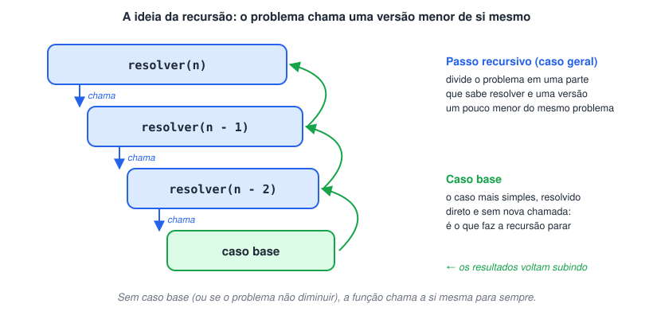
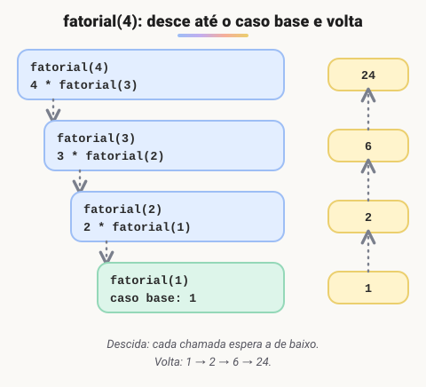

# Recursividade (Funções recursivas)

> 🗺️ **Nesta aula:** o que é uma função recursiva, caso base e caso geral, como as chamadas se empilham e voltam, e o fatorial como exemplo.

## O que é recursividade

Uma função é **recursiva** quando chama a si mesma. A chamada pode ser:

- **direta**: a função `f` chama `f`;
- **indireta**: `f` chama `g`, que chama `f` de novo.

Toda função recursiva tem duas partes:

- **Caso base**: a versão mais simples do problema, que a função resolve diretamente, sem nova chamada. É ele que faz a recursão parar.
- **Caso geral (passo recursivo)**: divide o problema numa parte que a função sabe resolver e numa versão **um pouco menor** do mesmo problema, que ela entrega a uma nova chamada de si mesma.



## Como a execução acontece

1. A função é chamada com o problema completo.
2. Se for o caso base, devolve o resultado na hora.
3. Se não for, chama a si mesma com um problema menor e **fica esperando** a resposta.
4. Isso se repete até alguma chamada chegar ao caso base.
5. Então as respostas voltam, uma a uma, completando cada chamada que estava esperando.

> 💡 O problema passado adiante precisa ser **menor** a cada chamada (n vira n - 1, por exemplo), senão o caso base nunca é alcançado e o programa chama a função até estourar a memória.

## Exemplo: fatorial

O fatorial de `n` (`n!`) é o produto de todos os inteiros de 1 até `n`: `4! = 4 × 3 × 2 × 1 = 24`. Ele tem uma definição naturalmente recursiva:

- **caso base**: `0! = 1` e `1! = 1`;
- **caso geral**: `n! = n × (n - 1)!`.



## Projeto: fatorial com função recursiva

**Código**

```c
programa
{
  inteiro num = 0
  inteiro fat = 0

  funcao inteiro calcula_fatorial(inteiro n)
  {
    se (n == 0 ou n == 1) {
      retorne 1  // caso base
    }
    senao {
      retorne n * calcula_fatorial(n - 1)  // caso geral: chama a si mesma com n - 1
    }
  }

  funcao inicio()
  {
    escreva("Cálculo do fatorial de um número\n")

    // não existe fatorial de número negativo
    enquanto (verdadeiro) {
      escreva("Digite um número positivo: ")
      leia(num)
      se (num < 0) {
        escreva("\nErro! Só é possível calcular o fatorial de números positivos.\n")
      }
      senao {
        pare
      }
    }

    fat = calcula_fatorial(num)
    escreva("O fatorial de ", num, " é: ", fat, "\n")
  }
}
```

> ⚠️ O fatorial cresce muito rápido: `13!` já passa do maior valor que cabe num `inteiro` (cerca de 2,1 bilhões), e o resultado sai errado. Para números maiores, use `real`.

## 📌 Resumo

| Item | Em uma frase |
| --- | --- |
| Função recursiva | Chama a si mesma, direta ou indiretamente |
| Caso base | Resolvido na hora, sem nova chamada; é o que faz a recursão parar |
| Caso geral | Chama a função com uma versão menor do problema |
| Execução | As chamadas esperam até o caso base; depois as respostas voltam uma a uma |
| Cuidado | O problema precisa diminuir a cada chamada, senão a memória estoura |
| Fatorial | `n! = n × (n − 1)!`, com `0! = 1! = 1` |
