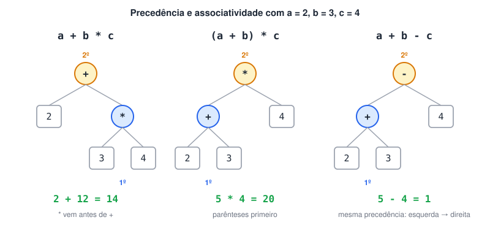

# 8 exemplos de Associatividade e Precedência de Operadores em Programação

**Referência (Boson Treinamentos)**

🔗 [Resumo Básico de Operadores em Programação - Bóson Treinamentos em Ciência e Tecnologia](http://www.bosontreinamentos.com.br/logica-de-programacao/resumo-basico-de-operadores-em-programacao/)

> 🗺️ **Nesta aula:** a diferença entre precedência e associatividade, exemplos de cada uma e a tabela completa de operadores da família C, com os equivalentes no Portugol.

Quando uma expressão tem vários operadores, duas regras decidem a ordem em que eles são resolvidos.

## Precedência

Decide qual operador é resolvido primeiro quando operadores **diferentes** aparecem lado a lado. Os de maior precedência vão antes.

```c
a + b * c  // * tem precedência maior: primeiro b * c, depois a soma
(a + b) * c  // os parênteses vêm antes de tudo: primeiro a + b
```

## Associatividade

Decide a ordem quando operadores de **mesma precedência** aparecem lado a lado:

- **ED (esquerda para a direita)**: o da esquerda é resolvido primeiro. É o caso de `+` e `-`, e de `*`, `/` e `%`.
- **DE (direita para a esquerda)**: o da direita é resolvido primeiro. É o caso das atribuições e da exponenciação.

```c
a + b - c  // mesma precedência, associatividade ED: (a + b) - c
10 - 4 - 3  // (10 - 4) - 3 = 3, e não 10 - (4 - 3) = 9
a = b = 5  // atribuição é DE: primeiro b = 5, depois a = b
```



## Tabela de precedência

Da maior para a menor precedência. A tabela é a referência geral das linguagens da família C; nem todos os operadores existem no Portugol (os bit a bit e o condicional, por exemplo), e lá os lógicos se escrevem `e`, `ou` e `nao`.

| Tipo de operador | Operadores | Associatividade |
| --- | --- | --- |
| Parênteses | `( )` | ED |
| Exponenciação (em linguagens que têm o operador) | `**` ou `^` | DE |
| Incremento/decremento pós-fixo | `x++`, `x--` | ED |
| Unários | `-x`, `!` (não), `~`, `++x`, `--x` | DE |
| Multiplicação, divisão e resto | `*`, `/`, `%` | ED |
| Adição e subtração | `+`, `-` | ED |
| Deslocamento de bits | `<<`, `>>` | ED |
| Relacionais | `<`, `<=`, `>`, `>=` | ED |
| Igualdade | `==`, `!=` | ED |
| E bit a bit | `&` | ED |
| OU-exclusivo bit a bit | `^` | ED |
| OU bit a bit | `\|` | ED |
| E lógico | `&&` (no Portugol, `e`) | ED |
| OU lógico | `\|\|` (no Portugol, `ou`) | ED |
| Condicional (ternário) | `? :` | DE |
| Atribuição | `=`, `+=`, `-=`, `*=`, `/=`, `%=`, `<<=`, `>>=`, `&=`, `^=`, `\|=` | DE |

> 💡 Na dúvida, use parênteses. Eles não mudam o resultado quando a ordem já está certa e deixam a intenção clara para quem lê: `(a * b) + c` é mais fácil de ler que `a * b + c`.

## 📌 Resumo

| Item | Em uma frase |
| --- | --- |
| Precedência | Decide qual operador diferente é resolvido primeiro |
| Associatividade | Decide a ordem entre operadores de mesma precedência |
| ED | Da esquerda para a direita: aritméticos, relacionais, lógicos |
| DE | Da direita para a esquerda: atribuições, unários, exponenciação |
| Exemplo | `10 - 4 - 3` vale 3, porque é `(10 - 4) - 3` |
| Na dúvida | Use parênteses |
