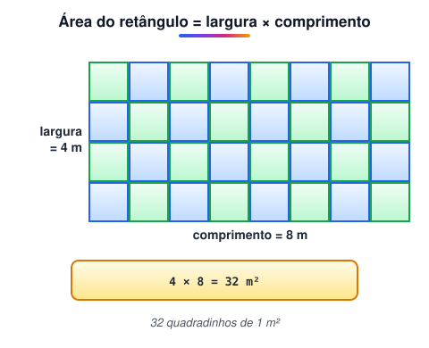
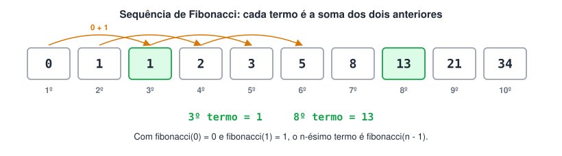
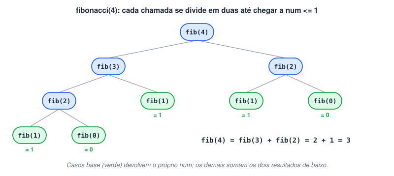
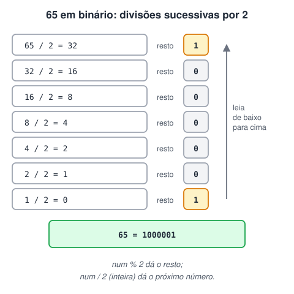
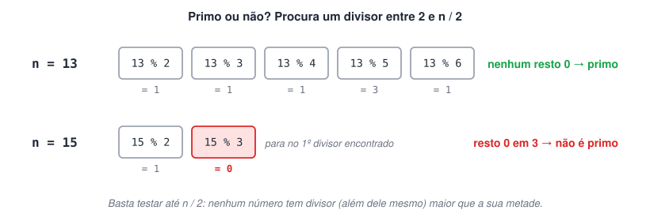
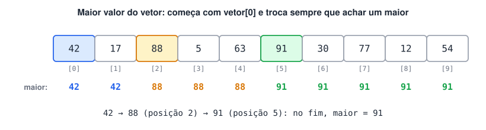

# 5ª Lista de exercícios

> 🗺️ **Nesta lista:** cinco exercícios de funções: área, Fibonacci recursivo, decimal para binário, números primos e maior valor de um vetor.

## De onde paramos

A última seção mostrou procedimentos e funções, passagem por valor e por referência, recursão e precedência de operadores. Esta lista fecha o curso usando tudo isso em funções pequenas e reutilizáveis.

> 💡 **Antes de escrever a função:** defina a assinatura. O que ela recebe (parâmetros e tipos)? O que devolve (tipo de retorno)? Com isso decidido, o corpo costuma sair quase sozinho.

## Exercício 1: área do terreno

Use uma função para calcular e devolver a área, em m², de um terreno retangular, recebendo a largura e o comprimento como argumentos.



> 💡 **Analogia:** é contar o piso de um cômodo: quantas lajotas de 1 m cabem numa fileira (largura) vezes quantas fileiras cabem (comprimento).

<details>
<summary>Ver resposta</summary>

```c
programa
{
  real largura, comprimento, area

  // recebe as duas medidas e devolve a
  // área; quem chama decide o que fazer
  funcao real calcula_area(real larg,
    real compr)
  {
    retorne larg * compr
  }

  funcao inicio()
  {
    escreva("Área do seu terreno\n")
    escreva("Largura (m): ")
    leia(largura)
    escreva("Comprimento (m): ")
    leia(comprimento)

    area = calcula_area(largura, comprimento)

    limpa()
    escreva("Largura: ", largura, " m\n")
    escreva("Comprimento: ", comprimento,
      " m\n")
    // o original mostrava "cm²"
    escreva("Área do terreno: ", area,
      " m²\n")
  }
}
```

</details>

## Exercício 2: n-ésimo número de Fibonacci

A sequência de Fibonacci começa com 0 e 1, e cada termo seguinte é a soma dos dois anteriores. Crie uma função que devolva o n-ésimo termo informado pelo usuário: o 3º termo é 1, e o 8º é 13.





> 💡 **Analogia:** é uma árvore genealógica ao contrário: para saber o termo de hoje você pergunta aos "pais" (os dois termos anteriores), que perguntam aos pais deles, até chegar aos fundadores, 0 e 1. Repare que os mesmos "avós" são consultados várias vezes.

<details>
<summary>Ver resposta</summary>

```c
programa
{
  // fibonacci(0) = 0, (1) = 1, (2) = 1,
  // (3) = 2...
  funcao inteiro fibonacci(inteiro num)
  {
    // casos base: 0 e 1 se respondem
    // sozinhos
    se (num <= 1) {
      retorne num
    }
    // caso geral: soma dos dois anteriores
    retorne fibonacci(num - 1)
      + fibonacci(num - 2)
  }

  funcao inicio()
  {
    inteiro x

    escreva("Qual termo de Fibonacci você ",
      "quer? ")
    leia(x)

    // o 1º termo é fibonacci(0), então o
    // x-ésimo é fibonacci(x - 1)
    escreva(x, "º termo: ",
      fibonacci(x - 1), "\n")
  }
}
```

Teste: 8 → `8º termo: 13`.

</details>

> ⚠️ O original mostrava `fibonacci(x)`, o que desloca a contagem em uma posição: pedindo o 8º termo, aparecia 21 em vez de 13. Como a função começa em `fibonacci(0) = 0` (o 1º termo), o x-ésimo termo é `fibonacci(x - 1)`.

> 💡 Repare na árvore: `fib(2)` é calculado duas vezes. Para termos grandes, a versão recursiva repete trabalho demais (o número de chamadas quase dobra a cada termo). Um laço que guarda os dois últimos valores resolve em poucas voltas.

## Exercício 3: decimal para binário

Crie uma função que converta um número decimal para binário: 65 em decimal equivale a 1000001 em binário. Use divisões sucessivas por 2 e o operador `%` para coletar os restos.



> 💡 **Analogia:** é dividir uma pilha de moedas em duplas, várias vezes. A cada rodada você anota se sobrou uma moeda (resto 1) ou não (resto 0); lidas de trás para a frente, essas anotações formam o número binário.

<details>
<summary>Ver resposta</summary>

```c
programa
{
  funcao inteiro converte_para_binario(
    inteiro dec)
  {
    // posicao: 1, 10, 100... coloca cada
    // dígito na casa certa do resultado
    inteiro bin = 0, resto, posicao = 1

    enquanto (dec != 0) {
      // próximo dígito binário (0 ou 1)
      resto = dec % 2
      bin = bin + resto * posicao
      // a próxima casa fica à esquerda
      posicao = posicao * 10
      // divisão inteira: descarta o resto
      dec = dec / 2
    }
    retorne bin
  }

  funcao inicio()
  {
    inteiro dec, bin

    escreva("Número decimal a converter: ")
    leia(dec)

    bin = converte_para_binario(dec)

    limpa()
    escreva(dec, " em binário é: ", bin, "\n")
  }
}
```

Teste: 65 → `65 em binário é: 1000001`.

</details>

> 💡 Como o resultado é montado num `inteiro` (os dígitos 0 e 1 lidos como número decimal), a função só funciona até 1023, cujo binário tem 10 dígitos. Acima disso o valor não cabe mais. Para números maiores, monte o binário numa `cadeia`.

## Exercício 4: número primo

Um número primo é um inteiro positivo que só é divisível por 1 e por ele mesmo. Crie uma função que receba um número e diga se ele é primo, usando o operador `%`. Primos até 100: 2, 3, 5, 7, 11, 13, 17, 19, 23, 29, 31, 37, 41, 43, 47, 53, 59, 61, 67, 71, 73, 79, 83, 89 e 97.



> 💡 **Analogia:** é tentar dividir uma barra de chocolate em pedaços iguais. Se só der para ter 1 pedaço (a barra inteira) ou pedaços de um quadradinho cada, o número de quadradinhos é primo; se der para fazer 3 pedaços iguais com 15, não é.

<details>
<summary>Ver resposta</summary>

```c
programa
{
  // logico: a resposta é sim ou não, e
  // pode ir direto num se
  funcao logico eh_primo(inteiro x)
  {
    // 0, 1 e negativos não são primos
    se (x < 2) {
      retorne falso
    }

    // nenhum divisor passa da metade
    // (exceto o próprio número)
    para (inteiro i = 2; i <= x / 2; i++) {
      se (x % i == 0) {
        // achou um divisor: já pode
        // responder e sair
        retorne falso
      }
    }
    retorne verdadeiro
  }

  funcao inicio()
  {
    inteiro num

    escreva("Digite um número: ")
    leia(num)
    limpa()

    se (eh_primo(num)) {
      escreva(num, " é primo.\n")
    }
    senao {
      escreva(num, " não é primo.\n")
    }
  }
}
```

</details>

A versão original devolvia `inteiro` (1 para primo, 0 para não primo). Uma função do tipo `logico` expressa melhor uma resposta de sim ou não e pode ser usada direto no `se`.

## Exercício 5: maior valor de um vetor

Crie uma função que receba um vetor de 10 inteiros e devolva o maior valor dele. Para testar mais rápido, preencha o vetor com números aleatórios de 1 a 100.



> 💡 **Analogia:** é o recorde de uma competição de salto. O primeiro atleta define o recorde provisório; cada atleta seguinte só muda o placar se saltar mais longe. No fim, o placar mostra o maior salto.

<details>
<summary>Ver resposta</summary>

```c
programa
{
  inclua biblioteca Util --> u

  // o vetor chega por referência: nada
  // é copiado
  funcao inteiro maior_valor(
    inteiro vetor[])
  {
    // começa supondo que o primeiro é o
    // maior (o recorde provisório)
    inteiro maior = vetor[0]

    para (inteiro i = 1; i < 10; i++) {
      se (vetor[i] > maior) {
        // achou um maior: novo recorde
        maior = vetor[i]
      }
    }
    retorne maior
  }

  funcao inicio()
  {
    inteiro vetor[10]
    inteiro i

    para (i = 0; i < 10; i++) {
      vetor[i] = u.sorteia(1, 100)
    }

    escreva("Vetor: ")
    para (i = 0; i < 10; i++) {
      escreva(vetor[i], " ")
    }

    escreva("\nMaior: ", maior_valor(vetor),
      "\n")
  }
}
```

</details>

O comentário da versão original chamava a função de recursiva, mas ela não é: percorre o vetor com um laço e não chama a si mesma.

## 🧠 Revisão rápida

<details>
<summary>Ver resposta: Quanto é 13 em binário?</summary>

1101: 13 → resto 1, 6 → 0, 3 → 1, 1 → 1; lendo de baixo para cima, 1101.

</details>

<details>
<summary>Ver resposta: Por que `maior` começa com `vetor[0]`, e não com 0?</summary>

Se todos os valores fossem negativos, começar em 0 daria uma resposta errada (0 não está no vetor).

</details>

<details>
<summary>Ver resposta: Para testar se 97 é primo, até qual divisor o laço vai?</summary>

Até 48 (97 / 2 na divisão inteira). Como nenhum resto dá 0, 97 é primo.

</details>

> ➡️ **Próximo passo:** fim do curso! Use os cheat sheets de cada seção para revisar, e volte às listas tentando resolver sem abrir as resoluções.

## 📌 Resumo

| Exercício | O que pratica |
| --- | --- |
| 1. Área do terreno | Função com dois parâmetros que devolve um `real` |
| 2. Fibonacci | Recursão com dois casos base; o x-ésimo termo é `fibonacci(x - 1)` |
| 3. Binário | Divisões sucessivas por 2 e `%` para coletar os restos |
| 4. Primo | Função `logico` usada direto no `se` |
| 5. Maior do vetor | Passar um vetor como parâmetro e percorrê-lo |
