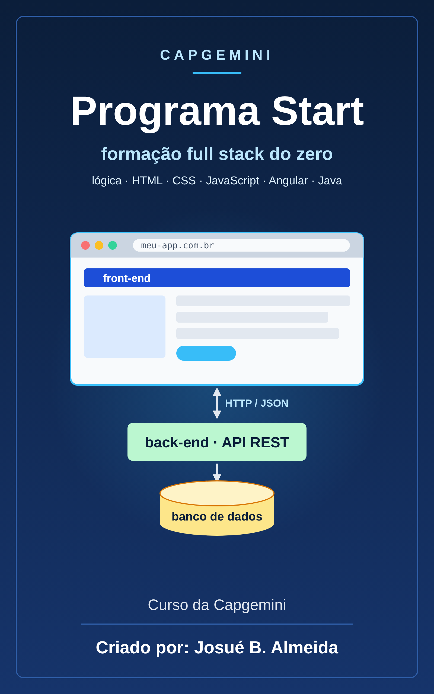

# Capgemini: Programa Start - Capgemini

📥 **[Baixar o EPUB](https://github.com/Joshpcbrrj/biblioteca-de-estudos/releases/download/epubs/capgemini-start.epub)**

Formação full stack do zero: lógica de programação, HTML, CSS e JavaScript, front-end com Angular e back-end com Java e Spring Boot. Cada aula segue o mesmo roteiro (Nesta aula → De onde paramos → conteúdo → Revisão rápida → Próximo passo → Resumo), e as respostas dos exercícios ficam recolhidas em **Ver resposta**. O curso termina com um projeto full-stack ligando Angular a uma API Spring Boot.

- [Sobre o curso](aulas/00-sobre-o-curso.md)
- [Boas-vindas e trilha de estudo](aulas/01-boas-vindas-e-trilha-de-estudo.md)

## 🧠 Etapa 1 · Lógica de programação

- [0 · Introdução à lógica de programação](aulas/02-0-introducao-a-logica-de-programacao.md)
- [1 · Lógica de programação e algoritmos I (Portugol)](aulas/03-1-logica-de-programacao-e-algoritmos-i-portugol.md)
- [2 · Lógica de programação e algoritmos II (estruturas, funções, SQL e POO)](aulas/04-2-logica-de-programacao-e-algoritmos-ii.md)
- [3 · Lógica de programação e algoritmos III (Java)](aulas/05-3-logica-de-programacao-e-algoritmos-iii-java.md)

## 🌐 Etapa 2 · Web e HTML

- [HTML 1 · Como a web funciona](aulas/06-html-1-como-a-web-funciona.md)
- [HTML 2 · Hospedagem, servidores e containers](aulas/07-html-2-hospedagem-servidores-e-containers.md)
- [HTML 3 · Fundamentos do HTML](aulas/08-html-3-fundamentos-do-html.md)
- [HTML avançado · SEO, acessibilidade, segurança e PWA](aulas/09-html-avancado-seo-acessibilidade-seguranca-e-pwa.md)

## 🎨 Etapa 3 · CSS

- [CSS 1 · Fundamentos do CSS](aulas/10-css-1-fundamentos-do-css.md)
- [CSS avançado · Sass, PostCSS, animações e organização](aulas/11-css-avancado-sass-postcss-animacoes-e.md)

## ⚡ Etapa 4 · JavaScript

- [JavaScript · Fundamentos, DOM, eventos e jQuery](aulas/12-javascript-fundamentos-dom-eventos-e-jquery.md)

## 🅰️ Etapa 5 · Front-end com Angular

- [Angular · Componentes, rotas, services e formulários](aulas/13-angular-componentes-rotas-services-e-formularios.md)
- [APIs com Angular · REST, HttpClient e CRUD](aulas/14-apis-com-angular-rest-httpclient-e-crud.md)

## ☕ Etapa 6 · Back-end com Java

- [Java 1 · Fundamentos da linguagem](aulas/15-java-1-fundamentos-da-linguagem.md)
- [Java 2 · Orientação a objetos, coleções e back-end](aulas/16-java-2-orientacao-a-objetos-colecoes-e-back-end.md)
