# 0 · Introdução à lógica de programação

> 🗺️ **Sobre o módulo:** como o computador funciona por dentro e como pensar de forma lógica para resolver problemas. É a base de todo o resto do programa: antes de aprender uma linguagem, você aprende a montar um **algoritmo**.
>
> **Professor:** Marcio Michelluzzi · **Ordem sugerida:** de cima para baixo.

## Do ábaco à máquina programável (história até o séc. XIX)

> 🗺️ **Nesta aula:** como a humanidade saiu do ábaco e chegou à ideia de uma máquina que segue um **programa**, e por que o **0 e 1** virou a base de todos os computadores.

### Por que começar pela história?

Programar é dar instruções a uma máquina. Antes de escrever a primeira instrução, ajuda muito entender **de onde veio essa ideia**: por que o computador precisa de um programa, por que ele trabalha com 0 e 1 e por que tem uma parte que calcula e outra que guarda dados. Cada uma dessas respostas apareceu em algum momento da história, e todas elas voltam nas próximas aulas.

### Computar é calcular

A palavra "computar" vem do latim *computare*, que significa **calcular**. Durante milhares de anos, as pessoas inventaram ferramentas para contar e fazer contas mais depressa. Olhando de longe, a história tem quatro saltos:

1. **Ferramentas manuais:** a pessoa faz a conta; a ferramenta só ajuda a guardar os valores.
2. **Máquinas mecânicas:** engrenagens fazem a conta sozinhas.
3. **Máquinas programáveis:** as instruções ficam fora da máquina, em cartões, e podem ser trocadas.
4. **Uma base matemática com dois valores** (verdadeiro e falso), que mais tarde permitiu construir circuitos eletrônicos.

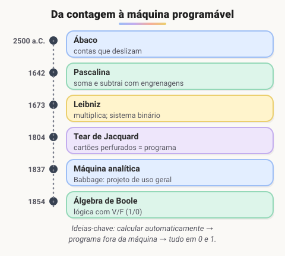

### Os marcos, um de cada vez

#### Ábaco (cerca de 2500 a.C.)

O ábaco tem contas que deslizam em varetas. Cada vareta representa uma casa decimal: unidades, dezenas, centenas. Surgiu na Mesopotâmia e foi aperfeiçoado por gregos, romanos e chineses.

O ponto importante: **quem calcula ainda é a pessoa**. O ábaco só ajuda a não esquecer os números no meio da conta.

#### Pascalina (1642)

Aos 19 anos, Blaise Pascal construiu uma **calculadora mecânica** para ajudar o pai, que era cobrador de impostos. Rodas dentadas faziam somas e subtrações, e o "vai um" passava sozinho de uma roda para a próxima, como o hodômetro de um carro.

Pela primeira vez, **a máquina fazia a conta**. A pessoa só girava as rodas com os números.

#### Calculadora de Leibniz (1673)

Gottfried Leibniz melhorou a ideia: sua máquina também **multiplicava e dividia**, usando somas e subtrações repetidas. Leibniz também descreveu o **sistema binário**, em que qualquer número é escrito só com os algarismos 0 e 1. Guarde esse detalhe: ele vai voltar.

#### Tear de Jacquard (1804)

Joseph-Marie Jacquard criou um tear que tecia desenhos seguindo **cartões perfurados**. Onde havia furo, o fio subia; onde não havia, o fio ficava. Para tecer outro desenho, bastava trocar os cartões, sem mexer na máquina.

Essa é a essência de um **programa**: instruções guardadas fora da máquina, que mudam o que ela faz. Quando você instala um aplicativo novo no celular, está fazendo a mesma coisa que o tecelão que trocava os cartões.

#### Máquina analítica de Babbage (1837)

Charles Babbage projetou uma máquina mecânica de **uso geral**, capaz de executar qualquer sequência de cálculos descrita em cartões. O projeto já tinha as partes de um computador moderno:

| Máquina analítica | Computador atual |
| --- | --- |
| entrada por cartões perfurados | teclado, arquivos |
| *mill* (moinho): fazia as contas | processador (CPU) |
| *store* (armazém): guardava os números | memória |
| impressora | monitor, impressora |

A máquina nunca foi concluída: era cara e complexa demais para a mecânica da época. Mesmo assim, **Ada Lovelace** escreveu para ela um algoritmo que calculava os números de Bernoulli. Por isso ela é considerada a **primeira programadora** da história.

#### Álgebra de Boole (1854)

George Boole mostrou que o raciocínio lógico pode ser escrito como contas, usando só **dois valores**: verdadeiro e falso. Na época parecia pura teoria.

Quase cem anos depois, em 1937, Claude Shannon percebeu que essa álgebra descrevia exatamente o comportamento de **circuitos com interruptores**: ligado (1) ou desligado (0). Juntando o binário de Leibniz com a lógica de Boole, nasceu a base de todos os computadores digitais. É por isso que, lá dentro, tudo é 0 e 1.

> 💡 Repare como as ideias se encaixam: Jacquard trouxe o **programa trocável**, Babbage separou **quem calcula** de **quem guarda**, e Boole deu a **matemática do 0 e 1**. Um computador atual é a soma dessas três ideias, construída com eletrônica.

### 🧠 Revisão rápida

**Qual foi a grande mudança trazida pela Pascalina?**

Pela primeira vez **a máquina fazia a conta** sozinha, com engrenagens. No ábaco, quem calcula é a pessoa.

**Por que o tear de Jacquard é importante para a computação?**

Porque separou o **programa** (os cartões perfurados) da **máquina**: trocar os cartões mudava o resultado sem alterar o tear.

**Quais partes da máquina analítica correspondem à CPU e à memória?**

O *mill* (moinho) fazia as contas, como a CPU, e o *store* (armazém) guardava os números, como a memória.

**O que a álgebra de Boole tem a ver com o computador?**

Ela trabalha com dois valores (verdadeiro/falso = 1/0), exatamente como um circuito com corrente ligada ou desligada. Todo processador é construído com essa lógica.

> ➡️ **Próximo passo:** no século XX, essas ideias saem do papel e viram máquinas eletrônicas. A próxima aula, **As gerações de computadores**, mostra como elas foram ficando menores, mais rápidas e mais baratas.

### 📌 Resumo

| Marco | O que trouxe |
| --- | --- |
| Ábaco | ferramenta para guardar valores; a pessoa calcula |
| Pascalina (1642) | a máquina passa a fazer a conta |
| Leibniz (1673) | multiplicação e o sistema binário |
| Jacquard (1804) | programa trocável em cartões perfurados |
| Babbage (1837) | máquina de uso geral com "CPU" e "memória"; Ada Lovelace, a primeira programadora |
| Boole (1854) | lógica com dois valores, a base dos circuitos digitais |

## As gerações de computadores (séc. XX)

> 🗺️ **Nesta aula:** as quatro gerações de computadores eletrônicos e a ideia que liga todas elas: trocar o "interruptor" que representa 0 e 1 por um menor, mais rápido e mais barato.

### De onde paramos

Na aula anterior, vimos que o computador junta três ideias: um **programa trocável**, uma parte que **calcula** separada de uma que **guarda**, e a **lógica do 0 e 1**. No século XX essas ideias ganharam eletricidade.

Para representar 0 e 1, um circuito precisa de **interruptores**: com corrente é 1, sem corrente é 0. Um computador usa milhões (hoje, bilhões) deles. A história das gerações é a história de como esse interruptor foi ficando menor.

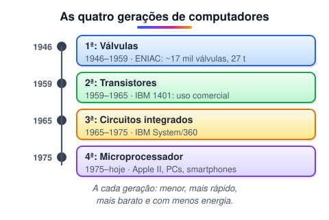

### 1ª geração (1946–1959): válvulas

A **válvula eletrônica** parece uma lâmpada e funciona como um interruptor sem partes móveis. O problema: ela esquenta muito e queima com frequência.

O **ENIAC** (1946), um dos primeiros computadores eletrônicos de uso geral, tinha cerca de **17,5 mil válvulas**, pesava **27 toneladas**, ocupava uma sala de uns 170 m² e consumia cerca de **150 kW**, o mesmo que dezenas de casas.

Para trocar o programa, era preciso **religar cabos à mão**, o que levava dias. Ainda não existia a ideia de guardar o programa na memória, junto com os dados.

### 2ª geração (1959–1965): transistores

O **transistor**, inventado em 1947 nos Laboratórios Bell, faz o mesmo papel da válvula, mas é sólido, pequeno e quase não esquenta. Os computadores ficaram mais confiáveis e baratos o bastante para **empresas**: bancos, seguradoras, governo. O **IBM 1401** foi um dos mais vendidos.

É também a época das primeiras **linguagens de alto nível**, como FORTRAN e COBOL. Em vez de escrever 0 e 1, as pessoas passaram a escrever algo mais parecido com inglês e fórmulas matemáticas.

### 3ª geração (1965–1975): circuitos integrados

O **circuito integrado**, ou **chip**, reúne muitos transistores numa pequena pastilha de silício. Os computadores encolheram mais uma vez.

A família **IBM System/360** (1964) trouxe outra ideia importante: vários modelos de tamanhos diferentes que rodavam **os mesmos programas**. Surgem também os **sistemas operacionais** capazes de executar vários programas ao mesmo tempo.

### 4ª geração (1975–hoje): microprocessadores

Em 1971, a Intel lançou o **4004**, o primeiro **microprocessador**: uma CPU inteira em um único chip. Foi isso que tornou possível o computador pessoal:

- anos 1970 e 1980: Apple II (1977) e IBM PC (1981);
- anos 1990: os PCs chegam às casas e a internet vira comercial;
- depois de 2000: notebooks, smartphones, tablets e relógios inteligentes, todos conectados.

O celular no seu bolso é um computador de 4ª geração.

> 💡 **Lei de Moore:** em 1965, Gordon Moore, cofundador da Intel, observou que o número de transistores em um chip dobrava a cada um ou dois anos. Essa tendência explica por que um celular de hoje é milhões de vezes mais potente que o ENIAC.

### As quatro gerações lado a lado

| Geração | Interruptor | O que mudou |
| --- | --- | --- |
| 1ª | válvula | computadores do tamanho de salas, programados religando cabos |
| 2ª | transistor | máquinas confiáveis para empresas; primeiras linguagens de alto nível |
| 3ª | circuito integrado | computadores menores e sistemas operacionais com vários programas |
| 4ª | microprocessador | computador pessoal, internet e celulares |

### 🧠 Revisão rápida

**O que muda de uma geração de computadores para outra?**

O componente que faz o papel de interruptor (representa 0 e 1): válvula → transistor → circuito integrado → microprocessador. Cada um é menor, mais rápido, mais barato e gasta menos energia.

**O que é um microprocessador?**

Uma CPU inteira construída em um único chip. O primeiro foi o Intel 4004, de 1971, e ele marca a 4ª geração.

**Como se trocava o programa do ENIAC?**

Religando cabos e chaves manualmente, o que podia levar dias. Ainda não existia programa guardado na memória.

**O que diz a Lei de Moore?**

Que o número de transistores em um chip dobra aproximadamente a cada um ou dois anos.

> ➡️ **Próximo passo:** todos esses computadores funcionam com base na lógica. A próxima aula, **A lógica no mundo**, mostra de onde vem essa forma de raciocinar e por que ela está em cada linha de código.

### 📌 Resumo

| Item | Em uma frase |
| --- | --- |
| Interruptor | representa 0 (sem corrente) e 1 (com corrente) |
| Válvula | 1ª geração; grande, quente e frágil (ENIAC) |
| Transistor | 2ª geração; pequeno e confiável |
| Circuito integrado | 3ª geração; muitos transistores num chip |
| Microprocessador | 4ª geração; a CPU inteira num chip (Intel 4004, 1971) |
| Lei de Moore | a quantidade de transistores por chip dobra a cada um ou dois anos |

## A lógica no mundo: de Aristóteles ao computador

> 🗺️ **Nesta aula:** o que é lógica, de onde ela vem e por que ela aparece tanto dentro do processador quanto em cada `if` que você vai escrever.

### De onde paramos

Vimos que todo computador digital funciona com 0 e 1, e que essa ideia vem da lógica de Boole. Mas a lógica é muito mais antiga que o computador. Entender o que ela é ajuda a programar melhor, porque **programar é, em grande parte, raciocinar com lógica**.

### O que é lógica

**Lógica é o estudo do raciocínio correto: como sair de afirmações aceitas (as premissas) e chegar a uma conclusão sem cometer erros.**

Ninguém inventou a lógica. As pessoas já raciocinavam muito antes de existir um nome para isso. O que os filósofos fizeram foi **organizar** as regras que tornam um raciocínio confiável.

Você usa lógica o tempo todo:

- "Se estiver chovendo, levo o guarda-chuva. Está chovendo. Logo, levo o guarda-chuva."
- "O ônibus passa às 8h ou às 8h30. Já são 8h10 e ele não passou. Logo, vai passar às 8h30."

### Aristóteles e o silogismo

No século IV a.C., o filósofo grego **Aristóteles** organizou a lógica pela primeira vez. A ferramenta central dele é o **silogismo**: duas premissas que levam a uma conclusão.

- Premissa 1: todo ser humano é mortal.
- Premissa 2: Sócrates é um ser humano.
- Conclusão: logo, Sócrates é mortal.

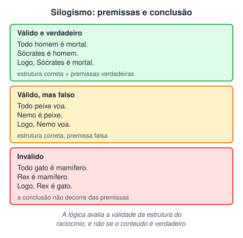

#### Válido não é o mesmo que verdadeiro

Essa é a ideia mais importante da aula:

- **Validade** é sobre a **estrutura**: se as premissas fossem verdadeiras, a conclusão teria de ser verdadeira?
- **Verdade** é sobre o **conteúdo**: o que foi dito corresponde à realidade?

Veja dois exemplos:

1. "Todo peixe voa. Nemo é um peixe. Logo, Nemo voa." É **válido**: a estrutura está certa. Mas a conclusão é **falsa**, porque a primeira premissa é falsa.
2. "Todo gato é mamífero. Rex é mamífero. Logo, Rex é gato." É **inválido**: mesmo com premissas verdadeiras, a conclusão não decorre delas. Rex pode ser um cachorro.

Com programas acontece igual: o código pode estar com a estrutura perfeita e ainda assim dar o resultado errado, se a regra estiver errada.

### Da filosofia ao computador

A lógica atravessou mais de dois mil anos até chegar ao processador:

1. **Aristóteles (séc. IV a.C.):** organiza o raciocínio em silogismos.
2. **George Boole e Augustus De Morgan (séc. XIX):** transformam a lógica em **álgebra**, com contas entre verdadeiro e falso. Você verá isso na aula de álgebra booleana.
3. **Claude Shannon (1937):** mostra que essa álgebra descreve circuitos elétricos com interruptores.
4. **Hoje:** a lógica está no **hardware** (portas lógicas dentro do processador) e no **software** (condições como `if`, `&&` e `||`).

Existem até programas que **provam teoremas** sozinhos, conferindo passo a passo se uma demonstração matemática é válida.

### Por que isso importa para quem programa

Cada `if` que você escrever é uma pergunta com resposta verdadeira ou falsa. Um erro de lógica **não impede o programa de rodar**: ele roda normalmente, mas produz o resultado errado. Por isso esses são os erros mais difíceis de encontrar.

```jsx
// o computador aceita, mas a regra está errada:
// quem tem exatamente 18 anos fica de fora!
if (idade > 18) {
  console.log("Maior de idade");
}

// o certo é "maior ou igual"
if (idade >= 18) {
  console.log("Maior de idade");
}
```

> ⚠️ O computador não sabe o que você quis dizer, só o que você escreveu. Antes de rodar, pergunte: "essa condição cobre todos os casos, inclusive os da fronteira?" (como os 18 anos do exemplo).

### 🧠 Revisão rápida

**Qual a diferença entre um raciocínio válido e um verdadeiro?**

Válido: a estrutura está correta (a conclusão decorre das premissas). Verdadeiro: o conteúdo corresponde à realidade. Um raciocínio pode ser válido e ter conclusão falsa, se uma premissa for falsa.

**Quem organizou a lógica pela primeira vez e qual era sua ferramenta principal?**

Aristóteles, na Grécia antiga, com o silogismo (duas premissas e uma conclusão).

**Onde a lógica aparece em um computador?**

No hardware, nas portas lógicas (AND, OR, NOT) que formam o processador. No software, nas condições e nos operadores lógicos (`if`, `&&`, `||`, `!`).

> ➡️ **Próximo passo:** agora que sabemos de onde vem a lógica do computador, vamos ver como ele é organizado por dentro. A próxima aula é **Hardware, software e as camadas do computador**.

### 📌 Resumo

| Item | Em uma frase |
| --- | --- |
| Lógica | estudo do raciocínio correto, das premissas à conclusão |
| Silogismo | duas premissas e uma conclusão (Aristóteles) |
| Validade × verdade | estrutura correta × conteúdo que corresponde à realidade |
| Boole e De Morgan | a lógica vira álgebra com verdadeiro e falso |
| Shannon | essa álgebra descreve circuitos com interruptores |
| Erro de lógica | o programa roda, mas dá o resultado errado |

## Hardware, software e as camadas do computador

> 🗺️ **Nesta aula:** a diferença entre hardware e software e como eles se organizam em camadas, do botão que você clica até o processador.

### De onde paramos

As aulas anteriores contaram como o computador nasceu. A partir daqui, olhamos para ele **por dentro**. A primeira divisão a entender é entre a parte física e a parte lógica, porque quem programa trabalha na parte lógica, mas precisa saber o que acontece na física.

### Hardware e software

**Hardware** é a parte **física** do computador, tudo o que dá para tocar: processador, memória, SSD, teclado, monitor. Ele **executa** as instruções.

**Software** é a parte **lógica**: os programas e os dados. O Windows, o navegador, um jogo e o aplicativo do banco são software. Ele **diz o que** deve ser executado.

Uma comparação que ajuda: o hardware é o instrumento musical, e o software é a partitura. O instrumento sozinho não toca nada; a partitura sozinha não faz som.

|  | Hardware | Software |
| --- | --- | --- |
| O que é | a parte física | programas e dados |
| Papel | executa as instruções | diz o que executar |
| Defeito típico | peça queimada ou gasta | bug ou configuração errada |

#### E o firmware?

Existe uma categoria no meio do caminho: o **firmware**. É um software gravado dentro do próprio hardware, que raramente muda. Está na placa-mãe, no roteador, na impressora e até no controle remoto. A **BIOS/UEFI**, que liga o computador, é um firmware.

### As camadas do computador

Um computador funciona em **camadas**, como um prédio. Cada andar só conversa com o andar vizinho, e isso esconde a complexidade de baixo para quem está em cima.

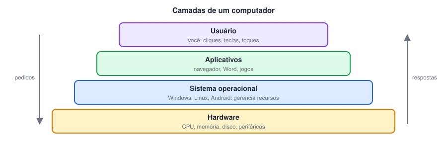

1. **Usuário:** você, que clica, digita e toca na tela.
2. **Aplicativos:** o navegador, o editor de texto, o jogo. Eles não falam direto com o hardware; pedem ajuda ao sistema operacional.
3. **Sistema operacional** (Windows, Linux, macOS, Android): gerencia o processador, a memória, os arquivos e os dispositivos, e divide esses recursos entre os aplicativos abertos.
4. **Hardware:** executa as instruções de fato.

#### Um exemplo do caminho completo

Você está no Word e aperta **Ctrl + S**:

1. O Word recebe o comando e pede ao sistema operacional: "grave estes dados no arquivo `relatorio.docx`".
2. O sistema operacional descobre em qual disco e em qual posição gravar e conversa com o SSD.
3. O SSD grava os bytes.

O Word não precisa saber qual é a marca do seu SSD. Essa separação em camadas é o que permite que o mesmo programa rode em milhares de computadores diferentes.

> 💡 Quando você programar, seu código vai ficar na camada dos **aplicativos**. Você vai pedir coisas ao sistema operacional (abrir um arquivo, mostrar algo na tela) sem precisar mexer direto no hardware.

### 🧠 Revisão rápida

**Um aplicativo do celular é hardware ou software? E a tela?**

O aplicativo é software; a tela é hardware.

**Por que os aplicativos não falam direto com o hardware?**

Porque o sistema operacional faz esse meio de campo: ele controla e divide os recursos entre os programas e esconde os detalhes de cada dispositivo.

**O que é firmware?**

Um software gravado dentro de um dispositivo de hardware, que raramente muda. Exemplo: a BIOS/UEFI da placa-mãe.

> ➡️ **Próximo passo:** vamos abrir a camada de baixo e conhecer as peças do hardware na aula **Partes do computador: CPU, memória e periféricos**.

### 📌 Resumo

| Item | Em uma frase |
| --- | --- |
| Hardware | a parte física, que executa as instruções |
| Software | os programas e dados, que dizem o que executar |
| Firmware | software gravado no hardware, como a BIOS/UEFI |
| Sistema operacional | gerencia os recursos e serve de ponte entre aplicativos e hardware |
| Camadas | cada nível conversa só com o vizinho e esconde a complexidade de baixo |

## Partes do computador: CPU, memória e periféricos

> 🗺️ **Nesta aula:** as peças principais do computador, o papel de cada uma e o caminho que um dado percorre da entrada até a saída.

### De onde paramos

Na aula anterior, vimos que o hardware é a camada de baixo, a que executa as instruções. Agora vamos conhecer as peças dessa camada. Isso vai ajudar mais tarde a entender por que um programa "trava" quando falta memória, ou por que é preciso salvar o trabalho.

### O caminho dos dados: entrada → processamento → saída

Todo computador segue o mesmo esquema:

1. **Entrada:** recebe dados (você digita, clica, fala no microfone).
2. **Processamento:** o processador faz contas e toma decisões com esses dados.
3. **Saída:** mostra o resultado (na tela, na caixa de som, na impressora).

No meio do caminho, os dados ficam guardados na **memória**. Esse mesmo esquema vai aparecer nos seus programas: quase todo algoritmo **lê** dados, **processa** e **mostra** um resultado.

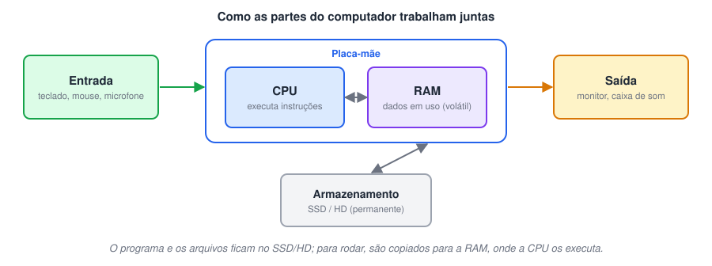

### As peças, comparadas com o corpo humano

- **Dispositivos de entrada** (teclado, mouse, microfone, câmera) levam dados para dentro. São como os **olhos e ouvidos**.
- **Dispositivos de saída** (monitor, caixa de som, impressora) mostram o resultado. São como a **boca**.
- **Placa-mãe:** a placa onde todas as peças se conectam. Leva os dados de um componente a outro, como o **sistema nervoso**.
- **Processador (CPU):** executa as instruções dos programas, uma após a outra, bilhões de vezes por segundo. É o **cérebro**.
- **Memória RAM:** guarda o que está **em uso agora**: programas abertos, o documento que você está editando.
- **Armazenamento (SSD ou HD):** guarda arquivos e programas **de forma permanente**.
- **Gabinete:** a caixa que protege e resfria tudo isso.

Alguns dispositivos são de **entrada e saída** ao mesmo tempo: a tela sensível ao toque (você toca e ela mostra) e o pendrive (você grava e lê).

### RAM × armazenamento: a mesa e o armário

Essa é a diferença que mais confunde quem está começando, então vale uma analogia:

- O **SSD é o armário**: cabe muita coisa, mas buscar algo lá demora um pouco.
- A **RAM é a mesa de trabalho**: é pequena, mas tudo nela está à mão.

Para trabalhar num documento, o computador tira o arquivo do armário (SSD) e coloca na mesa (RAM). Enquanto você edita, as mudanças estão **só na mesa**.

Quando o computador desliga, a mesa é limpa: a RAM é **volátil**, perde tudo sem energia. Por isso existe o botão **Salvar**: ele devolve o documento ao armário.

> ⚠️ Faltou energia e o documento sumiu? Ele estava só na RAM. Esse é o motivo de salvar com frequência (ou usar programas com salvamento automático).

### Alguns números para ter noção

- **CPU:** a velocidade é medida em GHz, bilhões de ciclos por segundo. Processadores atuais têm vários **núcleos**, que trabalham em paralelo.
- **RAM:** computadores comuns têm de 8 a 32 GB.
- **SSD/HD:** de centenas de GB a vários TB (1 TB = 1000 GB).

### 🧠 Revisão rápida

**Qual a diferença entre RAM e SSD?**

A RAM é rápida, menor e volátil (perde tudo ao desligar): guarda o que está em uso. O SSD é mais lento, maior e não volátil: guarda arquivos permanentemente.

**Por que um documento não salvo some quando falta energia?**

Porque, enquanto você edita, ele está só na RAM, que é volátil. Salvar grava uma cópia no SSD ou HD.

**Classifique: teclado, monitor, tela touch.**

Teclado: entrada. Monitor: saída. Tela touch: entrada e saída.

> ➡️ **Próximo passo:** a RAM e o SSD não são as únicas memórias. A próxima aula, **Tipos de memória**, mostra a hierarquia completa, dos registradores dentro da CPU até o HD.

### 📌 Resumo

| Peça | Em uma frase |
| --- | --- |
| Entrada / saída | levam dados para dentro / mostram o resultado |
| Placa-mãe | conecta todas as peças |
| CPU | executa as instruções; o "cérebro" |
| RAM | mesa de trabalho: rápida e volátil |
| SSD / HD | armário: guarda tudo de forma permanente |
| Salvar | copiar da RAM para o armazenamento |

## Tipos de memória: registradores, cache, RAM, ROM, SSD e HD

> 🗺️ **Nesta aula:** os tipos de memória do computador, por que existem tantos e onde cada um entra no trabalho do processador.

### De onde paramos

Na aula anterior, a RAM foi a "mesa de trabalho" e o SSD foi o "armário". Mas a CPU é tão rápida que até a mesa fica longe dela. Por isso o computador usa vários tipos de memória ao mesmo tempo.

### Por que não usar um tipo só?

Porque existe uma troca que não tem como escapar:

- memória **rápida** é **cara** e por isso pequena;
- memória **grande** é **barata**, mas lenta.

A solução é montar uma **hierarquia**: o que a CPU usa o tempo todo fica no topo, bem perto dela, em memórias pequenas e rapidíssimas. O resto fica mais abaixo, em memórias grandes e lentas.

Pense na sua cozinha: o sal fica do lado do fogão, os mantimentos ficam no armário e as compras do mês ficam na despensa. Quanto mais você usa, mais perto fica.

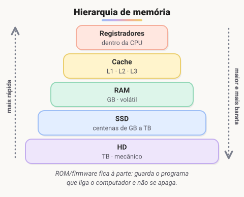

### Os tipos, do topo para a base

#### Registradores

Ficam **dentro da CPU**. Guardam os poucos valores que ela está calculando neste instante, como os dois números de uma soma. São os mais rápidos de todos e os menores.

#### Cache (L1, L2 e L3)

Também fica dentro do chip do processador. Guarda uma **cópia** dos dados da RAM usados com mais frequência, para a CPU não ter de esperar a RAM. É dividida em níveis: L1 é a menor e mais rápida; L3 é a maior e mais lenta das três.

#### Memória RAM

A "mesa de trabalho": guarda os programas e dados em uso. É rápida, mas **volátil**: apaga tudo ao desligar.

#### SSD e HD

O "armário": guardam o sistema, os programas e os arquivos de forma **permanente**.

- O **HD** grava os dados em discos magnéticos que giram, lidos por um braço mecânico. É mais **barato** por gigabyte.
- O **SSD** usa chips de memória *flash*, sem partes móveis. É muito mais **rápido**, silencioso e resistente a quedas.

#### ROM e firmware

**ROM** quer dizer *Read Only Memory* (memória somente de leitura). É onde fica o **firmware** da placa-mãe, o programa que roda assim que você aperta o botão de ligar: ele testa o hardware e procura o sistema operacional no disco.

Hoje esse firmware se chama **UEFI** (a sucessora da antiga BIOS) e fica numa memória flash, que pode ser atualizada. Mesmo assim, ela continua não volátil: não apaga ao desligar.

### Comparando

| Memória | Velocidade | Apaga ao desligar? | Guarda |
| --- | --- | --- | --- |
| Registradores | a mais rápida | sim | valores do cálculo atual |
| Cache | muito alta | sim | cópias do que é mais usado |
| RAM | alta | sim | programas e dados em uso |
| SSD | média | não | sistema, programas e arquivos |
| HD | baixa | não | arquivos grandes, com menor custo |
| ROM/flash | — | não | firmware (UEFI) |

### 🧠 Revisão rápida

**Por que existe memória cache se já temos RAM?**

Porque a RAM é lenta comparada à CPU. A cache guarda uma cópia do que é usado com mais frequência, bem perto da CPU, e evita que ela fique esperando.

**O que roda primeiro quando você liga o computador?**

O firmware (UEFI ou BIOS), gravado na placa-mãe. Ele testa o hardware e carrega o sistema operacional do disco.

**Cite duas vantagens do SSD sobre o HD.**

É muito mais rápido e, por não ter partes móveis, é silencioso e mais resistente a impactos.

> ➡️ **Próximo passo:** já conhecemos o hardware. Agora vamos para o software, a parte que você vai criar. A próxima aula é **Tipos de software e linguagens de programação**.

### 📌 Resumo

| Item | Em uma frase |
| --- | --- |
| Hierarquia | o mais usado fica mais perto da CPU, em memória pequena e rápida |
| Registradores e cache | dentro do processador; os mais rápidos |
| RAM | volátil; guarda o que está em uso |
| SSD × HD | flash e rápido × disco magnético e barato |
| ROM / UEFI | firmware que liga o computador e carrega o sistema |

## Tipos de software e linguagens de programação

> 🗺️ **Nesta aula:** o que é software, quais são os tipos principais e onde entram as linguagens de programação.

### De onde paramos

Até aqui olhamos para o hardware: as peças e as memórias. Agora passamos para o outro lado, o **software**, que é justamente o que você vai aprender a criar. Esta aula organiza os tipos de software e apresenta a ferramenta que usamos para escrevê-los: as linguagens de programação.

### O que é software

**Software é um conjunto de instruções que diz ao computador o que fazer, junto com os dados que essas instruções usam.** É a parte que não se toca: está gravada como bits no SSD e, quando roda, na memória RAM. Todo hardware é controlado por algum software; sem ele, o processador não tem o que executar.

### Tipos de software

| Tipo | O que faz | Exemplos |
| --- | --- | --- |
| **Software de sistema** | controla o hardware e oferece serviços aos outros programas: gerencia memória, processos e arquivos | Windows, Linux, macOS, Android |
| **Driver de dispositivo** (um tipo de software de sistema) | "tradutor" entre o sistema operacional e um dispositivo específico | driver da impressora, da placa de vídeo, do Wi-Fi |
| **Firmware** | software gravado dentro do hardware | BIOS/UEFI, software do roteador |
| **Aplicativo** | resolve uma tarefa do usuário final | navegador, Word, Photoshop, WhatsApp |
| **Ferramenta de desenvolvimento** | ajuda a criar outros softwares | VS Code, compiladores, Git |

Outra classificação comum é pela **licença**: **software livre/código aberto** (o código pode ser lido e modificado, como Linux e VS Code) × **proprietário** (o código é fechado, como Windows e Photoshop).

### Linguagens de programação

Uma **linguagem de programação** é um idioma com regras rígidas (sintaxe) para escrever as instruções de um software de um jeito que humanos entendem e que pode ser **traduzido** para a linguagem do processador.

- **Baixo nível:** próximas do hardware (Assembly). Muito controle, pouca produtividade.
- **Alto nível:** próximas da linguagem humana (Java, Python, JavaScript, C#). Mais produtivas e legíveis.

Cada linguagem foi pensada para certos problemas: JavaScript para a web, Java para sistemas corporativos e Android, Python para dados e automação, C para sistemas embarcados. A forma de traduzi-las para o processador leva à divisão entre **compiladas** e **interpretadas**, assunto das próximas aulas.

### 🧠 Revisão rápida

**O Windows é software de sistema ou aplicativo? E o Chrome?**

O Windows é software de sistema (sistema operacional). O Chrome é um aplicativo.

**Para que serve um driver?**

Para que o sistema operacional consiga se comunicar com um dispositivo específico, como impressora ou placa de vídeo.

**Qual a diferença entre linguagem de alto e de baixo nível?**

Alto nível é mais próxima da linguagem humana e mais produtiva (Java, Python). Baixo nível é mais próxima do hardware e dá mais controle (Assembly).

> ➡️ **Próximo passo:** o processador só entende 0 e 1. Como o código escrito numa linguagem vira algo que ele executa? A próxima aula, **Linguagens compiladas, Assembly e linguagem de máquina**, mostra o primeiro caminho: a compilação.

### 📌 Resumo

| Item | Em uma frase |
| --- | --- |
| Software | instruções e dados que dizem ao computador o que fazer |
| Software de sistema | controla o hardware e serve os outros programas (sistema operacional) |
| Driver | tradutor entre o sistema operacional e um dispositivo |
| Aplicativo | resolve uma tarefa do usuário final |
| Código aberto × proprietário | código que pode ser lido e alterado × código fechado |
| Alto × baixo nível | perto da linguagem humana × perto do hardware |

## Linguagens compiladas, Assembly e linguagem de máquina

> 🗺️ **Nesta aula:** como uma linguagem compilada vira algo que o processador executa, e o que são Assembly, Assembler e linguagem de máquina.

### De onde paramos

Na aula anterior vimos que escrevemos programas em linguagens próximas da nossa, mas o processador só entende 0 e 1. Alguém precisa **traduzir**. Existem dois jeitos principais de fazer essa tradução; esta aula mostra o primeiro, a **compilação**, que funciona como traduzir um livro inteiro antes de entregá-lo ao leitor.

### Linguagens compiladas

Em uma linguagem compilada, um programa chamado **compilador** lê **todo** o código-fonte, verifica se há erros e o traduz de uma vez para **linguagem de máquina**, gerando um **executável** (no Windows, um `.exe`). Depois disso, o executável roda direto no processador, sem precisar do código-fonte nem do compilador.

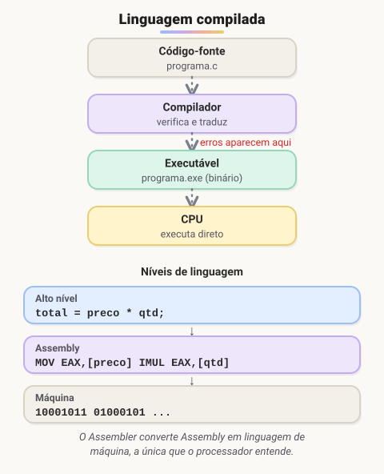

Exemplos: **C, C++, Go, Rust**.

| ✅ Vantagens | ❌ Desvantagens |
| --- | --- |
| execução muito rápida | cada mudança exige compilar de novo |
| muitos erros são pegos antes de rodar | o executável vale só para um sistema e um tipo de processador (um `.exe` do Windows não roda no Linux) |
| não precisa entregar o código-fonte | a compilação de projetos grandes pode demorar |

### Os níveis da linguagem

- **Linguagem de máquina:** sequências de **bits** (0 e 1). É a única coisa que o processador entende de fato, e é ilegível para humanos.
- **Assembly:** cada instrução de máquina ganha um nome curto (*mnemônico*), como `MOV` (mover um valor), `ADD` (somar) e `JMP` (pular para outra instrução). Ainda é de **baixo nível**: cada linha corresponde a uma operação do processador, e cada família de processadores (Intel/AMD x86, ARM) tem o seu Assembly.
- **Assembler (montador):** o programa que traduz Assembly em linguagem de máquina.
- **Alto nível:** C, Java, Python. Uma linha como `total = preco * qtd;` pode virar várias instruções de máquina.

> 💡 **Assembly** é a linguagem; **Assembler** é o programa tradutor. Muitos compiladores traduzem o código de alto nível para Assembly e depois usam um assembler para gerar o binário final.

### 🧠 Revisão rápida

**O que o compilador produz?**

Um programa executável em linguagem de máquina, que roda direto no processador.

**Por que um .exe do Windows não roda no Linux?**

Porque o executável é gerado para um sistema operacional e um tipo de processador específicos. Para outro sistema, é preciso compilar de novo.

**Qual a diferença entre Assembly e Assembler?**

Assembly é a linguagem de baixo nível (MOV, ADD...). Assembler é o programa que traduz Assembly para linguagem de máquina.

> ➡️ **Próximo passo:** o outro jeito de traduzir é ir lendo e executando na hora, como um intérprete numa conversa. A próxima aula, **Linguagens interpretadas, compiladas e o Java híbrido**, compara os dois caminhos e mostra onde o Java se encaixa.

### 📌 Resumo

| Item | Em uma frase |
| --- | --- |
| Compilador | traduz todo o código de uma vez e gera um executável |
| Executável | roda direto no processador, mas só no sistema para o qual foi gerado |
| Linguagem de máquina | sequências de 0 e 1; a única que o processador entende |
| Assembly | nomes curtos (`MOV`, `ADD`) para cada instrução de máquina |
| Assembler | programa que traduz Assembly em linguagem de máquina |

## Linguagens interpretadas, compiladas e o Java híbrido

> 🗺️ **Nesta aula:** como funciona uma linguagem interpretada, como ela se compara à compilada e por que o Java fica no meio do caminho.

### De onde paramos

Na compilação, o programa inteiro é traduzido antes de rodar, como um livro traduzido antes de ir para a livraria. Na **interpretação**, a tradução acontece durante a execução, como um intérprete que traduz cada frase enquanto a pessoa fala. Vale a pena entender os dois, porque neste programa você vai usar uma linguagem de cada lado: **JavaScript** (interpretada) e **Java** (híbrida).

### Linguagens interpretadas

Em uma linguagem interpretada não existe um executável final. Um programa chamado **interpretador** lê o código-fonte e o executa **na hora**, instrução por instrução. Para rodar o programa em outro computador, basta que ele tenha o interpretador instalado.

Exemplos: **JavaScript, Python, PHP, Ruby**.

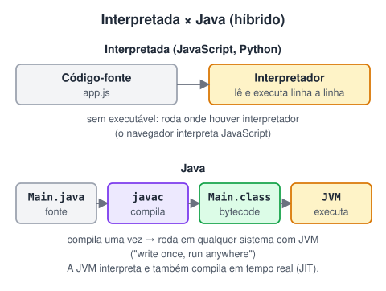

> 🌐 O **navegador** tem um interpretador de JavaScript embutido (o V8, no Chrome; o SpiderMonkey, no Firefox). Por isso o mesmo site funciona em Windows, Mac, Linux e celular: quem executa o código é o navegador.

### Compilada × interpretada

|  | Compilada | Interpretada |
| --- | --- | --- |
| Quando traduz | tudo, antes de rodar | durante a execução |
| O que se distribui | o executável | o código-fonte |
| Velocidade | em geral, maior | em geral, menor |
| Portabilidade | um executável por plataforma | roda onde houver interpretador |
| Quando o erro aparece | muitos já ao compilar | só quando aquela linha é executada |
| Exemplos | C, C++, Go, Rust | JavaScript, Python, PHP |

### Java: o melhor dos dois mundos

O Java é **híbrido**:

1. o compilador `javac` traduz `Main.java` para **bytecode** (`Main.class`), uma linguagem intermediária que não é de nenhum processador específico;
2. a **JVM** (*Java Virtual Machine*), instalada em cada sistema, executa esse bytecode.

Assim o Java pega erros na compilação, como as compiladas, e roda em qualquer sistema com JVM, como as interpretadas. O lema é *"write once, run anywhere"* (escreva uma vez, rode em qualquer lugar). C# (.NET) segue a mesma ideia.

> 💡 **Nuance:** hoje a fronteira é menos rígida do que a tabela sugere. A JVM e os motores de JavaScript usam **compilação JIT** (*just-in-time*): durante a execução, compilam para código de máquina os trechos mais usados. Por isso JavaScript e Java são bem mais rápidos do que um interpretador "linha a linha" puro.

### 🧠 Revisão rápida

**O que precisa existir no computador para rodar um programa em Python?**

O interpretador do Python.

**O que é bytecode?**

O código intermediário gerado pelo compilador do Java (`.class`). Ele não é específico de nenhum processador e é executado pela JVM.

**Por que um erro de digitação numa linha de JavaScript pode passar despercebido?**

Porque o erro só aparece quando o interpretador chega naquela linha. Se ela estiver dentro de um `if` que nunca é executado, o erro fica escondido.

> ➡️ **Próximo passo:** já sabemos como o código vira instruções. Falta ver o que acontece quando você dá dois cliques num programa. A próxima aula é **Como um software é executado**.

### 📌 Resumo

| Item | Em uma frase |
| --- | --- |
| Interpretador | lê e executa o código na hora, instrução por instrução |
| Compilada × interpretada | traduz tudo antes × traduz durante a execução |
| Erros | na compilada, muitos aparecem antes de rodar; na interpretada, só quando a linha executa |
| Bytecode | código intermediário do Java (`.class`), igual em qualquer sistema |
| JVM | máquina virtual que executa o bytecode; existe uma para cada sistema |
| JIT | compila durante a execução os trechos mais usados, para ganhar velocidade |

## Como um software é executado

> 🗺️ **Nesta aula:** o caminho de um programa desde o clique no ícone até o resultado na tela, juntando tudo o que vimos sobre hardware e software.

### De onde paramos

Esta aula fecha a parte sobre o computador. Ela junta as peças das aulas anteriores (SSD, RAM, CPU, sistema operacional) numa história só: o que acontece, passo a passo, quando você abre um programa.

### Do clique ao resultado

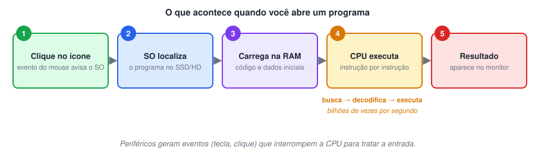

1. **Clique:** o mouse gera um **evento**, que avisa o sistema operacional.
2. **Localizar:** o sistema operacional encontra o arquivo do programa no SSD/HD.
3. **Carregar:** copia o código e os dados iniciais para a **RAM**. O programa em execução passa a se chamar **processo** (dá para vê-lo no Gerenciador de Tarefas).
4. **Executar:** a CPU repete o **ciclo de instrução**:
  - **busca** a próxima instrução na memória;
  - **decodifica**, ou seja, entende o que ela pede;
  - **executa** a instrução (uma soma, uma comparação, um desvio).
5. **Resultado:** o programa pede ao sistema operacional para desenhar na tela, tocar um som, gravar um arquivo.

### Eventos e interrupções

O programa não fica parado esperando a pessoa. Os periféricos avisam o processador quando algo acontece, por meio de **eventos** (tecnicamente, *interrupções*):

- você aperta uma tecla, e o caractere aparece no editor de texto;
- você clica num botão, e o programa executa a ação daquele botão;
- chega um pacote pela rede, e a mensagem aparece no chat.

Esse modelo de "esperar e reagir a eventos" é exatamente o que você vai usar em JavaScript, com `addEventListener("click", ...)`.

### 🧠 Revisão rápida

**Por que um programa precisa ser carregado na RAM antes de rodar?**

Porque a CPU busca as instruções na memória principal (RAM), que é muito mais rápida que o SSD/HD.

**Quais são as três etapas do ciclo de instrução da CPU?**

Busca, decodificação e execução.

**O que é um evento?**

Um aviso de que algo aconteceu (tecla, clique, dado da rede) para que o programa reaja a isso.

> ➡️ **Próximo passo:** o processador executa instruções, e muitas delas são decisões do tipo "se isso for verdade, faça aquilo". Para escrever boas decisões, precisamos da lógica formal. A próxima aula é **Lógica formal: proposições e princípios**.

### 📌 Resumo

| Etapa | O que acontece |
| --- | --- |
| Clique | o mouse gera um evento para o sistema operacional |
| Localizar | o sistema encontra o programa no SSD ou HD |
| Carregar | o código vai para a RAM e vira um processo |
| Executar | a CPU repete busca → decodifica → executa |
| Resultado | o programa pede ao sistema para mostrar, tocar ou gravar |
| Eventos | avisos de tecla, clique ou rede aos quais o programa reage |

## Lógica formal: proposições e princípios

> 🗺️ **Nesta aula:** o que é uma proposição e os três princípios da lógica formal. Eles parecem óbvios, mas explicam por que todo `if` funciona do jeito que funciona.

### De onde paramos

Vimos que o processador executa instruções, e que muitas delas são decisões: "se isso for verdade, faça aquilo". Para escrever decisões corretas, precisamos de uma forma precisa de dizer o que é verdadeiro e o que é falso. É isso que a **lógica formal** oferece.

### O que é lógica formal

A **lógica formal** é a parte da lógica que trabalha com a **forma** dos raciocínios, e não com o assunto. Ela serve para encadear pensamentos, **encontrar contradições** e separar raciocínios **válidos** de **inválidos**.

A matéria-prima da lógica formal são as **proposições**.

### Proposição

> 🔑 **Proposição** é uma frase declarativa que pode ser julgada como **verdadeira (V)** ou **falsa (F)**, e só uma das duas. Uma frase falsa continua sendo proposição.

Para saber se uma frase é proposição, pergunte: "dá para responder se isso é verdadeiro ou falso?"

**São proposições:**

- "A Lua é o único satélite natural da Terra." (V)
- "Florianópolis é a capital de São Paulo." (F)
- "7 é maior que 10." (F)

**Não são proposições:**

- "Tenha um bom dia!" (é um desejo)
- "Que horas são?" (é uma pergunta)
- "Feche a porta." (é uma ordem)
- "O dia está bonito." (é uma opinião; não dá para julgar de forma objetiva)

#### Proposições no código

No código, toda **condição** é uma proposição. A expressão `idade >= 18` é verdadeira ou falsa, dependendo do valor guardado em `idade`:

```jsx
let idade = 20;
console.log(idade >= 18); // true

idade = 15;
console.log(idade >= 18); // false
```

### Os três princípios da lógica formal

Toda a lógica que o computador usa se apoia em três princípios. Eles parecem óbvios, e é justamente por isso que funcionam como regras de segurança.

#### 1. Princípio da identidade

**Toda coisa é igual a si mesma.** Uma cadeira é uma cadeira. No código, um valor comparado com ele mesmo dá verdadeiro: `x === x` é `true`.

> 💡 Existe uma exceção curiosa em JavaScript: `NaN` ("não é um número") não é igual a si mesmo, então `NaN === NaN` dá `false`. Você vai encontrá-lo ao converter textos inválidos em números.

#### 2. Princípio da não contradição

**Nada pode ser verdadeiro e falso ao mesmo tempo.** "Pedro é médico" não pode ser V e F no mesmo momento. No código, `a && !a` ("a e não a") é sempre `false`.

#### 3. Princípio do terceiro excluído

**Toda proposição é verdadeira ou falsa; não existe terceira opção.** No código, `a || !a` ("a ou não a") é sempre `true`.

É por causa desse princípio que um `if` com `else` sempre executa **exatamente um** dos dois blocos: a condição só pode ser verdadeira ou falsa.

```jsx
if (idade >= 18) {
  console.log("Pode votar"); // quando a condição é V
} else {
  console.log("Ainda não");  // quando a condição é F
}
```

### 🧠 Revisão rápida

**"Feche a janela" é uma proposição?**

Não. É uma ordem; não dá para dizer se é verdadeira ou falsa.

**"2 + 2 = 5" é uma proposição?**

Sim. É uma frase declarativa com valor lógico definido: falso.

**Qual princípio garante que uma condição não pode ser verdadeira e falsa ao mesmo tempo?**

O princípio da não contradição.

**Por que um `if/else` sempre executa um dos blocos?**

Pelo princípio do terceiro excluído: a condição só pode ser verdadeira (executa o `if`) ou falsa (executa o `else`).

> ➡️ **Próximo passo:** proposições sozinhas são simples. A graça começa quando juntamos várias com "e", "ou" e "não". A próxima aula é **Álgebra booleana, operadores lógicos e tabela verdade**.

### 📌 Resumo

| Item | Em uma frase |
| --- | --- |
| Lógica formal | estuda a forma dos raciocínios para separar válidos de inválidos |
| Proposição | frase declarativa que é V ou F |
| Identidade | toda coisa é igual a si mesma |
| Não contradição | nada é V e F ao mesmo tempo |
| Terceiro excluído | ou é V ou é F; por isso o `if/else` sempre executa um bloco |

## Álgebra booleana, operadores lógicos e tabela verdade

> 🗺️ **Nesta aula:** como juntar proposições com os operadores NÃO, E e OU, como montar uma tabela verdade e como o computador avalia condições compostas.

### De onde paramos

Na aula anterior, cada proposição era uma frase só: "a idade é maior ou igual a 18". Na vida real, as decisões costumam juntar várias: "**tem** 18 anos **e** tem habilitação". Para combinar proposições sem errar, usamos a **álgebra booleana**.

### Álgebra booleana

No século XIX, George Boole criou uma álgebra em que as variáveis só têm dois valores: **verdadeiro** e **falso**. No computador, esses valores aparecem como `true` e `false`, ou como 1 e 0.

Além dos princípios que já vimos (não contradição e terceiro excluído), vale uma regra importante: o valor de uma proposição **composta** depende **só** dos valores das partes e dos operadores que as ligam. Por isso dá para calcular uma condição como se fosse uma conta.

### Os operadores lógicos

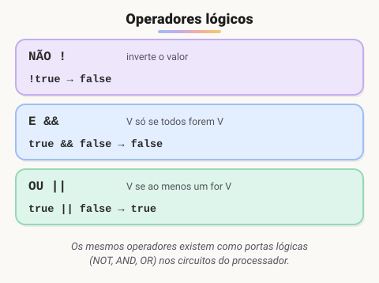

#### NÃO (negação): `!`

Inverte o valor. Se "está chovendo" é V, então "não está chovendo" é F.

#### E (conjunção): `&&`

Só dá verdadeiro se **todas** as partes forem verdadeiras. Pense numa porta com duas fechaduras: ela só abre se as duas chaves girarem.

#### OU (disjunção): `||`

Dá verdadeiro se **pelo menos uma** parte for verdadeira. Pense numa casa com duas portas: basta uma estar aberta para você entrar.

#### OU exclusivo (XOR): `^`

Dá verdadeiro se **exatamente uma** parte for verdadeira. É o "ou isto, ou aquilo, mas não os dois". Em Java é `^`; em JavaScript, entre dois booleanos, dá para usar `!==`.

### Tabela verdade

A **tabela verdade** lista todas as combinações possíveis de V e F e o resultado de cada uma. Com *n* proposições, existem **2ⁿ linhas**: 2 proposições dão 4 linhas, 3 proposições dão 8.

#### NÃO

| A | !A |
| --- | --- |
| V | F |
| F | V |

#### E e OU

| A | B | A && B | A \|\| B |
| --- | --- | --- | --- |
| V | V | **V** | **V** |
| V | F | F | **V** |
| F | V | F | **V** |
| F | F | F | F |

#### OU exclusivo

| A | B | A ^ B |
| --- | --- | --- |
| V | V | F |
| V | F | **V** |
| F | V | **V** |
| F | F | F |

### Exemplo prático

"Posso dirigir se tenho **18 anos ou mais** **e** tenho **habilitação**":

```java
boolean podeDirigir =
  idade >= 18 && temHabilitacao;
```

| idade >= 18 | temHabilitacao | podeDirigir |
| --- | --- | --- |
| V | V | **V** |
| V | F | F |
| F | V | F |
| F | F | F |

Só a primeira linha libera a direção, exatamente como a regra do `&&`.

### Ordem de avaliação

Como na matemática, onde a multiplicação vem antes da soma, os operadores lógicos têm uma ordem: **primeiro** `!`**, depois** `&&`**, por último** `||`.

```java
// o && é calculado antes:
// true || (false && false) → true
true || false && false

// os parênteses mudam a ordem:
// (true || false) && false → false
(true || false) && false
```

Na dúvida, use parênteses. Eles evitam erros e deixam o código mais fácil de ler.

### Leis de De Morgan

Servem para negar uma condição composta:

- `!(A && B)` é igual a `!A || !B`;
- `!(A || B)` é igual a `!A && !B`.

Em palavras: "não (é fim de semana **e** está sol)" é o mesmo que "não é fim de semana **ou** não está sol". Ao negar, o E vira OU e o OU vira E.

### Curto-circuito

O computador é econômico: em `A && B`, se `A` já for falso, o resultado será falso de qualquer jeito, então ele **nem olha** o `B`. Em `A || B`, se `A` for verdadeiro, ele também pula o `B`.

Isso permite escrever com segurança:

```java
// se usuario for null, o lado direito
// nem é avaliado e não dá erro
if (usuario != null && usuario.isAtivo()) {
  // ...
}
```

> ⚠️ A ordem importa: escrito ao contrário (`usuario.isAtivo() && usuario != null`), o programa tenta usar `usuario` antes de conferir se ele existe e quebra quando ele é nulo.

### 🧠 Revisão rápida

**Quantas linhas tem a tabela verdade de uma expressão com 3 proposições?**

2³ = 8 linhas.

**Qual o resultado de `!(true && false)`?**

`true && false` é `false`; negando, fica `true`.

**Use De Morgan para reescrever `!(chovendo || frio)`.**

`!chovendo && !frio`: não está chovendo e não está frio.

**Em `false && algumaFuncao()`, a função é chamada?**

Não. Pelo curto-circuito, como o lado esquerdo já é falso, o `&&` nem avalia o lado direito.

> ➡️ **Próximo passo:** agora temos as ferramentas: sabemos como o computador funciona e como ele decide. Chegou a hora de juntar tudo num **algoritmo**. A próxima aula é **O que é um algoritmo**.

### 📌 Resumo

| Item | Em uma frase |
| --- | --- |
| `!` (NÃO) | inverte o valor |
| `&&` (E) | V só se todos forem V |
| `\|\|` (OU) | V se pelo menos um for V |
| `^` (XOR) | V se exatamente um for V |
| Tabela verdade | todas as combinações; 2ⁿ linhas |
| Precedência | `!`, depois `&&`, depois `\|\|`; na dúvida, parênteses |
| De Morgan | ao negar, E vira OU e OU vira E |
| Curto-circuito | o lado direito é pulado quando o esquerdo já decide |

## O que é um algoritmo

> 🗺️ **Nesta aula:** a definição de algoritmo, as características que todo algoritmo precisa ter e as três estruturas com que qualquer algoritmo é montado.

### De onde paramos

Até aqui vimos como o computador funciona e como ele toma decisões com a lógica. Falta o mais importante: **dizer a ele o que fazer**. Antes de escrever em qualquer linguagem, quem programa escreve um **algoritmo**. Esta é a aula que liga tudo o que veio antes com tudo o que vem depois.

### Definição

**Algoritmo é um conjunto finito de passos bem definidos, executados em uma ordem específica, para resolver um problema.** Uma receita de bolo, o manual de montagem de um móvel e as instruções de um caixa eletrônico são algoritmos do dia a dia.

Um **programa** é um algoritmo escrito em uma linguagem que o computador entende (Java, JavaScript...). Por isso se aprende primeiro a pensar no algoritmo e só depois na linguagem.

### Características de um bom algoritmo

| Característica | O que significa | Exemplo do que **não** fazer |
| --- | --- | --- |
| **Finito** | tem início e fim; termina depois de um número limitado de passos | "mexa até ficar bom" (pode nunca acabar) |
| **Ordenado** | a sequência dos passos importa | colocar o bolo no forno antes de misturar a massa |
| **Sem ambiguidade** | cada passo tem um único jeito de ser entendido | "coloque um pouco de sal" |
| **Completo** | não pula etapas; não depende de "bom senso" | esquecer de ligar o forno |
| **Efetivo** | cada passo pode ser realmente executado | "adivinhe a senha" |
| **Tem entrada e saída** | recebe dados (pode ser zero) e produz um resultado | — |

### Exemplo: trocar uma lâmpada

```
inicio
  desligue o interruptor
  pegue uma escada e posicione embaixo da lâmpada
  suba na escada
  retire a lâmpada queimada
  coloque a lâmpada nova
  desça da escada
  ligue o interruptor
  se a lâmpada não acender entao
    verifique o disjuntor
fim
```

Repare que até um algoritmo simples precisa de uma **decisão** ("se não acender") e depende da **ordem** (desligar antes de mexer). Sequência, decisão e repetição são as três estruturas básicas de qualquer algoritmo.

### 🧠 Revisão rápida

**Qual a diferença entre algoritmo e programa?**

O algoritmo é a sequência de passos para resolver o problema. O programa é esse algoritmo escrito em uma linguagem de programação.

**Por que "coloque sal a gosto" não serve num algoritmo?**

Porque é ambíguo: cada pessoa entende uma quantidade diferente. Um algoritmo precisa de passos com um único significado.

**Quais são as três estruturas básicas de um algoritmo?**

Sequência, decisão (condição) e repetição.

> ➡️ **Próximo passo:** saber o que é um algoritmo é diferente de saber criar um. A próxima aula, **Como resolver problemas com algoritmos**, mostra um método passo a passo para sair do problema e chegar à solução.

### 📌 Resumo

| Item | Em uma frase |
| --- | --- |
| Algoritmo | passos finitos, ordenados e sem ambiguidade que resolvem um problema |
| Programa | um algoritmo escrito numa linguagem que o computador entende |
| Características | finito, ordenado, sem ambiguidade, completo, efetivo, com entrada e saída |
| Três estruturas | sequência, decisão e repetição |

## Como resolver problemas com algoritmos

> 🗺️ **Nesta aula:** um roteiro em cinco passos para sair do enunciado de um problema e chegar a um algoritmo que funciona, com um exemplo resolvido.

### De onde paramos

Já sabemos o que é um algoritmo e quais características ele precisa ter. Mas, diante de um problema novo, por onde começar? Quem está começando costuma ir direto para o código e se perder. Este roteiro evita isso: ele organiza o pensamento **antes** de escrever qualquer linha.

### O roteiro

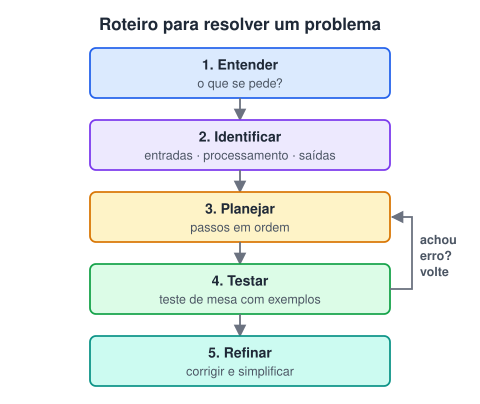

1. **Entender o problema.** Leia o enunciado mais de uma vez. O que exatamente está sendo pedido? Quais são os casos especiais?
2. **Identificar entradas, processamento e saídas.** Que dados eu recebo? O que preciso calcular ou decidir? O que devo mostrar?
3. **Planejar os passos** em ordem, em português ou pseudocódigo.
4. **Testar à mão (teste de mesa).** Pegue valores de exemplo e execute o algoritmo no papel, anotando o valor de cada variável a cada passo.
5. **Refinar.** Se o teste falhar, volte e corrija. Depois veja se dá para simplificar.

### Exemplo aplicado

> "Calcule o valor final de uma compra: se o total passar de R$ 100, há 10% de desconto."

| Etapa | Resposta |
| --- | --- |
| Entrada | o total da compra |
| Processamento | se total > 100, desconto = total × 0,10; senão, desconto = 0. valorFinal = total − desconto |
| Saída | o valor final |
| Casos a testar | 50 (sem desconto), 100 (exatamente no limite: sem desconto, porque não *passa* de 100), 200 (com desconto: 180) |

#### Teste de mesa com total = 200

| Passo | total | desconto | valorFinal |
| --- | --- | --- | --- |
| leia total | 200 | — | — |
| total > 100? sim | 200 | 20 | — |
| valorFinal = total − desconto | 200 | 20 | **180** |

### Dicas

- **Divida e conquiste:** quebre o problema grande em partes menores e resolva uma de cada vez.
- **Comece pelo caso simples** e depois trate os casos especiais (zero, negativo, lista vazia).
- **Teste os limites:** os erros costumam aparecer exatamente no valor de fronteira (100, no exemplo).
- **Não comece pelo código.** Um algoritmo claro no papel economiza horas de depuração.

### 🧠 Revisão rápida

**O que é teste de mesa?**

Executar o algoritmo à mão, com valores de exemplo, anotando o valor de cada variável a cada passo para conferir se o resultado está certo.

**No exemplo do desconto, por que testar o valor 100?**

Porque é o limite da condição. Ele revela se o algoritmo usa `>` ou `>=` corretamente.

**Quais perguntas ajudam a identificar entrada, processamento e saída?**

O que eu recebo? O que eu faço com isso? O que eu devolvo?

> ➡️ **Próximo passo:** o passo 3 do roteiro pede para escrever o plano. A próxima aula, **Representando algoritmos: pseudocódigo e fluxograma**, mostra as duas formas mais usadas de fazer isso.

### 📌 Resumo

| Passo | Pergunta-chave |
| --- | --- |
| 1. Entender | o que exatamente está sendo pedido? |
| 2. Identificar | o que eu recebo, o que calculo e o que devolvo? |
| 3. Planejar | quais passos, e em que ordem? |
| 4. Testar | o teste de mesa com valores de exemplo dá certo? |
| 5. Refinar | o que corrigir ou simplificar? |
| Limites | teste sempre os valores de fronteira (como o 100 do exemplo) |

## Representando algoritmos: pseudocódigo e fluxograma

> 🗺️ **Nesta aula:** as duas formas mais comuns de representar um algoritmo, pseudocódigo e fluxograma, com o mesmo exemplo nas duas e também em Java.

### De onde paramos

No roteiro da aula anterior, o passo 3 era "planejar os passos". Mas em que formato escrever esse plano? Texto solto em português fica ambíguo; código de verdade ainda é difícil para quem está começando. As duas formas desta aula ficam no meio do caminho: são precisas como código e fáceis de ler como português.

### Pseudocódigo

**Pseudocódigo é o algoritmo escrito em texto, com palavras do português e uma estrutura parecida com a de uma linguagem de programação.** No Brasil, a versão mais usada é o **Portugol** (ferramentas como o Portugol Studio e o VisuAlg permitem executá-lo).

```
inicio
  leia nota1, nota2, nota3
  media <- (nota1 + nota2 + nota3) / 3
  se media >= 7 entao
    escreva "Aprovado"
  senao
    escreva "Reprovado"
  fimse
fim
```

✅ rápido de escrever e fácil de transformar em código. ❌ menos visual: em algoritmos grandes, fica difícil enxergar os caminhos.

### Fluxograma

**Fluxograma é o algoritmo desenhado com formas e setas**, lido de cima para baixo. Cada forma tem um significado:


O mesmo algoritmo da média, em fluxograma:

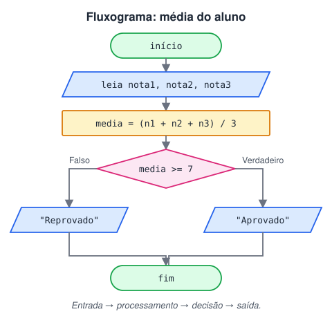

✅ mostra visualmente os caminhos e as decisões. ❌ trabalhoso de desenhar e de manter.

### Comparando

|  | Pseudocódigo | Fluxograma |
| --- | --- | --- |
| Forma | texto | desenho |
| Melhor para | algoritmos longos; transição para o código | entender e explicar decisões e caminhos |
| Ferramentas | Portugol Studio, VisuAlg, qualquer editor | draw.io, Lucidchart, papel |

E o mesmo algoritmo em Java, para comparar:

```java
double media = (nota1 + nota2 + nota3) / 3;
if (media >= 7) {
  System.out.println("Aprovado");
} else {
  System.out.println("Reprovado");
}
```

### 🧠 Revisão rápida

**Que forma representa uma decisão no fluxograma?**

O losango, com saídas para verdadeiro (sim) e falso (não).

**Que forma representa "leia" e "escreva"?**

O paralelogramo (entrada/saída).

**Quando um fluxograma é mais útil que o pseudocódigo?**

Para explicar ou entender algoritmos com várias decisões e caminhos, porque mostra visualmente para onde o fluxo vai.

> ➡️ **Próximo passo:** seja em pseudocódigo ou em fluxograma, um algoritmo só ajuda se for claro. A próxima aula, **Boas práticas para escrever algoritmos**, reúne as regras de escrita.

### 📌 Resumo

| Item | Em uma frase |
| --- | --- |
| Pseudocódigo | algoritmo em texto, com estrutura parecida com código (Portugol) |
| Fluxograma | algoritmo desenhado com formas e setas |
| Losango | decisão, com saídas "sim" e "não" |
| Paralelogramo | entrada e saída (`leia`, `escreva`) |
| Retângulo | processamento (cálculos e atribuições) |

## Boas práticas para escrever algoritmos

> 🗺️ **Nesta aula:** regras práticas para escrever algoritmos claros e a divisão de todo algoritmo em entrada, processamento e saída.

### De onde paramos

Já sabemos **em que formato** escrever um algoritmo. Esta aula trata de **como** escrever bem. Um algoritmo confuso gera um programa confuso, e as regras daqui valem do mesmo jeito para o código que você vai escrever em Java e JavaScript.

### Regras de escrita

1. **Um verbo por frase:** cada linha é **uma** ação (`leia`, `calcule`, `escreva`).
2. **Escreva para um leigo:** imagine que quem vai seguir o algoritmo não sabe nada do assunto, nem de informática.
3. **Frases curtas e simples.**
4. **Seja objetivo:** nada de palavras vagas ou de duplo sentido ("um pouco", "mais ou menos", "rapidinho").
5. **Use nomes claros:** `precoTotal` é melhor que `x`.

| ❌ Vago | ✅ Claro |
| --- | --- |
| faça a conta e mostre | calcule media = (nota1 + nota2) / 2 · escreva media |
| se a nota for boa, aprove | se media >= 7 entao escreva "Aprovado" |
| repita algumas vezes | repita 10 vezes |

### As três fases

Quase todo algoritmo se divide em três fases. Identificá-las antes de escrever ajuda muito:

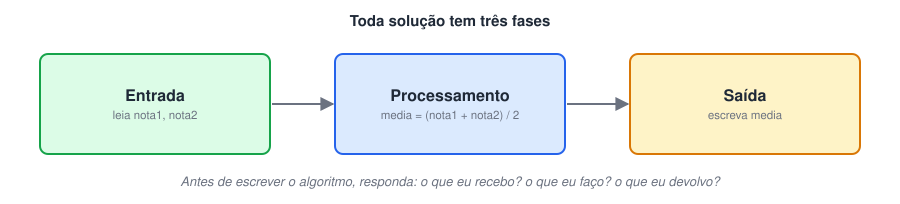

| Fase | Pergunta | Exemplo (média de duas notas) |
| --- | --- | --- |
| **Entrada** | que dados eu recebo? | `leia nota1, nota2` |
| **Processamento** | o que faço com eles? | `media <- (nota1 + nota2) / 2` |
| **Saída** | o que devolvo? | `escreva media` |

> ⚠️ Cuidado com a ordem das operações: `nota1 + nota2 / 2` calcula `nota1 + (nota2 / 2)`, porque a divisão vem antes da soma. Os **parênteses** são obrigatórios para fazer a média.

### 🧠 Revisão rápida

**Reescreva de forma objetiva: "aumente um pouco o preço".**

Por exemplo: `preco <- preco * 1.10` (aumente o preço em 10%).

**Quais são as fases de um algoritmo que calcula a área de um retângulo?**

Entrada: largura e altura. Processamento: area = largura × altura. Saída: mostrar a área.

**Qual o resultado de `8 + 6 / 2` e de `(8 + 6) / 2`?**

11 e 7. A divisão é feita antes da soma, a menos que haja parênteses.

> ➡️ **Próximo passo:** hora de praticar. A página **Exercícios de algoritmos** traz problemas do cotidiano até algoritmos com decisão e repetição, todos com resposta.

### 📌 Resumo

| Item | Em uma frase |
| --- | --- |
| Um verbo por frase | cada linha faz uma única ação |
| Para um leigo | quem segue o algoritmo não precisa adivinhar nada |
| Sem palavras vagas | "um pouco" e "algumas vezes" viram números |
| Nomes claros | `precoTotal` em vez de `x` |
| Entrada → processamento → saída | o que recebo, o que faço, o que devolvo |
| Parênteses | definem a ordem das contas, como em `(n1 + n2) / 2` |

## Exercícios de algoritmos (com respostas)

> 🗺️ **Nesta lista:** nove exercícios que juntam tudo o que vimos no módulo, do cotidiano até algoritmos com decisão e repetição.

> 📝 **Como usar esta página:** tente resolver cada exercício no papel **antes** de abrir a resposta. Depois faça um teste de mesa com valores próprios. Os exercícios vão do cotidiano (sem computador) até algoritmos com decisão e repetição.

### Nível 1: algoritmos do dia a dia

1. Prepare um macarrão instantâneo.Resposta`inicio
  coloque 400 ml de água na panela
  leve ao fogo alto
  espere a água ferver
  coloque o macarrão
  espere 3 minutos, mexendo de vez em quando
  desligue o fogo
  misture o tempero
  sirva no prato
fim`
2. Tome banho.Resposta`inicio
  separe toalha e roupa limpa
  entre no banheiro
  tire a roupa
  abra o chuveiro e ajuste a temperatura
  molhe o corpo
  ensaboe-se
  enxágue
  feche o chuveiro
  seque-se
  vista a roupa limpa
fim`

### Nível 2: sequência (entrada → processamento → saída)

3. Receba dois números e mostre a soma.Resposta`inicio
  leia numA, numB
  soma <- numA + numB
  escreva soma
fim`
4. Receba a temperatura em graus Celsius e mostre em Fahrenheit (F = C × 9/5 + 32).Resposta`inicio
  leia celsius
  fahrenheit <- celsius * 9 / 5 + 32
  escreva fahrenheit
fim`Teste de mesa: 100 °C → 212 °F; 0 °C → 32 °F.

### Nível 3: decisão

5. Joãozinho fez 3 provas e precisa de média 7 para passar. Informe se ele foi aprovado.Resposta`inicio
  leia nota1, nota2, nota3
  media <- (nota1 + nota2 + nota3) / 3
  se media >= 7 entao
    escreva "Aprovado. Parabéns!"
  senao
    escreva "Reprovado. Estude mais e não desanime!"
  fimse
fim`⚠️ Use `>=` (e não `==`): média 8 também aprova. Os parênteses garantem que a soma aconteça antes da divisão.
6. Receba um número inteiro e informe se ele é par ou ímpar.Resposta`inicio
  leia numero
  se numero mod 2 = 0 entao
    escreva "Par"
  senao
    escreva "Ímpar"
  fimse
fim``mod` é o **resto da divisão**: um número é par quando o resto da divisão por 2 é zero. No pseudocódigo, `=` compara; em Java e JavaScript o resto é `%` e a comparação é `==`.
7. Receba dois números diferentes e mostre o maior.Resposta`inicio
  leia a, b
  se a > b entao
    escreva a
  senao
    escreva b
  fimse
fim`

### Nível 4: repetição

8. Mostre a tabuada de um número de 1 a 10.Resposta`inicio
  leia n
  para i de 1 ate 10 faca
    escreva n, " x ", i, " = ", n * i
  fimpara
fim`
9. Leia números até o usuário digitar 0 e mostre a soma dos números lidos.Resposta`inicio
  soma <- 0
  leia numero
  enquanto numero <> 0 faca
    soma <- soma + numero
    leia numero
  fimenquanto
  escreva soma
fim`O primeiro `leia` antes do laço é importante: sem ele, `numero` não teria valor na primeira verificação.

> 💡 Os exercícios 8 e 9 usam laços (`para` e `enquanto`), que serão explicados em detalhe no próximo módulo. Se travar neles, siga em frente e volte aqui depois.

> ➡️ **Próximo passo:** fim do módulo 0! No módulo 1 você vai escrever e **executar** algoritmos de verdade, em Portugol, começando por **Variáveis, tipos, operadores e decisões**.

### 📌 Resumo

| Nível | O que pratica |
| --- | --- |
| 1. Dia a dia | sequência de passos, sem ambiguidade |
| 2. Sequência | entrada → processamento → saída |
| 3. Decisão | `se ... senao`, comparações e resto da divisão |
| 4. Repetição | `para` (número fixo de voltas) e `enquanto` (até uma condição) |

## 📌 Resumo do módulo

| Conceito | Em uma frase |
| --- | --- |
| Hardware × software | a parte física executa; a parte lógica diz o que executar |
| CPU | executa as instruções: busca, decodifica e executa |
| RAM | memória rápida e volátil, para o que está em uso |
| SSD/HD | armazenamento permanente |
| Compilada | traduzida inteira antes de rodar (C, Go) |
| Interpretada | executada por um interpretador durante a execução (JavaScript, Python) |
| Java | compila para bytecode, que roda na JVM |
| Proposição | frase que é V ou F |
| `&&` / `\|\|` / `!` | E (todos V) / OU (pelo menos um V) / NÃO (inverte) |
| Algoritmo | passos finitos, ordenados e sem ambiguidade |
| Entrada → processamento → saída | as três fases de quase toda solução |
