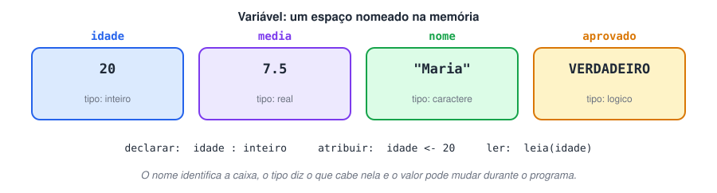
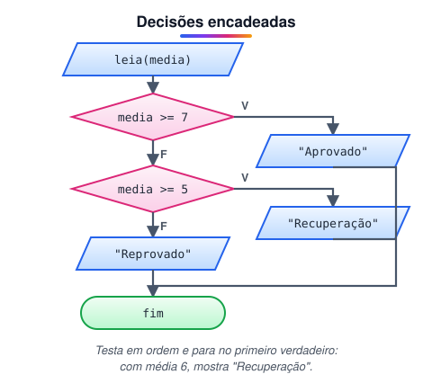
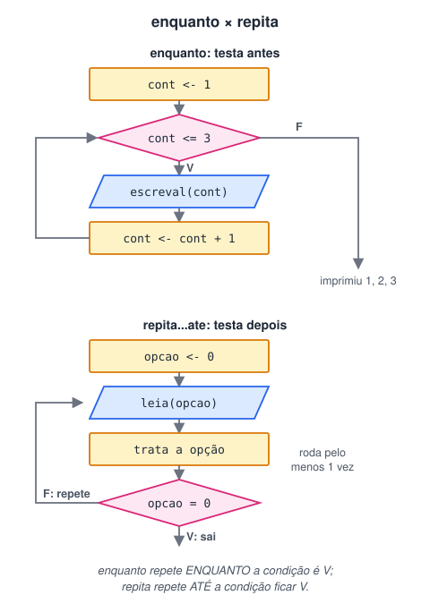
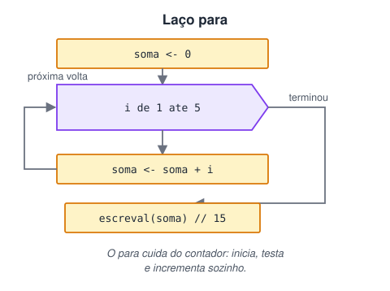

# 1 · Lógica de programação e algoritmos I (Portugol)

> 🗺️ **Sobre o módulo:** os blocos básicos de qualquer programa, escritos em **Portugol** (VisuAlg): variáveis, operadores, decisões e repetições. Tudo aqui reaparece depois em Java e JavaScript, só com outra sintaxe.
>
> **Professor:** Marcelo Bernardi · **Ferramenta:** VisuAlg ou Portugol Studio.

## Variáveis, tipos, operadores e decisões (Portugol)

> 🗺️ **Nesta aula:** seu primeiro programa em Portugol. Você vai aprender a guardar dados em variáveis, conversar com o usuário (`leia` e `escreva`), fazer contas, comparar valores e tomar decisões com `se` e `escolha`.

### De onde paramos

No módulo 0 você escreveu algoritmos em pseudocódigo, mas só no papel. Agora eles vão **rodar**. Usaremos o **Portugol** no **VisuAlg** (ou no Portugol Studio), que executa pseudocódigo em português. É o jeito mais suave de aprender a programar: as ideias são as mesmas de Java e JavaScript, mas sem a barreira do inglês e da sintaxe.

### 1. Variáveis: as caixas da memória

Lembra da RAM, a "mesa de trabalho" do computador? Um programa precisa guardar dados nela enquanto trabalha: o nome que o usuário digitou, a média calculada, o total da compra. Cada um desses dados fica numa **variável**.

Uma **variável** é um espaço na memória com três coisas:

- um **nome**, para você se referir a ela (`idade`);
- um **tipo**, que diz o que cabe ali (números inteiros, texto...);
- um **valor**, o dado guardado naquele momento (`25`).

Ela se chama "variável" porque o valor pode **mudar** durante o programa.



> 💡 **Analogia:** pense nas caixas de uma mudança. A etiqueta escrita por fora é o **nome** ("livros"). O tipo de caixa diz o que pode entrar: na caixa de copos, só vão copos (o **tipo**). O que está dentro agora é o **valor**. Você pode tirar o conteúdo e pôr outro (uma nova atribuição), mas a etiqueta e o tipo da caixa continuam os mesmos.

#### Os quatro tipos básicos

| Tipo | Guarda | Exemplo |
| --- | --- | --- |
| `inteiro` | números sem casas decimais | `42`, `-3` |
| `real` | números com casas decimais | `7.5` (com ponto, não vírgula) |
| `caractere` | texto, sempre entre aspas | `"Maria"` |
| `logico` | verdadeiro ou falso | `VERDADEIRO` |

Por que o tipo importa? Porque ele define o que dá para fazer com o valor. Faz sentido somar dois números, mas não faz sentido multiplicar dois nomes. Esses mesmos quatro tipos vão reaparecer em Java como `int`, `double`, `String` e `boolean`.

#### Declarar e atribuir

Antes de usar uma variável, você a **declara**, ou seja, avisa o nome e o tipo. No VisuAlg isso é feito na seção `var`:

```
var
   nome  : caractere
   idade : inteiro
   media : real
```

Para colocar um valor na variável, usamos a **atribuição**, com a seta `<-`. Lê-se "recebe":

```
idade <- 25  // idade recebe 25
idade <- idade + 1  // agora idade vale 26
```

A segunda linha pode parecer estranha à primeira vista, mas faz todo sentido: o computador calcula o lado direito (`25 + 1`) e guarda o resultado na caixa da esquerda.

### 2. Conversando com o usuário: leia e escreva

Um programa útil recebe dados (entrada) e mostra resultados (saída), exatamente o esquema que vimos no módulo 0.

- `escreva(...)` mostra algo na tela e continua na mesma linha.
- `escreval(...)` mostra e **pula para a linha de baixo**.
- `leia(x)` espera o usuário digitar algo e guarda na variável `x`.

Um programa completo:

```
algoritmo "ola"
var
   nome  : caractere
   idade : inteiro
inicio
   escreva("Seu nome: ")
   leia(nome)
   escreva("Sua idade: ")
   leia(idade)
   escreval("Olá, ", nome, "!")
   escreval("Ano que vem você terá ", idade + 1, " anos.")
fimalgoritmo
```

Repare que o `escreval` aceita várias partes separadas por vírgula: textos entre aspas e variáveis sem aspas. Se a pessoa digitar "Ana" e 20, a tela mostra:

```
Olá, Ana!
Ano que vem você terá 21 anos.
```

### 3. Operadores: fazendo contas e comparações

#### Aritméticos

| Operador | Faz | Exemplo | Resultado |
| --- | --- | --- | --- |
| `+` `-` `*` | soma, subtração, multiplicação | `4 * 3` | `12` |
| `/` | divisão com casas decimais | `7 / 2` | `3.5` |
| `div` | divisão inteira (descarta o resto) | `7 div 2` | `3` |
| `mod` | resto da divisão | `7 mod 2` | `1` |

O `div` e o `mod` são como a divisão que você fazia na escola, com quociente e resto: 7 dividido por 2 dá 3 e sobra 1.

O `mod` é muito mais útil do que parece:

- `n mod 2 = 0` testa se `n` é **par**;
- `n mod 10` pega o **último dígito** de `n` (`347 mod 10` é `7`).

#### Relacionais: comparar

Comparam dois valores e respondem **verdadeiro ou falso**. São as proposições que vimos no módulo 0.

| Operador | Significa |
| --- | --- |
| `=` | igual |
| `<>` | diferente |
| `>` / `<` | maior / menor |
| `>=` / `<=` | maior ou igual / menor ou igual |

> ⚠️ No Portugol, a seta `<-` **atribui** e o `=` **compara**. Em Java e JavaScript é diferente: o `=` atribui e o `==` (ou `===` no JavaScript) compara. Trocar um pelo outro é um dos erros mais comuns de quem muda de linguagem.

#### Lógicos: juntar comparações

São os operadores da álgebra booleana: `nao`, `e`, `ou` (em Java e JavaScript: `!`, `&&`, `||`).

```
// pode dirigir se tiver 18 anos ou mais E habilitação
podeDirigir <- (idade >= 18) e temCnh
```

Lembre a regra: **e** só é verdadeiro se as duas partes forem; **ou** é verdadeiro se pelo menos uma for.

### 4. Decisões com se

Até aqui, o programa executa todas as linhas, de cima para baixo. Com uma **decisão**, ele escolhe um caminho conforme uma condição. É a estrutura de "decisão" que vimos entre as três estruturas básicas.

#### se ... entao ... fimse

```
se media >= 7 entao
   escreval("Aprovado")
fimse
```

Se a condição for verdadeira, executa o bloco. Se for falsa, pula direto para depois do `fimse`.

#### se ... entao ... senao ... fimse

Quando há um caminho para cada resposta:

```
se media >= 7 entao
   escreval("Aprovado")
senao
   escreval("Reprovado")
fimse
```

Pelo princípio do terceiro excluído, exatamente um dos dois blocos é executado.

#### Várias faixas: um se dentro do outro

Muitas vezes há mais de dois caminhos. Por exemplo: média 7 ou mais aprova, de 5 a 7 vai para recuperação, abaixo de 5 reprova. Colocamos um `se` dentro do `senao` do outro:

```
se media >= 7 entao
   escreval("Aprovado")
senao
   // aqui já sabemos que media < 7
   se media >= 5 entao
      escreval("Recuperação")
   senao
      escreval("Reprovado")
   fimse
fimse
```



> 💡 **Analogia:** é como uma fila de porteiros. O primeiro pergunta "tirou 7 ou mais?": quem diz sim vai para a sala dos aprovados; quem diz não segue para o segundo porteiro, que pergunta "tirou 5 ou mais?". Cada porteiro só vê quem não passou pelo anterior, por isso não precisa perguntar de novo se a nota é menor que 7.

Repare no comentário: quando o programa chega ao segundo `se`, ele já sabe que a média é menor que 7. Por isso basta testar `media >= 5`, sem repetir `media < 7`.

### 5. Escolhas com escolha ... caso

Quando você compara **uma variável** com vários **valores exatos**, como as opções de um menu, o `escolha` fica mais legível que uma fila de `se`:

```
escreval("1 - Saldo   2 - Extrato")
leia(opcao)
escolha opcao
   caso 1
      escreval("Seu saldo é...")
   caso 2
      escreval("Seu extrato é...")
   outrocaso
      escreval("Opção inválida")
fimescolha
```

O `outrocaso` funciona como o `senao`: é executado quando nenhum `caso` bate.

> 💡 **Quando usar cada um:** o `escolha` só testa igualdade com valores fixos. Para faixas (`>`, `<`) ou condições com `e`/`ou`, use `se`.

### 6. Projetos

Agora é hora de juntar tudo. Cada projeto tem o arquivo original do curso (`.por`) e uma resolução comentada. Tente resolver antes de abrir.

#### Projeto 1: situação do aluno

Leia a média e classifique: **7 ou mais** aprovado; **5 ou mais** recuperação; **abaixo de 5** reprovado.

<details>
<summary>Ver resposta</summary>

É o exemplo de faixas da seção 4:

```
leia(media)
se media >= 7 entao
   escreval("Aprovado")
senao
   se media >= 5 entao
      escreval("Recuperação")
   senao
      escreval("Reprovado")
   fimse
fimse
```

</details>

#### Projeto 2: radar de velocidade

O limite é 55 km/h. Mostre a penalidade: **56 a 70**, 3 pontos; **71 a 90**, 4 pontos; **91 a 110**, 5 pontos; **acima de 110**, 7 pontos e risco de perder a CNH.

<details>
<summary>Ver resposta</summary>

A estratégia é a mesma do projeto 1: testar as faixas da menor para a maior. Cada `senao` já sabe que a velocidade passou da faixa anterior.

```
leia(velocidade)
se velocidade <= 55 entao
   escreval("Dentro do limite")
senao
   se velocidade <= 70 entao
      escreval("Multa: 3 pontos")
   senao
      se velocidade <= 90 entao
         escreval("Multa: 4 pontos")
      senao
         se velocidade <= 110 entao
            escreval("Multa: 5 pontos")
         senao
            escreval("Multa: 7 pontos")
            escreval("Risco de suspensão da CNH")
         fimse
      fimse
   fimse
fimse
```

Os pontos deste enunciado são didáticos. No Código de Trânsito Brasileiro, o excesso de velocidade gera 4, 5 ou 7 pontos, conforme o quanto passou do limite.

</details>

#### Projeto 3: triângulo

Leia três lados (A, B e C) e diga se eles formam um triângulo e de que tipo.

- Três medidas formam um triângulo se **cada lado for menor que a soma dos outros dois**.
- **Equilátero:** os três lados iguais. **Isósceles:** exatamente dois iguais. **Escaleno:** todos diferentes.

<details>
<summary>Ver resposta</summary>

```
leia(a, b, c)
se (a < b + c) e (b < a + c) e (c < a + b) entao
   se (a = b) e (b = c) entao
      escreval("Equilátero")
   senao
      se (a = b) ou (a = c) ou (b = c) entao
         escreval("Isósceles")
      senao
         escreval("Escaleno")
      fimse
   fimse
senao
   escreval("Não forma um triângulo")
fimse
```

A ordem importa: o teste de equilátero vem primeiro, porque um triângulo equilátero também tem dois lados iguais e cairia no "isósceles".

</details>

#### Projeto 4: eleição

Recolha 10 votos para 2 partidos (qualquer outro número é voto nulo), conte e mostre o vencedor usando `escolha`.

> 💡 Este projeto repete a leitura 10 vezes com o laço `para`, que é o assunto das próximas aulas. Vale tentar agora e voltar depois de estudar os laços.

<details>
<summary>Ver resposta</summary>

```
votos1 <- 0
votos2 <- 0
nulos  <- 0
para i de 1 ate 10 faca
   escreva("Voto ", i, " (1 ou 2): ")
   leia(voto)
   escolha voto
      caso 1
         votos1 <- votos1 + 1
      caso 2
         votos2 <- votos2 + 1
      outrocaso
         nulos <- nulos + 1
   fimescolha
fimpara
se votos1 > votos2 entao
   escreval("Partido 1 venceu: ", votos1, " votos")
senao
   se votos2 > votos1 entao
      escreval("Partido 2 venceu: ", votos2, " votos")
   senao
      escreval("Empate")
   fimse
fimse
escreval("Votos nulos: ", nulos)
```

Não esqueça o caso de **empate**.

</details>

### 🧠 Revisão rápida

**Quanto vale `17 mod 5` e `17 div 5`?**

`17 mod 5` = 2 (o resto); `17 div 5` = 3 (o quociente da divisão inteira).

**Como testar se um número é ímpar?**

`n mod 2 <> 0`: o resto da divisão por 2 é diferente de zero.

**O que acontece na linha `total <- total + preco`?**

O computador calcula `total + preco` com os valores atuais e guarda o resultado em `total`, substituindo o valor antigo.

**Quando usar `escolha` em vez de `se`?**

Quando você compara uma única variável com vários valores exatos (como opções de menu). Para faixas de valores, use `se`.

**Qual a diferença entre `escreva` e `escreval`?**

`escreval` pula uma linha depois de escrever; `escreva` continua na mesma linha.

> ➡️ **Próximo passo:** já temos sequência e decisão. Falta a terceira estrutura básica, a **repetição**, que permite fazer uma tarefa muitas vezes sem copiar código. A próxima aula é **Laços de repetição: enquanto e repita**.

### 📌 Resumo

| Item | Em uma frase |
| --- | --- |
| Variável | espaço na memória com nome, tipo e valor |
| Tipos | `inteiro`, `real`, `caractere`, `logico` |
| `<-` | atribui: calcula a direita e guarda na esquerda |
| `leia` / `escreva` | entrada / saída; `escreval` pula linha |
| `div` / `mod` | divisão inteira / resto da divisão |
| `=` / `<>` | igual / diferente (comparação, no Portugol) |
| `e` / `ou` / `nao` | juntam ou invertem condições |
| `se ... senao` | escolhe um caminho; aninhado, trata várias faixas |
| `escolha ... caso` | compara uma variável com valores exatos |

## Laços de repetição: enquanto e repita (Portugol)

> 🗺️ **Nesta aula:** como repetir um bloco de código com `enquanto` e `repita`, os padrões de contador e acumulador e como evitar o temido laço infinito.

### De onde paramos

Na aula anterior você usou duas das três estruturas básicas: **sequência** (uma linha depois da outra) e **decisão** (`se`). Falta a terceira: a **repetição**.

### Por que repetir

Imagine mostrar os números de 1 a 1000. Sem repetição, seriam mil linhas de `escreval`. Agora imagine somar as notas de uma turma em que você nem sabe quantos alunos há. Impossível escrever uma linha para cada um.

Um **laço** (ou *loop*) resolve isso: ele executa o mesmo bloco várias vezes, enquanto uma condição permitir. Cada execução do bloco se chama **volta** ou **iteração**.



> 💡 **Analogia:** o `enquanto` é o porteiro que confere o ingresso **antes** de cada entrada: sem ingresso, você nem entra (pode rodar zero vezes). O `repita` é o rodízio de pizza: a primeira fatia chega sem você pedir, e só depois de comer você decide se quer mais (roda pelo menos uma vez).

### 1. enquanto ... faca ... fimenquanto

O `enquanto` **testa a condição antes** de cada volta. Se for verdadeira, executa o bloco e volta para testar de novo. Se for falsa, sai do laço.

```
cont <- 1
enquanto cont <= 3 faca
   escreval(cont)
   cont <- cont + 1
fimenquanto
escreval("Fim")
```

Todo laço tem três partes, e vale a pena procurá-las sempre:

1. **Inicialização:** `cont <- 1`, o valor de partida.
2. **Condição:** `cont <= 3`, que decide se continua.
3. **Atualização:** `cont <- cont + 1`, que leva o laço em direção ao fim.

#### Teste de mesa

Vamos acompanhar o programa acima no papel, como aprendemos no módulo 0:

| Volta | cont antes | cont <= 3? | Mostra | cont depois |
| --- | --- | --- | --- | --- |
| 1 | 1 | sim | 1 | 2 |
| 2 | 2 | sim | 2 | 3 |
| 3 | 3 | sim | 3 | 4 |
| — | 4 | **não** | sai do laço | — |

Depois do laço, aparece "Fim". O teste de mesa é a melhor ferramenta para entender um laço que não está fazendo o que você esperava.

> ⚠️ **Laço infinito:** se você esquecer a atualização (`cont <- cont + 1`), `cont` fica sempre em 1, a condição nunca fica falsa e o programa não para. Sempre pergunte: "o que, dentro do bloco, vai tornar a condição falsa um dia?"

#### Quando o número de voltas é desconhecido

O `enquanto` brilha quando você não sabe quantas voltas serão. Por exemplo, somar números até o usuário digitar 0:

```
soma <- 0
leia(numero)
enquanto numero <> 0 faca
   soma <- soma + numero
   leia(numero)
fimenquanto
escreval("Soma: ", soma)
```

Repare que há um `leia` **antes** do laço (para a condição ter o que testar na primeira vez) e outro **no fim** do bloco (para ler o próximo número).

### 2. repita ... ate

O `repita` executa o bloco **primeiro** e testa **no final**. Por isso ele roda **pelo menos uma vez**. E ele repete **até** a condição ficar verdadeira, o contrário do `enquanto`.

É perfeito para **menus**, que precisam aparecer ao menos uma vez:

```
repita
   escreval("1 - Saldo")
   escreval("2 - Extrato")
   escreval("0 - Sair")
   leia(opcao)
   // trata a opção escolhida...
ate opcao = 0
```

E para **validar entrada**, pedindo de novo até o usuário acertar:

```
repita
   escreva("Nota (0 a 10): ")
   leia(nota)
ate (nota >= 0) e (nota <= 10)
```

#### enquanto × repita

|  | `enquanto` | `repita ... ate` |
| --- | --- | --- |
| Testa | antes da volta | depois da volta |
| Execuções mínimas | 0 | 1 |
| Continua quando a condição é | verdadeira | falsa |
| Uso típico | número de voltas desconhecido | menus e validação |

> 💡 Em Java e JavaScript, o `enquanto` vira `while` e o `repita` vira `do ... while`. Atenção: o `do ... while` repete enquanto a condição for **verdadeira**, ao contrário do `repita ... ate`.

### 3. Padrões que aparecem o tempo todo

Alguns jeitos de usar laços se repetem em quase todo programa. Reconhecê-los economiza muito tempo.

#### Contador

Conta **quantas vezes** algo aconteceu. Começa em 0 e soma 1 a cada ocorrência:

```
menores <- 0
// dentro do laço:
se idade < 18 entao
   menores <- menores + 1
fimse
```

#### Acumulador

Soma **valores** ao longo das voltas. Também começa em 0:

```
soma <- 0
// dentro do laço:
soma <- soma + idade
```

Depois do laço, a média é `soma / quantidade`.

#### Maior e menor

Para achar o maior valor, guarde o primeiro como "maior até agora" e compare cada novo valor com ele:

```
se cont = 1 entao
   maior <- idade  // o primeiro é o maior até agora
fimse
se idade > maior entao
   maior <- idade
fimse
```

#### Saindo antes da hora

O comando `interrompa` sai do laço imediatamente. Use com moderação: ele "esconde" a condição de saída, e o laço fica mais difícil de entender.

### 4. Exercícios

Tente resolver cada um antes de abrir a resolução. Os arquivos `.por` são do curso original.

#### Exercício 1: quem fica mais alto?

Marcelo tem 1,20 m e cresce 5 cm por ano. João tem 1,05 m e cresce 7 cm por ano. Os dois têm 8 anos. Com que idade João fica mais alto que Marcelo? Use `enquanto`.

<details>
<summary>Ver resposta</summary>

Trabalhar em centímetros evita números com vírgula:

```
marcelo <- 120
joao    <- 105
idade   <- 8
enquanto joao <= marcelo faca
   marcelo <- marcelo + 5
   joao    <- joao + 7
   idade   <- idade + 1
fimenquanto
escreval("João passa Marcelo aos ", idade, " anos")
```

A diferença começa em 15 cm e diminui 2 cm por ano. Depois de 8 anos, aos 16, João tem 161 cm e Marcelo 160 cm.

</details>

#### Exercício 2: pesquisa de idades

Leia a idade de 10 pessoas e mostre a maior idade, a menor, o percentual de menores de idade e a média. Use `enquanto`.

<details>
<summary>Ver resposta</summary>

Este exercício junta os quatro padrões: contador, acumulador, maior e menor.

```
cont <- 1
soma <- 0
menores <- 0
enquanto cont <= 10 faca
   leia(idade)
   se cont = 1 entao
      maior <- idade
      menor <- idade
   fimse
   se idade > maior entao
      maior <- idade
   fimse
   se idade < menor entao
      menor <- idade
   fimse
   se idade < 18 entao
      menores <- menores + 1
   fimse
   soma <- soma + idade
   cont <- cont + 1
fimenquanto
escreval("Maior: ", maior, "  Menor: ", menor)
escreval("Menores: ", menores * 100 / 10, "%")
escreval("Média: ", soma / 10)
```

</details>

#### Exercício 3: orçamento de oficina

Monte um menu com 5 serviços de carro, cada um com um preço. Some as escolhas e mostre o total quando o usuário escolher fechar o orçamento. Use `repita`.

<details>
<summary>Ver resposta</summary>

```
total <- 0
repita
   escreval("1-Troca de óleo (R$ 120)")
   escreval("2-Alinhamento (R$ 80)")
   escreval("3-Balanceamento (R$ 60)")
   escreval("4-Revisão (R$ 350)")
   escreval("5-Lavagem (R$ 40)")
   escreval("0-Fechar orçamento")
   leia(opcao)
   escolha opcao
      caso 1
         total <- total + 120
      caso 2
         total <- total + 80
      caso 3
         total <- total + 60
      caso 4
         total <- total + 350
      caso 5
         total <- total + 40
      caso 0
         escreval("Fechando...")
      outrocaso
         escreval("Opção inválida")
   fimescolha
ate opcao = 0
escreval("Total: R$ ", total)
```

O `total` é um acumulador, e o menu usa o `repita` porque precisa aparecer pelo menos uma vez. Os preços são exemplos.

</details>

### 🧠 Revisão rápida

**Quantas vezes roda `enquanto x > 10 faca ... fimenquanto` se `x` começa com 5?**

Nenhuma: a condição é testada antes e já começa falsa.

**E `repita ... ate x > 10`, com `x` começando em 20?**

Uma vez: o `repita` executa o bloco antes de testar, e a condição já é verdadeira no primeiro teste.

**Qual a diferença entre contador e acumulador?**

O contador soma 1 a cada ocorrência (quantas vezes). O acumulador soma valores (quanto ao todo).

**Quais são as três partes de um laço?**

Inicialização (valor de partida), condição (decide se continua) e atualização (leva o laço ao fim).

> ➡️ **Próximo passo:** quando você já sabe quantas voltas o laço vai dar, existe um jeito mais compacto de escrevê-lo. A próxima aula é **Laço para e teste de mesa**.

### 📌 Resumo

| Item | Em uma frase |
| --- | --- |
| Laço | repete um bloco enquanto uma condição permitir |
| Três partes | inicialização, condição e atualização |
| `enquanto` | testa antes; pode rodar zero vezes |
| `repita ... ate` | testa depois; roda pelo menos uma vez; para quando a condição fica verdadeira |
| Laço infinito | acontece quando nada no bloco torna a condição falsa |
| Contador / acumulador | `cont <- cont + 1` / `soma <- soma + valor` |
| Maior / menor | começa com o primeiro valor e compara cada novo |

## Laço para e teste de mesa

> 🗺️ **Nesta aula:** o laço `para`, usado quando já se sabe quantas vezes repetir, laços um dentro do outro e o **teste de mesa** para conferir um algoritmo à mão.

### De onde paramos

Na aula anterior, todo laço `enquanto` tinha três partes espalhadas: a inicialização antes do laço, a condição no topo e a atualização no fim do bloco. Quando o número de voltas é conhecido, o `para` junta essas três partes numa linha só, e fica mais difícil esquecer alguma.

### O laço `para`

Quando o número de repetições é **conhecido** (de 1 a 10, para cada aluno da turma), o `para` é mais simples que o `enquanto`: ele mesmo **inicia**, **testa** e **incrementa** a variável de controle.

```
para i de 1 ate 5 faca
   escreval(i)
fimpara
```



> 💡 **Analogia:** é o treino de corrida em que o técnico manda dar 5 voltas na pista. Você sabe desde o início quantas voltas são, e o placar ao lado da linha de chegada soma 1 sozinho a cada passada. Quando marcar 5, acabou. No `enquanto`, você correria até "cansar", sem saber de antemão quando ia parar.

#### Variações

```
para i de 10 ate 1 passo -1 faca  // contagem regressiva
   escreval(i)
fimpara

para i de 0 ate 100 passo 5 faca  // de 5 em 5
   escreval(i)
fimpara
```

#### `para` × `enquanto`: o mesmo laço

Os dois trechos abaixo fazem exatamente a mesma coisa:

```
para i de 1 ate 5 faca
   escreval(i)
fimpara
```

```
i <- 1
enquanto i <= 5 faca
   escreval(i)
   i <- i + 1
fimenquanto
```

No `para`, a inicialização (`de 1`), a condição (`ate 5`) e a atualização (soma 1 a cada volta) ficam todas na primeira linha.

Use `para` quando souber quantas voltas; `enquanto` ou `repita` quando a parada depender de algo que acontece durante o laço (o usuário digitar 0, um valor ser encontrado).

Em Java e JavaScript, o `para` vira o `for`:

```java
for (int i = 1; i <= 5; i++) {
  System.out.println(i);
}
```

> ⚠️ Não altere a variável de controle (`i`) dentro do corpo do `para`. Quem cuida dela é o próprio laço, e mudá-la à mão gera resultados difíceis de prever.

### Laços aninhados

Um laço dentro do outro: para cada volta do externo, o interno roda **inteiro**. É assim que se percorre uma tabela (linhas × colunas):

```
para linha de 1 ate 3 faca
   para coluna de 1 ate 3 faca
      escreva(linha * coluna, "  ")
   fimpara
   escreval("")  // pula linha ao fim de cada linha
fimpara
```

Saída:

```
1  2  3
2  4  6
3  6  9
```

### Teste de mesa

**Teste de mesa é executar o algoritmo à mão, anotando numa tabela o valor de cada variável a cada passo.** É a melhor forma de entender um laço e de achar erros antes de rodar o programa.

Algoritmo:

```
soma <- 0
para i de 1 ate 4 faca
   se i mod 2 = 0 entao
      soma <- soma + i
   fimse
fimpara
escreval(soma)
```

| Volta | i | i mod 2 = 0? | soma |
| --- | --- | --- | --- |
| início | — | — | 0 |
| 1 | 1 | F | 0 |
| 2 | 2 | V | 2 |
| 3 | 3 | F | 2 |
| 4 | 4 | V | **6** |

O algoritmo soma os **pares** de 1 a 4 e mostra **6**.

### Exercícios

1. Mostre os números ímpares de 1 a 20.Resposta`para i de 1 ate 20 passo 2 faca
   escreval(i)
fimpara`Outra forma: percorrer de 1 a 20 e mostrar só quando `i mod 2 = 1`.
2. Calcule o fatorial de um número (5! = 5 × 4 × 3 × 2 × 1 = 120).Resposta`leia(n)
// multiplicação começa em 1, não em 0
fat <- 1
para i de 1 ate n faca
   fat <- fat * i
fimpara
escreval(n, "! = ", fat)`
3. Faça o teste de mesa de `x <- 1; para i de 1 ate 3 faca x <- x * 2 fimpara`. Quanto vale `x` no fim?Respostaix—112243**8**

### 🧠 Revisão rápida

**Quando usar `para` e quando usar `enquanto`?**

`para` quando o número de repetições é conhecido; `enquanto` (ou `repita`) quando a parada depende de algo que acontece durante a execução.

**Em laços aninhados de 3 × 4 voltas, quantas vezes o corpo interno roda?**

3 × 4 = 12 vezes.

**Por que o acumulador de um produto (fatorial) começa em 1?**

Porque 1 é o elemento neutro da multiplicação. Se começasse em 0, todo o resultado seria 0.

> ➡️ **Próximo passo:** fim do módulo 1! Você já domina as três estruturas básicas. No módulo 2, elas ganham ferramentas novas: guardar muitos valores numa variável só, começando por **Vetores e busca sequencial**.

### 📌 Resumo

| Item | Em uma frase |
| --- | --- |
| `para` | laço com número de voltas conhecido; inicia, testa e atualiza numa linha |
| `passo` | define de quanto em quanto a variável anda (`passo -1` conta para trás) |
| Variável de controle | não altere o `i` dentro do corpo |
| Laços aninhados | o interno roda inteiro a cada volta do externo |
| Teste de mesa | executar à mão, anotando cada variável a cada passo |
| Produto acumulado | começa em 1 (o neutro da multiplicação) |

## 📌 Resumo do módulo

| Portugol | Java | Para quê |
| --- | --- | --- |
| `idade : inteiro` | `int idade;` | declarar |
| `idade <- 20` | `idade = 20;` | atribuir |
| `leia(x)` / `escreval(x)` | `Scanner` / `System.out.println(x)` | entrada e saída |
| `=` `<>` | `==` `!=` | comparar |
| `e` `ou` `nao` | `&&` `\|\|` `!` | lógica |
| `mod` / `div` | `%` / `/` entre inteiros | resto / divisão inteira |
| `se ... senao ... fimse` | `if ... else` | decisão |
| `escolha ... caso` | `switch ... case` | vários valores exatos |
| `enquanto` | `while` | repete enquanto V (testa antes) |
| `repita ... ate` | `do ... while` | roda ao menos 1 vez |
| `para i de 1 ate n` | `for (int i = 1; i <= n; i++)` | número conhecido de voltas |
